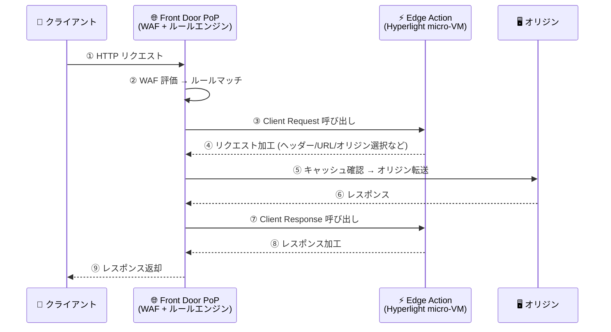

# Azure Front Door: Edge Actions の一般提供開始 (GA)

**リリース日**: 2026-11-10

**サービス**: Azure Front Door

**機能**: Edge Actions (エッジでのサーバーレスコンピューティング)

**ステータス**: Launched (GA)

[このアップデートのインフォグラフィックを見る](https://takech9203.github.io/azure-news-summary/20261110-front-door-edge-actions.html)

## 概要

Azure Front Door の Edge Actions が一般提供 (GA) となりました。Edge Actions は、Azure Front Door のクライアントリクエスト/レスポンス処理中に軽量な JavaScript 関数を実行できる、エッジでのサーバーレスコンピューティング機能です。ユーザーに近いエッジ PoP (Point of Presence) でリアルタイムな判断を行うことで、オリジンインフラに複雑さを追加することなく、パフォーマンス・セキュリティ・アプリケーションの柔軟性を向上させます。

代表的なシナリオとして、A/B テスト、カナリアデプロイ、ヘッダー操作、リクエストフィルタリング、動的オリジン選択、高度なルーティング、エッジでの認証/認可 (JWT 検証) などが挙げられています。Edge Actions は、ルールエンジン、キャッシュ、ルーティング、Web Application Firewall (WAF) といった既存の Azure Front Door 機能とシームレスに統合されます。

実行基盤には Microsoft のセキュアなマイクロ VM 技術である **Hyperlight** が採用されており、顧客コードの実行に対してハードウェアベースの分離を提供します。Front Door Standard / Premium の両 SKU で利用可能です。

**アップデート前の課題**

- A/B テスト、JWT 検証、動的オリジン選択などのカスタムロジックは、オリジン側で実装するか、ルールエンジンの定義済みアクションの範囲内で表現する必要があった
- リアルタイムな判断をユーザーに近い場所で実行する手段がなく、オリジンインフラ側に処理の複雑さが集中していた

**アップデート後の改善**

- Front Door のエッジ PoP 上で任意の JavaScript コードを実行し、リクエスト/レスポンスをリアルタイムに加工・判断できるようになった
- Hyperlight マイクロ VM によるハードウェアベースの分離環境でコードが実行され、セキュリティを確保しつつオリジンの負荷と複雑さを軽減できる
- GA となったことで本番ワークロードでの利用が可能になった

## アーキテクチャ図

クライアントリクエストは WAF 評価・ルールエンジンを経て、**Client Request** 呼び出しポイントで Edge Action により加工され、オリジンからのレスポンスは **Client Response** 呼び出しポイントで加工されてからクライアントに返却されます。Edge Action は Front Door エッジサーバー内の Hyperlight マイクロ VM 上で分離実行されます。

## サービスアップデートの詳細

### 主要機能

1. **2 つの呼び出しポイント (Client Request / Client Response)**
   - ルールエンジンのアクションとして「Invoke Edge Action」を設定し、クライアントリクエスト処理時またはクライアントレスポンス処理時に JavaScript コードを実行できる

2. **豊富なサポートシナリオ**
   - A/B テスト、リクエスト/レスポンスヘッダー操作、リクエスト拒否、動的オリジン選択、URL リライト、URL リダイレクト、JWT 検証など。サンプルコードは [Azure/EdgeActionsSamples](https://github.com/Azure/EdgeActionsSamples) リポジトリで公開

3. **Hyperlight ベースのセキュアな実行環境**
   - 呼び出しごとに Hyperlight サンドボックスが作成され、セキュアな JavaScript ランタイム、コンテキスト変数 (サーバー変数、正常なオリジン一覧、リクエスト元の国コード、User-Agent から導出したデバイスタイプ、現在日時) がロードされる

4. **バージョン管理と実行フィルター**
   - 1 つの Edge Action につき最大 3 バージョンのコードを保持し、デフォルトバージョンを切り替え可能。実行フィルター (特定のヘッダー名/値) により、デフォルト以外のバージョンを選択的に実行でき、カナリアリリースやゼロダウンタイムのバージョン切り替えを実現

5. **ブラウザー内でのコード編集・テスト**
   - Azure Portal 上でコードを編集し、ヘッダー・オリジン・コンテキストを指定したローカルテストを実行して Summary / Console / Raw output を確認できる。JavaScript ファイルのアップロードにも対応

6. **ログと監視**
   - 診断設定で `EdgeActionConsoleLog` (`console.log` の出力、`TrackingReference`、バージョン情報など) を Log Analytics に送信可能。Front Door アクセスログの `edgeActionsStatusCode` 列 (200: 成功、503: エラー) で実行結果を確認できる

## 技術仕様

| 項目 | 詳細 |
|------|------|
| 対応 SKU | Azure Front Door Standard / Premium |
| 対応言語 | JavaScript のみ |
| コードサイズ上限 | 16 KB |
| 最大バージョン数 | 3 / Edge Action |
| 実行時間上限 | 10 ms (超過時はコードを停止し、Edge Action 処理なしで続行) |
| サブスクリプションあたりの Edge Actions リソース数 | 最大 100 |
| 呼び出しポイント | Client Request / Client Response |
| 実行環境 | Hyperlight マイクロ VM (ハードウェアベースの分離) |
| 呼び出し方法 | Front Door ルートに関連付けたルールセット経由のみ |

## 設定方法

### 前提条件

1. Azure Front Door Standard または Premium のプロファイル
2. Edge Action を実行対象とするルート (ルールセット経由で関連付けるため)

### Azure Portal

1. **Edge Action の作成**: Front Door プロファイルの **Settings > Edge actions** から **+ Create** を選択 (または Portal 検索で「Edge Actions」を検索して単独作成)
2. **バージョンの作成**: Edge Action の **Settings > Versions** で **+ Add** を選択し、ブラウザー内エディターで JavaScript コードを編集・テストするか、既存の JavaScript ファイルをアップロード。**Set default** でデフォルトバージョンに設定
3. **ルートへのアタッチ**: 以下のいずれかの方法で関連付け
   - プロファイルの **Edge actions** ページから **Associate with route** (簡易アタッチ)
   - ルート構成の **Attach Edge Actions** リンクから選択
   - **Rule sets** でルールを作成し、アクションに **Invoke Edge Action** を選択して **Client Request** / **Client Response** の呼び出しポイントを指定
4. **検証**: Front Door manager でルートの **Manage Edge Actions** から関連付けを確認

## メリット

### ビジネス面

- A/B テストやカナリアデプロイをエッジで実現でき、新機能の段階的リリースと検証が容易になる
- オリジンインフラの改修なしでパーソナライズやルーティング制御を追加でき、開発・運用コストを抑制できる
- 実行フィルターによるゼロダウンタイムのバージョン切り替えとロールバックで、リリースリスクを低減できる

### 技術面

- ユーザーに近いエッジ PoP で処理することで、オリジン往復なしのリアルタイム判断が可能
- WAF、ルールエンジン、キャッシュなど既存の Front Door 機能とシームレスに統合
- Hyperlight マイクロ VM によるハードウェアベースの分離で、コード実行のセキュリティを確保
- `console.log` ベースのログを Log Analytics で分析でき、`X-Azure-Ref` の追跡参照でアクセスログと突合可能

## デメリット・制約事項

- 対応言語は JavaScript のみ
- コードサイズは 16 KB まで、実行時間は 10 ms まで (超過すると処理がスキップされる)
- バージョンは 1 つの Edge Action につき最大 3 つ、サブスクリプションあたりの Edge Actions リソースは最大 100
- 呼び出しは Front Door ルート構成 (ルールセット) 経由のみ。ルートにアタッチしない限り実行されない
- 実行フィルターが参照しているバージョンは削除・更新不可 (バージョン保護)
- ブラウザー内テストはローカルテストであり、実際の Front Door 経由の動作確認は別途必要

## ユースケース

### ユースケース 1: カナリアリリース / A/B テスト

**シナリオ**: 新バージョンの Edge Action コードを、一部のリクエストのみに適用して検証してから全体に展開したい。

**実装例**: 実行フィルターで非デフォルトバージョンにヘッダー名 `test` / 値 `execution` を設定し、クライアントからそのヘッダー付きリクエストを送信してテストバージョンを実行。検証後にデフォルトバージョンへ昇格。

**効果**: ダウンタイムなしで新バージョンを段階的に展開でき、問題発生時は即座に旧バージョンへロールバックできる。

### ユースケース 2: エッジでの JWT 検証

**シナリオ**: 認証トークンの検証をオリジンに到達する前に行い、不正なリクエストをエッジで拒否したい。

**実装例**: Client Request 呼び出しポイントで JWT を検証する Edge Action をルートにアタッチ ([公式サンプルリポジトリ](https://github.com/Azure/EdgeActionsSamples) に JWT 検証のサンプルあり)。

**効果**: 不正リクエストがオリジンに到達しなくなり、オリジンの負荷軽減とセキュリティ向上を同時に実現できる。

### ユースケース 3: 動的オリジン選択・高度なルーティング

**シナリオ**: リクエスト元の国コードやデバイスタイプに応じて転送先オリジンや URL を動的に切り替えたい。

**実装例**: コンテキスト変数 (国コード、デバイスタイプ、正常なオリジン一覧など) を参照する Edge Action を Client Request 呼び出しポイントで実行し、オリジン選択や URL リライトを実施。

**効果**: ルールエンジンの定義済みアクションでは表現しにくい複雑な条件分岐を、コードで柔軟に実装できる。

## 料金

Edge Actions は、呼び出し数と呼び出しごとの 1 ms を超えた実行時間に基づく 2 部構成の課金モデルです (Standard / Premium 共通)。

| 項目 | 料金 |
|------|------|
| 呼び出し (Invocations) | $0.10 / 100 万呼び出し |
| 超過実行時間 (1 ms を超えた累積実行時間) | $0.00005 / 秒 |

詳細は [Azure Front Door 料金ページ](https://azure.microsoft.com/pricing/details/frontdoor/) および [課金ドキュメントの Example 7 (Edge Actions)](https://learn.microsoft.com/azure/frontdoor/billing#example-7-edge-actions) を参照してください。

## 利用可能リージョン

Edge Actions は Azure Front Door のエッジ PoP 上で実行されます。エッジロケーションの一覧は [Azure Front Door edge locations](https://learn.microsoft.com/azure/frontdoor/edge-locations-by-region) を参照してください。

## 関連サービス・機能

- **Azure Front Door ルールエンジン**: Edge Action の呼び出しはルールセットのアクション「Invoke Edge Action」として構成する。条件マッチと組み合わせて柔軟に制御可能
- **Azure Web Application Firewall (WAF)**: WAF 評価はルールエンジン処理 (Edge Action 呼び出し) の前に実行され、セキュリティレイヤーとして併用できる
- **Azure Front Door キャッシュ / ルーティング**: Client Request の加工はキャッシュ・オリジン処理の前に、Client Response の加工はキャッシュ処理後・クライアント返却前に適用される
- **Azure Monitor / Log Analytics**: 診断設定で `EdgeActionConsoleLog` を送信し、実行ログやバージョン情報を分析できる

## 参考リンク

- [インフォグラフィック](https://takech9203.github.io/azure-news-summary/20261110-front-door-edge-actions.html)
- [公式アップデート情報](https://azure.microsoft.com/updates?id=579310)
- [Microsoft Learn: Edge Actions - Azure Front Door](https://learn.microsoft.com/azure/frontdoor/edge-actions)
- [JavaScript サンプル: Azure/EdgeActionsSamples](https://github.com/Azure/EdgeActionsSamples)
- [料金ページ](https://azure.microsoft.com/pricing/details/frontdoor/)

## まとめ

Azure Front Door Edge Actions の GA により、CDN エッジでのサーバーレスコンピューティングが Azure でも本番利用可能になりました。A/B テスト、JWT 検証、動的オリジン選択などのロジックをオリジンからエッジにオフロードでき、Hyperlight マイクロ VM による分離とバージョン管理・実行フィルターにより、安全なデプロイ運用も可能です。Front Door Standard / Premium を利用中で、ルールエンジンの定義済みアクションでは実現できないカスタムロジックが必要な場合は、公式サンプルリポジトリを起点に評価を始めることを推奨します。コードサイズ 16 KB・実行時間 10 ms という制約があるため、軽量なリクエスト/レスポンス加工に用途を絞る設計が重要です。

---

**タグ**: Azure Front Door, Edge Actions, Networking, Security, Serverless, JavaScript, Hyperlight, GA
