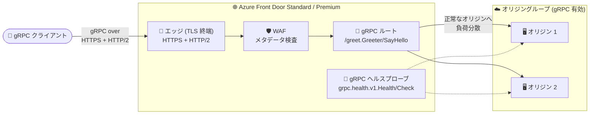

# Azure Front Door: ネイティブ gRPC サポート (Public Preview)

**リリース日**: 2026-11-10

**サービス**: Azure Front Door

**機能**: ネイティブ gRPC サポート

**ステータス**: In preview

[このアップデートのインフォグラフィックを見る](https://takech9203.github.io/azure-news-summary/20261110-front-door-grpc-support.html)

## 概要

Azure Front Door Standard および Premium におけるネイティブ gRPC サポートのパブリックプレビューが発表されました。gRPC アプリケーションを Azure Front Door 経由で構築・配信できるようになり、特定のサービスやメソッド単位での呼び出しルーティング、正常なオリジン間でのトラフィック分散、サポート対象の Front Door セキュリティ・ルーティング機能の適用が可能になります。

gRPC は HTTP/2 をベースとするオープンソースの RPC フレームワークで、バイナリフレーミング・ヘッダー圧縮・コネクション多重化による効率的な通信と、Protocol Buffers による厳密に型付けされたサービスコントラクトを特徴とします。今回のプレビューでは、クライアントからオリジンまで HTTPS + HTTP/2 上で gRPC がサポートされ、unary RPC に加えてクライアントストリーミング、サーバーストリーミング、双方向ストリーミングのすべての RPC パターンに対応します。また、gRPC ネイティブのヘルスプローブ (`grpc.health.v1.Health/Check`) を構成して正常なオリジンへ負荷分散できます。

パブリックプレビューはすべての Azure Front Door Standard / Premium の利用者が対象で、プレビューへの登録や追加の利用要件は不要です。

**アップデート前の課題**

- Azure Front Door は gRPC をネイティブにサポートしておらず、gRPC アプリケーションを Front Door のグローバル配信・負荷分散・セキュリティ機能と組み合わせて配信できなかった
- gRPC サービスの正常性を gRPC 標準のヘルスチェック RPC で監視する仕組みが Front Door 側になかった

**アップデート後の改善**

- gRPC アプリケーションを Front Door Standard / Premium 経由で配信でき、`/package.Service/Method` 形式のパスでサービス・メソッド単位のルーティングが可能になった
- unary / クライアントストリーミング / サーバーストリーミング / 双方向ストリーミングのすべての RPC パターンに対応した
- gRPC 標準ヘルスサービス (`grpc.health.v1.Health/Check`) によるネイティブプローブで、正常なオリジンのみにトラフィックを分散できるようになった
- WAF によるリクエストメタデータ (URI、ヘッダー、クライアント IP、地理情報) の検査やレート制限を gRPC トラフィックにも適用できるようになった

## アーキテクチャ図



gRPC クライアントの TLS 接続は Front Door エッジで終端され、ルートマッチングと WAF メタデータ評価の後、別の HTTPS + HTTP/2 接続で正常なオリジンへ転送されます。レスポンスメッセージと gRPC トレーラーはクライアントへ返却されます。

## サービスアップデートの詳細

### 主要機能

1. **メソッド単位のルーティング**
   - `.proto` で定義した完全修飾パス (例: `/greet.Greeter/SayHello`) をルートの一致パターンに指定し、特定のサービス・メソッドへの呼び出しをルーティングできる
   - 複数メソッドやサーバーリフレクションを公開する場合は、意図的に `/*` のような広いパターンも利用可能

2. **全 RPC パターンのサポート**
   - unary、クライアントストリーミング、サーバーストリーミング、双方向ストリーミングのすべてに対応

3. **gRPC ネイティブヘルスプローブ**
   - プローブプロトコルに **gRPC** を選択すると、標準の `grpc.health.v1.Health/Check` RPC でオリジンの正常性を確認し、正常なオリジンへ負荷分散する
   - 代替として HTTP / HTTPS プローブ + HTTP ヘルスエンドポイントの構成も可能

4. **WAF・ルールセット・Edge Actions との統合**
   - WAF は HTTP/2 リクエストメタデータ (URI、ヘッダー、クライアント IP、地理情報) の検査とメタデータベースのレート制限に対応
   - ルールセットと Edge Actions は HTTPS 転送要件とプレビュー制限の範囲内でサポート

## 技術仕様

| 項目 | 詳細 |
|------|------|
| 対象 SKU | Front Door Standard / Premium のみ |
| トランスポート | クライアント ↔ Front Door、Front Door ↔ オリジンの双方で HTTPS + HTTP/2 が必須 |
| RPC パターン | unary / クライアントストリーミング / サーバーストリーミング / 双方向ストリーミング |
| ルート一致 | 完全な `/package.Service/Method` パス、または意図的な `/*` などの広いパターン |
| プロトコル設定 | gRPC を有効化すると Accepted protocol / Forwarding protocol は自動的に **HTTPS only** に設定 |
| キャッシュ | gRPC 有効ルートではサポートされず無効化される |
| リダイレクト | gRPC トラフィックでは無効。ルート・ルールセットの転送は HTTPS を維持する必要がある |
| ヘルスプローブ | gRPC ネイティブプローブ (`grpc.health.v1.Health/Check`) または HTTP / HTTPS プローブ |
| WAF | メタデータ検査のみ。Protobuf メッセージ本文はデコード・検査されない |

## 設定方法

### 前提条件

1. Azure Front Door Standard または Premium プロファイル
2. 構成した HTTPS オリジンポートで TLS と HTTP/2 を受け付ける gRPC オリジン (ルートのオリジングループ内の **すべての** オリジンで gRPC を有効化する必要あり)

### Azure Portal

**オリジングループとヘルスプローブの構成:**

1. Front Door プロファイルの **Settings** > **Origin groups** で gRPC サービス用のオリジングループを追加・編集
2. 各オリジンで gRPC を有効化し、HTTPS ポートを gRPC サービスに合わせて構成 (プレビュー中は Private Link を有効化しない)
3. ヘルスプローブを有効化し、プロトコルに **gRPC** (各オリジンで `grpc.health.v1.Health/Check` の実装が必要) または **HTTP / HTTPS** を選択
4. オリジングループを保存

**gRPC ルートの構成:**

1. **Settings** > **Front Door manager** でエンドポイントを選択し、ルートを追加・編集
2. ドメインと gRPC 有効オリジンを含むオリジングループを選択
3. **Enable gRPC** をオンにする (Accepted / Forwarding protocol は自動で HTTPS only に設定される)
4. **Patterns to match** に `/greet.Greeter/SayHello` のような完全な RPC パスを入力して保存

**grpcurl によるテスト:**

```bash
# ローカルの proto ファイルを使用してメソッド固有ルートをテスト (TLS、ポート 443)
grpcurl -import-path "." -proto "greet.proto" -d "{}" contoso.azurefd.net:443 greet.Greeter/SayHello

# /* ルート + サーバーリフレクション有効時のサービス一覧
grpcurl contoso.azurefd.net:443 list
```

Infrastructure as Code でルートを構成する場合は、HTTPS と gRPC の互換性のある設定を明示的に指定する必要があります。互換性のない HTTP プロトコルの組み合わせは拒否されます。

## メリット

### ビジネス面

- 既存の Front Door Standard / Premium 環境で追加の登録なしに gRPC マイクロサービスをグローバル配信でき、API 基盤を統合できる
- WAF のメタデータ検査・レート制限を gRPC API にも適用し、エッジでのセキュリティ統制を一元化できる

### 技術面

- HTTP/2 のバイナリフレーミング・ヘッダー圧縮・多重化による効率的な通信を Front Door 経由で維持できる
- メソッド単位のルーティングにより、サービスコントラクトに基づいた細かなトラフィック制御が可能
- gRPC 標準ヘルスチェックに基づく負荷分散で、異常なオリジンへのルーティングを回避できる
- 双方向ストリーミングを含む全 RPC パターンに対応し、リアルタイム性の高いワークロードにも適用可能

## デメリット・制約事項

- パブリックプレビューであり、[プレビューの追加利用規約](https://azure.microsoft.com/support/legal/preview-supplemental-terms/)が適用される
- gRPC 有効ルートではキャッシュがサポートされず無効化される
- リダイレクトは gRPC トラフィックでは無効。ルールセットで転送プロトコルを HTTP に設定すると gRPC クライアントに HTTP `301` が返るため、HTTPS 転送を維持する必要がある
- プレビュー中は gRPC 有効オリジンで **Private Link がサポートされない**
- プレビュー中は gRPC 有効オリジングループをルート構成オーバーライドルールのターゲットにできない
- WAF は Protobuf メッセージ本文をデコードしないため、メッセージレベルの検査は gRPC アプリケーション側などで実施する必要がある
- オリジングループ内のすべてのオリジンで gRPC を有効化する必要がある
- ネイティブ gRPC プローブには標準 gRPC ヘルスサービスの実装がオリジン側に必要 (アプリケーション RPC だけでは不可)

## ユースケース

### ユースケース 1: gRPC マイクロサービスのグローバル配信

**シナリオ**: 複数リージョンにデプロイした gRPC マイクロサービスを、単一のグローバルエンドポイントから配信し、正常なオリジンのみにトラフィックを分散する。

**実装例**:

```bash
# オリジングループで gRPC を有効化し、gRPC ヘルスプローブを構成した上で
# ルートに完全修飾メソッドパスを設定し、grpcurl で疎通確認
grpcurl -import-path "." -proto "greet.proto" -d "{}" contoso.azurefd.net:443 greet.Greeter/SayHello
```

**効果**: Front Door のエッジネットワークと gRPC ヘルスチェックベースの負荷分散により、gRPC API の可用性とレイテンシーを改善できる。

### ユースケース 2: gRPC API のエッジセキュリティ強化

**シナリオ**: 公開する gRPC API に対して、WAF による URI・ヘッダー・クライアント IP・地理情報ベースの検査とレート制限をエッジで適用する。

**効果**: オリジンに到達する前に不正なメタデータを持つリクエストを遮断できる。ただし Protobuf 本文は検査されないため、メッセージレベルの検証はアプリケーション側で補完する。

## 料金

gRPC サポート固有の料金情報はアップデート発表およびドキュメントでは確認できませんでした。Azure Front Door Standard / Premium の料金体系については公式料金ページを参照してください。

- [Azure Front Door 料金ページ](https://azure.microsoft.com/pricing/details/frontdoor/)

## 利用可能リージョン

パブリックプレビューはすべての Azure Front Door Standard / Premium の利用者が対象で、プレビューへの登録や追加要件は不要です。リージョン別の提供状況の詳細は公式ドキュメントを参照してください。

- [gRPC support in Azure Front Door (preview)](https://learn.microsoft.com/azure/frontdoor/grpc)

## 関連サービス・機能

- **Azure Web Application Firewall (WAF)**: gRPC トラフィックに対して HTTP/2 リクエストメタデータ (URI、ヘッダー、クライアント IP、地理情報) の検査とレート制限を適用できる
- **Azure Monitor / Log Analytics**: Front Door の診断ログ (`FrontDoorAccessLog`) を Log Analytics に送信し、gRPC リクエストの URI・HTTP バージョン・ステータスコードを KQL で分析できる。gRPC ステータス (トレーラー) はオリジン側のアプリケーションログと突き合わせて調査する
- **ルールセット / Edge Actions**: HTTPS 転送要件とプレビュー制限の範囲内で gRPC 有効ルートに適用可能

## 参考リンク

- [インフォグラフィック](https://takech9203.github.io/azure-news-summary/20261110-front-door-grpc-support.html)
- [公式アップデート情報](https://azure.microsoft.com/updates?id=579383)
- [Microsoft Learn: gRPC support in Azure Front Door (preview)](https://learn.microsoft.com/azure/frontdoor/grpc)
- [Azure Front Door 料金ページ](https://azure.microsoft.com/pricing/details/frontdoor/)
- [gRPC 公式ドキュメント](https://grpc.io/docs/what-is-grpc/introduction/)

## まとめ

Azure Front Door Standard / Premium がネイティブ gRPC サポートのパブリックプレビューを開始し、gRPC マイクロサービスをエッジ経由でグローバル配信できるようになりました。メソッド単位のルーティング、全 RPC パターン対応、gRPC ネイティブヘルスプローブ、WAF メタデータ検査が利用可能で、登録不要ですぐに試せます。一方、キャッシュ無効、Private Link 非対応、Protobuf 本文の WAF 検査不可などプレビュー固有の制約があるため、gRPC API を公開している Solutions Architect は、これらの制約を踏まえて検証環境での評価から着手することを推奨します。

---

**タグ**: Azure Front Door, gRPC, Networking, Security, HTTP/2, Public Preview, WAF, Load Balancing
