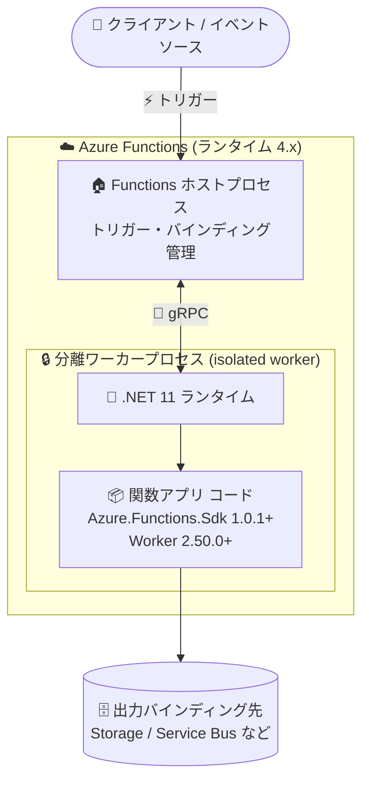

# Azure Functions: .NET 11 サポートの一般提供開始 (GA)

**リリース日**: 2026-11-10

**サービス**: Azure Functions

**機能**: .NET 11 サポート (isolated worker model)

**ステータス**: Launched (GA)

[このアップデートのインフォグラフィックを見る](https://takech9203.github.io/azure-news-summary/20261110-functions-dotnet-11.html)

## 概要

Azure Functions における .NET 11 のサポートが一般提供 (GA) となりました。分離ワーカーモデル (isolated worker model) を使用して .NET 11 をターゲットとする関数アプリを構築でき、従来どおり Azure Functions のプログラミングモデルとホスト統合をそのまま利用できます。

.NET 11 は Azure Functions ランタイム バージョン 4.x の分離ワーカーモデルで利用可能です。最新の .NET ランタイム、C#、ライブラリ、SDK の改善をサーバーレスアプリに取り込むことで、ランタイムのパフォーマンス最適化、より充実した API、強化された開発者ツールの恩恵を受けられます。

なお、in-process モデルは .NET 11 をサポートしません。in-process モデルのサポートは 2026 年 11 月 10 日に終了するため、.NET の新バージョンを利用するには分離ワーカーモデルへの移行が必須です。

**アップデート前の課題**

- Azure Functions で GA サポートされる最新の .NET バージョンは .NET 10 までであり、.NET 11 の新しいランタイム最適化や API、C# の言語機能をサーバーレスアプリで利用できなかった
- Azure Functions は Preview / Go-live 段階の .NET リリースでは動作しないため、.NET 11 の正式サポート開始を待つ必要があった

**アップデート後の改善**

- 分離ワーカーモデルで `net11.0` をターゲットとする関数アプリを本番環境で構築・実行できるようになった
- 最新の .NET ランタイムによるパフォーマンス最適化、充実した API、強化された開発者ツールをサーバーレスアプリで活用できるようになった
- `Azure.Functions.Sdk` ベースのプロジェクト構成により、`dotnet run` で Functions ホストを起動できるなどツール統合が改善された

## アーキテクチャ図



分離ワーカーモデルでは、関数アプリのコードが Functions ホストとは別の .NET 11 ワーカープロセスで実行されます。ホストがトリガー・バインディングを管理し、ワーカープロセスとは gRPC で通信するため、ホストのランタイムコンポーネントに依存せず .NET バージョンを独立して選択できます。

## サービスアップデートの詳細

### 主要機能

1. **.NET 11 ターゲットの関数アプリ構築 (GA)**
   - 分離ワーカーモデルで `net11.0` をターゲットにでき、Azure Functions ランタイム 4.x 上で本番利用が可能
   - 従来の Azure Functions プログラミングモデル (トリガー / バインディング) とホスト統合はそのまま利用可能

2. **`Azure.Functions.Sdk` ベースの新しいプロジェクト構成**
   - .NET 11 プロジェクトはプロジェクト SDK として `Azure.Functions.Sdk` 1.0.1 以降が必須
   - `Microsoft.Azure.Functions.Worker` パッケージの明示的な参照が必要 (2.50.0 以降を推奨)
   - `Azure.Functions.Sdk` が `AzureFunctionsVersion` を `v4` に自動設定し、メタデータ用ソースジェネレーター・アナライザーを追加。Azure Functions Core Tools がインストールされていれば `dotnet run` で Functions ホストを起動可能

3. **最新 .NET ランタイムのメリット**
   - ランタイムのパフォーマンス最適化
   - より充実した API
   - 強化された開発者ツール

## 技術仕様

| 項目 | 詳細 |
|------|------|
| 対応ランタイム | Azure Functions ランタイム 4.x |
| 実行モデル | 分離ワーカーモデル (isolated worker model) のみ。in-process モデルは .NET 11 非対応 |
| ターゲットフレームワーク | `net11.0` |
| プロジェクト SDK | `Azure.Functions.Sdk` 1.0.1 以降 (必須) |
| ワーカーパッケージ | `Microsoft.Azure.Functions.Worker` 2.50.0 以降を推奨 (明示的な参照が必須) |
| 対応言語 | 現時点では C# のみ (F# サポートは一時的に利用不可) |
| ホスティングプランの制約 | Linux の従量課金 (Consumption) プランは .NET 10 以降非対応。Flex Consumption プランへの移行が必要 |

**Functions 4.x (分離ワーカーモデル) でサポートされる .NET バージョン:**

| バージョン | サポートレベル | サポート終了予定日 |
|------|------|------|
| .NET 11 | GA | .NET サポートポリシーに準拠 |
| .NET 10 | GA | 2028-11-14 |
| .NET 9 | GA | 2026-11-10 |
| .NET 8 | GA | 2026-11-10 |
| .NET Framework 4.8.1 | GA | .NET Framework サポートポリシーに準拠 |

## 設定方法

### 前提条件

1. [.NET 11 SDK](https://dotnet.microsoft.com/download/dotnet/11.0) のインストール
2. Azure Functions Core Tools および開発ツール・テンプレートを最新版に更新
3. Linux Consumption プランのアプリの場合は、事前に Flex Consumption プランへ移行

### 新規プロジェクトの作成 (Azure Functions Core Tools)

```bash
# .NET 11 の分離ワーカープロジェクトを作成
func init --worker-runtime dotnet-isolated --target-framework net11.0
```

生成されるプロジェクトファイルの例 (SDK / パッケージのバージョンはテンプレートのバージョンにより異なります):

```xml
<Project Sdk="Azure.Functions.Sdk/1.0.1">
  <PropertyGroup>
    <TargetFramework>net11.0</TargetFramework>
    <ImplicitUsings>enable</ImplicitUsings>
    <Nullable>enable</Nullable>
  </PropertyGroup>
</Project>
```

### 既存プロジェクトのアップグレード

1. プロジェクト SDK を `Azure.Functions.Sdk/1.0.1` に変更する (`Project` 要素の `Microsoft.NET.Sdk` と `Microsoft.Azure.Functions.Worker.Sdk` パッケージ参照を置き換え)
2. ターゲットフレームワークを `net11.0` に変更する
3. `Microsoft.Azure.Functions.Worker` の明示的な参照と、使用しているトリガー / バインディング拡張パッケージの参照は維持する
4. ビルド SDK の移行自体にアプリコードの変更は不要だが、依存関係の互換性を確認し、アプリをテストする
5. デプロイ時には、Azure 側の関数アプリが .NET 11 の分離ワーカースタックを使用するように構成する

## メリット

### ビジネス面

- 最新の .NET ランタイムによるパフォーマンス最適化で、サーバーレスワークロードの実行効率向上が期待できる
- in-process モデルのサポート終了 (2026-11-10) 後も、分離ワーカーモデル + 最新 .NET でフルサポートを継続して受けられる
- 社内標準の .NET バージョンを .NET 11 に統一する際、サーバーレス層も足並みを揃えられる

### 技術面

- .NET 11 の新しい API・C# 言語機能・ライブラリ・SDK の改善をそのまま関数アプリで利用できる
- 分離ワーカーモデルにより、Functions ホストのランタイムコンポーネントに依存せず .NET バージョンを独立して選択できる
- `Azure.Functions.Sdk` により `dotnet run` での Functions ホスト起動などツール統合が強化される

## デメリット・制約事項

- **in-process モデルは .NET 11 非対応**: .NET 11 を利用するには分離ワーカーモデルへの移行が必須
- **C# のみ対応**: .NET 11 では現時点で C# のみサポート。F# サポートは一時的に利用不可
- **Linux Consumption プラン非対応**: Linux の従量課金プランでは .NET 10 以降を実行できない。Flex Consumption プランへの移行が必要
- **SDK / パッケージ要件**: `Azure.Functions.Sdk` 1.0.1 以降と `Microsoft.Azure.Functions.Worker` の明示的な参照が必須のため、既存プロジェクトはプロジェクトファイルの更新が必要
- Azure Functions は Preview / Go-live 段階の .NET リリースでは動作しないため、利用できるのは GA リリースのみ

## ユースケース

### ユースケース 1: .NET 8 / .NET 9 関数アプリの .NET 11 へのアップグレード

**シナリオ**: 分離ワーカーモデルで稼働中の .NET 8 / .NET 9 関数アプリ (いずれも 2026-11-10 にサポート終了) を、最新の .NET 11 へアップグレードしてサポートを継続する。

**実装例**:

```xml
<!-- プロジェクトファイルを更新 -->
<Project Sdk="Azure.Functions.Sdk/1.0.1">
  <PropertyGroup>
    <TargetFramework>net11.0</TargetFramework>
  </PropertyGroup>
</Project>
```

**効果**: サポート切れを回避しつつ、.NET 11 のランタイム最適化と新 API を活用できる。アプリコードの変更は原則不要 (依存関係の互換性確認とテストは必要)。

### ユースケース 2: in-process モデルからの移行先としての .NET 11

**シナリオ**: in-process モデル (.NET 8) で稼働中の関数アプリを、サポート終了 (2026-11-10) に伴い分離ワーカーモデルへ移行し、あわせて .NET 11 へアップグレードする。

**実装例**:

```bash
# 新しい .NET 11 分離ワーカープロジェクトを作成して移行
func init --worker-runtime dotnet-isolated --target-framework net11.0
```

**効果**: フルサポートの継続に加え、今後の .NET 新バージョンへの追従が容易な構成に刷新できる。

## 料金

このアップデートによる追加料金は確認されていません。Azure Functions の料金はホスティングプラン (Consumption / Flex Consumption / Premium / Dedicated) に基づきます。詳細は料金ページを参照してください。

- [Azure Functions の料金](https://azure.microsoft.com/pricing/details/functions/)

## 利用可能リージョン

アップデート情報にリージョン固有の記載はありません。注意点として、Linux Consumption プランでは .NET 10 以降 (当然 .NET 11 も) を実行できず、Flex Consumption プランが必要です。詳細は公式ドキュメントを参照してください。

- [サポートされる .NET バージョン](https://learn.microsoft.com/azure/azure-functions/dotnet-isolated-process-guide#supported-versions)

## 関連サービス・機能

- **Azure Functions Core Tools**: `func init` による .NET 11 プロジェクトの作成、ローカル開発・デバッグに使用
- **Flex Consumption プラン**: Linux で .NET 10 以降を実行する場合の移行先ホスティングプラン
- **Azure App Service**: Functions のホスト基盤。ランタイムのマイナーバージョン削除などのリリース情報は App Service announcements で通知される

## 参考リンク

- [インフォグラフィック](https://takech9203.github.io/azure-news-summary/20261110-functions-dotnet-11.html)
- [公式アップデート情報](https://azure.microsoft.com/updates?id=578773)
- [.NET isolated worker model ガイド (Microsoft Learn)](https://learn.microsoft.com/azure/azure-functions/dotnet-isolated-process-guide)
- [Azure Functions ランタイムバージョンの比較 (Microsoft Learn)](https://learn.microsoft.com/azure/azure-functions/functions-versions)
- [isolated worker model への移行ガイド (Microsoft Learn)](https://learn.microsoft.com/azure/azure-functions/migrate-dotnet-to-isolated-model)
- [料金ページ](https://azure.microsoft.com/pricing/details/functions/)

## まとめ

Azure Functions の .NET 11 サポートが GA となり、分離ワーカーモデルで最新の .NET ランタイムを本番利用できるようになりました。このアップデートの重要性は、同日 (2026-11-10) に in-process モデルのサポートと .NET 8 / .NET 9 の分離ワーカーモデルでのサポートが終了する点にあります。該当する関数アプリを運用している場合は、`Azure.Functions.Sdk` 1.0.1 以降への移行と `net11.0` (または LTS の `net10.0`) へのアップグレードを早急に計画することを推奨します。Linux Consumption プランのアプリは、先に Flex Consumption プランへの移行が必要な点にも注意してください。

---

**タグ**: Azure Functions, .NET 11, isolated worker model, Serverless, Compute, GA, SDK and Tools
