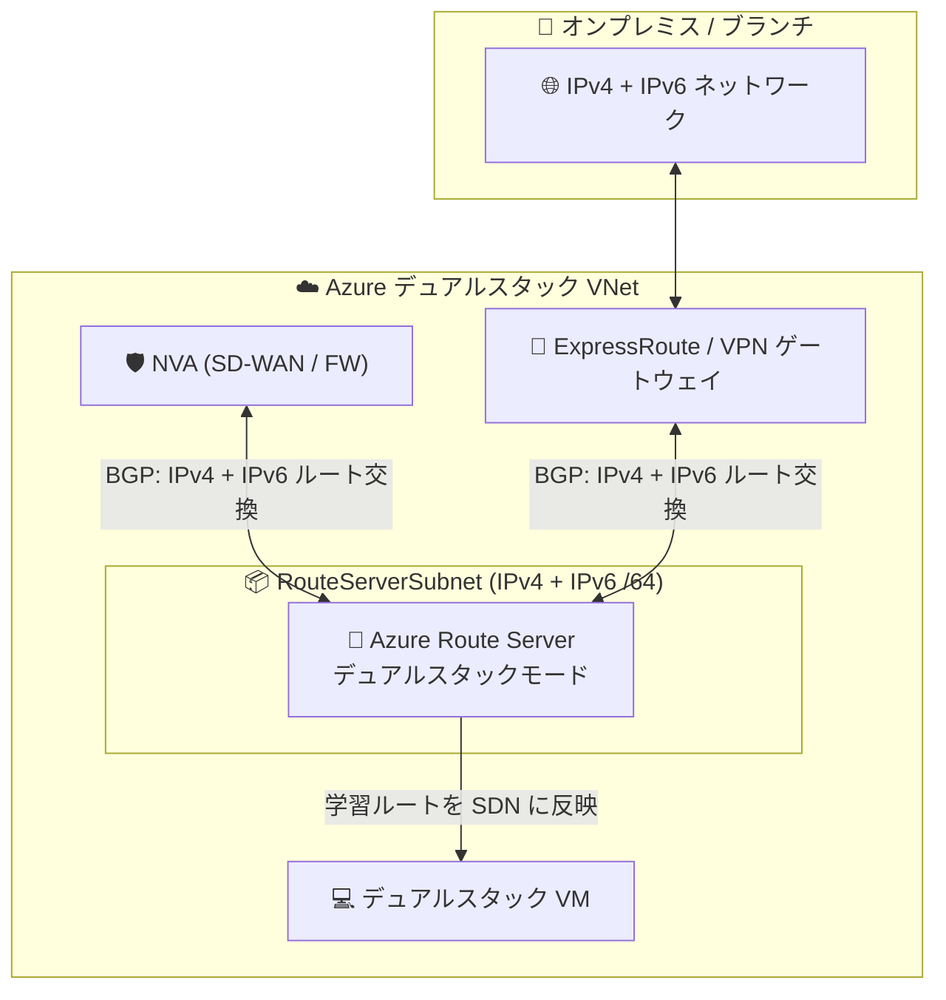

# Azure Route Server: IPv4/IPv6 デュアルスタックサポート (Public Preview)

**リリース日**: 2026-11-10

**サービス**: Azure Route Server

**機能**: IPv4/IPv6 デュアルスタックモード

**ステータス**: In preview

[このアップデートのインフォグラフィックを見る](https://takech9203.github.io/azure-news-summary/20261110-route-server-dual-stack-ipv6.html)

## 概要

Azure Route Server の IPv4/IPv6 デュアルスタックモードがパブリックプレビューとして発表されました。これにより、サポート対象のハイブリッドネットワーク接続において、IPv4 と IPv6 の両アドレスファミリでの BGP ルート交換が可能になります。

デュアルスタックモードは、ExpressRoute 接続、VPN Gateway 接続、およびハブ/スポーク仮想ネットワーク内のネットワーク仮想アプライアンス (NVA) 接続に対応します。既存の IPv4 接続は変更されずそのまま維持されるため、組織は現行の IPv4 ルーティングを稼働させたまま、IPv6 ルーティングを段階的に導入できます。

有効化は、既存の IPv4 専用 Route Server に対して `RouteServerSubnet` に IPv6 /64 プレフィックスを追加し、構成画面で Dual Stack Mode を有効にするだけです。NVA ピアリングやゲートウェイ接続の有無にかかわらず有効化できます。

**アップデート前の課題**

- Azure Route Server は IPv6 に対応しておらず、IPv6 アドレス空間を持つ仮想ネットワークに Route Server をデプロイすると IPv6 トラフィックの接続性が壊れる動作だった
- デュアルスタック仮想ネットワークをピアリングしても、IPv6 接続はサポート対象外だった (IPv4 のみ動作)
- NVA やオンプレミスとの間で IPv6 プレフィックスの動的ルート交換ができず、IPv6 導入の障壁となっていた

**アップデート後の改善**

- IPv4 と IPv6 の両アドレスファミリで、NVA・ExpressRoute・VPN Gateway との BGP ルート交換が可能になった
- 既存の IPv4 接続は無変更で維持されるため、IPv6 ルーティングを段階的 (インクリメンタル) に導入できる
- デュアルスタックモードでは、Route Server のルートマップを両アドレスファミリの接続に適用できる

## アーキテクチャ図

デュアルスタックモードの Azure Route Server が、NVA および ExpressRoute/VPN ゲートウェイとの間で IPv4 と IPv6 の両方の BGP ルートを交換し、学習したルートを仮想ネットワーク内の VM に自動反映します。

## サービスアップデートの詳細

### 主要機能

1. **両アドレスファミリでのルート交換**
   - サポート対象のハイブリッドネットワーク接続 (ExpressRoute、VPN Gateway、NVA) において、IPv4 と IPv6 の両方で BGP ルート交換が可能

2. **既存 IPv4 接続への影響なし**
   - 既存の IPv4 専用接続は変更されず維持されるため、IPv6 ルーティングを段階的に導入できる

3. **既存 Route Server のインプレース有効化**
   - 既存の IPv4 専用 Route Server に対して、`RouteServerSubnet` への IPv6 プレフィックス追加と構成変更のみでデュアルスタック化が可能 (再デプロイ不要)

4. **ルートマップのデュアルスタック対応**
   - デュアルスタックモードでは、Route Server のルートマップを ExpressRoute 接続、VPN Gateway 接続、ハブ/スポーク内の NVA 接続に適用可能

## 技術仕様

| 項目 | 詳細 |
|------|------|
| 対応接続タイプ | ExpressRoute 接続、VPN Gateway 接続、NVA 接続 (ハブ/スポーク VNet 内) |
| RouteServerSubnet の要件 | 仮想ネットワークの IPv6 アドレス空間内の /64 プレフィックスを追加 |
| 有効化の可逆性 | **不可逆** (IPv4 専用に戻すには Route Server の削除・再作成が必要) |
| 有効化の所要時間 | 最大 40 分 |
| 既存 IPv4 接続への影響 | なし (無変更で維持) |
| ルーティングプロトコル | BGP (Route Server の既存仕様に準拠) |

## 設定方法

### 前提条件

1. IPv4 のみのアドレスプレフィックスを持つ `RouteServerSubnet` にデプロイ済みの Azure Route Server
2. Route Server がプレビュー対象リージョン (後述) に存在すること
3. IPv4/IPv6 デュアルスタック仮想ネットワークと、`RouteServerSubnet` 用に利用可能な IPv6 /64 プレフィックス (仮想ネットワークの IPv6 アドレス空間内)
4. プレビューアクセスが有効化されたサブスクリプション

### Azure Portal

**ステップ 1: RouteServerSubnet に IPv6 プレフィックスを追加**

1. Azure portal で Route Server が存在する仮想ネットワークを開く
2. [設定] > [サブネット] から `RouteServerSubnet` を選択
3. [Add IPv6] を選択し、仮想ネットワークのアドレス空間内の利用可能な IPv6 /64 プレフィックスを入力
4. [保存] でサブネットを更新

**ステップ 2: デュアルスタックモードを有効化**

1. Azure Route Server リソースを開き、[設定] > [構成] を選択
2. [Dual Stack Mode] を [Enabled] に設定し、不可逆な変更に関する確認を読んだうえで [保存] を選択
3. 有効化の完了には最大 40 分かかる

**ステップ 3: 構成の確認**

1. Route Server の [概要] ページで、プロビジョニング状態と接続状態が [Succeeded] であることを確認
2. [構成] で [Dual Stack Mode] が [Enabled] であることを確認
3. 接続済みのピアやゲートウェイがある場合は、構成した各アドレスファミリで期待どおりのルートが交換されているか確認する

## メリット

### ビジネス面

- IPv4 アドレス枯渇への対応や IPv6 義務化要件 (政府・公共調達など) に向けた、ハイブリッドネットワークの IPv6 移行計画を具体化できる
- 既存 IPv4 環境を止めずに段階的に IPv6 を導入できるため、移行リスクとダウンタイムを最小化できる

### 技術面

- NVA・ExpressRoute・VPN Gateway との間で IPv6 プレフィックスの動的ルート交換が可能になり、IPv6 の UDR 手動管理が不要になる
- 既存 Route Server をインプレースでデュアルスタック化でき、再構築が不要
- ルートマップによる経路制御 (フィルタリング、集約、BGP 属性変更) を両アドレスファミリで利用できる

## デメリット・制約事項

- **パブリックプレビュー**であり、プレビューの追加利用規約が適用される (本番 SLA の対象外)
- デュアルスタックモードの有効化は**不可逆**。IPv4 専用モードに戻すには Route Server の削除・再作成が必要なため、事前にルーティング依存関係の確認が必須
- 有効化処理に最大 40 分かかる
- 利用可能リージョンがプレビュー対象の一部リージョンに限定される
- ハブ & スポーク構成では、ハブ仮想ネットワークへの IPv6 アドレス空間追加と `RouteServerSubnet` への IPv6 プレフィックス追加により、スポークとの仮想ネットワークピアリングが非同期 (out of sync) 状態になるため、各ピアリングの再同期が必要
- プロビジョニングが Succeeded にならない場合は、ルート交換可能とみなさず、追加のルーティング変更前に Azure サポートへ問い合わせることが推奨されている

## ユースケース

### ユースケース 1: ハイブリッド環境への段階的な IPv6 導入

**シナリオ**: ExpressRoute でオンプレミスと接続済みの既存 IPv4 ハブ & スポーク環境に、業務システムの IPv6 対応要件が発生。既存の IPv4 ルーティングを止めずに IPv6 経路交換を追加したい。

**実装例**:

1. ハブ仮想ネットワークに IPv6 アドレス空間を追加し、`RouteServerSubnet` に IPv6 /64 プレフィックスを追加
2. Route Server の Dual Stack Mode を有効化 (最大 40 分)
3. スポークとの仮想ネットワークピアリングを再同期
4. NVA / ゲートウェイ側で IPv6 ルートの広報を構成し、両アドレスファミリの経路交換を確認

**効果**: 既存の IPv4 接続は無変更のまま、IPv6 の動的ルーティングを追加でき、手動の UDR 管理なしにデュアルスタック環境へ移行できる。

### ユースケース 2: SD-WAN NVA 経由の IPv6 ブランチ接続

**シナリオ**: ハブ仮想ネットワーク内の SD-WAN NVA 経由でブランチ拠点と接続しており、拠点側の IPv6 化に合わせて Azure 側でも IPv6 プレフィックスを動的に学習させたい。

**効果**: Route Server が NVA から IPv6 ルートを BGP で学習し、仮想ネットワーク内の VM に自動反映。IPv6 経路の追加・変更のたびにルートテーブルを手動更新する運用が不要になる。

## 料金

デュアルスタックモード固有の料金情報はアップデート発表およびドキュメントでは確認できませんでした。Azure Route Server 自体はデプロイ時間ベースの時間課金モデルです。最新の料金は以下の料金ページを参照してください。

- [Azure Route Server の料金](https://azure.microsoft.com/pricing/details/route-server/)

## 利用可能リージョン

パブリックプレビュー時点では、以下のリージョンでのみ利用可能です。

| リージョン | プログラム名 |
|-----------|-------------|
| East US 2 EUAP | `eastus2euap` |
| Central US EUAP | `centraluseuap` |
| West Central US | `westcentralus` |
| East Asia | `eastasia` |
| UK South | `uksouth` |
| Central US | `centralus` |
| Australia Central | `australiacentral` |
| Korea Central | `koreacentral` |
| Central India | `centralindia` |
| Brazil South | `brazilsouth` |
| Malaysia West | `malaysiawest` |

## 関連サービス・機能

- **Azure ExpressRoute**: ExpressRoute ゲートウェイ接続との間で IPv4/IPv6 両方のルート交換が可能
- **Azure VPN Gateway**: VPN ゲートウェイ接続との間で IPv4/IPv6 両方のルート交換が可能
- **ネットワーク仮想アプライアンス (NVA)**: ハブ/スポーク仮想ネットワーク内の BGP 対応 NVA (SD-WAN、ファイアウォールなど) とのデュアルスタックピアリング
- **ルートマップ**: デュアルスタックモードの接続に対して、ルートのフィルタリング・プレフィックス集約・BGP 属性変更を適用可能
- **仮想ネットワークピアリング**: ハブ & スポーク構成で学習ルートをスポークに伝播 (IPv6 追加時はピアリングの再同期が必要)

## 参考リンク

- [インフォグラフィック](https://takech9203.github.io/azure-news-summary/20261110-route-server-dual-stack-ipv6.html)
- [公式アップデート情報](https://azure.microsoft.com/updates?id=579746)
- [Enable IPv4/IPv6 dual-stack mode on Azure Route Server (Microsoft Learn)](https://learn.microsoft.com/azure/route-server/enable-route-server-dual-stack)
- [What is Azure Route Server? (Microsoft Learn)](https://learn.microsoft.com/azure/route-server/overview)
- [Azure Route Server FAQ (Microsoft Learn)](https://learn.microsoft.com/azure/route-server/route-server-faq)
- [料金ページ](https://azure.microsoft.com/pricing/details/route-server/)

## まとめ

Azure Route Server の IPv4/IPv6 デュアルスタックモードがパブリックプレビューとなり、ExpressRoute・VPN Gateway・NVA 接続において両アドレスファミリの BGP ルート交換が可能になりました。これまで Route Server は IPv6 非対応であり、IPv6 導入の大きな障壁となっていたため、ハイブリッドネットワークの IPv6 移行を検討する組織にとって重要なアップデートです。

既存の IPv4 接続は無変更で維持されるため段階的な導入が可能ですが、**有効化は不可逆** (IPv4 専用に戻すには削除・再作成が必要) である点、プレビュー対象リージョンが限定される点、ハブ & スポーク構成ではピアリングの再同期が必要になる点に注意が必要です。IPv6 対応を計画している Solutions Architect は、まず非本番環境のプレビュー対象リージョンで検証し、ルーティング依存関係を確認したうえで導入計画を立てることを推奨します。

---

**タグ**: Networking, Azure Route Server, IPv6, Dual-stack, BGP, ExpressRoute, VPN Gateway, NVA, Public Preview
