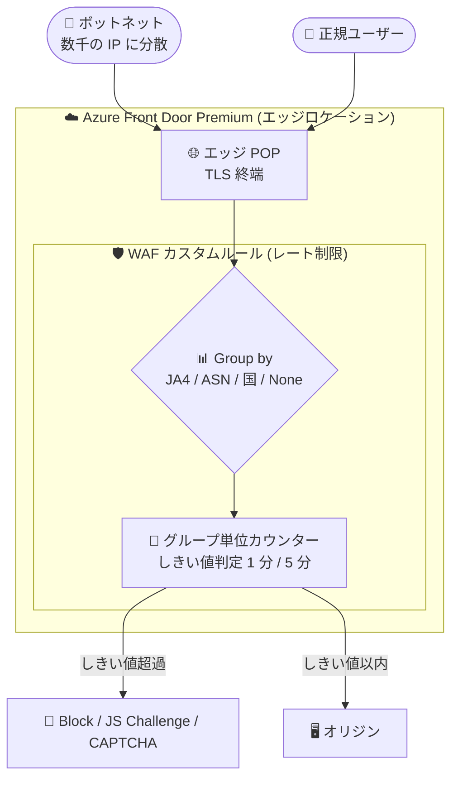

# Azure Front Door Premium WAF: レート制限グルーピング (Public Preview)

**リリース日**: 2026-11-11

**サービス**: Azure Front Door / Azure Web Application Firewall (WAF)

**機能**: Rate limit grouping (レート制限グルーピング)

**ステータス**: In preview

[このアップデートのインフォグラフィックを見る](https://takech9203.github.io/azure-news-summary/20261111-front-door-waf-rate-limit-grouping.html)

## 概要

Azure Front Door Premium の Web Application Firewall (WAF) で、レート制限ルールの「グルーピング (group-by)」が Public Preview になりました。従来、レート制限ルールはクライアントの IP アドレス (ソケットアドレス) ごとに個別にリクエスト数をカウントしていました。しかし、ボットネットなどによる分散攻撃では、トラフィックを数千の IP アドレスに分散させ、各 IP がしきい値未満に収まるようにすることでレート制限を回避できてしまうという課題がありました。

今回のアップデートにより、攻撃クライアントが共有する属性 (JA4 フィンガープリント、AS 番号、国/地域) でリクエストをグルーピングしてカウントできるようになり、多数の IP アドレスに分散したトラフィックを単一のしきい値で制限できます。また「None」を選択すると、ルールに一致するすべてのリクエストを 1 つのカウンターで合算でき、サインインページなど特定リソースへの総リクエストレートの上限設定が可能です。

既存のレート制限ルールはグルーピングを指定しない限り従来どおり IP アドレス単位でカウントされるため、既存構成への影響はありません。設定は Azure Portal、ARM テンプレート、Bicep、REST API、Azure PowerShell で行えます。

**アップデート前の課題**

- レート制限はソケット IP アドレス単位のカウントのみで、数千の IP にトラフィックを分散する分散攻撃 (HTTP フラッドなど) は各 IP がしきい値未満に収まり、レート制限をすり抜けられた
- ホスティング事業者やクラウドプロバイダーなど特定ネットワークからのトラフィックを制限するには、IP レンジのリストを維持する必要があった
- 特定パス (サインインページなど) への「総リクエストレート」に上限を設ける手段がなかった

**アップデート後の改善**

- IP をローテーションしても同じクライアントソフトウェアを再利用する攻撃を、JA4 フィンガープリント単位で制限可能に
- AS 番号単位のカウントにより、IP レンジのリストを維持せずにホスティング/クラウドプロバイダーなどのネットワーク単位でトラフィックを制限可能に
- 国/地域単位で、単一の国/地域が送信できるトラフィック量に上限を設定可能に
- 「None」によりルールに一致する全リクエストを合算カウントし、特定リソースへの総リクエストレートを制限可能に

## アーキテクチャ図



多数の IP に分散した攻撃トラフィックも、JA4 フィンガープリントや AS 番号など共有属性でグルーピングされ、単一カウンターでしきい値判定されます。カウントはエッジロケーション (POP) ごとに独立して保持され、グローバル集計はされません。

## サービスアップデートの詳細

### 主要機能

1. **JA4 フィンガープリントによるグルーピング**
   - TLS ネゴシエーションの方法が同じクライアントを 1 つのカウンターで集計。多数の IP をローテーションしながら同一クライアントソフトウェアを使い回す分散攻撃に有効。HTTP フラッドでは攻撃トラフィックの大半が少数のフィンガープリントに集中することが多い

2. **AS 番号 (ASN) によるグルーピング**
   - 同一ネットワーク (ISP、ホスティング事業者など) のクライアントを 1 つのカウンターで集計。IP レンジのリストを維持せずに、ユーザーが通常使わないネットワークからのトラフィックに上限を設定できる

3. **国/地域によるグルーピング**
   - 同じ国/地域のクライアントを 1 つのカウンターで集計。特定の国/地域に集中したフラッド攻撃の緩和に有効

4. **None (全リクエスト合算)**
   - ルールに一致するすべてのリクエストを 1 つのカウンターで集計。サインインページや疑わしい User-Agent のリストなど、狭い一致条件と組み合わせて特定リソースへの総リクエストレートに上限を設定できる

## 技術仕様

| 項目 | 詳細 |
|------|------|
| 対象 SKU | Azure Front Door **Premium** のみ (プレビューのグルーピング)。ソケット IP 単位 (デフォルト) は Standard/Premium/Classic で GA |
| Group by 変数 (API 値) | `SocketAddr` (GA・デフォルト) / `GeoLocation` / `Asn` / `Ja4` / `None` (いずれもプレビュー) |
| グルーピング数 | 1 ルールにつき 1 変数。同一トラフィックを複数の方法でカウントするにはルールを分ける |
| しきい値の時間枠 | 1 分または 5 分の固定ウィンドウ。超過するとウィンドウの残り時間、該当グループのトラフィックをブロック |
| カウント単位 | エッジロケーション (POP) ごとに独立してカウント。グローバル集計なし (許可される総量はしきい値 × 到達 POP 数になりうる) |
| 国/AS 番号の判定 | ソケット IP アドレスから導出 |
| アクション | Block / Log / JavaScript Challenge / CAPTCHA など |
| 既存ルールへの影響 | グルーピング未指定のルールは従来どおりソケット IP 単位でカウント (影響なし) |

## 設定方法

### 前提条件

1. Azure Front Door Premium プロファイル
2. Front Door に関連付けられた WAF ポリシー (レート制限はカスタムルールで構成)

### Azure Portal

レート制限ルールの **Group rate limit traffic by** 設定でグルーピング (ソケットアドレス / 国/地域 / AS 番号 / JA4 / None) を選択します。

### ARM テンプレート / Bicep / REST API

カスタムルールの `groupBy` プロパティを設定します。以下は JA4 フィンガープリントごとに 5 分間で 500 リクエストまで許可する例です。

```json
{
  "name": "RateLimitByJa4",
  "priority": 10,
  "enabledState": "Enabled",
  "ruleType": "RateLimitRule",
  "rateLimitDurationInMinutes": 5,
  "rateLimitThreshold": 500,
  "groupBy": [
    { "variableName": "Ja4" }
  ],
  "matchConditions": [
    {
      "matchVariable": "RequestUri",
      "operator": "Contains",
      "matchValue": [ "/" ]
    }
  ],
  "action": "Block"
}
```

### Azure PowerShell

`New-AzFrontDoorWafCustomRuleGroupByVariableObject` コマンドレットで groupBy 変数オブジェクトを作成してカスタムルールに指定します。

## メリット

### ビジネス面

- 数千の IP に分散するボットネット型 HTTP フラッドによるサービス停止・コスト増のリスクを低減できる
- IP レンジリストの維持 (ホスティング事業者の IP 列挙など) という運用負荷なしに、ネットワーク単位の制限を実現できる
- WAF は Front Door Premium に追加料金なしで含まれるため、追加コストなしで防御を強化できる (CAPTCHA アクション利用時を除く)

### 技術面

- 攻撃側にとって変更コストの高い属性 (JA4 フィンガープリント) と安価な属性 (IP) を組み合わせた多層的なレート制限を構成できる
- 既存の per-IP ルールはそのまま動作するため、段階的に導入できる (Log アクションでの試験運用も可能)
- サインインページへの総リクエスト上限 + JavaScript チャレンジの組み合わせで、スクリプト型クライアントのみを選別的に排除できる

## デメリット・制約事項

- **プレビュー機能**: Azure プレビューの追加利用条件が適用され、本番利用は非推奨。グルーピングは Front Door **Premium のみ** で利用可能
- **グループ全体への影響**: しきい値超過時は同じ国/ネットワーク/フィンガープリントを共有する正規ユーザーも制限される。一般的なブラウザーの JA4 フィンガープリントは多数の正規ユーザーに共有されるため、攻撃と同一フィンガープリントの場合は正規ユーザーも巻き込まれる
- **エッジロケーションごとの独立カウント**: グループのトラフィックは複数 POP に到達することが多く、全体で許可される量はしきい値の数倍になりうる。しきい値は総トラフィックではなく POP 単位のトラフィックから算出する必要がある
- **低しきい値での精度**: しきい値が低い場合 (目安: 200 リクエスト/分未満)、カウンター未更新のサーバーにリクエストが到達し、しきい値を超えるリクエストが一部通過することがある
- **プロキシ/CDN 経由のトラフィック**: クライアントが別のプロキシや CDN 経由で Front Door に到達する場合、ソケット IP・国/AS 番号・JA4 はエンドユーザーではなくプロキシを表す
- **推奨運用**: グルーピングルールは per-IP ルールの代替ではなく併用が推奨。新規ルールは Log アクションで試験導入し、Block の代わりに JavaScript チャレンジや CAPTCHA も検討する

## ユースケース

### ユースケース 1: IP ローテーション型の HTTP フラッド対策 (JA4)

**シナリオ**: ボットネットが数千の IP をローテーションしながら同一ツールで HTTP フラッドを仕掛けてくる。per-IP レート制限では各 IP がしきい値未満に収まりすり抜けられる。

**実装例**: JA4 フィンガープリント単位で 5 分間 500 リクエストのしきい値を設定 (上記 JSON 例)。カウントが IP ではなくフィンガープリントに追従するため、IP をローテーションしても制限される。

**効果**: IP リストの管理なしで、同一クライアントソフトウェアを使う分散攻撃を単一しきい値で遮断。

### ユースケース 2: サインインページへの総リクエスト上限 (None + JS Challenge)

**シナリオ**: サインインページへのクレデンシャルスタッフィング/総当たり攻撃を、送信元を問わず総量で抑えたい。

**実装例**:

```json
{
  "name": "RateLimitSignInTotal",
  "priority": 20,
  "enabledState": "Enabled",
  "ruleType": "RateLimitRule",
  "rateLimitDurationInMinutes": 1,
  "rateLimitThreshold": 2000,
  "groupBy": [ { "variableName": "None" } ],
  "matchConditions": [
    {
      "matchVariable": "RequestUri",
      "operator": "Contains",
      "matchValue": [ "/signin" ]
    }
  ],
  "action": "JSChallenge"
}
```

**効果**: POP ごとに 1 分間 2,000 リクエストを超えるとウィンドウの残り時間、該当パスへのリクエストに JavaScript チャレンジを提示。正規ブラウザーは通過し、スクリプト型クライアントの多くは排除される。

### ユースケース 3: しきい値の適正化 (Log Analytics)

**シナリオ**: グルーピングルールのしきい値を、通常トラフィックで単一 POP の最大レートを上回る値に設定したい。

**実装例**: Front Door アクセスログに対して、POP (`pop_s`) ごと・JA4 フィンガープリントごとの 5 分ビンのリクエスト数をクエリする。

```kusto
AzureDiagnostics
| where Category =~ "FrontDoorAccessLog"
| where TimeGenerated > ago(7d)
| summarize Requests = count() by bin(TimeGenerated, 5m), pop_s, clientJA4FingerPrint_s
| summarize P99 = percentile(Requests, 99), Peak = max(Requests) by clientJA4FingerPrint_s
| order by Peak desc
```

**効果**: 日次・週次のピークを含む最低 1 週間の実トラフィックに基づき、正規ユーザーを巻き込まないしきい値を設定できる。国/地域グルーピングの場合は `clientJA4FingerPrint_s` を `clientCountry_s` に置き換える。

## 料金

レート制限グルーピング自体に追加料金はありません。WAF は Azure Front Door Premium に追加料金なしで含まれます ("includes WAF and Private Link at no additional cost")。

| 項目 | 料金 (参考) |
|------|------|
| Front Door Premium 基本料金 | $330/月 (時間単位課金) |
| リクエスト料金 (Premium、最初の 2.5 億リクエスト) | Zone 1 (北米)/Zone 6 (欧州): $0.015 / 1 万リクエスト、Zone 2 (日本含むアジア太平洋): $0.0168 / 1 万リクエスト |
| WAF (カスタムルール/ポリシー) | Premium に含まれる (追加料金なし) |
| CAPTCHA アクション | $0.4 / 1,000 CAPTCHA セッション |

最新の料金は [Azure Front Door 料金ページ](https://azure.microsoft.com/pricing/details/frontdoor/) を参照してください。

## 関連サービス・機能

- **Azure Front Door Premium**: 本グルーピング機能の前提となる SKU。Microsoft Threat Intelligence 統合、Bot Protection、Private Link も含む
- **WAF カスタムルール**: レート制限はカスタムルールとして構成し、一致条件 (match condition) と組み合わせる
- **JA4 クライアントフィンガープリント一致条件 / AS 番号一致条件**: グルーピングと同じ属性を一致条件としても利用可能
- **JavaScript Challenge / CAPTCHA**: しきい値超過時のアクションとして Block の代わりに利用でき、正規ブラウザーを巻き込みにくい
- **Azure Monitor / Log Analytics**: Front Door アクセスログ (`FrontDoorAccessLog`) から POP 単位のトラフィックを分析し、しきい値を算出

## 参考リンク

- [インフォグラフィック](https://takech9203.github.io/azure-news-summary/20261111-front-door-waf-rate-limit-grouping.html)
- [公式アップデート情報](https://azure.microsoft.com/updates?id=580155)
- [WAF Rate Limiting for Azure Front Door (Microsoft Learn)](https://learn.microsoft.com/azure/web-application-firewall/afds/waf-front-door-rate-limit)
- [Azure Front Door WAF カスタムルール (Microsoft Learn)](https://learn.microsoft.com/azure/web-application-firewall/afds/waf-front-door-custom-rules)
- [料金ページ (Azure Front Door)](https://azure.microsoft.com/pricing/details/frontdoor/)

## まとめ

Azure Front Door Premium WAF のレート制限グルーピングは、per-IP レート制限の最大の弱点だった「分散攻撃によるすり抜け」に対する直接的な回答です。JA4 フィンガープリント・AS 番号・国/地域・None という 4 つのグルーピングにより、IP リストを管理せずに攻撃クライアントの共有属性でトラフィックを制限できます。既存ルールへの影響はないため、Front Door Premium を利用中の組織は、(1) Log Analytics で POP 単位のトラフィックを計測してしきい値を算出、(2) Log アクションで試験導入、(3) per-IP ルールと併用しつつ JS チャレンジ/CAPTCHA アクションで本格運用、という段階的な導入を検討する価値があります。プレビュー機能のため、本番適用は GA 後を推奨します。

---

**タグ**: Azure Front Door, Web Application Firewall, WAF, Networking, Security, Rate Limiting, DDoS, Public Preview
