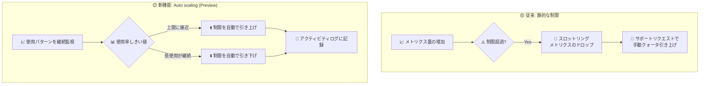

# Azure Monitor: Azure Monitor workspace インジェスト制限の自動スケーリング (Public Preview)

**リリース日**: 2026-11-12

**サービス**: Azure Monitor (Azure Monitor workspace / Managed Prometheus)

**機能**: Auto scaling of ingestion limits in Azure Monitor workspace

**ステータス**: In preview

[このアップデートのインフォグラフィックを見る](https://takech9203.github.io/azure-news-summary/20261112-azure-monitor-workspace-ingestion-auto-scaling.html)

## 概要

Azure Monitor workspace (AMW) において、インジェスト制限 (クォータ上限) を実際の使用パターンに基づいて自動的にスケーリングする機能が Public Preview として発表されました。AMW は Azure Monitor managed service for Prometheus のメトリクス格納先であり、ワークスペースごとに「アクティブ時系列数」と「1 分あたりのイベント数」のインジェスト制限 (いずれもデフォルト 100 万) が設定されています。

本機能を有効化すると、メトリクス量の増加に応じて制限が自動的に引き上げられ、使用量が低い状態が一定期間続くと制限が引き下げられます。これにより、制限超過によるスロットリング (メトリクスのドロップ) のリスクと、手動でのクォータ管理の運用負荷の両方を軽減できます。制限の変更はすべてワークスペースのアクティビティログに記録されるため、いつ・どの方向に制限が変化したかの履歴を確認でき、変更イベントに対するアラートも設定できます。

**アップデート前の課題**

- 使用量が制限を超えそうな場合、サポートリクエスト (または Preview の ARM API) によって手動で制限引き上げを申請し、適用を待つ必要があった
- 使用量の増加が制限の引き上げに追いつかないと、メトリクスがドロップされ、環境が変化しているまさにそのタイミングで可視性を失うリスクがあった
- 繰り返しの申請を避けるため、必要以上に大きなヘッドルームを要求する過剰プロビジョニングが起こりがちだった

**アップデート後の改善**

- 使用量がしきい値に近づくと制限が自動的に引き上げられ、スロットリングを未然に防止
- 使用量が低い状態が一定期間続くと未使用の容量が自動的に回収される (インジェスト自体には影響なし)
- 制限変更の履歴がアクティビティログに記録され、監査・アラート設定が可能
- 課金への影響はなし (課金は実際にインジェストした量に基づくため、クォータ上限の変更では課金額は変わらない)

## アーキテクチャ図



従来は制限超過によるスロットリング発生後に手動でクォータ引き上げを申請する必要がありましたが、Auto scaling を有効化すると使用状況に基づいて制限が自動的に増減し、変更履歴はアクティビティログに記録されます。

## サービスアップデートの詳細

### 主要機能

1. **使用量ベースの自動スケールアップ**
   - インジェスト使用率が上限しきい値に近づくと、制限が自動的に引き上げられ、スロットリングを防止する

2. **低使用時の自動スケールダウン**
   - 使用量が低い状態が一定期間継続すると、未使用の容量が回収される。スケールダウンしてもインジェスト自体には影響しない

3. **アクティビティログによる変更履歴の記録**
   - 制限の変更はすべてワークスペースのアクティビティログに記録され、変更イベントに対するアクティビティログアラートを設定できる

4. **ワークスペース単位のオプトイン設定**
   - ワークスペースごとに有効/無効を切り替え可能。無効化すると制限は固定され、従来どおり手動管理となる

## 技術仕様

| 項目 | 詳細 |
|------|------|
| 対象リソース | Azure Monitor workspace (`Microsoft.Monitor/accounts`) |
| 対象の制限 | Events per minute (デフォルト 100 万)、Active time series (デフォルト 100 万) |
| 有効化方法 | ARM API 更新 (`properties.limits.enableAutoScale=true`)、API バージョン `2026-09-03-preview` |
| 設定単位 | ワークスペース単位 (オプトイン) |
| 変更履歴 | ワークスペースのアクティビティログに記録 |
| 課金への影響 | なし (課金は実際のインジェスト量・クエリ量に基づく) |
| 監視用メトリクス | `ActiveTimeSeriesPercentUtilization`、`EventsPerMinuteIngestedPercentUtilization` |

## 設定方法

### 前提条件

1. Azure Monitor workspace が作成済みであること
2. ワークスペースに対する書き込みアクセス権があること

### Azure CLI

```bash
# Azure Monitor workspace の default metricsContainer に対して Auto scaling を有効化
resourceId="/subscriptions/<subscriptionId>/resourceGroups/<resourceGroupName>/providers/Microsoft.Monitor/accounts/<azureMonitorWorkspaceName>/metricsContainers/default"

az resource update \
  --ids $resourceId \
  --api-version 2026-09-03-preview \
  --set properties.limits.enableAutoScale=true \
  --force-string

# 無効化する場合は enableAutoScale=false を設定 (制限は固定され手動管理に戻る)
```

## メリット

### ビジネス面

- クォータ管理 (サポートリクエストの作成・適用待ち) にかかる運用工数を削減
- 環境の変化・成長期における監視データ欠損のリスクを低減し、可観測性を維持
- 過剰プロビジョニング (必要以上のヘッドルーム要求) が不要になる

### 技術面

- 使用率に基づく自動スケールアップでスロットリング (429) を未然に防止
- 低使用時の自動スケールダウンにより制限値が実態に追従
- アクティビティログで制限変更を追跡でき、アラートによる変更検知も可能
- クォータ上限の変更のみで課金に影響しないため、安心して有効化できる

## デメリット・制約事項

- Public Preview のため、本番環境での利用は SLA の対象外
- ワークスペースごとのオプトイン設定であり、デフォルトでは無効
- 現時点で確認できた有効化手段は ARM API 経由 (`az resource update`) のみ (Preview API バージョン `2026-09-03-preview` を使用)
- Auto scaling を使わない場合の手動引き上げには従来どおり条件がある (API 経由は最大 2,000 万まで、200 万超は現在使用量が希望値の 50% に達している必要あり、2,000 万超はサポートチケット)

## ユースケース

### ユースケース 1: 成長中の AKS クラスターの Prometheus メトリクス監視

**シナリオ**: AKS クラスターのノード・Pod 数が継続的に増加しており、Managed Prometheus のアクティブ時系列数がデフォルト制限 (100 万) に近づいている。スパイク時のメトリクスドロップを避けたいが、都度のクォータ申請は避けたい。

**実装例**:

```bash
# 1. Auto scaling を有効化
az resource update \
  --ids "/subscriptions/<subId>/resourceGroups/<rg>/providers/Microsoft.Monitor/accounts/<amw>/metricsContainers/default" \
  --api-version 2026-09-03-preview \
  --set properties.limits.enableAutoScale=true \
  --force-string

# 2. 推奨アラート (使用率 75% / 95%) を併用して利用状況を監視
#    Azure Portal: Azure Monitor workspace > Alerts > Set up recommended alerts
```

**効果**: クラスターの成長に合わせて制限が自動で引き上げられ、スロットリングによるメトリクス欠損を防止。閑散期には制限が自動で引き下げられ、クォータが実態に追従する。

## 料金

Auto scaling の有効化による追加料金や課金の変更はありません。本機能はインジェスト制限 (クォータ上限) を調整するのみで、課金は従来どおり実際にインジェスト・クエリしたデータ量に基づきます。Azure Monitor managed service for Prometheus 自体および Azure Monitor workspace の作成に直接のコストはなく、収集データのインジェストとクエリに対して課金されます。

詳細は [Azure Monitor 料金ページ](https://azure.microsoft.com/pricing/details/monitor/) の Metrics タブを参照してください。

## 関連サービス・機能

- **Azure Monitor managed service for Prometheus**: Azure Monitor workspace は Prometheus メトリクスの格納先であり、本機能のインジェスト制限はこのメトリクス取り込みに適用される
- **Azure Kubernetes Service (AKS)**: Managed Prometheus の主要なデータソース。クラスター規模の拡大に伴う時系列数の増加に本機能が対応
- **アクティビティログ / アクティビティログアラート**: 制限変更イベントの履歴確認と変更検知アラートに利用
- **Azure Monitor 推奨アラート**: インジェスト使用率 75% / 95% のしきい値で通知する推奨アラートルールを併用可能
- **Azure Managed Grafana**: AMW に格納したメトリクスの可視化に利用

## 参考リンク

- [インフォグラフィック](https://takech9203.github.io/azure-news-summary/20261112-azure-monitor-workspace-ingestion-auto-scaling.html)
- [公式アップデート情報](https://azure.microsoft.com/updates?id=578207)
- [Monitor Azure Monitor workspace metrics ingestion (Autoscale ingestion limits)](https://learn.microsoft.com/azure/azure-monitor/metrics/azure-monitor-workspace-monitor-ingest-limits#autoscale-ingestion-limits-in-azure-monitor-workspace-preview)
- [Azure Monitor service limits (Prometheus metrics)](https://learn.microsoft.com/azure/azure-monitor/fundamentals/service-limits#prometheus-metrics)
- [Overview of Azure Monitor with Prometheus](https://learn.microsoft.com/azure/azure-monitor/metrics/prometheus-metrics-overview)
- [料金ページ](https://azure.microsoft.com/pricing/details/monitor/)

## まとめ

Azure Monitor workspace のインジェスト制限自動スケーリングは、Managed Prometheus 運用における「スロットリングリスク」「手動クォータ申請の手間」「過剰プロビジョニング」という 3 つの課題を一度に解消する機能です。課金への影響はなくオプトインで有効化できるため、AKS など成長中の環境で Managed Prometheus を利用している場合は、Preview 段階から非本番環境で評価する価値があります。有効化とあわせて、推奨アラート (使用率 75% / 95%) とアクティビティログアラートを設定し、制限変更を可視化する運用を推奨します。

---

**タグ**: Azure Monitor, Azure Monitor workspace, Managed Prometheus, AKS, Ingestion Limits, Auto Scaling, Public Preview, Observability
