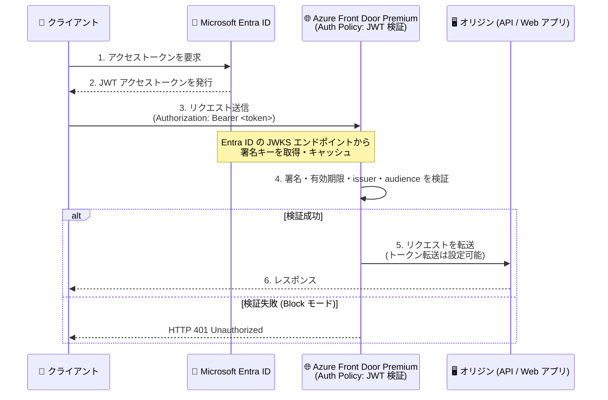

# Azure Front Door: Auth Policy による JWT 検証 (Public Preview)

**リリース日**: 2026-11-12

**サービス**: Azure Front Door (Premium)

**機能**: Auth Policy による JWT (JSON Web Token) 検証

**ステータス**: In preview

[このアップデートのインフォグラフィックを見る](https://takech9203.github.io/azure-news-summary/20261112-front-door-jwt-validation.html)

## 概要

Azure Front Door Premium で、Auth Policy (認証ポリシー) による JSON Web Token (JWT) 検証がパブリックプレビューとして利用可能になった。Microsoft Entra ID が発行したベアラートークンを、リクエストが API や Web アプリケーションに到達する前にエッジで検証できるようになり、認証の強制を一元化できる。

クライアントは `Authorization` または `Proxy-Authorization` リクエストヘッダーに `Bearer` スキームでトークンを送信する。Front Door はポリシーに基づいてトークンを検証し、成功すればオリジンへ転送、失敗すれば設定されたアクション (Block / Log) を適用する。ポリシーは Front Door のプロファイル、ドメイン、ルートの各スコープに関連付けることができる。

無効なトークンや欠落したトークンを持つリクエストをオリジン到達前に拒否できるため、認証チェックの一元化とオリジンへの不要なトラフィックの削減が期待できる。また、Log モードを使えばブロックせずに検証結果のみを記録できるため、本番適用前のポリシー評価にも利用できる。

**アップデート前の課題**

- JWT の検証は API Management の `validate-jwt` ポリシーやアプリケーション側の実装など、エッジより後段のコンポーネントで行う必要があった
- 無効なトークンを持つリクエストもオリジンまで到達するため、不要なトラフィックがオリジンの負荷になっていた
- 複数のアプリケーション・API にまたがる認証の強制を、Front Door 配下で一元管理する手段がなかった

**アップデート後の改善**

- Microsoft Entra ID 発行の JWT をエッジで検証し、無効なリクエストを HTTP 401 で即座に拒否できる
- プロファイル / ドメイン / ルートの各スコープにポリシーを関連付け、認証の強制を一元化できる
- Log モードにより、ブロックせずに検証結果を記録してポリシーの影響を事前評価できる

## アーキテクチャ図

Microsoft Entra ID が発行した JWT を Front Door Premium のエッジで検証し、有効なリクエストのみをオリジンに転送するフロー。検証失敗時は Block モードなら 401 を返し、Log モードなら記録のみ行い通過させる。

## サービスアップデートの詳細

### 主要機能

1. **エッジでの JWT 検証**
   - トークンの署名キー識別子 (`kid`) を読み取り、Microsoft Entra ID の JWKS エンドポイントから対応する署名キーを取得 (キーはキャッシュされ自動更新される)
   - トークンの署名、有効期限、発行者 (`iss`)、対象者 (`aud`) をポリシーに対して検証

2. **2 つのポリシーアクション**
   - **Block**: 要件を満たさないリクエストを HTTP `401 Unauthorized` で拒否し、オリジンに転送しない
   - **Log**: 検証結果を記録し、リクエストは通過させる (本番適用前の評価に有用)

3. **柔軟なスコープ設定**
   - ポリシーはプロファイル / ドメイン / ルートの各スコープに関連付け可能
   - 複数スコープにポリシーがある場合の優先順位は **ルート > ドメイン > プロファイル**

4. **トークンのオリジン転送制御**
   - 「検証済みトークンをオリジンへ転送する」設定 (デフォルト: 有効)
   - 無効にすると、Front Door は転送前に設定されたトークンヘッダーを削除する

5. **オリジン認証との組み合わせ**
   - クライアント→Front Door の JWT 検証と、Front Door→オリジンの認証 (マネージド ID) は別々に構成可能
   - マネージド ID によるオリジン認証を併用する場合、オリジン用トークンが `Authorization` ヘッダーを使うため、Auth Policy 側は `Proxy-Authorization` を使用してクライアントトークンと分離する

## 技術仕様

| 項目 | 詳細 |
|------|------|
| 対象ティア | Azure Front Door Premium のみ |
| ステータス | Public Preview (SLA なし、本番ワークロード非推奨) |
| 対応 ID プロバイダー | Microsoft Entra ID のみ |
| トークン形式 | JWT (ベアラートークン)、`Bearer` 認証スキーム必須 |
| トークン送信ヘッダー | `Authorization` または `Proxy-Authorization` (ポリシーで選択) |
| 検証項目 | 署名、有効期限、発行者 (`iss`)、対象者 (`aud`) |
| ポリシースコープ | プロファイル / ドメイン / ルート (優先順位: ルート > ドメイン > プロファイル) |
| アクション | Block (HTTP 401 で拒否) / Log (記録のみ) |
| サポートされる issuer ホスト (Azure パブリッククラウド) | `login.microsoftonline.com`、`sts.windows.net` |

## 設定方法

### 前提条件

1. Azure Front Door Premium プロファイル
2. 保護対象の API / アプリケーションを表す Microsoft Entra ID アプリ登録 (既存または新規)
3. 保護対象アプリ向けアクセストークンの想定される発行者 (`iss`) と対象者 (`aud`) の値
4. Microsoft Entra ID から JWT アクセストークンを取得し、設定されたヘッダーに `Bearer` スキームで送信できるクライアント

### Azure Portal

1. Azure Portal にサインインし、Front Door Premium プロファイルを開く
2. JWT 検証用の認証ポリシーを作成し、ポリシー名を指定する
3. ID プロバイダーとして **Microsoft Entra ID** を選択し、アプリケーションの issuer と audience を設定する
4. 認証の場所を **Header** に設定し、`Authorization` または `Proxy-Authorization` を選択する
5. 検証済みトークンをオリジンへ転送するかどうかを選択する
6. ポリシーアクション (Block / Log) を選択する
7. ポリシーを対象のプロファイル、ドメイン、またはルートに関連付ける
8. ポリシーのデプロイ完了を待ってからテストする

**テスト手順**: 有効なトークン付きリクエストがオリジンへ転送されること、トークンなし / 無効なトークンのリクエストが選択したアクションどおりに処理されること (Block なら HTTP 401) を確認し、アクセスログとポリシー診断で検証結果を確認する。

## メリット

### ビジネス面

- 認証の強制を Front Door で一元化でき、複数アプリケーション / API にまたがるガバナンスを簡素化できる
- 無効なリクエストがオリジンに到達しないため、オリジンのリソース消費とコストを抑制できる
- Log モードにより、既存トラフィックへの影響を確認してから段階的に適用できる

### 技術面

- エッジ (PoP) でトークンを検証するため、不正リクエストを早期に遮断できる
- 署名キーは Entra ID の JWKS エンドポイントから自動取得・キャッシュされ、キー管理が不要
- ルート / ドメイン / プロファイルの優先順位付きスコープで柔軟にポリシーを適用できる
- マネージド ID によるオリジン認証と組み合わせて、クライアント→エッジ、エッジ→オリジンの両区間を保護できる

## デメリット・制約事項

- **Premium ティア限定**: Standard ティアでは利用できない
- **プレビュー段階**: SLA がなく、本番ワークロードには推奨されない。GA 前に仕様が変更される可能性がある
- **Microsoft Entra ID 発行トークンのみ対応**: 他の ID プロバイダー (Auth0、Okta など) のトークンは検証できない
- **クロスクラウドトークンは非対応**
- Azure パブリッククラウドでサポートされる issuer ホストは `login.microsoftonline.com` と `sts.windows.net` のみ
- JWT 検証はトークンの有効性のみを確認する。アプリケーション固有の認可 (ロール・スコープの確認など) は引き続きアプリケーション側で実装する必要がある
- クライアントが Front Door を迂回してオリジンへ直接アクセスできないよう、Private Link、IP フィルタリング、`X-Azure-FDID` ヘッダー検証などのオリジンアクセス制限を別途構成する必要がある (JWT 検証はこれらの代替にはならない)

## 料金

Auth Policy / JWT 検証自体の追加料金は、現時点で料金ページに記載されていない。Front Door Premium の基本料金は以下のとおり。

| 項目 | 料金 |
|------|------|
| Premium 基本料金 | $330/月 (時間課金、WAF と Private Link を追加料金なしで含む) |
| リクエスト (Premium、最初の 2.5 億リクエスト) | $0.015〜$0.0259 / 1 万リクエスト (リージョンによる) |
| データ転送 (エッジ→クライアント、最初の 10 TB/月) | $0.083/GB (北米・欧州) 〜 $0.14/GB (韓国) |

最新の料金は [Azure Front Door 料金ページ](https://azure.microsoft.com/pricing/details/frontdoor/)を参照。

## 関連サービス・機能

- **Microsoft Entra ID**: JWT の発行元。Auth Policy は Entra ID の JWKS エンドポイントから署名キーを取得して検証する
- **マネージド ID によるオリジン認証 (プレビュー)**: Front Door→オリジン間の認証。クライアント JWT 検証と組み合わせる場合はヘッダーを分離する (`Proxy-Authorization` を Auth Policy に使用)
- **Azure Private Link / IP フィルタリング / `X-Azure-FDID` ヘッダー検証**: Front Door 迂回を防ぐためのオリジンアクセス制限。JWT 検証と併用が必須
- **Azure API Management (`validate-jwt` ポリシー)**: API ゲートウェイ層での JWT 検証。Front Door の Auth Policy はこれより手前のエッジで検証を行う補完的な位置付け
- **Azure Web Application Firewall (WAF)**: Front Door Premium に含まれる L7 保護。Auth Policy と組み合わせて多層防御を構成できる

## 参考リンク

- [インフォグラフィック](https://takech9203.github.io/azure-news-summary/20261112-front-door-jwt-validation.html)
- [公式アップデート情報](https://azure.microsoft.com/updates?id=577673)
- [Microsoft Learn: Validate JSON Web Tokens with an authentication policy (Preview)](https://learn.microsoft.com/azure/frontdoor/authentication-policy)
- [Microsoft Learn: Secure traffic to Azure Front Door origins](https://learn.microsoft.com/azure/frontdoor/origin-security)
- [料金ページ](https://azure.microsoft.com/pricing/details/frontdoor/)

## まとめ

Azure Front Door Premium の Auth Policy による JWT 検証は、Microsoft Entra ID 発行のベアラートークンをエッジで検証し、無効なリクエストをオリジン到達前に遮断できる機能である。認証の強制を一元化しつつオリジンの負荷を軽減できるため、Front Door 配下で複数の API / Web アプリを運用する構成では有力な選択肢となる。まずは Log モードで既存トラフィックへの影響を評価し、オリジンアクセス制限 (Private Link や `X-Azure-FDID` 検証) と組み合わせた上で Block モードへ移行する段階的な導入を推奨する。現時点ではプレビューのため、本番適用は GA を待つのが無難である。

---

**タグ**: Azure Front Door, Networking, Security, JWT, Microsoft Entra ID, Public Preview
