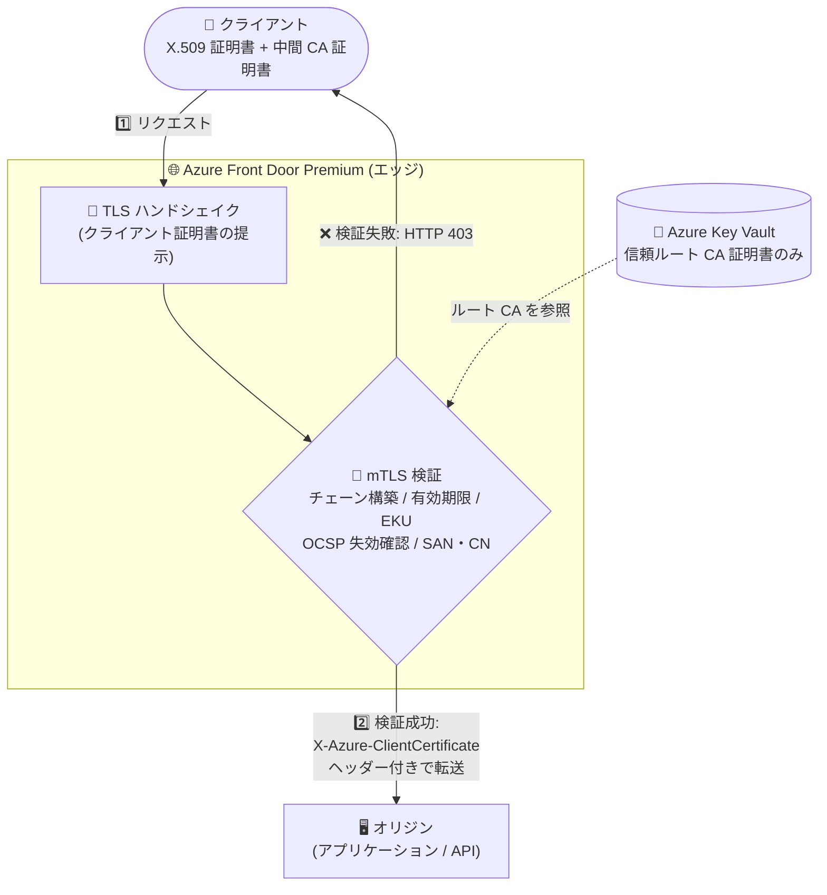

# Azure Front Door: mutual TLS (クライアント証明書認証) が一般提供開始 (GA)

**リリース日**: 2026-11-12

**サービス**: Azure Front Door

**機能**: Mutual TLS (mTLS) / クライアント証明書認証

**ステータス**: Launched (GA)

[このアップデートのインフォグラフィックを見る](https://takech9203.github.io/azure-news-summary/20261112-front-door-mtls-ga.html)

## 概要

Azure Front Door Premium の mutual TLS (mTLS、クライアント証明書認証) が一般提供 (GA) となりました。X.509 クライアント証明書を使用して、リクエストがオリジンに到達する前に Azure Front Door のエッジでクライアントを認証でき、B2B アプリケーション、IoT、金融サービス、エンタープライズシナリオなど、機密性の高いアプリケーションや API の保護に活用できます。

検証モードは 4 種類 (必須 + 検証、必須 + 検証なし、提示時のみ検証、オリジンへのパススルー) から選択でき、クライアント証明書を必須とするか、証明書検証を Front Door とオリジンのどちらで行うかを制御できます。オリジンへ転送する場合、クライアント証明書は `X-Azure-ClientCertificate` リクエストヘッダーで提供されます。

GA では信頼する CA の構成が簡素化されました。中間 CA 証明書をアップロードすることなく、信頼するルート CA 証明書のみを Azure Key Vault にアップロードして Front Door カスタムドメインに関連付けられます。この構成では、クライアントが TLS ハンドシェイク時にクライアント証明書と必要なすべての中間証明書を提示し、エッジ検証が有効な場合は Front Door がリクエスト時に証明書チェーンを構築して、構成済みの信頼ルート CA に対して検証します。

**アップデート前の課題 (Preview 時点)**

- Preview では信頼する CA 証明書チェーン (ルート + 中間) を Azure Key Vault にアップロードする必要があった
- Preview 機能のため、本番ワークロードでの利用には SLA やサポート面の制約があった

**アップデート後の改善 (GA)**

- 信頼するルート CA 証明書のみのアップロードで構成可能になり、中間 CA 証明書のアップロードが不要になった (クライアントがハンドシェイク時に中間証明書を提示し、Front Door がリクエスト時にチェーンを構築・検証)
- 一般提供となり、本番環境の機密アプリケーション・API 保護に正式に利用できるようになった

## アーキテクチャ図

クライアントは TLS ハンドシェイク時にクライアント証明書と必要な中間 CA 証明書を提示し、Front Door がエッジでチェーンを構築して Key Vault に登録した信頼ルート CA に対して検証します。成功したリクエストのみが証明書ヘッダー付きでオリジンへ転送され、失敗時は HTTP 403 が返されます。

## サービスアップデートの詳細

### 主要機能

1. **4 つのクライアント証明書検証モード**
   - **Client certificate required and validated (必須 + 検証)**: 証明書は必須。Front Door がエッジで完全検証 (証明書の有無、有効性、失効、ルート CA チェーン、SAN/CN リスト) を行い、`X-Azure-ClientCertificate` ヘッダーでオリジンに転送する。mTLS 有効時の既定モード
   - **Client certificate required but not validated (必須 + 検証なし)**: 証明書は必須だが Front Door は検証せず、証明書を持たないリクエストのみ拒否する。検証はオリジン側で実施
   - **Client certificate validation if presented (提示時のみ検証)**: 証明書は任意。提示された場合のみ完全検証してオリジンに転送し、証明書なしのリクエストはオリジンへ通して追加検証を委ねる
   - **mTLS passthrough to origin (パススルー)**: 証明書は任意。Front Door は検証を行わず、オリジン側ですべての検証を実施

2. **信頼 CA 構成の簡素化 (GA での改善点)**
   - 信頼するルート CA 証明書のみを Azure Key Vault にアップロードして、カスタムドメインに関連付け可能
   - クライアントは TLS ハンドシェイク時にクライアント証明書と必要な中間 CA 証明書をすべて提示し、Front Door がリクエスト時に証明書チェーンを構築・検証
   - ルート CA 単体、またはルート CA + 最大 3 つの中間 CA 証明書の構成に対応

3. **エッジでの完全な証明書検証**
   - 有効期限 (`Not Before` / `Not After`)、証明書の完全性、EKU (クライアント認証 OID)、信頼ルート CA までのチェーンを検証
   - オプションで SAN/CN を許可リスト (Allowed SAN list) と照合可能 (SAN を先に検証し、不一致・空の場合は CN を検証)
   - OCSP による失効確認を既定で有効化。失効している場合は HTTP 403 を返却

4. **オリジンへの証明書情報の転送**
   - 検証後、クライアント証明書を `X-Azure-ClientCertificate` リクエストヘッダーでオリジンに提供
   - クライアントが `X-Azure-ClientCert*` 系ヘッダーを偽装して送信した場合、Front Door はこれらのヘッダーを削除してから転送 (ヘッダーインジェクション対策)

5. **監視・トラブルシューティング**
   - メトリック: mTLS リクエスト数、失敗した mTLS リクエスト数、エラー種別・SNI ホスト名・TLS プロトコル別の mTLS エラーリクエスト
   - リクエストに `X-Azure-DebugInfo:1` ヘッダーを付与すると、403 応答時に `X-Azure-Externalerror` ヘッダーでエラー原因 (ClientCertExpired、ClientCertRevoked、ClientCertTooLongChain など) を確認可能

## 技術仕様

| 項目 | 詳細 |
|------|------|
| 対応 SKU | Azure Front Door Premium のみ |
| 検証モード | 4 種類 (必須 + 検証 / 必須 + 検証なし / 提示時のみ検証 / パススルー) |
| CA 証明書の構成 | ルート CA 証明書のみ、またはルート CA + 最大 3 つの中間 CA 証明書 |
| CA 証明書の形式 | PEM エンコード、25 KB 未満、Azure Key Vault 経由でアップロード |
| 証明書チェーン長 | リーフ証明書を含め最大 5 証明書 (超過時は `ClientCertTooLongChain` エラー) |
| 失効確認 | OCSP (証明書の AIA 拡張で定義された OCSP レスポンダーを使用)。既定で有効 |
| EKU チェック | クライアント認証 OID の確認を実施 |
| CA 証明書のローテーション | 自動ローテーション非対応。2 つの CA 証明書を関連付けてシームレスなロールオーバーが可能 |
| 対応 CA | パブリック CA / プライベート CA の両方の発行証明書に対応 |
| オリジンへのヘッダー | `X-Azure-ClientCertificate` で証明書を転送 |

## 設定方法

### 前提条件

1. Azure Front Door Premium プロファイル
2. 信頼するルート CA 証明書 (PEM 形式、25 KB 未満) を格納した Azure Key Vault とそのシークレットへのアクセス権
3. mTLS を有効化するカスタムドメイン (Front Door の既定ドメイン `*.z01.azurefd.net` は mTLS 有効エンドポイントのルートに関連付け不可)

### Azure Portal

1. Azure Portal で Front Door プロファイルを開き、**Security** > **Mutual TLS CA certificates** を選択して **+ Add** から Key Vault のシークレット (信頼ルート CA 証明書) を登録する
2. **Settings** > **Front Door manager** で **+ Add an endpoint** を選択し、**Enforce mutual TLS** にチェックを入れてエンドポイントを作成する
3. **Settings** > **Domains** で **+ Add** を選択し、**Advanced settings** の **Enable mutual TLS** を有効にしてドメインを追加する
   - mutual TLS モードを 4 種類から選択
   - 検証に使用する CA 証明書を選択
   - 証明書失効確認 (Certificate Revocation Check) を有効化
   - 照合する SAN/CN 許可リストを追加 (Front Door カスタムドメインのホスト名を明示的に含める必要あり)
4. 作成したエンドポイントにルートを追加してドメインとオリジングループを関連付ける
5. ローカルホストの IP バインドなどで mTLS の動作を検証後、DNS の CNAME レコードを Front Door エンドポイントに向ける
6. オリジンへのアクセスを Front Door 経由のみに制限し、mTLS のバイパスを防止する

## メリット

### ビジネス面

- B2B、IoT、金融サービスなど規制・セキュリティ要件の厳しい業界で、クライアント認証をマネージドなエッジサービスとして実現できる
- GA により本番ワークロードで正式に利用可能になり、機密アプリケーション・API の保護基盤として採用しやすくなった
- 中間 CA 証明書の管理・アップロードが不要になり、CA 構成の運用負荷が軽減された

### 技術面

- 認証されないリクエストをオリジン到達前にエッジでブロックでき、オリジンの負荷軽減と攻撃面の縮小につながる
- 4 つの検証モードにより、エッジでの完全検証からオリジンへの検証委譲まで柔軟に構成できる
- OCSP 失効確認、EKU チェック、SAN/CN 許可リスト照合などの検証をエッジで実施でき、`X-Azure-ClientCertificate` ヘッダーでオリジン側のアプリケーションロジックにも証明書情報を活用できる
- 2 つの CA 証明書の関連付けにより、CA 証明書の期限切れ・失効時にダウンタイムなしでロールオーバーできる

## デメリット・制約事項

- **Azure Front Door Premium 限定** (Standard では利用不可)
- **mTLS 有効時はキャッシュを有効化できない** (ルートのキャッシュ、Rules Engine のキャッシュオーバーライドとも不可)。未認証クライアントへのキャッシュ済みコンテンツ返却を防ぐための制約
- **既存ドメインでの有効化/無効化にはダウンタイムが発生する**。mTLS はまずエンドポイントで有効化する必要があり、既存ドメインはルート・エンドポイントからの関連付け解除と再関連付けが必要。新規エンドポイント・新規ドメインでの有効化が推奨
- 同一エンドポイントに mTLS 有効/無効が混在するドメインを関連付けることはできない
- mTLS 有効エンドポイントでは Front Door の既定ドメイン (`*.z01.azurefd.net`) をルートに関連付けできない
- 失効確認は現在 OCSP のみ対応
- CA 証明書の自動ローテーションは非対応
- SAN/CN の許可リスト (Allowed Domain list) ではワイルドカードドメインを指定できない (クライアント証明書側の SAN/CN がワイルドカードの場合、許可リストの 1 階層のサブドメインと一致すれば検証成功)
- 業界動向により、パブリック CA は近い将来クライアント認証 EKU 付き証明書の発行を停止する見込みのため、mTLS 用クライアント証明書はプライベート CA への移行が推奨される
- mTLS バイパス防止のため、オリジン側で Front Door 経由のトラフィックのみ許可するアクセス制御が別途必要

## ユースケース

### ユースケース 1: B2B API のクライアント認証

**シナリオ**: 取引先企業にのみ公開する API に対し、自社プライベート CA が発行したクライアント証明書を持つシステムだけがアクセスできるようにする。

**実装のポイント**: プライベートルート CA 証明書を Key Vault に登録し、「Client certificate required and validated」モードでエッジ検証と OCSP 失効確認を有効化。SAN/CN 許可リストで接続元を限定し、オリジンは Front Door 経由のみ許可する。

**効果**: 不正クライアントのリクエストをエッジでブロックし、API オリジンには認証済みトラフィックのみが到達する。

### ユースケース 2: IoT デバイスからのデータ収集エンドポイント保護

**シナリオ**: 多数の IoT デバイスがデバイス証明書を用いてデータ送信するエンドポイントを保護する。

**実装のポイント**: デバイス証明書の発行元ルート CA を信頼 CA として構成し、エッジで証明書チェーンと有効期限・失効を検証。`X-Azure-ClientCertificate` ヘッダーを使ってオリジン側でデバイス識別を行う。

**効果**: 証明書を持たない、または失効した証明書を持つデバイスからのトラフィックをエッジで遮断できる。

### ユースケース 3: 段階的な mTLS 移行 (提示時のみ検証)

**シナリオ**: 既存クライアントの証明書配布が完了するまで、証明書を持つクライアントと持たないクライアントが混在する。

**実装のポイント**: 「Client certificate validation if presented」モードを使用し、証明書を提示したクライアントはエッジで検証、未提示のリクエストはオリジンに転送して追加の検証・制御を行う。

**効果**: 全クライアントへの証明書展開完了を待たずに mTLS 検証を段階的に導入できる。

## 料金

mTLS 機能自体の追加料金に関する公式情報は、今回のアナウンスおよびドキュメントでは確認できませんでした。Azure Front Door Premium の料金体系については公式料金ページを参照してください。

- [Azure Front Door 料金ページ](https://azure.microsoft.com/pricing/details/frontdoor/)

## 関連サービス・機能

- **Azure Key Vault**: 信頼するルート CA 証明書 (および任意の中間 CA 証明書) の格納先。Front Door カスタムドメインに関連付けて使用する
- **Azure Front Door オリジンセキュリティ (Private Link など)**: mTLS のバイパスを防ぐため、オリジンへの直接アクセスを制限し Front Door 経由のトラフィックのみ許可する構成と組み合わせる
- **Azure Web Application Firewall (WAF)**: Front Door 上で mTLS と併用でき、クライアント認証に加えてアプリケーション層の攻撃からも保護できる
- **Azure Monitor / メトリック**: mTLS リクエスト数、失敗数、エラー種別などのメトリックで mTLS の動作を監視できる

## 参考リンク

- [インフォグラフィック](https://takech9203.github.io/azure-news-summary/20261112-front-door-mtls-ga.html)
- [公式アップデート情報](https://azure.microsoft.com/updates?id=577678)
- [Microsoft Learn: Mutual TLS authentication - Azure Front Door](https://learn.microsoft.com/en-us/azure/frontdoor/mutual-tls)
- [Microsoft Learn: Secure traffic to Azure Front Door origins](https://learn.microsoft.com/en-us/azure/frontdoor/origin-security)
- [Azure Front Door 料金ページ](https://azure.microsoft.com/pricing/details/frontdoor/)
- [関連レポート: Front Door mutual TLS パブリックプレビュー (2026-08-12)](./2026-08-12-front-door-mutual-tls.md)

## まとめ

Azure Front Door Premium の mutual TLS (クライアント証明書認証) が GA となり、B2B・IoT・金融などの機密アプリケーション・API を本番環境でエッジ認証により保護できるようになりました。GA では信頼ルート CA 証明書のみのアップロードで構成できるようになり、中間 CA 証明書の管理負荷が軽減されています。導入時は「mTLS 有効時はキャッシュ不可」「既存ドメインでの有効化はダウンタイムを伴う」という制約があるため、新規エンドポイント・新規ドメインでの有効化を計画し、オリジン側のアクセス制御 (Front Door 経由のみ許可) とプライベート CA への移行検討を併せて進めることを推奨します。

---

**タグ**: Azure Front Door, Networking, Security, mTLS, クライアント証明書認証, GA
