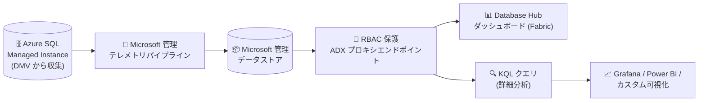

# Azure SQL Managed Instance: SQL パフォーマンス監視 (Microsoft マネージド)

**リリース日**: 2026-11-12

**サービス**: Azure SQL Managed Instance

**機能**: SQL performance monitoring (Microsoft-managed)

**ステータス**: In preview

[このアップデートのインフォグラフィックを見る](https://takech9203.github.io/azure-news-summary/20261112-sql-managed-instance-performance-monitoring.html)

## 概要

Azure SQL Managed Instance 向けの Microsoft マネージドなパフォーマンス監視機能がパブリックプレビューとして提供開始されました。パフォーマンステレメトリの収集と保存が自動化され、監視エージェントやデータストアなどの監視インフラをユーザー自身でデプロイ・維持する必要がなくなります。

本機能は Microsoft Fabric の Database Hub と連携した Microsoft SQL 向け統合監視基盤の一部で、Azure SQL Database、SQL Server on Azure VMs、SQL Server enabled by Azure Arc と同じテレメトリパイプラインに監視データが送信されます。収集されたデータはリソース単位および大規模 (at-scale) ダッシュボードでの傾向・異常・リソースボトルネックの把握に利用できるほか、RBAC で保護された Azure Data Explorer プロキシエンドポイント経由で KQL (Kusto Query Language) を使って安全にクエリできます。

**アップデート前の課題**

- ビジネスクリティカルな SQL Managed Instance ワークロードの監視に、カスタムスクリプトや分断された監視ツールに頼る必要があった
- テレメトリ基盤 (ウォッチャー/エージェント、パイプライン、データストア、ダッシュボード) のデプロイ・構成・運用コストをユーザーが負担し、サーバーやリージョンの追加のたびに再設定が必要だった
- SQL Managed Instance 全体にわたるパフォーマンス情報を手動で関連付ける必要があった

**アップデート後の改善**

- パフォーマンステレメトリの収集・保存が自動化され、監視インフラの管理が不要になった (追加コストなし)
- 事前構築済みダッシュボードにより、パフォーマンスの傾向、異常、リソースボトルネックを構築作業なしで特定可能になった
- Microsoft 管理の RBAC 保護された Azure Data Explorer プロキシエンドポイント経由で、KQL による詳細分析やカスタム可視化 (Grafana、Power BI、Real-Time Dashboards 連携) が可能になった

## アーキテクチャ図



SQL Managed Instance の DMV から収集されたパフォーマンステレメトリが Microsoft 管理のパイプラインとデータストアに自動送信され、RBAC で保護されたエンドポイント経由でダッシュボードや KQL による分析に利用できます。

## サービスアップデートの詳細

### 主要機能

1. **テレメトリ収集・保存の自動化**
   - DMV (動的管理ビュー) からパフォーマンスデータを自動収集し、Microsoft 管理のパイプラインとデータストアに保存
   - 監視エージェント、データストア、その他の監視インフラのデプロイ・維持が不要

2. **リソース単位および大規模 (at-scale) ダッシュボード**
   - パフォーマンスの傾向、異常、リソースボトルネックの特定を支援
   - Fabric の Database Hub でリソース使用量、待機 (waits)、セッションアクティビティへのドリルダウンが可能
   - 注: プレビュー時点では Database Hub の Performance ページは SQL Managed Instance に未対応であり、SQL MI のテレメトリは KQL クエリ経由で利用可能 (Microsoft Learn ドキュメントに記載)

3. **KQL による安全なクエリ**
   - RBAC で保護された Microsoft 管理の Azure Data Explorer プロキシエンドポイント経由で監視データをクエリ可能
   - 独自の ADX クラスターの作成・費用負担は不要
   - Grafana、Power BI、Real-Time Dashboards、AI エージェントとの連携に活用可能

### 収集されるデータセット (プレビュー時点)

- CPU・メモリ使用率
- 待機統計 (Wait statistics)
- アクティブセッション
- ストレージ I/O とデータベースストレージ使用率
- パフォーマンスカウンター
- クライアント接続
- データベースプロパティ
- 可用性グループ、レプリカ、DB レプリカの正常性

## 技術仕様

| 項目 | 詳細 |
|------|------|
| データ収集元 | SQL リソース上の DMV (動的管理ビュー) |
| 有効化方法 (SQL MI) | `master` データベースに拡張プロパティ `MS_EnablePerformanceMonitoringPreview` を追加 (インスタンス全体に適用) |
| データアクセス | RBAC 保護された Azure Data Explorer プロキシエンドポイント経由の KQL クエリ |
| データの取り扱い | 個人データ・顧客コンテンツは収集しない。監視対象リソースの地理 (geography) の外に保存されない |
| 閲覧要件 | 対象サブスクリプションでの Reader 以上のロール、`Microsoft.Sql` リソースプロバイダーの登録 |
| 対象外 | Government、ソブリン、エアギャップクラウドはプレビュー期間中は未サポート |

## 設定方法

### 前提条件

1. 監視対象リソースを含む各サブスクリプションで `Microsoft.Sql` リソースプロバイダーを登録する
2. Database Hub (Microsoft Fabric) の利用にはプレビュー期間中、Fabric 管理者によるテナント設定の有効化が必要

### Azure CLI (リソースプロバイダーの登録)

```bash
# Microsoft.Sql リソースプロバイダーを登録
az provider register --namespace Microsoft.Sql

# 登録状態を確認 (Registered になれば完了)
az provider show --namespace Microsoft.Sql --query "registrationState" --output tsv
```

### T-SQL (SQL Managed Instance での有効化)

マネージドインスタンスの `master` データベースで以下のスクリプトを実行します。設定はインスタンス全体に適用されるため、ユーザーデータベースごとの実行は不要です。

```sql
USE master;
IF EXISTS (
    SELECT 1 FROM sys.extended_properties
    WHERE class = 0 AND name = N'MS_EnablePerformanceMonitoringPreview'
)
BEGIN
    EXEC sys.sp_updateextendedproperty
        @name = N'MS_EnablePerformanceMonitoringPreview',
        @value = N'true';
END
ELSE
BEGIN
    EXEC sys.sp_addextendedproperty
        @name = N'MS_EnablePerformanceMonitoringPreview',
        @value = N'true';
END;
GO
```

無効化する場合は、`@value = N'true'` を `@value = N'false'` に変更して同じスクリプトを再実行します。

## メリット

### ビジネス面

- 監視インフラ (エージェント、パイプライン、データストア、ダッシュボード) の構築・運用コストが不要になり、追加コストなしで利用できる
- 監視基盤の管理ではなくデータベース自体の改善に運用チームのリソースを集中できる

### 技術面

- インスタンス単位の有効化 (master での T-SQL 1 回) のみで、スケールに応じた再設定が不要
- 標準化されたテレメトリを KQL で直接クエリでき、Grafana / Power BI / AI エージェントなど既存の分析エコシステムと連携可能
- Azure SQL Database、SQL Server on Azure VMs、Azure Arc 対応 SQL Server と同一パイプラインのため、ハイブリッド環境の SQL エステート全体を横断的に分析できる

## デメリット・制約事項

- パブリックプレビューであり、本番環境での利用には SLA の観点で注意が必要
- プレビュー時点では Database Hub の **Performance** ページは SQL Managed Instance に未対応 (テレメトリの参照は KQL クエリ経由)
- 利用可能リージョンが限定されており、Government・ソブリン・エアギャップクラウドは未サポート
- Database Hub の利用には Microsoft Fabric のテナント設定の有効化 (Fabric 管理者による操作) が必要

## ユースケース

### ユースケース 1: カスタム監視基盤からの移行

**シナリオ**: ビジネスクリティカルな SQL Managed Instance の監視のために、カスタムスクリプトで DMV を定期取得し、独自のデータベースや分断されたツールに蓄積している。

**実装例**:

```sql
-- master データベースで監視を有効化 (インスタンス全体に適用)
USE master;
EXEC sys.sp_addextendedproperty
    @name = N'MS_EnablePerformanceMonitoringPreview',
    @value = N'true';
```

**効果**: カスタムスクリプトや収集基盤の運用が不要になり、Microsoft 管理のテレメトリパイプラインに収集・保存を委任できる。

### ユースケース 2: KQL による SQL エステート横断の性能分析

**シナリオ**: 複数の SQL Managed Instance・SQL Database にまたがる CPU 使用率や待機統計を横断的に分析し、Grafana / Power BI のダッシュボードに統合したい。

**実装**: RBAC で保護された Azure Data Explorer プロキシエンドポイントに接続し、KQL で監視テレメトリをクエリ。Grafana や Power BI のデータソースとして接続してカスタム可視化を構築する。

**効果**: 独自の ADX クラスターを構築・維持することなく、エステート全体の性能傾向やボトルネックを一元的に分析できる。

## 料金

パフォーマンス監視の有効化に追加コストは発生しません (公式ドキュメントに "Enabling performance monitoring doesn't incur an extra cost" と明記)。監視エージェント、データストア、その他の監視インフラのデプロイ・維持費用も不要です。

Azure SQL Managed Instance 本体の料金は料金ページを参照してください。

- [Azure SQL Managed Instance 料金ページ](https://azure.microsoft.com/pricing/details/azure-sql-managed-instance/)

## 利用可能リージョン

プレビュー時点で以下のリージョンで利用可能です (Government、ソブリン、エアギャップクラウドは未サポート)。

| 地域 | リージョン |
|------|-----------|
| 南北アメリカ | Brazil South, Canada Central, Canada East, Central US, East US, East US 2, North Central US, South Central US, West Central US, West US, West US 2, West US 3 |
| アジア太平洋 | Australia East, Central India, **Japan East**, Korea Central, Southeast Asia |
| 欧州・中東・アフリカ | France Central, North Europe, Norway East, South Africa North, Sweden Central, Switzerland North, UAE North, UK South, UK West, West Europe |

## 関連サービス・機能

- **Microsoft Fabric Database Hub**: 収集されたテレメトリに基づくダッシュボードを提供する統合監視ポータル
- **Azure Data Explorer / KQL**: Microsoft 管理のプロキシエンドポイント経由で監視データをクエリする基盤
- **Database watcher (preview)**: ユーザー自身のサブスクリプション内データストアに収集する既存の詳細監視ソリューション。本機能は収集・保存を Microsoft 管理とする点が異なる
- **Azure Monitor / Log Analytics**: プラットフォームメトリックや診断ログによる従来からの監視手段。アラートや他サービスとの横断分析に利用
- **Grafana / Power BI**: KQL エンドポイント経由でカスタムダッシュボード・レポートを構築可能

## 参考リンク

- [インフォグラフィック](https://takech9203.github.io/azure-news-summary/20261112-sql-managed-instance-performance-monitoring.html)
- [公式アップデート情報](https://azure.microsoft.com/updates?id=574158)
- [発表ブログ (Azure SQL Blog)](https://techcommunity.microsoft.com/blog/azuresqlblog/public-preview-performance-monitoring-for-azure-sql-in-database-hub/4560498)
- [Microsoft Learn: Enable performance monitoring for Microsoft SQL (preview)](https://learn.microsoft.com/fabric/database/hub/add-sql)
- [Microsoft Learn: Query performance monitoring telemetry](https://learn.microsoft.com/fabric/database/hub/microsoft-sql-query-performance-monitoring-telemetry)
- [Microsoft Learn: Monitor Azure SQL Managed Instance](https://learn.microsoft.com/azure/azure-sql/managed-instance/monitoring-sql-managed-instance-azure-monitor)
- [料金ページ](https://azure.microsoft.com/pricing/details/azure-sql-managed-instance/)

## まとめ

Azure SQL Managed Instance のパフォーマンス監視が Microsoft マネージドで提供され、カスタムスクリプトや独自監視基盤の構築・運用が不要になりました。master データベースでの T-SQL 実行のみで有効化でき、追加コストも発生しないため、プレビュー対応リージョン (Japan East を含む) で SQL MI を運用しているチームは評価を開始する価値があります。プレビュー時点では Database Hub の Performance ページが SQL MI 未対応で KQL クエリ経由の利用となる点、および本番 SLA の観点には留意してください。

---

**タグ**: Azure SQL Managed Instance, Databases, Performance Monitoring, Database Hub, Microsoft Fabric, KQL, Public Preview
