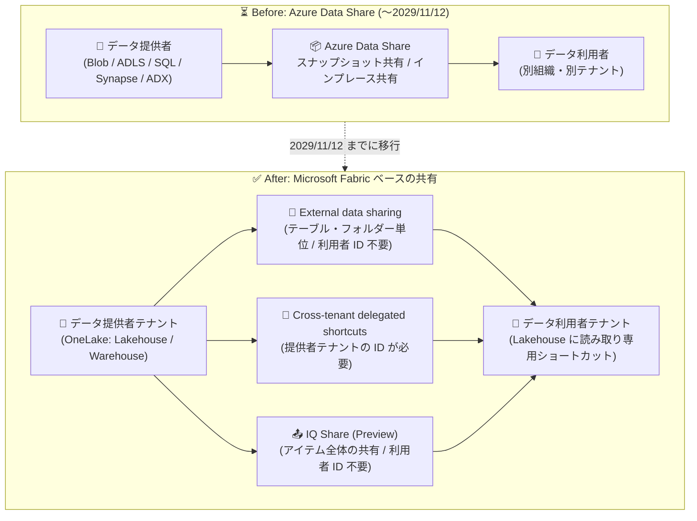

# Azure Data Share: 2029 年 11 月 12 日に廃止 (Retirement)

**リリース日**: 2026-11-13

**サービス**: Azure Data Share

**機能**: サービス廃止の発表 (廃止日: 2029 年 11 月 12 日)

**ステータス**: Retirement (廃止予定)

[このアップデートのインフォグラフィックを見る](https://takech9203.github.io/azure-news-summary/20261113-data-share-retirement.html)

## 概要

Azure Data Share が **2029 年 11 月 12 日に廃止** されることが発表されました。Azure Data Share は、組織間 (サードパーティを含む) で安全にデータを共有するためのマネージドサービスで、スナップショットベースの共有と Azure Data Explorer のインプレース共有を提供してきました。

本発表に伴い、**新規の Azure Data Share アカウントは作成できなくなり**、既存の機能は廃止日である 2029 年 11 月 12 日までメンテナンスモードで提供されます。廃止日までは既存の Azure サポートチャネルを引き続き利用できます。

移行先としては **Microsoft Fabric** が推奨されており、External data sharing (外部データ共有)、Cross-tenant delegated shortcuts (クロステナント委任ショートカット)、IQ Share (パブリックプレビュー) の 3 つの共有モデルが提供されています。ただし、これらは Azure Data Share の一対一の代替ではなく、**自動移行パスは用意されていない** ため、共有関係ごとに移行パスの評価・設計・検証が必要です。

**影響を受ける対象**

- リソース、データセット、招待、スナップショットスケジュール、利用条件を公開しているデータ提供者 (プロバイダー)
- 招待の受諾、共有サブスクリプションの維持、データセットマッピング、スナップショット実行を行っているデータ利用者 (コンシューマー)
- ARM / REST / SDK / Azure CLI / PowerShell / スケジュール処理で共有を自動化しているデータエンジニア・アプリケーション所有者
- アクセス許可、ID、プライベートエンドポイント、診断設定、コスト管理を担当するストレージ・データベース・分析・セキュリティ・ネットワーク管理者
- 地理的要件、主権、監査、保持、サポート要件を持つ規制対象・リージョナルクラウドの顧客

## アーキテクチャ図

Azure Data Share によるスナップショット/インプレース共有から、Microsoft Fabric の 3 つの共有モデル (External data sharing、Cross-tenant delegated shortcuts、IQ Share) への移行イメージ。Fabric はデータをコピーせず、OneLake ショートカットによるインプレースのライブ共有を実現します。

## サービスアップデートの詳細

### 廃止タイムライン

| 項目 | 内容 |
|------|------|
| 廃止発表 | 2026 年 11 月 13 日 |
| 新規アカウント作成 | 不可 (既に停止) |
| 既存機能 | 2029 年 11 月 12 日までメンテナンスモードで継続 |
| サポート | 2029 年 11 月 12 日まで既存の Azure サポートチャネルを利用可能 |
| 廃止日 | **2029 年 11 月 12 日** |

### シナリオ別の移行パス

公式の移行ガイダンスでは、Azure Data Share の利用シナリオごとに以下の移行先が示されています。

1. **フルスナップショット共有 (Blob Storage / ADLS Gen1 / ADLS Gen2)**
   - データを Fabric Lakehouse にインポートするか、ショートカットを作成した上で、External data sharing / Cross-tenant delegated shortcuts / IQ Share のいずれかを選択
   - 適合する Blob Storage パターンでは Azure Storage オブジェクトレプリケーションも評価対象
   - 読み取り専用の SQL アクセスで十分な場合は、Azure SQL Database のデータ仮想化 (外部テーブル / OPENROWSET) で CSV・Parquet ファイルを直接クエリ可能 (ADLS Gen1 は非対応)

2. **増分・スケジュールされたスナップショット共有 (Blob Storage / ADLS Gen1 / ADLS Gen2)**
   - Fabric によるストレージアカウントのインプレース・ライブ共有へ移行
   - Azure Data Share の時間単位/日単位のスナップショットスケジュールに対し、Fabric はライブなインプレース共有を提供 (動作モデルが異なる点に注意)

3. **Azure SQL Database / Azure Synapse Analytics のテーブル・ビューのスナップショット共有**
   - Azure Data Factory または Fabric Data Factory のパイプラインで、受信者側の SQL・ストレージ・分析基盤へコピー
   - Azure Data Share と同等の共有コントラクトは存在しないため、スキーマ作成、上書き動作、ビューの扱い、出力形式、資格情報、スケジュール、障害復旧を明示的に設計・テストする必要がある

4. **利用者側のデータセットマッピング (Blob / ADLS Gen2 / SQL Database / Synapse への CSV・Parquet 出力)**
   - SQL Server は Fabric Migration Assistant に従って Fabric へ移行後、External data sharing を利用

5. **Azure Data Explorer のインプレース共有 (データベース / クラスター / テーブル)**
   - 同一テナント: Azure Data Explorer ネイティブのフォロワーデータベース API
   - 同一/クロステナント: Fabric Eventhouse のデータベースショートカットで ADX クラスターをフォロー

6. **共有ライフサイクル管理 (招待、利用条件、サブスクリプション、取り消し、REST API、監視)**
   - Fabric External data sharing が、共有の確立・追跡・取り消しを必要な RBAC とともに提供

### Microsoft Fabric の 3 つの共有モデルの違い

| モデル | 共有単位 | 利用者側の ID 要件 | 適したシナリオ |
|--------|---------|------------------|--------------|
| External data sharing | Lakehouse / Warehouse 内のテーブル・フォルダーの選択的共有 | 提供者テナントのアカウント・ID 不要 | 外部パートナー・顧客への選択的なデータ共有 |
| Cross-tenant delegated shortcuts | 利用者が提供者テナントの組織アカウント / サービスプリンシパルで認証した接続でショートカットを作成 | 提供者テナントの ID が必要 | テスト/本番テナント間など、提供者テナントの ID を利用できる場合 |
| IQ Share (パブリックプレビュー) | Lakehouse / Warehouse / Mirrored アイテム全体 (受諾で Share Subscription と読み取り専用 Mirrored OneLake アイテムを作成) | 提供者テナントの ID 不要 | マネージドな共有エクスペリエンスでアイテム全体を配布 |

いずれもテナント間でコピーを作成せずにアクセスを提供しますが、**アクセスモデルが異なり、相互に置き換え可能な選択肢でも自動移行パスでもありません**。

### External data sharing の仕組み (補足)

- データは提供者テナントの OneLake からインプレースで共有され、**データのコピーは発生しない**。利用者テナントには元データを指す OneLake ショートカットが作成され、ソースの変更は即座に反映される
- 前提条件として、**両テナントの Fabric 管理者が External data sharing のテナント設定を有効化** する必要がある (作成・受諾できるユーザーの指定を含む)
- 共有の作成元: Lakehouse、Warehouse、KQL / SQL / Mirrored データベース内のテーブル・ファイル。受諾先: Lakehouse のみ
- 受諾後は Power BI レポート、Spark ノートブック、SQL 分析エンドポイントなど OneLake 互換のワークロードから読み取り専用でアクセス可能
- 提供者側は Read + Reshare 権限を持つユーザーがいつでも共有を取り消し可能
- クロステナントアクセスは Fabric 専用の認証メカニズムで実現され、Entra B2B ゲストアクセスは不要

## 推奨される移行アクション

公式アナウンスおよび移行ガイダンスで示されている推奨手順は以下のとおりです。

1. **ワークロードごとの移行パスを評価する**
   - OneLake 対応データには Fabric External data sharing
   - コピーが必要な場合は Azure Data Factory / Fabric Data Factory パイプライン
   - 読み取り専用のファイルクエリには Azure SQL Database データ仮想化 (プレビュー)。ただしスナップショット配信や共有ライフサイクル管理の代替にはならない
2. **棚卸し (インベントリ)**: すべてのアカウント、共有、データセット、招待、サブスクリプション、マッピング、スケジュール、スナップショット実行、API 連携、ID、プライベートエンドポイント、診断設定、所有者、下流の利用者を記録する
3. **重要度と要件の評価**: 配信モデル、ソース/宛先、テナント、地理、頻度、ボリューム、ビジネス重要度、コンプライアンス要件で分類する
4. **提供者と利用者のカットオーバー調整**: ID、ネットワーク、スキーマ、完全性、鮮度、取り消し、監視、コスト、復旧を検証する
5. **証跡とデータの保全**: 構成、監査情報、実行履歴、照合証跡を保持し、必要に応じて最終スナップショットや顧客管理のコピーを完了する
6. **本番ワークロードの保護**: **代替環境のテストが完了するまで、本番の Azure Data Share リソースを削除・無効化しない**

## デメリット・制約事項

- Fabric の各共有モデルや Data Factory パイプラインは Azure Data Share の **一対一の代替ではない**。データ配信、ID、アクセス許可、ライフサイクル管理、運用の違いを事前に評価する必要がある
- **共有・サブスクリプション・データの自動移行は提供されない**。共有関係ごとに手動で移行パスを選択・構成・テストする必要がある
- External data sharing を使うには、ストレージアカウントや SQL Server の資産を **事前に Fabric (OneLake) に取り込む必要がある**
- Fabric External data sharing では、提供者はデータが利用者テナント内で誰にアクセスされるかを制御できない。提供者テナントのガバナンス制御 (Purview の秘密度ラベル、DLP など) は利用者テナントには引き継がれない
- 利用者テナントでのアクセス時に、データが地理的境界を越えて転送される可能性がある
- Azure SQL Database データ仮想化は読み取り専用のインプレースクエリであり、増分コピーのオーケストレーション、スナップショットスケジュール、ポイントインタイムコピーの保持は提供されない。ADLS Gen1 はソースとして非対応
- フォルダー内に含まれるショートカットは、External data sharing では利用者テナント側で解決されない
- Azure Data Share を通じて既にコピー済みのデータは廃止によって削除されないが、宛先の所有者がアクセス・保持・削除の責任を負う

## 関連サービス・機能

- **Microsoft Fabric / OneLake**: 推奨移行先。External data sharing、Cross-tenant delegated shortcuts、IQ Share によるコピーレスのクロステナント共有を提供
- **Azure Data Factory / Fabric Data Factory**: SQL Database / Synapse のテーブル・ビューのスナップショット共有の代替として、コピー・同期パイプラインを構築
- **Azure Storage オブジェクトレプリケーション**: 適合する Blob Storage のコピーパターンの代替候補
- **Azure SQL Database データ仮想化 (プレビュー)**: Blob Storage / ADLS Gen2 上の CSV・Parquet ファイルへの読み取り専用 SQL アクセスの選択肢
- **Azure Data Explorer / Fabric Eventhouse**: ADX インプレース共有の移行先 (フォロワーデータベース API / データベースショートカット)
- **AzCopy**: 顧客管理のコピーオプションを評価する際の補助ツール

## 参考リンク

- [インフォグラフィック](https://takech9203.github.io/azure-news-summary/20261113-data-share-retirement.html)
- [公式アップデート情報](https://azure.microsoft.com/updates?id=578818)
- [Azure Data Share retirement (移行ガイダンス)](https://learn.microsoft.com/en-us/azure/data-share/retirement)
- [Azure Data Share ドキュメント](https://learn.microsoft.com/en-us/azure/data-share/)
- [Fabric External data sharing の概要](https://learn.microsoft.com/en-us/fabric/governance/external-data-sharing-overview)
- [Cross-tenant OneLake shortcuts の作成](https://learn.microsoft.com/en-us/fabric/onelake/shortcuts/create-cross-tenant-onelake-shortcut)

## まとめ

Azure Data Share は 2029 年 11 月 12 日に廃止されます。新規アカウント作成は既に停止しており、既存機能は廃止日までメンテナンスモードで提供されます。猶予期間は約 3 年ありますが、移行先となる Microsoft Fabric の各共有モデル (External data sharing / Cross-tenant delegated shortcuts / IQ Share) は Azure Data Share の一対一の代替ではなく、自動移行も提供されません。共有関係にはデータ提供者と利用者の双方が関わるため、組織間での調整に時間を要します。まずは共有・サブスクリプション・スケジュール・依存関係の棚卸しから着手し、シナリオごとに移行パスを評価・検証することを推奨します。テストが完了するまで本番の Azure Data Share リソースを削除・無効化しないよう注意してください。

---

**タグ**: Azure Data Share, Microsoft Fabric, OneLake, External Data Sharing, Retirement, Analytics, Storage
