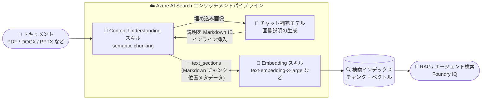

# Azure AI Search: Azure Content Understanding によるセマンティックチャンキングと AI 生成画像説明が一般提供 (GA)

**リリース日**: 2026-11-17

**サービス**: Azure AI Search (Foundry IQ)

**機能**: Azure Content Understanding スキルによるセマンティックチャンキングと AI 生成画像説明

**ステータス**: Launched (GA)

[このアップデートのインフォグラフィックを見る](https://takech9203.github.io/azure-news-summary/20261117-ai-search-content-understanding.html)

## 概要

Azure AI Search (Foundry IQ) の Azure Content Understanding スキルにおいて、セマンティックチャンキングと AI 生成画像説明が一般提供 (GA) になりました。2026 年 6 月のプレビュー開始を経て、Microsoft Ignite に合わせて GA に到達しています。ベーススキルは Search REST API `2026-04-01` で GA 済みで、今回 GA となった 2 機能は `2026-05-01-preview` で導入され、Search REST API `2026-10-01` で一般提供されます。

このスキルは、Azure Content Understanding (Foundry Tools) のドキュメントアナライザーを使用してドキュメントからテキスト・画像・位置メタデータを抽出し、マルチモーダル検索、エージェント検索 (agentic retrieval)、RAG 向けにコンテンツをチャンク化します。エンリッチメントパイプライン内で、構造化された Markdown 形式のチャンク、位置メタデータ、検索可能な画像説明を生成します。Foundry IQ および Azure AI Search での利用を想定した機能です。

**アップデート前の課題**

- 固定文字数ベースのチャンキング (Text Split スキルなど) では、段落や見出しの途中で分割され、意味的に一貫しないチャンクが生成されることがあった
- ドキュメントに埋め込まれた図・グラフ・ダイアグラムはテキスト抽出では内容が失われ、検索や RAG の回答に活用できなかった
- セマンティックチャンキングと画像説明はプレビュー機能であり、本番ワークロードでの採用が難しかった

**アップデート後の改善**

- `semantic` チャンキングにより、レイアウト・段落・見出しの境界に沿ったトークン長ベースの意味的に一貫したチャンクが生成される (チャンキング用に Text Split スキルを追加する必要がない)
- `modelName` / `modelDeployment` を指定することで、埋め込み画像 (図・グラフ・ダイアグラム) の説明を LLM で生成し、ベクトル化前にチャンクの Markdown にインライン挿入できる
- GA 版 API (`2026-10-01`) により本番環境で安心して利用可能になった

## アーキテクチャ図



ドキュメントは Content Understanding スキルでセマンティックチャンクに分割され、埋め込み画像の説明が LLM で生成されてチャンクに挿入された後、ベクトル化されて検索インデックスに格納されます。

## サービスアップデートの詳細

### 主要機能

1. **セマンティックチャンキング (`chunkingProperties.method: semantic`)**
   - レイアウト・段落・見出しの境界に従い、トークン長単位 (100〜8,000 トークン、既定 500) で意味的に一貫したチャンクを生成
   - ページをまたぐチャンクやページ間テーブル (cross-page table) を認識し、Markdown のテーブル・図として出力
   - 従来の `fixedSize` (文字数ベース、300〜50,000 文字) も引き続き選択可能
   - 「セマンティックチャンキング」は検索時のセマンティックランキングとは別の機能

2. **AI 生成画像説明 (image verbalization)**
   - スキルセットにアタッチした Foundry リソース内のチャット補完モデル (`modelName` + `modelDeployment` のペア) を指定すると、埋め込み図・グラフ・ダイアグラムの説明を生成
   - 生成された説明はベクトル化の前にチャンクの Markdown コンテンツへインライン挿入され、ベクトル検索・RAG で画像内容を検索可能にする
   - 両プロパティを省略すれば画像説明は無効化でき、チャンキングや画像抽出のみ継続可能
   - 対応モデルは Content Understanding の `prebuilt-document` アナライザーが決定 (Content Understanding の Supported generative models を参照)

3. **画像・位置メタデータの抽出 (`extractionOptions`)**
   - `images` を指定すると `normalized_images` (id、base64 データ、imagePath) を出力
   - `locationMetadata` を指定すると `pageNumberFrom` / `pageNumberTo` / `ordinalPosition` / `source` を付与し、引用 (citation) やページ参照に活用できる
   - 画像抽出と画像説明は独立した設定 (抽出だけでは説明は生成されない)

## 技術仕様

| 項目 | 詳細 |
|------|------|
| @odata.type | `#Microsoft.Skills.Util.ContentUnderstandingSkill` |
| GA 対象 API | Search REST API `2026-10-01` (ベーススキルは `2026-04-01` で GA) |
| 呼び出し先 API | Content Understanding REST API `2025-11-01` |
| チャンキング方式 | `fixedSize` (既定、characters 単位) / `semantic` (tokens 単位) |
| チャンク最大長 | 300〜50,000 文字 または 100〜8,000 トークン (既定: 500) |
| オーバーラップ | `fixedSize` のみ (`maximumLength` の半分未満、既定 0)。`semantic` では 0 または省略 |
| スキル入力 | `file_data` (base64 データまたはダウンロード可能 URL。インデクサーで `allowSkillsetToReadFileData: true` が必要) |
| スキル出力 | `text_sections` (Markdown チャンク + 位置メタデータ)、`normalized_images` |
| 対応ファイル形式 | PDF, JPEG/JPG, PNG, BMP, HEIF, TIFF, DOCX, XLSX, PPTX, HTML, TXT, MD, RTF, EML |
| 分析ポーリング上限 | ドキュメント分析のポーリングウィンドウは最大 8 分 (超過時はスキルタイムアウトエラー) |

## 設定方法

### 前提条件

1. Foundry IQ (Azure AI Search) サービスと、スキルセットにアタッチする Microsoft Foundry リソース (Content Understanding 対応リージョンに配置)
2. Search マネージド ID への Foundry リソースに対するアクセス許可の構成
3. 画像説明を使う場合: Foundry リソースに Content Understanding 対応のチャット補完モデルをデプロイ
4. Blob / SharePoint インデクサーでは `parameters.configuration.allowSkillsetToReadFileData` を `true` に設定
5. パスワード保護された PDF は事前に保護を解除

### REST API (スキルセット定義例)

```http
PUT {endpoint}/skillsets/cu-semantic?api-version=2026-10-01
Authorization: Bearer <access-token>
Content-Type: application/json

{
  "name": "cu-semantic",
  "skills": [
    {
      "@odata.type": "#Microsoft.Skills.Util.ContentUnderstandingSkill",
      "context": "/document",
      "modelName": "<MODEL_NAME>",
      "modelDeployment": "<chat-deployment>",
      "extractionOptions": ["images", "locationMetadata"],
      "chunkingProperties": {
        "method": "semantic",
        "unit": "tokens",
        "maximumLength": 500
      },
      "inputs": [{"name": "file_data", "source": "/document/file_data"}],
      "outputs": [
        {"name": "text_sections", "targetName": "text_sections"},
        {"name": "normalized_images", "targetName": "normalized_images"}
      ]
    }
  ],
  "cognitiveServices": {
    "@odata.type": "#Microsoft.Azure.Search.AIServicesByIdentity",
    "subdomainUrl": "https://<foundry-resource>.services.ai.azure.com",
    "identity": null
  }
}
```

ベクトル検索を行う場合は、同じスキルセットに Azure OpenAI Embedding スキル (context: `/document/text_sections/*`) を追加し、チャンクの `content` (画像説明を含む) をベクトル化してインデックスプロジェクションでベクトルフィールドに投影します。

## メリット

### ビジネス面

- RAG・エージェント検索の回答品質向上: 意味的に一貫したチャンクと画像内容の説明により、図表を多用する社内文書 (マニュアル、レポート、プレゼン資料) も検索・回答の対象にできる
- GA により本番ワークロードで採用可能になり、プレビュー機能に依存しない構成を組める

### 技術面

- Text Split スキルが不要になり、抽出とチャンキングを 1 スキルで完結できる
- Document Layout スキルと比較して、Markdown のテーブル・図の出力、ページ間テーブルの認識、ページをまたぐチャンクに対応
- 位置メタデータ (`locationMetadata`) により、引用・ページ参照付きの RAG 回答を実装しやすい
- チャンキング・画像抽出・画像説明・埋め込みが独立して構成でき、要件に応じてコストと品質を調整可能

## デメリット・制約事項

- ドキュメント分析のポーリングウィンドウは最大 8 分で、超過するとスキルタイムアウトエラーとなりそのドキュメントの分析出力が得られない (顧客側でのオーバーライド不可)。大規模・複雑なドキュメントは代表ファイルで事前検証が必要
- DOCX と PDF で画像の出力結果が異なる場合があるなど、Content Understanding のドキュメントタイプごとのサービス動作が出力に影響する (一貫した画像処理が必要なら PDF への変換を検討)
- Foundry リソースは Content Understanding 対応リージョンに配置する必要があり、Search とのリージョンが離れるとインデクサー性能に影響する
- 他の組み込みスキルで利用できる無料ドキュメント枠は適用されない
- インデクサーの再実行・リセットは分析を再実行し追加課金が発生しうる (以前の分析結果は再利用されない)
- SharePoint ACL (ドキュメント権限) を取り込むパイプラインでは、画像ストレージ手順に制限がある

## 料金

スキルセットにアタッチした Microsoft Foundry リソースを通じて処理・課金されます。

| 課金要素 | 内容 |
|------|------|
| Content Understanding | レイアウト解析・抽出のアナライザー呼び出し (Foundry IQ とは別課金) |
| 画像説明 (image verbalization) | 構成した LLM デプロイメントのモデル使用料が追加で発生 |
| Foundry IQ (Azure AI Search) | 検索サービス自体の料金 |
| 埋め込み | Embedding スキルを構成した場合のモデル使用料 |

画像説明を無効化 (`modelName` / `modelDeployment` を両方省略) しても、Content Understanding の抽出・チャンキング、Search、埋め込み、取得の課金は発生します。詳細は [Content Understanding 料金ページ](https://azure.microsoft.com/pricing/details/content-understanding/)、[Azure AI Search 料金ページ](https://azure.microsoft.com/pricing/details/search/) を参照してください。

## 利用可能リージョン

スキルがアタッチする Foundry リソースは [Content Understanding 対応リージョン](https://learn.microsoft.com/azure/ai-services/content-understanding/language-region-support) に配置する必要があります。Foundry IQ (Azure AI Search) サービス自体は [対応する任意のリージョン](https://learn.microsoft.com/azure/search/search-region-support) に配置できますが、リージョン間のネットワーク遅延はインデクサー性能に影響します。

## 関連サービス・機能

- **Microsoft Foundry / Foundry IQ**: 本スキルの主要な利用先。ナレッジソース・ナレッジベース API によるマネージドな取得 (agentic retrieval) で活用
- **Azure Content Understanding (Foundry Tools)**: ドキュメントアナライザーの提供元。スキルは Content Understanding `2025-11-01` API を呼び出す
- **Azure OpenAI Embedding スキル**: チャンク (画像説明を含む) のベクトル化に組み合わせて使用
- **Document Layout スキル**: 類似の抽出スキル。Content Understanding スキルはこれと比べて Markdown テーブル・図の出力やページ間テーブル認識に対応
- **SharePoint インデクサー**: SharePoint ドキュメントの抽出・エンリッチにも対応 (ナレッジソース API またはインデクサー + スキルセット構成を選択可能)

## 参考リンク

- [インフォグラフィック](https://takech9203.github.io/azure-news-summary/20261117-ai-search-content-understanding.html)
- [公式アップデート情報](https://azure.microsoft.com/updates?id=563661)
- [Microsoft Learn: Azure Content Understanding skill](https://learn.microsoft.com/azure/search/cognitive-search-skill-content-understanding)
- [Microsoft Learn: Chunk and vectorize with Content Understanding](https://learn.microsoft.com/azure/search/search-how-to-semantic-chunking-content-understanding)
- [Microsoft Learn: Content Understanding の概要](https://learn.microsoft.com/azure/ai-services/content-understanding/overview)
- [Content Understanding 料金ページ](https://azure.microsoft.com/pricing/details/content-understanding/)
- [Azure AI Search 料金ページ](https://azure.microsoft.com/pricing/details/search/)

## まとめ

Azure AI Search の Content Understanding スキルで、セマンティックチャンキングと AI 生成画像説明が GA になりました。固定長分割では失われがちだった文書構造 (見出し・段落・ページ間テーブル) を保ったチャンク生成と、図表のテキスト化により、マルチモーダルな RAG・エージェント検索の品質を大きく底上げする機能です。RAG パイプラインを構築・運用している Solutions Architect は、Search REST API `2026-10-01` への移行とあわせて、既存の Text Split / Document Layout スキル構成からの置き換えを評価することを推奨します。その際は、8 分の分析ポーリングウィンドウ、Foundry リソースのリージョン配置、画像説明による追加の LLM 課金を考慮した事前検証が重要です。

---

**タグ**: Azure AI Search, Foundry IQ, Content Understanding, Microsoft Foundry, セマンティックチャンキング, RAG, マルチモーダル検索, GA, Microsoft Ignite
