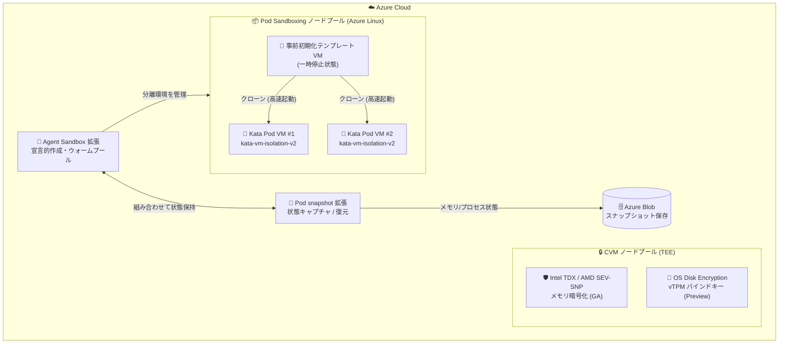

# Azure Kubernetes Service (AKS): Confidential VM / Pod Sandboxing 関連アップデート群 (Ignite 2026)

**リリース日**: 2026-11-17

**サービス**: Azure Kubernetes Service (AKS)

**機能**: Pod Sandboxing kata-vm-isolation-v2 / Confidential VMs Intel TDX / CVM OS Disk Encryption / Agent Sandbox 拡張 / Pod snapshot 拡張

**ステータス**: Launched (GA) 1 件 / In preview 4 件

[このアップデートのインフォグラフィックを見る](https://takech9203.github.io/azure-news-summary/20261117-aks-confidential-sandbox-updates.html)

## 概要

Microsoft Ignite 2026 に合わせて、AKS のワークロード分離 (Isolation) と機密コンピューティング (Confidential Computing) に関する 5 つのアップデートが同日に発表された。いずれも「ホストや他のワークロードから隔離された安全な実行環境を、性能・運用コストを犠牲にせずに提供する」という共通テーマを持つ。

1. **Pod Sandboxing `kata-vm-isolation-v2` ランタイムクラス (Public Preview)**: 事前初期化済みのテンプレート VM から Kata サンドボックス Pod を生成し、コールドスタート遅延とメモリオーバーヘッドを削減する新ランタイムクラス。
2. **Confidential VMs の Intel TDX サポート (GA)**: AKS の CVM ノードプールが AMD SEV-SNP に加えて Intel TDX (Trust Domain Extensions) に対応。VM SKU から適切な CVM イメージが自動選択される。
3. **Confidential VMs の OS Disk Encryption (Public Preview)**: Ubuntu 26.04 の CVM ノードプールで OS ディスク暗号化がデフォルトで有効化され、メモリ (使用中) とディスク (保存時) の両方を保護。
4. **Agent Sandbox cluster extension (Public Preview)**: AI エージェントが生成した信頼できないコードをセッションごとに分離実行するためのサンドボックス作成・ライフサイクル管理・ウォームプールをマネージド拡張機能として提供。
5. **Pod snapshot cluster extension (Public Preview)**: 対応する Pod のメモリ・プロセス状態を Azure Blob にキャプチャし、オンデマンドで復元。初期化処理の再実行を回避する。

Agent Sandbox と Pod snapshot は組み合わせて利用でき、分離されたエージェント環境の状態をスナップショット・復元することで、サンドボックスのライフサイクル全体でランタイム状態を維持できる。

**アップデート前の課題**

- 従来の Pod Sandboxing (`kata-vm-isolation`) では Pod ごとに新しい Kata VM をコールドブートするため、起動遅延と Pod あたりの追加メモリオーバーヘッドが発生していた
- AKS の CVM ノードイメージは AMD SEV-SNP のみ対応で、Intel TDX を attestation / ハードウェア機密性の標準として採用している顧客は該当ワークロードを AKS で実行できなかった
- CVM ノードプールはメモリ内の保護はできても OS ディスクは保存時に暗号化されず、規制対象の顧客はデータ保存時のギャップをプラットフォーム外で補う必要があった
- AI エージェントのコード実行環境を Kubernetes 上に構築するチームは、サンドボックスのライフサイクル・ストレージ・ウォームアップロジックを自前で組み立てる必要があり、運用負荷と初期化待ち時間が課題だった
- サンドボックス化ワークロードの再起動のたびにメモリ内状態が失われ、モデルの再読み込み・JVM ウォームアップ・キャッシュ再構築など完了済みの処理を再実行する必要があった

**アップデート後の改善**

- `kata-vm-isolation-v2` は一時停止状態の事前初期化済みテンプレート VM からクローンして Pod を生成し、Kata の Rust ランタイム採用と合わせて、Pod レベルの VM 分離を維持したまま高速起動と低いランタイムコストを実現
- Intel TDX 対応の VM SKU を選択するだけで CVM イメージが自動選択され、既存の attestation モデルや AKS の構成・API を変更せずに機密ワークロードを AKS へ移行可能 (Azure Container Linux で GA、Ubuntu 26.04 はプレビュー)
- Ubuntu 26.04 CVM ノードプールでは Intel TDX / AMD SEV-SNP 両 SKU で OS ディスク暗号化がデフォルト有効となり、CVM の vTPM にバインドされたキーで初回ブート前からディスクを保護。新しい設定や API は不要
- Agent Sandbox 拡張機能 (オープンソースの Kubernetes Agent Sandbox プロジェクト基盤) により、宣言的なサンドボックス作成・ライフサイクル管理・事前ウォームアップ済みプールがマネージドで利用可能
- Pod snapshot 拡張機能により、メモリとプロセスの状態を Azure Blob に保存し、コールドスタートの代わりにキャプチャ済み状態から再開可能

## アーキテクチャ図



CVM ノードプールはノード単位 (メモリ + OS ディスク) の機密性境界を提供し、Pod Sandboxing は Pod 単位の VM 分離境界を提供する。Agent Sandbox / Pod snapshot 拡張は、この分離環境の上に AI エージェント向けのライフサイクル管理と状態保持を追加する。

## サービスアップデートの詳細

### 主要機能

1. **`kata-vm-isolation-v2` ランタイムクラス (Preview)**
   - クラスターのランタイムクラスとして GA 版の `kata-vm-isolation` と並んで提供され、ワークロードのマニフェストの `runtimeClassName` で v1/v2 を選択する (ノードプールの `--workload-runtime KataVmIsolation` は共通)
   - 各ノードで DaemonSet (`kata-ctl factory init`) によりテンプレート VM を初期化し、以降の Pod はテンプレートからクローン生成される
   - 現行プレビューではテンプレート初期化後の各 v2 Pod は Pod の limits にかかわらず 2 GiB メモリ / 2 vCPU のゲスト VM となる

2. **Confidential VMs の Intel TDX サポート (GA)**
   - CVM ノードプールで Intel TDX が AMD SEV-SNP と並んでサポートされ、VM SKU から適切な CVM イメージが自動選択される
   - Azure Container Linux で GA。Ubuntu 26.04 でもプレビューとしてサポート
   - Intel TDX VM サイズの利用には Ubuntu 26.04 CVM ノードプール (または Azure Container Linux) が必要

3. **CVM OS Disk Encryption (Preview)**
   - Ubuntu 26.04 CVM ノードプールで OS ディスク暗号化がデフォルト有効 (無効化は不可)
   - ディスク暗号化キーは VM の vTPM にバインドされ、保護されたディスク内容はその VM からのみアクセス可能。初回ブート前にクラウド側で暗号化される

4. **Agent Sandbox cluster extension (Preview)**
   - オープンソースの Kubernetes Agent Sandbox プロジェクトを基盤とするマネージド拡張機能
   - 宣言的なサンドボックス作成、ライフサイクル管理、事前ウォームアップ済みプールを提供し、モデル生成コードのセッション単位の分離実行を容易にする

5. **Pod snapshot cluster extension (Preview)**
   - 対応する Pod のメモリ・プロセス状態を Azure Blob にキャプチャし、オンデマンドで復元
   - Agent Sandbox 拡張と組み合わせることで、分離されたエージェント環境のキャプチャと復元が可能

## 技術仕様

| 項目 | 詳細 |
|------|------|
| `kata-vm-isolation-v2` 前提条件 | Azure CLI 2.80.0 以降、`KataVMIsolationV2Preview` フィーチャーフラグ登録、Kubernetes 1.34.0 以降、Azure Linux ノードイメージ `202610.30.1` 以降 |
| v2 対応 VM SKU ファミリー | Dasv6, Dadsv6, Dalsv6, Daldsv6, Easv6, Eadsv6, Falsv6, Fasv6, Famsv6 (v6/v7 SKU) |
| Pod Sandboxing 対応 OS | Azure Linux のみ (Ubuntu / Windows / Azure Container Linux は非対応) |
| v2 Pod のゲスト VM サイズ | テンプレート初期化後は 2 GiB メモリ / 2 vCPU 固定 (現行プレビュー) |
| CVM 対応 TEE | AMD SEV-SNP、Intel TDX |
| CVM 対応 OS SKU | Ubuntu (20.04/24.04)、Ubuntu 26.04 (プレビュー)、Azure Linux 3.0、Azure Container Linux (Kubernetes 1.34+) |
| Intel TDX / OS Disk Encryption 要件 | Ubuntu 26.04 CVM ノードプール (Kubernetes 1.36 以降、`Ubuntu2604Preview` フィーチャー登録、プレビュー CLI 21.0.0b14 以降) |
| Pod snapshot の保存先 | Azure Blob |

## 設定方法

### 前提条件

1. 既存の AKS クラスターと、対象リージョンでの CVM / 対応 VM サイズのクォータ
2. プレビュー機能ごとのフィーチャーフラグ登録 (`KataVMIsolationV2Preview`、Ubuntu 26.04 は `Ubuntu2604Preview`)
3. `kubectl` と Azure CLI (2.80.0 以降、Ubuntu 26.04 プレビューは 21.0.0b14 以降)

### Azure CLI

```bash
# kata-vm-isolation-v2 のフィーチャーフラグ登録
az feature register \
  --namespace "Microsoft.ContainerService" \
  --name "KataVMIsolationV2Preview"
az provider register --namespace "Microsoft.ContainerService"

# Pod Sandboxing 対応ノードプールの追加 (v1/v2 共通で KataVmIsolation を指定)
az aks nodepool add \
  --cluster-name myAKSCluster \
  --resource-group myResourceGroup \
  --name nodepool2 \
  --os-sku AzureLinux \
  --workload-runtime KataVmIsolation \
  --node-vm-size Standard_D4ads_v6 \
  --node-count 1

# CVM ノードプールの追加 (CVM 対応 VM サイズを指定するだけで有効化)
az aks nodepool add \
  --resource-group myResourceGroup \
  --cluster-name myAKSCluster \
  --name cvmnodepool \
  --node-count 3 \
  --node-vm-size Standard_DC4as_v5
```

v2 ランタイムの選択はワークロードのマニフェストで行う。

```yaml
apiVersion: v1
kind: Pod
metadata:
  name: isolated-pod-v2
spec:
  runtimeClassName: kata-vm-isolation-v2
  containers:
  - name: kata
    image: mcr.microsoft.com/aks/fundamental/base-ubuntu:v0.0.11
```

テンプレート VM の初期化は、各ノードで `kata-ctl factory init` を実行する DaemonSet で行う (公式ドキュメントにマニフェスト例あり)。init コンテナーはノード上で root として実行されるため、デプロイ前にセキュリティチームによるレビューが推奨されている。

## メリット

### ビジネス面

- 規制産業 (政府契約・コンプライアンス要件) の機密ワークロードを、コード変更なしで AKS に移行できる選択肢が拡大 (Intel TDX 対応により Intel 標準の顧客もカバー)
- メモリ (使用中) + OS ディスク (保存時) のエンドツーエンドの機密性により、データ保存時の保護をプラットフォーム外で補う運用コストを削減
- AI エージェントのサンドボックス基盤を自前構築せずに済み、エージェント系サービスの市場投入を加速

### 技術面

- Pod レベルの VM 分離を維持したまま、サンドボックス Pod の起動高速化とメモリオーバーヘッド削減を両立
- Intel TDX は VM SKU からイメージが自動選択され、新しい構成や API サーフェスの学習が不要
- Pod snapshot により JVM ウォームアップやモデルロードなどの初期化を繰り返さず、キャプチャ済み状態から再開可能

## デメリット・制約事項

- `kata-vm-isolation-v2`、CVM OS Disk Encryption、Agent Sandbox、Pod snapshot はいずれもプレビューであり、SLA 対象外。本番利用は非推奨
- Pod Sandboxing は Azure Linux のみ対応。FIPS、Trusted Launch、Arm64 は併用不可。Microsoft Defender for Containers は Kata ランタイム Pod の評価に非対応。Kata のホストネットワークアクセスも非対応
- v2 は現行プレビューではテンプレート初期化後の Pod が 2 GiB / 2 vCPU 固定となるため、Pod の requests/limits との整合とスケジューリング挙動の検証が必要。`emptyDir` は `medium: Memory` と `sizeLimit` の明示が必要
- v1 から v2 への移行はワークロードマニフェストの明示的な変更であり、既存 Pod の `runtimeClassName` は変更不可 (Pod の再作成が必要)。挙動が v1 と同一とは限らない
- CVM ノードプールは FIPS、ARM64、Trusted Launch (Azure Container Linux を除く)、Pod sandboxing、Confidential containers、ノード自動プロビジョニング (NAP) と併用不可。Windows ノードプールは非対応
- Ubuntu 26.04 CVM ノードプールでは OS ディスク暗号化を無効化できない
- v2 のリージョン展開は段階的であり、利用可否は AKS release tracker で確認が必要

## ユースケース

### ユースケース 1: AI エージェントのコード実行サンドボックス

**シナリオ**: LLM が生成した信頼できないコードをセッションごとに分離環境で実行する AI エージェントサービス。セッション開始の待ち時間を最小化し、中断後も実行コンテキストを維持したい。

**実装例**: Agent Sandbox 拡張でウォームプール付きのサンドボックスを宣言的に作成し、`kata-vm-isolation-v2` により VM 分離を確保。Pod snapshot 拡張でモデルロード済みの状態を Azure Blob にキャプチャし、再開時に復元する。

**効果**: サンドボックス基盤の自前構築が不要になり、コールドスタートと初期化の再実行を回避してユーザーの待ち時間を削減。

### ユースケース 2: 規制対象ワークロードの AKS 移行

**シナリオ**: 金融・政府系で Intel TDX ベースの attestation を標準とする組織が、機密データを扱うコンテナーワークロードを AKS に移行する。

**実装例**: Intel TDX 対応 VM サイズで CVM ノードプールを作成 (Ubuntu 26.04 プレビューまたは Azure Container Linux)。Ubuntu 26.04 では OS ディスク暗号化がデフォルトで有効になる。

**効果**: コード変更なしでメモリ暗号化 + OS ディスク暗号化を獲得し、使用中データと保存時データの両方の保護要件を AKS プラットフォーム内で満たせる。

## 料金

今回の発表に個別の追加料金の記載はない。Pod Sandboxing / CVM はノードプールの VM サイズ (例: DCas_v5 / ECas_v5、TDX 対応 SKU、v2 対応の v6 SKU ファミリー) に基づく通常の AKS / VM 課金となる。Pod snapshot は Azure Blob への保存を利用するためストレージ料金が発生し得る。詳細は料金ページを参照。

- [AKS 料金ページ](https://azure.microsoft.com/pricing/details/kubernetes-service/)
- [Linux Virtual Machines 料金ページ](https://azure.microsoft.com/pricing/details/virtual-machines/linux/)

## 利用可能リージョン

公式発表にリージョン一覧の記載はない。`kata-vm-isolation-v2` のリージョン展開状況は [AKS release tracker](https://releases.aks.azure.com/AKSRelease) で、CVM 対応 VM サイズの提供リージョンは各 VM サイズのドキュメントで確認すること。

## 関連サービス・機能

- **Azure Confidential Computing (Confidential VMs)**: AKS CVM ノードプールの基盤となる AMD SEV-SNP / Intel TDX ベースの TEE を提供
- **Azure Linux container host for AKS**: Pod Sandboxing が唯一サポートするノード OS
- **Azure Blob Storage**: Pod snapshot 拡張がメモリ・プロセス状態の保存先として利用
- **Kata Containers (OSS)**: Pod Sandboxing のランタイム基盤。v2 では Rust ランタイムを採用
- **Kubernetes Agent Sandbox (OSS)**: Agent Sandbox cluster extension の基盤プロジェクト

## 参考リンク

- [インフォグラフィック](https://takech9203.github.io/azure-news-summary/20261117-aks-confidential-sandbox-updates.html)
- [公式アップデート情報: Pod Sandboxing kata-vm-isolation-v2 runtime class (Preview)](https://azure.microsoft.com/updates?id=581120)
- [公式アップデート情報: Confidential VMs with Intel TDX support on AKS (GA)](https://azure.microsoft.com/updates?id=581130)
- [公式アップデート情報: Confidential VMs with OS Disk Encryption support on AKS (Preview)](https://azure.microsoft.com/updates?id=581125)
- [公式アップデート情報: Agent Sandbox cluster extension (Preview)](https://azure.microsoft.com/updates?id=580916)
- [公式アップデート情報: Pod snapshot cluster extension (Preview)](https://azure.microsoft.com/updates?id=580921)
- [Microsoft Learn: Pod sandboxing with AKS](https://learn.microsoft.com/azure/aks/use-pod-sandboxing)
- [Microsoft Learn: Use Confidential VMs in AKS](https://learn.microsoft.com/azure/aks/use-cvm)
- [AKS release tracker](https://releases.aks.azure.com/AKSRelease)
- [AKS 料金ページ](https://azure.microsoft.com/pricing/details/kubernetes-service/)

## まとめ

Ignite 2026 の AKS 発表は、「分離」と「機密性」を性能・運用コストと両立させる方向への大きな前進である。Intel TDX サポートの GA は Intel 標準の規制産業顧客にとって即時に検証を始められるアップデートであり、CVM 利用中または検討中の組織はまず TDX 対応 SKU と Ubuntu 26.04 / Azure Container Linux の要件を確認したい。`kata-vm-isolation-v2` と Agent Sandbox / Pod snapshot 拡張はいずれもプレビューだが、AI エージェントのコード実行基盤を Kubernetes 上に構築しているチームには、自前実装を置き換えられる可能性のある重要な組み合わせであり、非本番環境での早期評価を推奨する。

---

**タグ**: AKS, Confidential Computing, Intel TDX, AMD SEV-SNP, Pod Sandboxing, Kata Containers, AI Agents, Microsoft Ignite, Preview, GA
