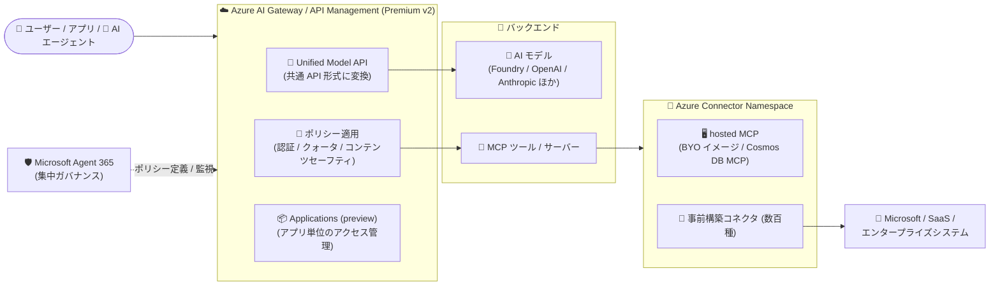

# Azure API Management / Azure AI Gateway: Ignite 2026 アップデート群 (AI Gateway GA、Premium v2 GA、Connector Namespace GA ほか)

**リリース日**: 2026-11-17

**サービス**: Azure API Management / Azure AI Gateway / Azure Connector Namespace

**機能**: AI Gateway GA、Agent 365 統合 GA、Premium v2 GA、Connector Namespace GA、Unified Model API GA、APIM Application (プレビュー)、hosted MCP の BYO イメージ / Cosmos DB MCP サーバー (プレビュー)

**ステータス**: Launched (GA) 5 件 / In preview 2 件

[このアップデートのインフォグラフィックを見る](https://takech9203.github.io/azure-news-summary/20261117-api-management-ai-gateway-updates.html)

## 概要

Microsoft Ignite 2026 に合わせて、Azure API Management と周辺の統合サービスに関する大型アップデートが一斉に発表された。中核となるのは **Azure AI Gateway の一般提供 (GA)** で、従来 API Management の「AI Gateway ティア」として提供されていた機能が、ユーザー・アプリケーション・エージェントを複数プロバイダーの AI モデルや MCP ツールに接続するフルマネージドな Azure サービスとして独立した。プラットフォームチームはゲートウェイインフラを管理することなく、認証・認可の集中管理、ポリシー適用、プロバイダー横断ルーティング、利用状況の監視、コストの帰属・制御を実現できる。

AI ガバナンス関連では、**Microsoft Agent 365 と API Management / AI Gateway の統合が GA** となり、Agent 365 で定義したガバナンスポリシーをゲートウェイのランタイムで適用 (サーバー単位・個別ツール単位のブロックを含む) できるようになった。また、OpenAI や Anthropic を含む複数プロバイダーのモデルを単一の標準化された API 形式で扱える **Unified Model API も GA** に到達した。

プラットフォーム基盤では、**API Management Premium v2 ティアが 35 リージョンで GA** となり、VNet インジェクションによる完全なネットワーク分離、最大 30 ユニットへのスケール、可用性ゾーン対応などのエンタープライズ機能が利用可能になった。さらに、アプリや AI エージェントを数百の Microsoft / SaaS / エンタープライズシステムに接続するフルマネージド統合サービス **Azure Connector Namespace が GA** し、その hosted MCP 機能では **bring-your-own イメージと Cosmos DB MCP サーバーがパブリックプレビュー**になった。加えて、API を利用アプリケーション中心に整理しアプリケーションレベルのアクセス管理を可能にする **Applications 機能がパブリックプレビュー**として全顧客に開放された。

**アップデート前の課題**

- AI Gateway 機能は API Management のティアの一部であり、利用には API Management インスタンスの構成・運用が前提だった
- プロバイダーごとに異なる API・SDK・リクエスト形式に個別対応する必要があり、モデルの切り替えやフェイルオーバー実装にアプリケーション側の改修が必要だった
- AI エージェントが増えるにつれ、MCP サーバー / ツールへのアクセス管理、ポリシー適用、エージェント活動の監視が複雑化していた
- SaaS・エンタープライズシステムとの連携には、カスタム API 統合コードの作成と、認証・資格情報ローテーション・リトライ・スロットリングなどの自前運用が必要だった
- Premium v2 は利用可能リージョンが限られており、グローバル展開の制約になっていた

**アップデート後の改善**

- AI Gateway がフルマネージドサービスとして GA し、ゲートウェイインフラの管理なしで AI トラフィックの統制・可観測性・コスト管理が可能になった
- Unified Model API により、単一の API インターフェイスで OpenAI・Anthropic を含む複数プロバイダーのモデルを利用でき、最小限の変更でモデル切り替え・フェイルオーバーを実装できる
- Agent 365 での集中ガバナンスとゲートウェイでのランタイム適用が接続され、エージェントリソースの自動検出・集中インベントリ化、ツール単位のアクセス制御、活動監視が可能になった
- Connector Namespace の事前構築済みコネクタ (.NET / Node.js / Python SDK、HTTP API) により、認証やリトライをサービス側にオフロードした統合開発が可能になった
- Premium v2 が 35 リージョンに拡大し、アプリケーションやユーザーの近くへのデプロイ選択肢が増えた

## アーキテクチャ図

ユーザー・アプリ・AI エージェントからのトラフィックは AI Gateway / API Management で認証・ポリシー適用・形式変換され、複数プロバイダーの AI モデルや MCP ツールへルーティングされる。Agent 365 がガバナンスポリシーを定義し、Connector Namespace が SaaS・エンタープライズシステムへの接続を担う。

## サービスアップデートの詳細

### 主要機能

1. **Azure AI Gateway (GA)**
   - 単一ゲートウェイ経由で複数プロバイダーのモデル・MCP ツールへアクセス。安定したモデルエイリアス、プロンプトに応じたインテリジェントなモデル選択、優先度と重みによるルーティング、セッションアフィニティ、自動フェイルオーバーに対応
   - 認証・認可の一元化、利用可能なモデル・ツールのキュレーション、コンテンツセーフティのガードレール適用、利用状況・パフォーマンス・エラー・トレースの可視化
   - ユーザー・チーム・アプリ・エージェント単位でのトークン消費と推定コストの監視・帰属、予算・クォータ・レート制限による支出管理
   - Microsoft Foundry、Microsoft Agent 365、Microsoft Entra ID、Azure Application Insights と統合

2. **Microsoft Agent 365 統合 (GA)**
   - API Management / AI Gateway に登録されたゲートウェイ・MCP サーバーを自動検出し、Agent 365 内に集中インベントリを作成
   - Agent 365 で定義したガバナンスポリシーをランタイムで適用 (サーバー単位・個別ツール単位のブロックを含む)
   - エージェントとツール間のやり取りを可視化し、監査・コンプライアンス・セキュリティ調査を支援
   - Microsoft Defender / Microsoft Purview と連携し、リクエスト/レスポンスのセキュリティ脅威・機密情報リスクの検出を支援

3. **API Management Premium v2 (GA)**
   - 35 の Azure リージョンで利用可能になり、エンタープライズ API ワークロードを地理的に柔軟に配置可能
   - VNet インジェクションによるインバウンド/アウトバウンド双方の完全なネットワーク分離 (ルートテーブルやサービスエンドポイント不要)
   - 最大 30 ユニットへのスケール、可用性ゾーン (ゾーン冗長) 対応、専用の App Service Environment 上で動作するゲートウェイ

4. **Azure Connector Namespace (GA)**
   - 数百の Microsoft・SaaS・エンタープライズシステムに接続できる事前構築済みの再利用可能なコネクタを提供 (.NET / Node.js / Python SDK、HTTP API)
   - 認証、資格情報ローテーション、ポーリング/Webhook、リトライ、スロットリングをマネージドサービス側にオフロード
   - コネクタを MCP ツールとして公開可能。Azure Functions、Container Apps、App Service、カスタムアプリから利用できる

5. **Unified Model API (GA)**
   - OpenAI Chat Completions のような共通 API 形式と、OpenAI・Anthropic を含む対応プロバイダーとの間でリクエスト/レスポンスを自動変換
   - 最小限のアプリ変更で新モデルの採用、プロバイダー切り替え、フェイルオーバー戦略の実装が可能
   - プロバイダーに関係なく、集中管理されたプラットフォームでモデルトラフィックを保護・監視・管理

6. **API Management Applications (パブリックプレビュー)**
   - API を利用するアプリケーションを API Management 内で直接登録・管理し、Products と関連付けてアクセスを制御
   - Microsoft Entra ID と OAuth 2.0 クライアント資格情報フローによる ID ベースのアプリケーション認証
   - サインアップや登録なしで全顧客が利用可能

7. **Connector Namespace hosted MCP: BYO イメージ / Cosmos DB MCP サーバー (パブリックプレビュー)**
   - **Bring-your-own image**: カスタム MCP サーバーをマネージドインフラ上でホストし、既存ツールの再利用やビジネス固有機能のエージェント公開が可能
   - **Cosmos DB MCP サーバー**: 構築済み MCP サーバーのデプロイにより、エージェントが Azure Cosmos DB for NoSQL のデータベース・コンテナーを検出しクエリを実行可能
   - ホスティングインフラのプロビジョニング・管理、Microsoft Entra ID 認証、アクセス制御、監視統合をプラットフォーム側が提供

## 技術仕様

| 項目 | 詳細 |
|------|------|
| AI Gateway 対応 API スキーマ | OpenAI Chat Completions / Responses API、Anthropic Messages API (v2 ティア)、Google Vertex AI API |
| AI Gateway 管理対象 | 言語モデル API、リモート MCP サーバー、A2A エージェント API、セルフホストモデル |
| Unified Model API | 複数の LLM バックエンドを単一の OpenAI 互換エンドポイントで公開し、形式変換とポリシー適用を一元化 |
| Premium v2 スケール | 最大 30 ユニット (Basic v2 / Standard v2 は最大 10 ユニット) |
| Premium v2 ネットワーク | VNet インジェクション (完全分離)、VNet 統合、インバウンドプライベートエンドポイント |
| Premium v2 コンピュート | 専用 App Service Environment 上のゲートウェイ |
| Premium v2 の制約 | クラシックティアからの移行ツールなし、マルチリージョンデプロイ・セルフホストゲートウェイなどは未対応 |
| Connector Namespace SDK | .NET、Node.js、Python (HTTP API も利用可能) |
| APIM Applications 認証 | Microsoft Entra ID + OAuth 2.0 クライアント資格情報フロー |

## メリット

### ビジネス面

- AI 利用のコストをユーザー・チーム・アプリ・エージェント単位で帰属・監視でき、予算・クォータで支出を統制できる
- Agent 365 との統合により、AI エージェントの利用拡大時にも監査・コンプライアンス対応の可視性と制御を維持できる
- Premium v2 のリージョン拡大により、データ所在地やレイテンシ要件に応じたグローバル展開の選択肢が広がる
- Connector Namespace により統合開発の工数を削減し、接続アプリケーションの構築・スケールを加速できる

### 技術面

- ゲートウェイインフラの構築・運用なしで、AI トラフィックの認証・ルーティング・フェイルオーバー・可観測性を実現できる
- Unified Model API により、プロバイダー固有の SDK・API 形式への依存を排除し、モデルの可搬性を確保できる
- トークンレート制限、セマンティックキャッシュ、優先度付きロードバランシング、サーキットブレーカーなど API Management の AI gateway 機能群と組み合わせられる
- hosted MCP の BYO イメージにより、カスタム MCP サーバーの運用をマネージド環境に任せられる

## デメリット・制約事項

- v2 ティアはクラシックティア (Developer / Basic / Standard / Premium) からの自動移行ツールが提供されておらず、新規インスタンスのみ利用可能
- v2 ティアではマルチリージョンデプロイ、セルフホストゲートウェイ、Event Grid へのイベント送信、バックアップ/リストアなど一部機能が未対応
- APIM Applications と hosted MCP の新機能はパブリックプレビューであり、GA 時期は未定。本番ワークロードへの適用は慎重に判断する必要がある
- AI Gateway・Connector Namespace の具体的な提供リージョンは発表に記載がなく、個別に確認が必要

## 料金

- **Azure AI Gateway**: サブスクリプションごとに月 10,000 ゲートウェイリクエストまで無料。以降は従量課金 (usage-based)
- **API Management Premium v2 / Connector Namespace** の料金詳細は公式発表に記載がないため、料金ページを参照

| 項目 | 料金 |
|------|------|
| Azure AI Gateway | 月 10,000 ゲートウェイリクエストまで無料、以降は従量課金 |
| API Management (Premium v2 含む) | [料金ページ](https://azure.microsoft.com/pricing/details/api-management/) を参照 |

無料枠: Azure AI Gateway はサブスクリプションごとに月 10,000 ゲートウェイリクエストまで無料。

## 利用可能リージョン

- **API Management Premium v2**: 35 の Azure リージョンで利用可能 (最新のリージョン一覧は [v2 ティアの利用可能リージョン](https://learn.microsoft.com/azure/api-management/api-management-region-availability) を参照)
- AI Gateway、Connector Namespace のリージョン情報は発表に記載なし

## 関連サービス・機能

- **Microsoft Foundry**: AI Gateway を Foundry に直接統合し、モデル・エージェント・ツールのガバナンスを Foundry 環境内から実施可能
- **Microsoft Agent 365**: エージェントリソースの集中ガバナンスを定義し、API Management / AI Gateway がランタイムで適用
- **Microsoft Entra ID**: AI Gateway、APIM Applications、hosted MCP の認証基盤
- **Azure Application Insights / Azure Monitor**: トークンメトリクス、プロンプト/コンプリーションのログ、利用状況分析
- **Microsoft Defender / Microsoft Purview**: Agent 365 統合におけるセキュリティ脅威・機密情報リスクの検出
- **Azure Cosmos DB**: hosted MCP の構築済み Cosmos DB MCP サーバーのクエリ対象
- **Azure Functions / Container Apps / App Service**: Connector Namespace のコネクタを利用できるコンピュート環境
- **Azure API Center**: API・MCP サーバーの組織カタログ登録とセルフサービス検出

## 参考リンク

- [インフォグラフィック](https://takech9203.github.io/azure-news-summary/20261117-api-management-ai-gateway-updates.html)
- [公式アップデート情報: Generally Available: Azure AI Gateway](https://azure.microsoft.com/updates?id=580080)
- [公式アップデート情報: Generally Available: Microsoft Agent 365 integration with Azure API Management and Azure AI Gateway](https://azure.microsoft.com/updates?id=580055)
- [公式アップデート情報: Generally Available: Azure API Management Premium v2](https://azure.microsoft.com/updates?id=580046)
- [公式アップデート情報: Generally Available: Azure Connector Namespace](https://azure.microsoft.com/updates?id=580041)
- [公式アップデート情報: Generally Available: Unified Model API in Azure API Management](https://azure.microsoft.com/updates?id=580036)
- [公式アップデート情報: Public Preview: Azure API Management Application](https://azure.microsoft.com/updates?id=581277)
- [公式アップデート情報: Public Preview: Bring-your-own image and Cosmos DB MCP server in Azure Connector Namespace hosted MCP](https://azure.microsoft.com/updates?id=579435)
- [Azure AI Gateway](https://ai.gateway.azure.com/)
- [Microsoft Learn: AI gateway capabilities in Azure API Management](https://learn.microsoft.com/azure/api-management/genai-gateway-capabilities)
- [Microsoft Learn: API Management v2 ティアの概要](https://learn.microsoft.com/azure/api-management/v2-service-tiers-overview)
- [Microsoft Learn: Azure Connector Namespace の概要](https://learn.microsoft.com/azure/connector-namespace/connector-namespace-overview)
- [Microsoft Learn: Unified Model API](https://aka.ms/apimdocs/unified-model-api)
- [hosted MCP アップデート詳細](https://aka.ms/hosted-mcp-ignite-update)
- [料金ページ: API Management](https://azure.microsoft.com/pricing/details/api-management/)

## まとめ

今回の Ignite 2026 アップデート群は、Azure における API 管理と AI ガバナンスの基盤を大きく再編するものである。AI Gateway のフルマネージドサービス化と Unified Model API の GA により、組織はゲートウェイインフラを運用することなく、複数プロバイダーの AI モデル・MCP ツールを一貫したセキュリティ・ガバナンス・コスト管理のもとで利用できるようになった。Agent 365 統合は、拡大する AI エージェントの統制というエンタープライズの喫緊の課題に対する実装手段を提供する。

Solutions Architect としては、(1) AI ワークロードのゲートウェイ戦略として AI Gateway (月 10,000 リクエストまで無料) を評価する、(2) 新規 API Management デプロイでは Premium v2 の VNet インジェクションと 35 リージョン展開を考慮する (ただしクラシックティアからの移行パスがない点に注意)、(3) エージェント開発における SaaS 統合に Connector Namespace と hosted MCP の採用を検討する、の 3 点を推奨する。

---

**タグ**: API Management, AI Gateway, Agent 365, Connector Namespace, MCP, Unified Model API, Premium v2, GA, Preview, Microsoft Ignite, Integration, AI
