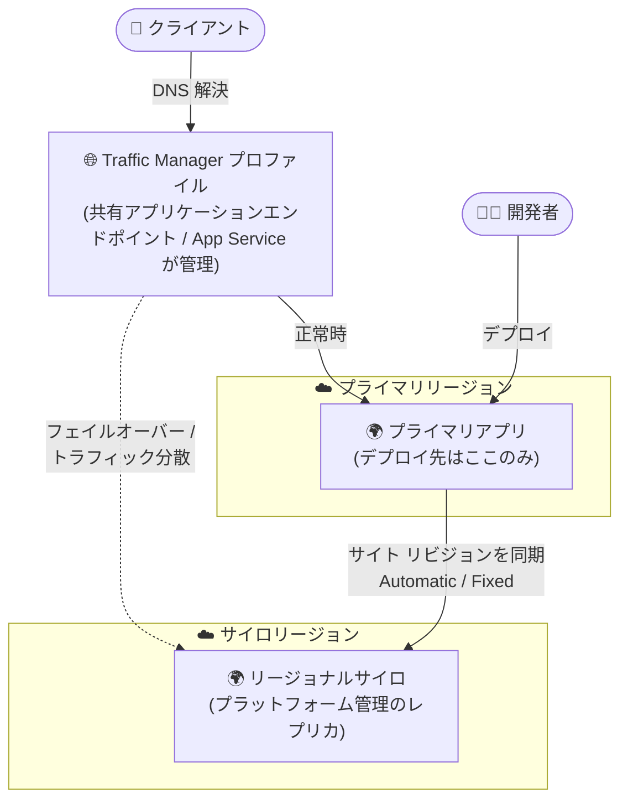
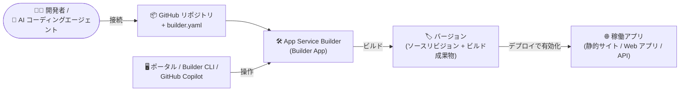

# Azure App Service: Geo-redundancy / App Service Builder (Public Preview)

**リリース日**: 2026-11-17

**サービス**: Azure App Service

**機能**: Geo-redundancy (地理冗長)、App Service Builder

**ステータス**: In preview

[このアップデートのインフォグラフィックを見る](https://takech9203.github.io/azure-news-summary/20261117-app-service-geo-redundancy-builder.html)

## 概要

Microsoft Ignite に合わせて、Azure App Service に関する 2 つの大きなパブリックプレビューが発表されました。

1 つ目は **Geo-redundancy (地理冗長)** です。各リージョンに個別の App Service デプロイを作成・管理することなく、複数の Azure リージョンにまたがる耐障害性の高い Web アプリケーションを構築できます。App Service がアプリの「リージョナルサイロ (レプリカ)」を自動的に作成・管理し、対応するアプリケーションコンテンツと構成を同期、さらにマネージドな Azure Traffic Manager プロファイルによる単一のアプリケーションエンドポイントを提供します。リージョン障害時のフェイルオーバー用 (Passive) と、正常なリージョン間でトラフィックを分散する (Active) の 2 つの利用シナリオに対応します。

2 つ目は **App Service Builder** です。アプリケーションコードをクラウド上で稼働するアプリにするには、通常ビルドパイプライン・デプロイワークフロー・ホスティング基盤の構成が必要ですが、App Service Builder はソースリポジトリ連携型のプラットフォームとしてこの工程を簡素化します。`builder.yaml` マニフェストにアプリを記述し、ソースからビルドしてデプロイするだけで、静的サイト・バックエンド Web アプリ・フロントエンド + API 構成のアプリを実行できます。ポータル、Builder CLI、GitHub Copilot のガイド付きエクスペリエンスから利用でき、開発者だけでなく AI コーディングエージェントによる利用も想定されています。

**アップデート前の課題**

- マルチリージョン構成では、リージョンごとに App Service プラン・Web アプリ・Traffic Manager (または Front Door) を個別に作成し、デプロイと構成を自前で同期し続ける必要があった
- コードを Azure 上で動かすまでに、ビルドパイプライン・デプロイワークフロー・ホスティングインフラの構成を開発者自身が行う必要があった

**アップデート後の改善**

- プライマリアプリを管理するだけで、App Service がリージョナルレプリカの作成・コンテンツと構成の同期・単一エンドポイントのトラフィックルーティングを管理してくれる (Geo-redundancy)
- リージョン障害時の自動フェイルオーバー (Passive) と複数リージョンからのトラフィック配信 (Active) の両方に対応 (Geo-redundancy)
- GitHub リポジトリを接続して `builder.yaml` を記述するだけで、ビルドとホスティング基盤をサービス側が管理し、コードから稼働アプリまでの工程が自動化される (App Service Builder)

## アーキテクチャ図

### Geo-redundancy の構成

開発者はプライマリアプリにのみデプロイし、App Service がサイロリージョンへのコンテンツ・構成の同期と Traffic Manager によるルーティングを管理します。

### App Service Builder のワークフロー

リポジトリと `builder.yaml` を接続すると、Builder がソースからバージョンをビルドし、デプロイによってバージョンを有効化してアプリを稼働させます。

## サービスアップデートの詳細

### Geo-redundancy on Azure App Service の主要機能

1. **リージョナルサイロの自動管理**
   - App Service がサイロリージョンに対応する App Service プラン (SKU、インスタンス数、ゾーン冗長構成を含む) と Web アプリを自動的にプロビジョニング・維持する
   - サイロは個別のデプロイ先ではなく、デプロイは引き続きプライマリアプリに対して行う

2. **サイト リビジョンの同期 (Automatic / Fixed モード)**
   - サポートされる公開コンテンツと構成のスナップショット (サイト リビジョン) をサイロに同期
   - 既定は **Automatic** で、プライマリの更新時に全サイロへ自動同期
   - **Fixed** モードでは、サイロを特定の「既知の正常なリビジョン」に固定し、手動でプロモートするまで維持できる

3. **共有アプリケーションエンドポイントとトラフィックルーティング**
   - App Service が管理する Traffic Manager プロファイルにより単一のエンドポイントを提供
   - プライマリエンドポイントが異常と検出された場合のリージョナルフェイルオーバーと、複数のアクティブリージョンからのトラフィック配信の両方に対応

4. **マネージド ID 構成のレプリケーション**
   - サポートされるマネージド ID の構成をレプリケート (ID がアクセスするリソース自体は複製されないため、各リージョンから依存先へのアクセスを別途確認する必要がある)

### Azure App Service Builder の主要機能

1. **ソース連携型のアプリモデル**
   - 認可された GitHub リポジトリを接続し、`builder.yaml` マニフェストに「何をビルドして何を配信するか」を記述
   - Builder App は 1 つの環境を表し、ソース構成・コンポーネント・バージョン・デプロイを所有する

2. **コンポーネント / バージョン / デプロイの概念**
   - **コンポーネント**: アプリを構成する静的コンテンツや HTTP プロセスを記述
   - **バージョン**: ソースリビジョン・ビルド成果物・バージョン固有の構成をキャプチャ
   - **デプロイ**: バージョンを有効化する操作 (ビルド成功だけではアプリは稼働しない)

3. **対応アプリタイプ**
   - 静的サイト、バックエンド Web アプリ (HTTP API)、静的フロントエンド + HTTP バックエンドの組み合わせ

4. **複数のアクセス手段**
   - Azure ポータル、Builder CLI、GitHub Copilot のガイド付きアプリエクスペリエンスから利用でき、開発者と AI コーディングエージェントの既存ワークフローに統合できる

## 技術仕様

### Geo-redundancy (プレビュー時点)

| 項目 | 詳細 |
|------|------|
| プラットフォーム | Windows のみ (Linux・コンテナーは非対応)、App Service Environment では利用不可 |
| 対応 SKU | Pv3、PMv3、Pv4、PMv4 のみ |
| アプリケーションタイプ | Web Apps のみ (Functions、Logic Apps は非対応) |
| 同期モード | Automatic (既定、プライマリ更新時に自動同期) / Fixed (指定リビジョンに固定) |
| ルーティング | App Service が管理する Azure Traffic Manager プロファイル (DNS ベース、HTTP プロキシではなく TLS 終端もしない) |
| 同期対象 | サポートされる公開コンテンツと構成のスナップショット (FTP アップロードや仮想ファイルシステムへの直接書き込みは自動同期されない) |
| 複製されないもの | Azure SQL Database、Cosmos DB、Storage、Key Vault などバックエンドサービスのリソース・データ |

### App Service Builder (プレビュー時点)

| 項目 | 詳細 |
|------|------|
| 位置づけ | 開発・テスト専用 (本番ワークロードのデプロイは不可)。SLA なし |
| プレビュー経緯 | 2026 年 10 月プライベートプレビュー → 2026 年 11 月パブリックプレビュー |
| ソース | 認可された GitHub リポジトリ + `builder.yaml` マニフェスト |
| 対応アプリ | 静的サイト、Web アプリ、HTTP API、フロントエンド + バックエンド構成 |
| アクセス手段 | Azure ポータル、Builder CLI、GitHub Copilot ガイド付きエクスペリエンス |
| 備考 | 標準の App Service の機能・サービス保証は自動的には適用されない |

## 設定方法

### Geo-redundancy の前提条件

1. 対象 SKU (Pv3 / PMv3 / Pv4 / PMv4) の新規または既存の App Service プランと Windows Web アプリ
2. サイロリージョンに互換性のある容量と十分なクォータがあること
3. プライマリアプリが VNet 統合を使用している場合、各サイロリージョンにも適格な統合サブネットを用意すること

評価は、選択したすべてのリージョンで依存関係をテストできる非本番 Web アプリから始めることが推奨されています。詳細な手順は [Geo-redundancy のドキュメント](https://learn.microsoft.com/azure/app-service/overview-geo-redundancy)を参照してください。

### App Service Builder の始め方

GitHub リポジトリを接続し、`builder.yaml` でアプリを記述してビルド・デプロイします。ポータル、Builder CLI、GitHub Copilot ガイド付きエクスペリエンスのいずれかを選択して開始できます。手順は [Get started with App Service Builder](https://learn.microsoft.com/azure/app-service/app-service-builder-get-started) および[製品ドキュメント](https://builder.appservice.azure.com/docs/)を参照してください。

## メリット

### ビジネス面

- マルチリージョン構成の構築・維持にかかる運用負荷とヒューマンエラーのリスクを削減できる (Geo-redundancy)
- リージョン障害時にも単一エンドポイントのままフェイルオーバーでき、Web アプリの可用性要件に応えやすくなる (Geo-redundancy)
- プロトタイプや開発・テスト用アプリをコードから短時間で稼働させられ、開発の初速が上がる (Builder)
- Builder は初期プレビュー期間中は無料で利用でき、評価コストが低い

### 技術面

- プラン SKU・インスタンス数・ゾーン冗長構成を含むレプリカのライフサイクルをプラットフォームが管理 (Geo-redundancy)
- Fixed モードにより、サイロを既知の正常なリビジョンに固定した安全なロールアウト運用が可能 (Geo-redundancy)
- `builder.yaml` によるソース定義型のアプリモデルで、AI コーディングエージェントからの操作にも適した宣言的な管理ができる (Builder)

## デメリット・制約事項

### Geo-redundancy

- Windows のみ対応で、Linux・コンテナー・App Service Environment では利用不可
- 対応 SKU は Pv3 / PMv3 / Pv4 / PMv4 のみ、アプリタイプも Web Apps のみ
- 利用可能リージョンは East Asia、West Central US、North Europe、West US 2 の 4 リージョンに限定
- App Service Authentication、デプロイスロット、カスタムドメイン・証明書、Bring Your Own Storage はプレビュー時点で利用不可
- バックエンドサービス (SQL Database、Cosmos DB、Storage、Key Vault など) のデータは複製されない。データ層のリージョン間レジリエンスは別途設計が必要
- DNS ベースのルーティングのため、ヘルス検出・DNS TTL・クライアントキャッシュによりフェイルオーバーの反映に時間差が生じ、既存接続はレプリカに引き継がれない
- FTP アップロードやファイルシステムへの直接変更は自動同期されない

### App Service Builder

- パブリックプレビューは開発・テスト専用で、本番ワークロードはデプロイ不可。SLA なし
- 標準の App Service の機能やサービス保証は自動的には適用されない
- サービス制限 (クォータ) の範囲内での利用となる

## ユースケース

### ユースケース 1: リージョン障害に備えた Web アプリのフェイルオーバー構成 (Geo-redundancy)

**シナリオ**: 単一リージョンで運用中のミッションクリティカルな Windows Web アプリについて、リージョン障害時にも別リージョンで継続稼働させたい。従来は 2 つ目のリージョンに App Service 一式を複製し、デプロイ同期と Traffic Manager を自前で管理する必要があった。

**効果**: Geo-redundancy を有効化すると、App Service がサイロリージョンへのレプリカ作成とコンテンツ同期、Traffic Manager によるフェイルオーバーを管理するため、プライマリアプリへのデプロイだけでマルチリージョンの冗長性を確保できる。

### ユースケース 2: アクティブ/アクティブでのトラフィック分散 (Geo-redundancy)

**シナリオ**: アプリと依存サービスが複数リージョンでのアクティブ稼働に対応しており、ユーザーに近いリージョンから配信して可用性と体感性能を高めたい。

**効果**: Active モードにより、正常なリージョン間でトラフィックを分散しつつ、単一のアプリケーションエンドポイントを維持できる。

### ユースケース 3: プロトタイプを最速で Azure にデプロイ (App Service Builder)

**シナリオ**: GitHub 上のフロントエンド + API 構成のプロトタイプを、CI/CD やインフラの構成に時間をかけずに Azure で動かして検証したい。

**効果**: リポジトリを接続して `builder.yaml` を記述するだけでビルド・デプロイ・ホスティングが完結し、GitHub Copilot のガイド付きエクスペリエンスから AI エージェント主導でのデプロイも可能になる。

## 料金

- **Geo-redundancy**: プライマリアプリの App Service プランインスタンス料金、リージョナルサイロのインスタンス料金に加えて、Geo-redundancy を有効化した Web アプリごとに追加の月額料金が発生する。具体的な金額は [App Service 料金ページ](https://azure.microsoft.com/pricing/details/app-service/)を参照。
- **App Service Builder**: 初期プレビュー期間中はサービス制限の範囲内で無料。ただし別途プロビジョニングするリソース・サービスには個別の課金が発生する。最新のプレビュー条件は [Cost ドキュメント](https://builder.appservice.azure.com/docs/resources/cost/)を参照。

## 利用可能リージョン

- **Geo-redundancy**: East Asia、West Central US、North Europe、West US 2 (プレビュー時点)
- **App Service Builder**: サポートリージョンは [Regions ドキュメント](https://builder.appservice.azure.com/docs/resources/regions/)を参照

## 関連サービス・機能

- **Azure Traffic Manager**: Geo-redundancy の共有エンドポイントを支える DNS ベースのトラフィックルーティング。プロファイルは App Service が管理する
- **App Service ゾーン冗長**: 単一リージョン内の可用性ゾーン間でインスタンスを分散する機能。リージョン間冗長の Geo-redundancy とは補完関係にある
- **App Service バックアップ**: コンテンツ・データの復旧可能なコピーを保持する機能。稼働中のリージョナルデプロイやフェイルオーバーの代替にはならない
- **GitHub / GitHub Copilot**: App Service Builder のソースリポジトリ連携とガイド付きデプロイエクスペリエンスを提供
- **マルチリージョンアプリの手動構成**: 自前でリージョナルデプロイとルーティングを管理するアーキテクチャ ([チュートリアル](https://learn.microsoft.com/azure/app-service/tutorial-multi-region-app)) の代替として Geo-redundancy が位置づけられる

## 参考リンク

- [インフォグラフィック](https://takech9203.github.io/azure-news-summary/20261117-app-service-geo-redundancy-builder.html)
- [公式アップデート情報: Public Preview: Geo-redundancy on Azure App Service](https://azure.microsoft.com/updates?id=578839)
- [公式アップデート情報: Public Preview: Azure App Service Builder](https://azure.microsoft.com/updates?id=578817)
- [Microsoft Learn: Overview of geo-redundancy in Azure App Service (Preview)](https://learn.microsoft.com/azure/app-service/overview-geo-redundancy)
- [Microsoft Learn: App Service Builder overview (preview)](https://learn.microsoft.com/azure/app-service/app-service-builder-overview)
- [Microsoft Learn: Get started with App Service Builder (preview)](https://learn.microsoft.com/azure/app-service/app-service-builder-get-started)
- [App Service Builder 製品ドキュメント](https://builder.appservice.azure.com/docs/)
- [料金ページ: App Service](https://azure.microsoft.com/pricing/details/app-service/)

## まとめ

今回の 2 つのパブリックプレビューは、App Service の「運用の簡素化」を異なる方向から進めるアップデートです。Geo-redundancy は、これまで自前で構築していたマルチリージョン構成 (リージョンごとのデプロイ + Traffic Manager 管理) をプラットフォームのマネージド機能に置き換えるもので、Windows の Premium v3/v4 系 Web Apps を運用する Solutions Architect はフェイルオーバー設計の選択肢として評価を始める価値があります。ただしデータ層は複製されないため、データベースや Key Vault などの依存サービスのリージョン間レジリエンスは引き続き別途設計が必要です。App Service Builder は開発・テスト専用ながら、`builder.yaml` によるソース定義型モデルと AI コーディングエージェント対応が特徴で、コードから稼働アプリまでの新しい開発体験として注目されます。いずれもプレビューのため、本番適用前に制約事項 (対応 SKU・リージョン・非対応機能) を確認してください。

---

**タグ**: App Service, Geo-redundancy, App Service Builder, Traffic Manager, In preview, Compute, Web, Microsoft Ignite
