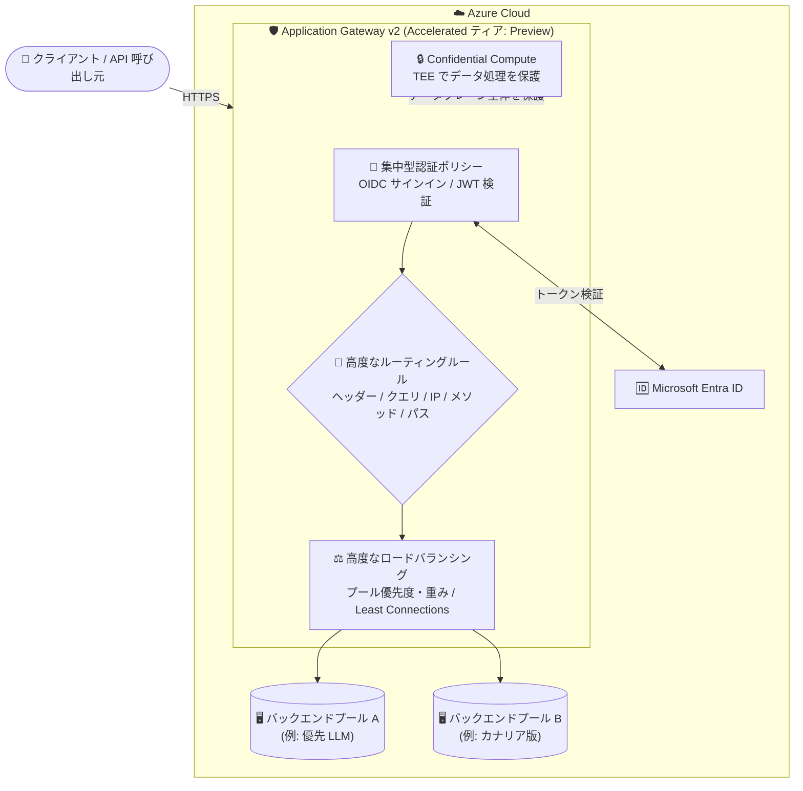

# Azure Application Gateway: v2 強化アップデート群 (次世代エラスティックアーキテクチャ / 高度なロードバランシング / 集中型ユーザー認証 + JWT 検証 / Confidential Compute / 高度なルーティングルール)

**リリース日**: 2026-11-17

**サービス**: Azure Application Gateway

**機能**: 次世代エラスティックアーキテクチャ、高度なロードバランシング、集中型ユーザー認証 + JWT 検証、Confidential Compute サポート、高度なルーティングルール (いずれもパブリックプレビュー)

**ステータス**: In preview

[このアップデートのインフォグラフィックを見る](https://takech9203.github.io/azure-news-summary/20261117-application-gateway-v2-enhancements.html)

## 概要

Microsoft Ignite 2026 に合わせて、Azure Application Gateway v2 に関する 5 つの大型アップデートがパブリックプレビューとして一斉に発表されました。基盤アーキテクチャの刷新からトラフィック制御、認証、機密データ保護まで、アプリケーションデリバリー層を包括的に強化する内容です。

1. **次世代エラスティックアーキテクチャ**: プロビジョニング時間を最大 50%、オートスケール時間を最大 70% 短縮する新しいデプロイメントティア「Accelerated (Preview)」
2. **高度なロードバランシング**: バックエンドプールの優先度・重み付け、サーバーレベルの Least Connections / Weighted Round Robin アルゴリズム
3. **集中型ユーザー認証 + JWT 検証**: OpenID Connect によるユーザーサインインと、集中管理ポリシーによる JWT 検証
4. **Confidential Compute サポート**: データプレーンを機密コンピューティング環境で実行し、処理中のデータ (data-in-use) をハードウェアベースで保護
5. **高度なルーティングルール**: HTTP ヘッダー、クエリ文字列、クライアント IP、HTTP メソッド、パスに基づく条件ベースルーティング

**アップデート前の課題**

- 従来のデプロイメントティアでは、プロビジョニングやオートスケールに時間がかかり、急激なトラフィック変動への追従に課題があった
- ロードバランシングはバックエンドプール内の均等分散が基本で、プール間の優先度やサーバーごとの重み付けといった細かな制御ができなかった
- ユーザー認証やトークン検証はバックエンドアプリケーション側で実装する必要があり、複数のゲートウェイ・アプリケーションに同じ認証設定を個別に構成する必要があった (既存の JWT 検証プレビューはゲートウェイごとの構成だった)
- TLS 終端後の復号されたデータは標準的なプラットフォーム保護の下で処理され、処理中のデータに対するハードウェアベースの保護はなかった
- ルーティングは従来のパスベースルーティングが中心で、ヘッダーやクエリ文字列など他の HTTP 属性に基づく柔軟なルーティングができなかった

**アップデート後の改善**

- 新ティアによりプロビジョニング最大 50% 短縮・オートスケール最大 70% 高速化。スケールイン/アウト時も接続を維持し、将来的な構成・データプレーンのスケール上限引き上げの基盤となる (追加コストなし)
- プール単位の優先度 (Priority) と重み (Weights)、サーバー単位の Least Connections / Weighted Round Robin により、AI ワークロード (優先 LLM デプロイメントへの振り分け) や Web トラフィックに応じたポリシー駆動のトラフィック管理が可能に
- Application Gateway が OpenID Connect でユーザーをサインインさせ、認証ポリシーを一度構成すれば複数のルーティングルール・複数のゲートウェイに一貫して適用可能に。バックエンドの認証コードを削減
- Confidential Compute アドオンにより、TLS 終端・WAF 検査・ルーティング評価中の復号済みデータがハードウェアベースのメモリ暗号化と分離で保護される
- 高度なルーティングルールにより、A/B テスト、カナリアデプロイ、API バージョニング、マルチテナント、トラフィックセグメンテーションなどを ゲートウェイ層で実現

## アーキテクチャ図



リクエストは集中型認証ポリシーで検証された後、高度なルーティングルールで条件評価され、高度なロードバランシングでバックエンドプールへ分散されます。データプレーン全体を Confidential Compute 環境で実行でき、処理中の復号データも保護されます。

## サービスアップデートの詳細

### 1. 次世代エラスティックアーキテクチャ (Public Preview)

- 要求の厳しいワークロードと動的なトラフィックパターン向けに構築された新しいプラットフォーム
- 現行のデプロイメントティア比で、プロビジョニング時間を最大 50%、オートスケール時間を最大 70% 短縮
- より高い構成・データプレーンのスケール上限への基盤を提供し、スケールアウト/スケールイン時もアプリケーション接続をシームレスに維持
- **追加コストなし**。新規 Application Gateway 作成時に Deployment tier で「Accelerated (Preview)」を選択してオプトイン
- プレビュー期間中は一部リージョンで利用可能 (順次拡大)。既存ゲートウェイには影響なし

### 2. 高度なロードバランシング (Public Preview)

- **バックエンドプールレベル**:
  - Priority (優先度): 優先プールを指定可能。AI アプリケーションでは優先する LLM デプロイメントをホストするプールを優先できる
  - Weights (重み): 対象プール間の相対的なトラフィック配分を構成可能。バックエンド容量やデプロイ要件の差異を反映できる
- **サーバーレベル (プール内)**:
  - Least Connections: アクティブ接続数が少ないサーバーへ振り分け
  - Weighted Round Robin: 構成したサーバー重みに応じてトラフィックを分散
- AI アプリケーションと Web トラフィックの両方に対応する、柔軟でポリシー駆動のトラフィック管理を実現

### 3. 集中型ユーザー認証 + JWT 検証 (Public Preview)

- **ユーザー認証**: トラフィックが Web アプリケーションに到達する前に、Application Gateway が OpenID Connect でユーザーをサインイン。認証を一度構成すれば、複数のルーティングルール・複数の Application Gateway に一貫して適用可能。バックエンドの認証コード削減と一貫したサインイン体験を実現
- **JWT 検証 (刷新版)**: API やサービス間トラフィック向けに、Microsoft Entra ID が発行したベアラートークンをゲートウェイで検証。署名・発行者 (iss)・対象者 (aud)・有効期間を検証し、検証済みリクエストには `x-msft-entra-identity` ヘッダー (`tenantId:oid`) をバックエンドへ転送
- 認証ポリシーはリージョナルリソースで、利用する Application Gateway と同一リージョンに配置する必要がある
- **注意**: 既存の JWT 検証プレビューは GA に移行せず、廃止が予定されている (正式な廃止通知は別途公開予定。今回の発表は正式な廃止通知ではない)。新規デプロイでは集中型 JWT 検証ポリシーの利用が推奨される

### 4. Confidential Compute サポート (Public Preview)

- Application Gateway のデータプレーンを機密コンピューティング環境 (Trusted Execution Environment: TEE) で実行するマネージドアドオン
- **ハードウェアベースのメモリ保護**: データプレーンが使用するメモリをハードウェアで暗号化
- **ハードウェア強制の分離**: ハイパーバイザー、ホスト管理コード、他の VM からワークロードを分離
- **データ使用中 (data-in-use) の保護**: TLS 終端、WAF 検査、ルーティングポリシー評価の間も機密データを保護
- TLS 終端、WAF、L7 ルーティング、L4 プロキシ、ロードバランシング、可観測性などのマネージド機能はそのまま利用可能
- Azure Key Vault (Standard/Premium) 連携では秘密鍵と処理データを機密環境内で保護。Managed HSM 連携では秘密鍵を HSM 外に出さない構成も可能
- 機密 Web アプリケーション、API、AI アプリケーション、規制対象ワークロードに特に有用 (Confidential VM バックエンドと組み合わせた一貫した機密アーキテクチャの構築など)
- **注意**: アプリケーションコード自体の脆弱性や、侵害されたバックエンドサーバーに対する保護は提供しない

### 5. 高度なルーティングルール (Public Preview)

- HTTP リクエスト属性を使った条件ベースのルーティングロジックを定義可能。従来のパスベースルーティングを超える柔軟性を提供
- **サポートされる条件タイプ**: Header、QueryString、ClientIP (CIDR 形式)、Method (GET/HEAD/POST/PUT/DELETE/CONNECT/OPTIONS/PATCH、完全一致のみ)、Path
- 完全一致とパターンマッチ (RE2 互換の正規表現) をサポート。条件セット内は AND 評価、条件値の配列は OR 評価
- ルールは優先度 (小さい値が先) で評価され、最初に一致したルールで振り分け先が決定。どのルールにも一致しない場合は既定のバックエンドプール (またはリダイレクト) へ
- Rewrite ルールセットやリダイレクト構成との組み合わせも可能。WAF ポリシーはルーティング判定の前に評価される (ルール単位の WAF ポリシー関連付けは非対応)
- ユースケース: A/B テスト・カナリアデプロイ、API バージョニング、マルチテナントアプリ、フィーチャーフラグ、パートナー統合、モバイル/デスクトップのトラフィック分離

## 技術仕様

### 高度なルーティングルールの上限 (プレビュー時点)

| 項目 | 上限 |
|------|------|
| Advanced Routing Map (ゲートウェイあたり) | 100 |
| Map あたりのルール数 | 100 |
| 条件セット (ゲートウェイあたり) | 10,000 |
| 条件セットあたりの条件数 | 5 |
| 条件あたりのプロパティ値数 | 5 |
| プロパティ値 / 正規表現の長さ | 128 文字 |

- 関連付けできるのは Basic フロントエンドリスナーのみ (Multisite リスナー、L4 TCP/TLS プロキシは非対応)

### Confidential Compute

| 項目 | 詳細 |
|------|------|
| 対象 SKU | Standard_v2、WAF_v2 (アドオンとして提供) |
| 有効化タイミング | ゲートウェイの新規作成時のみ (既存ゲートウェイでは有効化不可) |
| API バージョン | 2026-05-01 以降を使用 |
| Key Vault 連携 | Standard / Premium / Managed HSM に対応 |

### 集中型認証ポリシー (JWT 検証)

| 構成 | サポート |
|------|---------|
| Basic ルーティングルール | 対応 |
| Advanced ルーティングルール (パス条件含む) | 対応 |
| パスベースルーティングルールタイプ | 非対応 (プレビュー期間中) |
| HTTPS リスナー | 必須 (HTTP リスナーは非対応) |

## 設定方法

### 前提条件

1. Application Gateway v2 (Standard_v2 または WAF_v2)
2. (認証ポリシーの場合) HTTPS リスナー、バックエンドターゲット、Microsoft Entra ID への API 登録、Entra メタデータエンドポイントへの TCP 443 疎通
3. (Confidential Compute の場合) 必要な Confidential VM SKU をサポートするリージョン

### Azure Portal

- **次世代エラスティックアーキテクチャ**: 新規 Application Gateway 作成時に Deployment tier で「Accelerated (Preview)」を選択
- **Confidential Compute**: 新規作成時に「Confidential Compute」チェックボックスを選択
- **JWT 検証**: Application Gateway の [Settings] > [Authentication policies (Preview)] から [Create] > [JWT validation] を選択し、発行者 (Issuer)・対象者 (Audience)・クライアント ID・未認証リクエストの動作 (Deny/Allow) を構成した上で、ゲートウェイと HTTPS ルーティングルールに関連付け

### REST API (Confidential Compute)

```json
"enableConfidentialCompute": true
```

API バージョン 2026-05-01 以降を使用します。

## メリット

### ビジネス面

- Microsoft Ignite 2026 で発表された一連の機能強化により、ロードバランサーのリプレイスや WAF 製品の追加なしに、AI 時代のアプリケーションデリバリー要件 (LLM ルーティング、ゼロトラスト、機密データ保護) に対応できる
- 認証をゲートウェイ層に集約することで、バックエンドの認証実装・運用コストを削減し、アプリ間で一貫したセキュリティポスチャを実現
- 金融・医療など規制対象ワークロードで、data-in-use 保護までカバーするコンプライアンス対応を強化
- エラスティックアーキテクチャは追加コストなしで性能向上を享受できる

### 技術面

- プロビジョニング最大 50% / オートスケール最大 70% 高速化により、急激なトラフィックスパイクへの追従性が向上
- プール優先度・重み・サーバーレベルアルゴリズムによるきめ細かなトラフィック制御
- 条件ベースルーティングでカナリアデプロイや A/B テストをインフラ層で宣言的に実現
- 1 つの認証ポリシーを複数ゲートウェイに適用でき、構成ドリフトを防止

## デメリット・制約事項

- いずれもパブリックプレビューであり、SLA は提供されない。本番ワークロードでの利用は非推奨 (プレビューの補足利用条件が適用される)
- 次世代エラスティックアーキテクチャは新規ゲートウェイ作成時のオプトインのみで、プレビュー期間中は一部リージョン限定
- Confidential Compute は既存ゲートウェイでは有効化できず、新規作成時のみ。対応リージョンも限定的。追加のアドオン料金が発生する。アプリケーションコードの脆弱性やバックエンド侵害は保護対象外
- 高度なルーティングルールは Multisite リスナー・L4 TCP/TLS プロキシ非対応。ルール単位の WAF ポリシー関連付けは不可
- 集中型認証ポリシーは HTTPS リスナー必須。パスベースルーティングルールタイプは非対応。認証ポリシーはゲートウェイと同一リージョンに配置する必要がある
- 既存の JWT 検証プレビューは GA へ移行せず廃止予定のため、既存利用者は移行計画が必要 (自動移行はされない)

## ユースケース

### ユースケース 1: LLM バックエンドの優先ルーティング

**シナリオ**: 複数リージョン・複数モデルの LLM デプロイメントを持つ AI アプリケーションで、優先モデルへトラフィックを集中させつつ、容量に応じてフォールバックさせたい。

**実装**: 高度なロードバランシングで優先 LLM デプロイメントをホストするプールに Priority を設定し、Weights で残りのプールへの配分を調整する。

**効果**: アプリケーション側のロジック変更なしに、推論バックエンドのトラフィック配分をゲートウェイ層で制御できる。

### ユースケース 2: ヘッダーベースのカナリアデプロイ

**シナリオ**: 特定の HTTP ヘッダーを持つリクエストだけを新バージョンのバックエンドに振り向けたい。

**実装例** (高度なルーティングルールの Header 条件):

```json
{
  "conditionType": "Header",
  "propertyName": "X-Canary",
  "propertyValues": ["true"]
}
```

**効果**: 対象リクエストのみ新バージョンへルーティングし、問題発生時はルールを削除するだけでロールバックできる。

### ユースケース 3: 規制対象 API のエンドツーエンド機密化

**シナリオ**: 医療情報を扱う API で、バックエンドを Confidential VM で運用しており、ゲートウェイでの TLS 終端・WAF 検査中のデータも保護したい。

**実装**: 新規 Application Gateway (WAF_v2) 作成時に Confidential Compute を有効化し、Managed HSM で TLS 秘密鍵を保護。集中型 JWT 検証ポリシーで API への全リクエストのトークンを検証する。

**効果**: 転送中・保存中に加え、ゲートウェイ処理中 (data-in-use) のデータまでハードウェアベースで保護され、認証もゲートウェイ層で強制される。

## 料金

- **次世代エラスティックアーキテクチャ**: 追加コストなし (公式アップデートに明記)
- **Confidential Compute**: Standard_v2 / WAF_v2 SKU への時間課金アドオン。固定料金 + キャパシティユニット料金に加え、Confidential Compute アドオンの時間料金が発生
- その他の機能 (高度なロードバランシング、認証ポリシー、高度なルーティングルール) の個別料金は公式アップデートに記載なし

リージョン別の料金は [Application Gateway 料金ページ](https://azure.microsoft.com/pricing/details/application-gateway/) を参照してください。

## 利用可能リージョン

- **次世代エラスティックアーキテクチャ**: プレビュー期間中は一部リージョンのみ (順次追加予定。具体的なリージョンリストは公式アップデートに記載なし)
- **Confidential Compute**: Australia East、Canada Central、Central India、Central US、East US、East US 2、France Central、Germany West Central、Japan East、North Central US、South Central US、Sweden Central、UAE North、UK South、West US、West US 2、West US 3

## 関連サービス・機能

- **Microsoft Entra ID**: 集中型ユーザー認証 (OpenID Connect) と JWT 検証のトークン発行・検証基盤
- **Azure Key Vault / Managed HSM**: TLS 証明書・秘密鍵の管理。Managed HSM 利用時は秘密鍵をゲートウェイ環境外で保護可能
- **Azure Confidential VM**: Confidential Compute バックエンドと組み合わせることで、アプリケーション層からデリバリー層まで一貫した機密コンピューティングアーキテクチャを構築可能
- **Azure Web Application Firewall (WAF)**: WAF_v2 SKU で Confidential Compute・高度なルーティングルールと併用可能。WAF 評価はルーティング判定より先に実行される
- **Azure Monitor**: Confidential Compute 有効時もアクセスログ・ファイアウォールログ・アクティビティログなどの診断を継続利用可能

## 参考リンク

- [インフォグラフィック](https://takech9203.github.io/azure-news-summary/20261117-application-gateway-v2-enhancements.html)
- [公式アップデート: Next-generation elastic architecture for Azure Application Gateway v2](https://azure.microsoft.com/updates?id=580428)
- [公式アップデート: Advanced load balancing in Azure Application Gateway](https://azure.microsoft.com/updates?id=580423)
- [公式アップデート: Centralized user authentication + JWT validation for Azure Application Gateway](https://azure.microsoft.com/updates?id=580418)
- [公式アップデート: Azure Application Gateway confidential compute support](https://azure.microsoft.com/updates?id=579649)
- [公式アップデート: Azure Application Gateway advanced routing rules](https://azure.microsoft.com/updates?id=579324)
- [Microsoft Learn: Application Gateway Confidential Compute Overview](https://learn.microsoft.com/azure/application-gateway/confidential-compute-overview)
- [Microsoft Learn: Advanced routing rules on Azure Application Gateway](https://learn.microsoft.com/azure/application-gateway/advanced-rules)
- [Microsoft Learn: JSON Web Token (JWT) validation in Azure Application Gateway](https://learn.microsoft.com/azure/application-gateway/json-web-token-overview)
- [料金ページ](https://azure.microsoft.com/pricing/details/application-gateway/)

## まとめ

Microsoft Ignite 2026 で発表された今回の 5 つのパブリックプレビューは、Application Gateway v2 を「高速にスケールする基盤 (エラスティックアーキテクチャ)」「賢いトラフィック制御 (高度なロードバランシング・ルーティング)」「ゲートウェイ層での認証 (OIDC + JWT)」「処理中データの保護 (Confidential Compute)」という 4 つの軸で大幅に強化するものです。特に AI アプリケーションの LLM バックエンド制御や、規制対象ワークロードの data-in-use 保護は、Solutions Architect にとって設計の選択肢を広げる重要なアップデートです。

いずれもプレビューのため本番適用は時期尚早ですが、新規ゲートウェイ作成時のみ有効化できる機能 (Accelerated ティア、Confidential Compute) があるため、将来の採用を見据えた検証環境での評価を早めに始めることを推奨します。また、既存の JWT 検証プレビューを利用中の場合は、廃止が予定されているため集中型認証ポリシーへの移行を計画してください。

---

**タグ**: Application Gateway, Networking, Security, In preview, Microsoft Ignite, Load Balancing, Authentication, JWT, Confidential Computing, Routing
