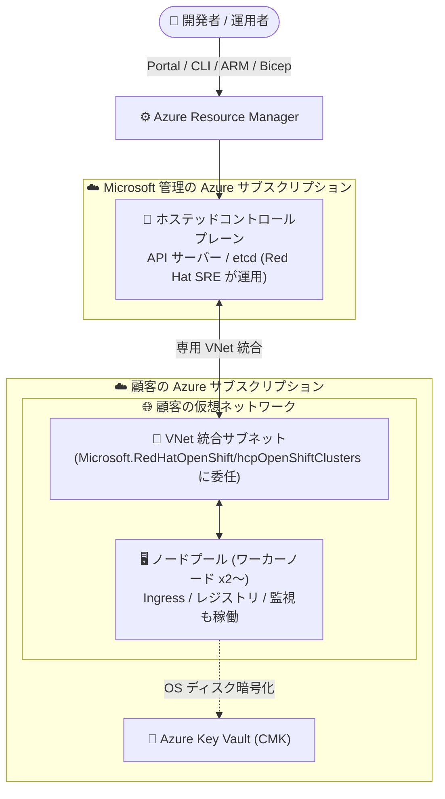

# Azure Red Hat OpenShift: Hosted Control Planes の一般提供開始 (GA)

**リリース日**: 2026-11-17

**サービス**: Azure Red Hat OpenShift

**機能**: Hosted Control Planes (ホステッドコントロールプレーン)

**ステータス**: Launched (GA)

[このアップデートのインフォグラフィックを見る](https://takech9203.github.io/azure-news-summary/20261117-aro-hosted-control-planes-ga.html)

## 概要

Microsoft は、Azure Red Hat OpenShift (ARO) の新しいデプロイオプションである **Hosted Control Planes (HCP)** の一般提供 (GA) を Microsoft Ignite に合わせて発表しました。HCP アーキテクチャでは、OpenShift のコントロールプレーン (API サーバーや etcd など) をアプリケーションが稼働するワーカーノードから分離し、Microsoft 管理の Azure サブスクリプション内でフルマネージドサービスとして稼働させます。利用者は自身のサブスクリプションと仮想ネットワークにワーカーノードのみをデプロイします。

HCP はアプリケーションのモダナイゼーション加速、開発者の生産性向上、運用の効率化、セキュリティ強化を支援しつつ、Microsoft と Red Hat が共同でエンジニアリング・サポートを提供する従来どおりの OpenShift エクスペリエンスを維持します。発表によると、HCP は Red Hat OpenShift 5 をサポートし、Azure 上で最新の OpenShift 機能を統合サポート体験とともに利用できます。なお、従来の標準アーキテクチャ版 ARO も引き続きフルサポートされます。

**アップデート前の課題**

- 標準アーキテクチャでは、コントロールプレーンノード 3 台 + ワーカーノード 3 台の最小構成が必要で、コントロールプレーン分の VM コストも利用者の負担だった
- クラスターの作成に約 45 分かかっていた
- コントロールプレーンとワーカーノードのアップグレードが一体で行われ、個別に制御できなかった
- Ingress コントローラーやイメージレジストリなどのプラットフォームコンポーネント用に専用のインフラストラクチャノードが必要だった

**アップデート後の改善**

- コントロールプレーンは Microsoft 管理のサブスクリプションでホストされ、利用者はワーカーノード (最小 2 台) の分だけを支払えばよい
- クラスターのプロビジョニングが約 15〜20 分に短縮
- コントロールプレーンと各ノードプールを個別にアップグレード可能。コントロールプレーンの z-stream (パッチ) アップグレードは Red Hat SRE により自動管理
- 専用インフラストラクチャノードが不要になり、プラットフォームコンポーネントはワーカーノード上で稼働

## アーキテクチャ図



コントロールプレーンは Microsoft 管理のサブスクリプションで稼働し、顧客 VNet 内の委任された VNet 統合サブネットを経由してワーカーノードと通信します。顧客のサブスクリプションにデプロイされるのはワーカーノードのみです。

## サービスアップデートの詳細

### 主要機能 (GA 時点)

1. **高速なクラスタープロビジョニング**
   - クラスター作成が約 15〜20 分で完了 (標準アーキテクチャは約 45 分)

2. **Azure ネイティブな作成体験**
   - Azure Portal での作成・構成に加え、Azure CLI、ARM テンプレート、Bicep による Infrastructure as Code ワークフローに対応

3. **暗号化キーの顧客管理**
   - すべてのクラスターの OS ディスクをカスタマーマネージドキー (CMK) で暗号化し、データ保護に使用するキーを顧客が提供・管理可能

4. **任意の ID プロバイダーの利用**
   - 独自の ID プロバイダーを構成して管理者・ユーザーの認証認可を行い、環境全体で一貫したアクセスポリシーを適用可能

5. **Red Hat Advanced Cluster Management による一元管理**
   - Red Hat Advanced Cluster Management for Kubernetes 5 のコンソールから HCP クラスターの作成・アップグレード・変更・削除と事前構成済みガバナンスポリシーの適用が可能。既存の OpenShift / Kubernetes 環境と合わせて単一ビューで統合的なガバナンスと可観測性を実現

6. **グローバル 8 リージョンで提供開始**
   - GA 後にさらにリージョンを拡大予定

## 技術仕様

標準アーキテクチャと HCP アーキテクチャの比較 (Microsoft Learn 公式ドキュメントより):

| 項目 | 標準アーキテクチャ | Hosted Control Planes (HCP) |
|------|------------------|------------------------------|
| コントロールプレーンのホスト | 顧客サブスクリプション内の専用 VM | サービス提供側の Azure アカウントでホストされ、Red Hat がフルマネージドで運用 |
| 仮想ネットワーク | コントロールプレーンとワーカーの両方を顧客 VNet にデプロイ | ワーカーノードのみ顧客 VNet にデプロイ。コントロールプレーンとは `Microsoft.RedHatOpenShift/hcpOpenShiftClusters` に委任された専用 VNet 統合サブネット経由で通信 |
| ワーカーノード | マシンセットで定義 | ノードプールを可用性セットまたは指定した可用性ゾーンにデプロイ可能 |
| インフラストラクチャノード | Ingress コントローラーやイメージレジストリ用に専用ノードを使用 | 専用インフラノード不要。監視・レジストリ・Ingress はワーカーノード上で稼働 |
| クラスターアップグレード | コントロールプレーンとワーカーを一体でアップグレード | コントロールプレーンと各ノードプールを個別にアップグレード可能。z-stream (パッチ) は Red Hat SRE が自動適用 |
| 最小構成 | コントロールプレーン 3 ノード + ワーカー 3 ノード | ワーカー 2 ノードのみ |
| プロビジョニング時間 | 約 45 分 | 約 15〜20 分 |
| 課金対象 | コントロールプレーン 3 ノードを含む全ノードの VM 料金 + ワーカーノードのライセンス料金 | ワーカーノード (最小 2 台) のみ。コントロールプレーンノードと専用インフラノードは不要 |

## 設定方法

### 前提条件

1. Azure CLI バージョン 2.93.0 以上
2. クラスターの作成・実行に最低 20 コアのリソースクォータが必要 (新規サブスクリプションの既定クォータでは不足する場合あり)
3. 対象リソースグループまたはサブスクリプションに対する Contributor + User Access Administrator 権限、または Owner 権限
4. リソースプロバイダーの登録: `Microsoft.RedHatOpenShift`、`Microsoft.Compute`、`Microsoft.Storage`、`Microsoft.Authorization`

### Azure CLI

```bash
# リソースプロバイダーの登録
az provider register --namespace Microsoft.RedHatOpenShift --wait
az provider register --namespace Microsoft.Compute --wait
az provider register --namespace Microsoft.Storage --wait
az provider register --namespace Microsoft.Authorization --wait

# VNet 統合サブネットの作成 (HCP 専用の委任が必要)
az network vnet subnet create \
  --name "${CUSTOMER_VNET_INTEGRATION_SUBNET_NAME}" \
  --vnet-name "${CUSTOMER_VNET_NAME}" \
  --resource-group "${CUSTOMER_RG_NAME}" \
  --address-prefixes 10.0.1.0/24 \
  --delegations Microsoft.RedHatOpenShift/hcpOpenShiftClusters

# HCP クラスターの作成 (抜粋。マネージド ID や KMS キーの指定が別途必要)
az aro hcp cluster create \
  --name "${CLUSTER_NAME}" \
  --resource-group "${CUSTOMER_RG_NAME}" \
  --location "${LOCATION}" \
  --version "${CLUSTER_VERSION}" \
  --subnet-id "${SUBNET_ID}" \
  --vnet-integration-subnet-id "${VNET_INTEGRATION_SUBNET_ID}" \
  --nsg "${NSG_ID}" \
  --kms-vault-name "${KEYVAULT_NAME}" \
  --kms-active-key "{name:${KMS_KEY_NAME},version:${KMS_KEY_VERSION}}"

# ノードプールの作成 (ワーカーノード 2 台)
az aro hcp cluster nodepool create \
  --cluster-name "${CLUSTER_NAME}" \
  --name "${NP_NAME}" \
  --resource-group "${CUSTOMER_RG_NAME}" \
  --replicas 2 \
  --vm-size Standard_D8s_v6 \
  --version "${NP_VERSION}"
```

クラスター作成にはコントロールプレーンオペレーター用・データプレーンオペレーター用の複数のマネージド ID の作成とロール割り当て、Key Vault での KMS キー作成が必要です。完全な手順は [クイックスタート](https://learn.microsoft.com/en-us/azure/openshift/quickstart-create-default-hosted-cluster) を参照してください。

### Azure Portal

Azure Portal から直接 HCP クラスターを作成・構成できます。Bicep / ARM テンプレートによるデプロイにも対応しています。

## メリット

### ビジネス面

- コントロールプレーン 3 ノードと専用インフラノードの VM コストが不要になり、最小ワーカー 2 ノードから開始できるためクラスターあたりの TCO を削減できる
- クラスター作成が約 15〜20 分に短縮され、環境構築や検証のリードタイムが短くなる
- Microsoft と Red Hat の共同エンジニアリング・共同サポート体制が HCP でも維持される

### 技術面

- コントロールプレーンの運用 (API サーバー、etcd、パッチ適用) を Red Hat SRE にオフロードできる
- コントロールプレーンとノードプールを個別にアップグレードでき、メンテナンスの柔軟性が向上
- CMK による OS ディスク暗号化、独自 ID プロバイダー構成など、ガバナンス要件に対応
- Azure CLI / ARM / Bicep による IaC ワークフローに統合可能

## デメリット・制約事項

- クラスターの作成・実行に最低 20 vCPU コアのクォータが必要
- ワーカーサブネットに加えて、`Microsoft.RedHatOpenShift/hcpOpenShiftClusters` に委任された専用の VNet 統合サブネットが必要
- プラットフォームコンポーネント (Ingress、レジストリ、監視) がワーカーノード上で稼働するため、ワーカーノードのサイジングでその分を考慮する必要がある
- GA 時点の提供リージョンは 8 リージョンに限定 (追加リージョンは GA 後に展開予定)
- コントロールプレーンは顧客のサブスクリプション外でホストされるため、コントロールプレーンノードを直接参照・操作する運用はできない

## ユースケース

### ユースケース 1: 開発・検証環境の小規模クラスターをコスト効率よく運用

**シナリオ**: 標準アーキテクチャではコントロールプレーン 3 台 + ワーカー 3 台が最小構成となり、開発・検証用途にはオーバースペックでコストが高かった。

**実装例**:

```bash
# ワーカー 2 ノードの最小構成でクラスターを作成
az aro hcp cluster nodepool create \
  --cluster-name dev-cluster \
  --name np1 \
  --resource-group dev-rg \
  --replicas 2 \
  --vm-size Standard_D8s_v6 \
  --version "${NP_VERSION}"
```

**効果**: 課金対象がワーカーノードのみとなり、約 15〜20 分でクラスターを作成できるため、開発チームごとの短命なクラスター運用が現実的になる。

### ユースケース 2: Red Hat Advanced Cluster Management によるマルチクラスターの一元管理

**シナリオ**: オンプレミスや他環境の OpenShift / Kubernetes クラスターと Azure 上の ARO クラスターを統合的に管理したい。

**効果**: Red Hat Advanced Cluster Management for Kubernetes 5 のコンソールから HCP クラスターのライフサイクル管理 (作成・アップグレード・変更・削除) とガバナンスポリシー適用を行い、OpenShift / Kubernetes 全体を単一ビューで可観測化できる。

## 料金

HCP の課金は次の 3 要素で構成されます (公式料金ページより):

| 項目 | 料金 |
|------|------|
| Azure インフラストラクチャ | ワーカーノード VM を標準 Linux VM 料金で課金 (コントロールプレーン分のインフラ費用は不要) |
| OpenShift ライセンス | ワーカー vCPU 4 コアあたり $0.171/時間 (VM シリーズ・サイズ・世代を問わず同一レート) |
| クラスター管理料金 (HCP のみ) | クラスターごと・時間ごとの定額料金 (単価はリージョンにより異なるため料金ページ・料金計算ツールで確認) |

- OpenShift ライセンスと Azure インフラは従量課金のほか、1 年 / 3 年のリザベーション (インフラは Azure savings plan も) を利用可能。クラスター管理料金は従量課金のみ
- Red Hat との個別契約は不要 (Azure の課金に含まれる)

詳細: [Azure Red Hat OpenShift 料金ページ](https://azure.microsoft.com/pricing/details/openshift/)

## 利用可能リージョン

GA 時点で以下の 8 リージョンで利用可能 (GA 後に追加リージョンを展開予定):

- US East 2
- Canada Central
- Brazil South
- UK South
- West Europe
- Switzerland North
- Central India
- Australia East

## 関連サービス・機能

- **Azure Red Hat OpenShift (標準アーキテクチャ)**: 従来のデプロイモデル。コントロールプレーンを顧客サブスクリプション内の VM で稼働させる。引き続きフルサポート
- **Azure Key Vault**: HCP クラスターの OS ディスク暗号化に使用するカスタマーマネージドキー (CMK) と etcd 用 KMS キーの管理
- **Azure Resource Manager / Bicep**: HCP クラスターの IaC デプロイに対応
- **Red Hat Advanced Cluster Management for Kubernetes**: HCP クラスターを含むマルチクラスターの一元管理・ガバナンス
- **Azure Kubernetes Service (AKS)**: Azure のマネージド Kubernetes。OpenShift のエコシステムが不要な場合の選択肢

## 参考リンク

- [インフォグラフィック](https://takech9203.github.io/azure-news-summary/20261117-aro-hosted-control-planes-ga.html)
- [公式アップデート情報](https://azure.microsoft.com/updates?id=580136)
- [標準アーキテクチャと Hosted Control Planes の比較 (Microsoft Learn)](https://learn.microsoft.com/en-us/azure/openshift/concepts-classic-hosted-control-planes-comparison)
- [クイックスタート: HCP クラスターの作成 (Microsoft Learn)](https://learn.microsoft.com/en-us/azure/openshift/quickstart-create-default-hosted-cluster)
- [インタラクティブデモ (Red Hat)](https://www.redhat.com/en/interactive-demo/create-aro-hcp-cluster)
- [料金ページ](https://azure.microsoft.com/pricing/details/openshift/)

## まとめ

Azure Red Hat OpenShift with hosted control planes の GA により、OpenShift のコントロールプレーン運用を Microsoft / Red Hat 側にオフロードし、ワーカーノード 2 台からの小さな構成を約 15〜20 分でプロビジョニングできるようになりました。コントロールプレーン分の VM コストが不要になるため、特に複数クラスターや開発・検証環境を運用する組織にとってコスト面・運用面のインパクトが大きいアップデートです。OpenShift を Azure で利用中・検討中の場合は、標準アーキテクチャとの比較ドキュメントを確認のうえ、新規クラスターでの HCP 採用を検討することを推奨します。提供リージョンが現時点で 8 リージョンに限られる点と、専用の VNet 統合サブネット委任やマネージド ID のセットアップが必要になる点は事前に確認してください。

---

**タグ**: Azure Red Hat OpenShift, Containers, Hosted Control Planes, OpenShift, Microsoft Ignite, Open Source, GA
