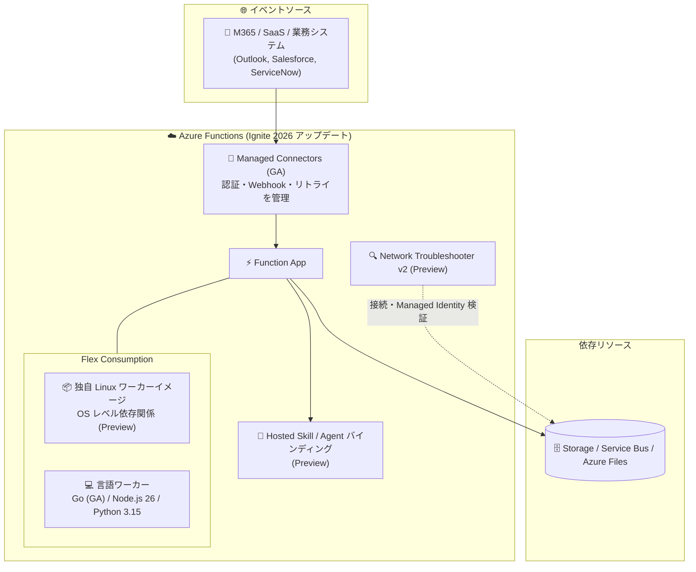

# Azure Functions: Ignite 2026 アップデート群 (Managed Connectors GA、Flex Consumption 拡張、エージェントバインディングほか)

**リリース日**: 2026-11-17

**サービス**: Azure Functions

**機能**: Managed Connectors GA / Network Troubleshooter v2 / OS レベル依存関係サポート (コンテナ) / Hosted Skill・Agent バインディング / Go サポート GA / Node.js 26 / Python 3.15

**ステータス**: Launched (GA) 2 件 / In preview 5 件

[このアップデートのインフォグラフィックを見る](https://takech9203.github.io/azure-news-summary/20261117-azure-functions-updates.html)

## 概要

Microsoft Ignite 2026 に合わせて、Azure Functions に関する 7 件のアップデートが同時に発表された。統合機能、診断ツール、ホスティング環境の拡張、AI エージェント連携、言語ランタイムの拡充と、Functions のプラットフォーム全体にわたる大規模な機能強化である。

GA (一般提供) となったのは 2 件。**Managed Connectors** は、Microsoft 365、SaaS、業務システム (Outlook、SharePoint、Dataverse、Salesforce、ServiceNow など) のイベントに反応するイベント駆動型アプリを、使い慣れた Functions のプログラミングモデルで構築できる機能である。**Golang サポート (Flex Consumption)** は、型付き Go ハンドラーと標準 Go モジュールによるコードファーストのプログラミングモデルを提供し、従来のカスタムハンドラー方式で必要だった HTTP サーバーの運用や `function.json` の手動作成を不要にする。

パブリックプレビューは 5 件。**Network Troubleshooter v2** は Function App の依存関係 (Storage、Service Bus、Azure Files) をトップダウンで可視化する診断ツール、**OS レベル依存関係サポート** は Flex Consumption で独自の Linux ワーカーイメージを持ち込める機能、**Hosted Skill and Agent バインディング** は AI エージェントを関数に組み込む際の定型コードを削減する 3 種のバインディング、**Node.js 26** と **Python 3.15** は最新言語ランタイムの早期評価を可能にするものである。

**アップデート前の課題**

- SaaS や業務システムと連携するには、サービスごとの API、認証、Webhook、リトライ処理を開発者が個別に実装・管理する必要があった (Managed Connectors 以前)
- 接続性の問題と構成 (Managed Identity など) の問題を別々のツールで診断する必要があった
- Flex Consumption は Microsoft 管理のワーカー環境のみで、ネイティブ実行ファイルやシステムライブラリが必要なワークロードは、再設計・別サービスへの切り出し・別ホスティングへの移行を迫られていた
- AI エージェントをアプリに組み込むには、ビジネスロジック以前にセットアップやライフサイクル管理のコードが必要だった
- Go で Functions を書くにはカスタムハンドラー方式しかなく、HTTP サーバーの運用と `function.json` の手動作成が必要だった
- Python ワーカーの gRPC メッセージングパッケージ (`grpcio` / `protobuf`) とアプリ依存関係が重複し、互換性競合が発生することがあった

**アップデート後の改善**

- Managed Connectors が認証・Webhook・リトライなどを Azure 側で処理し、開発者はアプリロジックに集中できる (C#、Python、Node.js 対応、Webhook 型とポーリング型の両トリガーをサポート)
- Network Troubleshooter v2 が依存関係の検出、接続ステータス確認、Managed Identity 構成の検証を 1 つの体験に統合
- Flex Consumption で関数コード・言語ワーカー・OS レベルソフトウェアを同梱した Linux ワーカーイメージをビルドでき、イメージダイジェストによるバージョン管理・昇格が可能に
- Hosted Skill / Microsoft Agent Framework / GitHub Copilot の 3 種のバインディングにより、エージェント統合の定型コードを削減しつつ、検証・実行タイミング・結果利用は関数コード側で制御可能
- Go ネイティブワーカーが GA し、HTTP ストリーミング、Durable Functions、構造化ログ、OpenTelemetry エクスポートまでフルサポート
- Python 3.15 ワーカーは Rust ベースの新トランスポートを採用し、`grpcio` / `protobuf` への依存を排除して互換性競合を解消 (開発者が書くのは従来どおり Python)

## アーキテクチャ図

Managed Connectors が外部システムのイベントを Function App に取り込み、Flex Consumption 上では独自コンテナイメージと拡充された言語ワーカーで実行、Network Troubleshooter v2 が依存リソースへの接続と構成を検証するという全体像を示す。

## サービスアップデートの詳細

### 1. Managed Connectors (GA)

1. **Azure Connector Namespace 経由のコネクタ提供**
   - Outlook、SharePoint、Dataverse、Salesforce、ServiceNow など多数の Microsoft 365 / SaaS / サードパーティシステムに対応
2. **認証・Webhook・リトライの管理**
   - サービス固有の API をラップし、認証、Webhook、リトライなどを Azure 側で処理
3. **Webhook 型・ポーリング型トリガーと自動スケーリング**
   - 強い型付けの Connector SDK クライアントとコネクタトリガーを組み合わせて利用可能
4. **対応言語**: C#、Python、Node.js
5. **段階的な統合**
   - 既存の Functions トリガー/バインディングと併用でき、既存アプリにも段階的に追加可能

### 2. Network Troubleshooter v2 (Preview)

1. **依存関係のトップダウンビュー**
   - Function App の依存関係 (Storage、Service Bus、Azure Files) を一覧表示
2. **接続ステータスの確認と Managed Identity 構成の検証**
   - 接続性の問題と構成の問題を別々に診断する必要がなくなった
3. **前提条件なし**
   - プラン、リージョン、Managed Identity に関する前提条件や制限はない

### 3. OS レベル依存関係サポート via コンテナ — Flex Consumption (Preview)

1. **独自 Linux ワーカーイメージのビルド**
   - 関数コード、言語ワーカー、言語依存関係、OS レベルソフトウェアを同梱可能
2. **有効になるシナリオ例**
   - Puppeteer + Chromium のブラウザ自動化、Puppeteer Sharp の PDF 生成、GnuPG によるデータ暗号化、カスタムフォント・証明書・ネイティブライブラリ・ドライバー・CLI ツールが必要なワークロード
3. **運用モデル**
   - イメージダイジェストでテスト済み環境をバージョン管理・昇格。ランタイムと依存関係を独自のリリースサイクルで更新可能
   - Azure 側は Functions ホストを個別に管理し、トリガー統合・リクエストルーティング・イベント駆動スケーリングを引き続き提供
4. **現時点の対応言語**: .NET isolated、Python、Go、Node.js (追加言語は数週間以内に対応予定)

### 4. Hosted Skill and Agent バインディング (Preview)

1. **Hosted Skill バインディング**
   - Markdown で定義されたホステッドスキルをシンプルな API で呼び出し。スキル設定・ツール・会話履歴の再利用、ストリーミング結果、会話の継続に対応
2. **Microsoft Agent Framework Agent バインディング**
   - ネイティブの Agent Framework エージェントを直接操作。SDK API、独自モデルクライアント、カスタム Python ツールに対応
3. **GitHub Copilot Agent バインディング**
   - ネイティブの GitHub Copilot SDK セッションを直接操作。セッション API、ツール、構成オプションに対応

### 5. Golang サポート — Flex Consumption (GA)

1. **コードファーストのプログラミングモデル**
   - 型付き Go ハンドラー、標準 Go モジュール、標準 `net/http` ハンドラーと型付きイベントペイロードをサポート
2. **主なリリース機能**
   - Functions トリガー、型付きバッチ処理、Blob Storage SDK クライアントのインジェクション、HTTP ストリーミング、Durable Functions のオーケストレーション/アクティビティ、構造化ログ、設定可能な OpenTelemetry エクスポート
3. **ツール統合**
   - Azure Functions Core Tools と Azure CLI でローカル開発・パッケージング・デプロイが可能
4. **カスタムハンドラー方式からの改善**
   - カスタムハンドラー HTTP サーバーの運用と `function.json` の手動作成が不要に

### 6. Node.js 26 サポート (Preview)

1. **対応プラン (Linux)**: Flex Consumption、Elastic Premium、Dedicated (App Service)
2. **既存プログラミングモデルを維持**
   - JavaScript / TypeScript の関数アプリを新ランタイムで評価可能
3. **制約**: Linux Consumption は非対応。Windows ホスティングは今後提供予定

### 7. Python 3.15 サポート (Preview)

1. **対応プラン (Linux x64)**: Flex Consumption、Elastic Premium、Dedicated (App Service) ※各プランが提供されるリージョンに限る
2. **v1 / v2 両プログラミングモデルに対応**
   - 依存関係、ネイティブ拡張、デプロイワークフローを含めて評価可能
3. **Rust ベースの新トランスポート**
   - ホストとのメッセージングを処理し CPython を埋め込む方式で、ワーカーの `grpcio` / `protobuf` 依存を排除。アプリ側では引き続き両パッケージを利用可能。パフォーマンスも向上

## 技術仕様

| 項目 | 詳細 |
|------|------|
| Managed Connectors 対応言語 | C#、Python、Node.js |
| Managed Connectors トリガー | Webhook 型・ポーリング型 (自動スケーリング対応) |
| Network Troubleshooter v2 対応依存関係 | Storage、Service Bus、Azure Files |
| OS レベル依存関係サポート対象 | Flex Consumption、Linux ワーカーイメージのみ |
| コンテナ対応言語 (現時点) | .NET isolated、Python、Go、Node.js |
| エージェントバインディング種別 | Hosted Skill / Microsoft Agent Framework / GitHub Copilot |
| Go サポート | Flex Consumption で GA。Durable Functions、HTTP ストリーミング対応 |
| Node.js 26 対応プラン | Flex Consumption、Elastic Premium、Dedicated (いずれも Linux) |
| Python 3.15 対応プラン | Flex Consumption、Elastic Premium、Dedicated (Linux x64) |

## メリット

### ビジネス面

- SaaS・業務システム連携の実装/保守コストを削減し、Logic Apps 的な接続性と Functions のコードファースト開発を両立できる
- AI エージェント機能の組み込みが容易になり、エージェント活用アプリの市場投入までの時間を短縮できる
- ネイティブ依存を持つ既存ワークロード (PDF 生成、暗号化処理など) を再設計せずにサーバーレスへ移行できる

### 技術面

- 認証・Webhook・リトライといった接続まわりの非機能要件をプラットフォームに委譲できる
- 依存関係の接続・構成問題を単一のトラブルシューターで診断でき、運用負荷が下がる
- Go がネイティブワーカーで GA となり、カスタムハンドラーの運用負担なしに Durable Functions まで利用可能
- Python ワーカーの依存競合 (gRPC パッケージの重複) が解消され、ランタイムの安定性が向上

## デメリット・制約事項

- Network Troubleshooter v2、OS レベル依存関係サポート、エージェントバインディング、Node.js 26、Python 3.15 はパブリックプレビューであり、本番利用には SLA 面の考慮が必要
- OS レベル依存関係サポートは Linux ワーカーイメージのみが対象。対応言語も現時点で .NET isolated、Python、Go、Node.js に限定 (追加言語は順次対応予定)
- Node.js 26 は Linux Consumption 非対応、Windows ホスティングは未対応 (今後提供予定)
- Python 3.15 は Linux x64 のみ、各プランが提供されるリージョンに限定

## ユースケース

### ユースケース 1: SaaS イベント駆動の業務自動化

**シナリオ**: Salesforce の商談更新イベントを受けて、SharePoint に資料を生成し、Outlook で関係者へ通知するワークフローを、Logic Apps ではなくコードファーストで実装したい。

**効果**: Managed Connectors (GA) により、各サービスの認証・Webhook・リトライを実装せずに C# / Python / Node.js のコードだけで実現。既存の Functions の監視・スケーリング体験をそのまま利用できる。

### ユースケース 2: ネイティブ依存を持つ処理のサーバーレス化

**シナリオ**: Chromium を使った Web ページのスクリーンショット取得や PDF 生成を、VM やカスタムコンテナ基盤ではなく従量課金のサーバーレスで動かしたい。

**効果**: Flex Consumption の OS レベル依存関係サポート (Preview) により、Chromium や GnuPG などを同梱した独自 Linux イメージを持ち込みつつ、イベント駆動スケーリングは Azure に任せられる。

### ユースケース 3: AI エージェントを組み込んだ API

**シナリオ**: 既存の HTTP API に、Markdown で定義したスキルを実行するエージェント機能を追加したいが、エージェント SDK のセットアップコードは書きたくない。

**効果**: Hosted Skill バインディング (Preview) でシンプルな API からスキルを呼び出し、ストリーミング応答と会話の継続も関数コードから制御できる。

## 料金

各アップデート固有の料金情報は公式発表には記載されていない。Azure Functions の料金体系 (Flex Consumption、Premium、Dedicated など) は料金ページを参照。

- [Azure Functions 料金ページ](https://azure.microsoft.com/pricing/details/functions/)

## 利用可能リージョン

公式発表にリージョン固有の記載はない (Node.js 26 / Python 3.15 は各プランが提供されるリージョンに準ずる)。

## 関連サービス・機能

- **Azure Logic Apps**: Managed Connectors は Logic Apps のコネクタエコシステムに関連する機能で、コードファースト開発との使い分けが可能
- **Azure Durable Functions**: Go ワーカー GA でオーケストレーションとアクティビティがサポートされた
- **Microsoft Agent Framework / GitHub Copilot SDK**: エージェントバインディングが直接統合する対象
- **Azure Storage / Service Bus / Azure Files**: Network Troubleshooter v2 が診断対象とする依存リソース
- **Application Insights / OpenTelemetry**: Go ワーカーはホストテレメトリと併用可能な OpenTelemetry エクスポートに対応

## 参考リンク

- [インフォグラフィック](https://takech9203.github.io/azure-news-summary/20261117-azure-functions-updates.html)
- [公式アップデート情報: Managed Connectors GA](https://azure.microsoft.com/updates?id=579440)
- [公式アップデート情報: Network Troubleshooter v2 Preview](https://azure.microsoft.com/updates?id=578980)
- [公式アップデート情報: OS-level dependency support via containers (Flex Consumption) Preview](https://azure.microsoft.com/updates?id=578975)
- [公式アップデート情報: Hosted Skill and Agent Bindings Preview](https://azure.microsoft.com/updates?id=578845)
- [公式アップデート情報: Golang support GA (Flex Consumption)](https://azure.microsoft.com/updates?id=578812)
- [公式アップデート情報: Node.js 26 Preview](https://azure.microsoft.com/updates?id=578807)
- [公式アップデート情報: Python 3.15 Preview](https://azure.microsoft.com/updates?id=578802)
- [Microsoft Learn: Hosted Skill and Agent Bindings](https://learn.microsoft.com/en-us/azure/azure-functions/functions-agent-bindings)
- [Microsoft Learn: Go developer reference](https://learn.microsoft.com/en-us/azure/azure-functions/functions-reference-go)
- [Microsoft Learn: Azure Functions のサポート言語](https://learn.microsoft.com/en-us/azure/azure-functions/supported-languages)
- [GitHub: Azure Functions Go worker](https://github.com/Azure/azure-functions-golang-worker)
- [料金ページ](https://azure.microsoft.com/pricing/details/functions/)

## まとめ

Ignite 2026 に合わせた今回の 7 件のアップデートで、Azure Functions は「SaaS 連携 (Managed Connectors)」「カスタム実行環境 (コンテナによる OS 依存関係)」「AI エージェント統合 (Skill/Agent バインディング)」「言語ランタイム (Go GA、Node.js 26、Python 3.15)」「運用診断 (Network Troubleshooter v2)」の各方向で大きく拡張された。特に Managed Connectors と Go サポートの GA は本番採用の検討に値する。Solutions Architect としては、Logic Apps と Functions の使い分け基準の見直し、ネイティブ依存ワークロードの Flex Consumption への移行可否評価、Node.js 26 / Python 3.15 プレビューでの既存アプリの互換性検証を推奨する。

---

**タグ**: Azure Functions, Flex Consumption, Managed Connectors, AI Agent, Golang, Node.js, Python, Microsoft Ignite, GA, Public Preview
