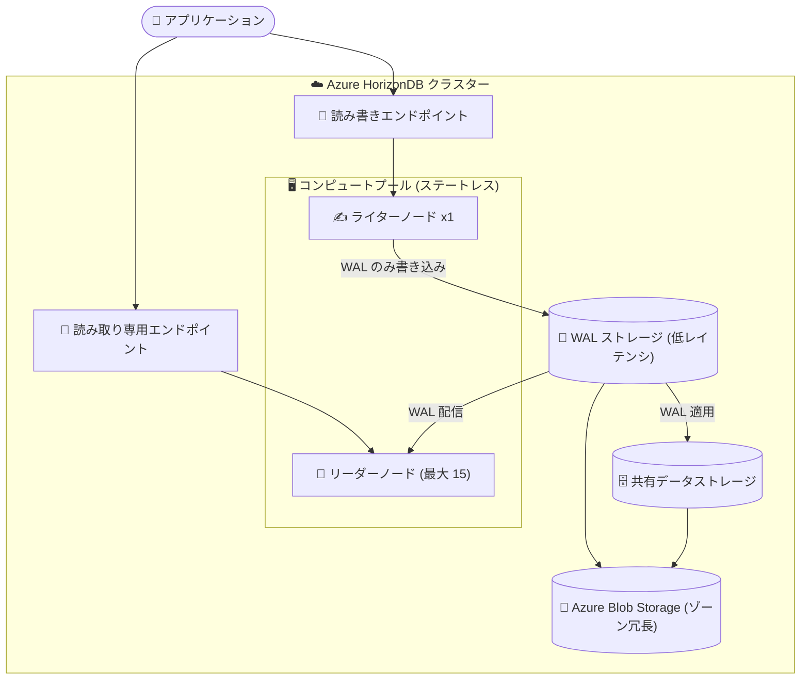

# Azure HorizonDB: 一般提供 (GA) 開始と関連機能群の発表

**リリース日**: 2026-11-17

**サービス**: Azure HorizonDB

**機能**: Azure HorizonDB の一般提供 (GA) 開始、およびセキュリティ・バックアップ・監視・AI 関連機能群

**ステータス**: Launched (GA) ※一部機能は In preview

[このアップデートのインフォグラフィックを見る](https://takech9203.github.io/azure-news-summary/20261117-azure-horizondb-ga.html)

## 概要

Microsoft Ignite に合わせて、Microsoft の次世代クラウドネイティブ PostgreSQL サービス **Azure HorizonDB** が一般提供 (GA) となりました。Azure HorizonDB は、コンピュートとストレージを完全に分離した「database-as-a-log」アーキテクチャを採用したフルマネージド PostgreSQL サービスで、高スループット・低レイテンシのトランザクション処理、AI ワークロード、大規模な読み取りスケールアウトを対象としています。完全な PostgreSQL 互換性を維持しているため、既存アプリケーションの移行も容易です。

GA と同時に、エンタープライズ利用に必要な多数の機能が発表されました。セキュリティ面では Microsoft Entra 認証、ユーザー割り当てマネージド ID (UMI)、プライベートエンドポイント対応、カスタマーマネージドキー (CMK、プレビュー) が提供されます。運用面では geo 冗長バックアップ、1〜35 日のバックアップ保持期間設定、システム管理メンテナンスウィンドウ、Azure Policy 対応、Azure Advisor 統合、Azure Monitor アラート、pgAudit による監査、Log Analytics 統合が追加されました。AI 面では AI モデル管理 (限定プレビュー)、AI パイプラインによるナレッジグラフ構築 (パブリックプレビュー)、Apache AGE のグラフクエリ性能改善が発表されています。

**アップデート前の課題**

- Azure HorizonDB はプレビュー段階 (2026 年 6 月開始) であり、本番ワークロードでの利用に SLA などの保証がなかった
- 従来の PostgreSQL サービスでは、コンピュートとストレージが密結合しており、読み取りノード追加時のデータコピーやチェックポイント I/O がボトルネックになりやすかった
- セルフマネージド PostgreSQL では、バックアップ・監査・監視・ガバナンスを個別に構築・運用する必要があった

**アップデート後の改善**

- GA によりミッションクリティカルな本番ワークロードで利用可能になった
- 共有ストレージ型アーキテクチャにより、データコピーなしで最大 15 台のリーダーノードを迅速に追加でき、WAL 共有により高速なフェイルオーバーを実現
- geo 冗長バックアップ、Entra 認証、Private Link、pgAudit、Azure Monitor/Advisor/Policy 統合など、エンタープライズ運用に必要な機能が Azure ネイティブで利用可能になった
- Microsoft Foundry 経由の AI モデル管理やナレッジグラフ構築など、データベース内で AI アプリケーションを構築する機能が追加された

## アーキテクチャ図

コンピュートノードはステートレスで、ライターノードは WAL のみを WAL ストレージに書き込みます。WAL が共有データストレージとリーダーノードに配信され、最終的な耐久性はゾーン冗長な Azure Blob Storage が担保します。

## サービスアップデートの詳細

### 主要機能

今回の発表は Azure HorizonDB 本体の GA と、それを取り巻く機能群で構成されます。

#### 1. Azure HorizonDB 本体の GA

1. **コンピュートとストレージの分離 (GA)**
   - コンピュート (vCore/メモリ) とストレージを独立してスケール可能。ストレージはデータ増加に応じて自動拡張され、使用分のみ課金
   - 全ノードが単一のデータコピーを共有するため、リーダーノードをデータコピーなしで迅速に追加可能
   - 各ノードは vCore あたり 8 GB メモリと 32 GB のローカル NVMe SSD キャッシュを持つ

2. **database-as-a-log アーキテクチャ (GA)**
   - コンピュートからストレージへは WAL のみを書き込み、データページは書き込まない。WAL がシステム全体の信頼できる唯一の情報源
   - チェックポイント I/O ボトルネックを排除し、データベースサイズによらず一貫した書き込みレイテンシを実現

3. **リージョン拡大 (GA)**
   - 「15 リージョンで利用可能」とアナウンス。ドキュメント上は Americas 6、Europe 2、Asia Pacific 5 リージョンが記載されている (詳細は「利用可能リージョン」参照)

#### 2. バックアップ・DR

4. **geo 冗長バックアップとリストア (GA)**
   - バックアップを別リージョンに複製し、リージョン障害時にペアリージョンへ復元可能。クラスター作成時に有効化する (後から変更不可)

5. **バックアップ保持期間のカスタマイズ (1〜35 日)**
   - アプリケーションとデータ保護要件に合わせて保持期間を 1〜35 日の範囲で設定可能

#### 3. セキュリティ・ネットワーク

6. **Microsoft Entra 認証 (GA)**
   - データベース認証を ID ベースで集中管理。ローカルの資格情報管理に依存しないセキュアな認証を実現

7. **ユーザー割り当てマネージド ID (UMI) (GA)**
   - HorizonDB クラスターに Azure ID を割り当てて集中管理し、資格情報管理の負担を削減

8. **プライベートエンドポイント対応 (GA)**
   - Azure Private Link 経由で仮想ネットワーク内のプライベート IP からクラスターに接続。プライベート DNS 統合と、パブリックアクセス無効化オプションを提供

9. **カスタマーマネージドキー (CMK) による保存時暗号化 (パブリックプレビュー)**
   - 既定のサービスマネージドキー (SMK) に加え、顧客が管理するキーでの暗号化を選択可能。暗号化方式はクラスター作成時に選択 (後から変更不可)

#### 4. 運用・ガバナンス・監視

10. **システム管理メンテナンスウィンドウ (GA)**
    - 計画されたサービスアップグレードを Azure が自動実行。メンテナンススケジュールの設定・管理は不要 (現時点でカスタムウィンドウや延期は不可)

11. **Azure Policy 対応**
    - 組み込みポリシーにより診断設定の自動デプロイなど、ガバナンスと可観測性の標準をクラスター全体に一貫して適用 (発表文ではプレビューと記載)

12. **Azure Advisor 統合 (GA)**
    - HorizonDB リソースを分析し、信頼性・パフォーマンス改善のためのパーソナライズされた推奨事項を提示

13. **Azure Monitor アラート (GA)**
    - HorizonDB メトリクスに基づくアラートルールとしきい値を設定し、条件成立時に通知を受信

14. **pgAudit による監査 (GA)**
    - データアクセス、変更、ロール変更、DDL 操作などの PostgreSQL アクティビティを記録し、監査ログを Azure Monitor Log Analytics へ送信

15. **Log Analytics 統合 (GA)**
    - Azure Monitor 診断設定によりデータベースログと診断データを Log Analytics へ送信し、一元的なクエリ・分析・トラブルシューティングが可能

#### 5. AI・グラフ機能

16. **AI モデル管理 (限定プレビュー)**
    - Microsoft Foundry を通じて、埋め込み・セマンティックランキング・生成用のフルマネージド AI モデルをワンステップでプロビジョニング。モデル管理自体は追加料金なし (モデル利用分は Microsoft Foundry の標準レートで課金)

17. **AI パイプラインによるナレッジグラフ構築 (パブリックプレビュー)**
    - AI がソースデータからエンティティ・リレーションシップ・プロパティを抽出し、クエリ可能なグラフを自動構築

18. **Apache AGE のグラフ性能改善 (GA)**
    - クエリプランニング強化とグラフ結合の最適化による読み取りクエリの高速化、重複検出の高速化とメモリ効率改善によるインジェスト性能向上

## 技術仕様

| 項目 | 詳細 |
|------|------|
| サービス形態 | フルマネージド・クラウドネイティブ PostgreSQL (完全な PostgreSQL 互換) |
| クラスター構成 | ライターノード x1 + リーダーノード最大 15 (クラスター全体) |
| コンピュートプール | 読み書きプール x1 (読み取り専用プールは未提供)。プール単位でコンピュートサイズ・ノード数・HA・ファイアウォール・パラメータグループを設定 |
| コンピュートサイズ | 2〜192 vCore/ノード (2, 4, 8, 16, 20, 32, 48, 64, 96, 128, 192)。AMD / Intel を選択可 |
| ノードリソース | vCore あたりメモリ 8 GB + ローカル NVMe SSD キャッシュ 32 GB |
| ストレージ | WAL ストレージ + 共有データストレージ + Azure Blob Storage の 3 層。すべてゾーン回復性あり。自動拡張・使用量課金 |
| 高可用性 | ゾーン冗長 HA (プールのノードを複数の可用性ゾーンに配置、2 ノード以上必要)。WAL 共有によりログ巻き戻し不要の高速フェイルオーバー |
| エンドポイント | 読み書きエンドポイント x1 (フェイルオーバー後も接続文字列変更不要) + プールごとの読み取り専用エンドポイント (負荷分散) |
| バックアップ | Blob スナップショットベース (DB サイズによらず高速、ノードリソースを消費しない)。保持期間 1〜35 日、geo 冗長バックアップ対応 |
| 認証 | PostgreSQL 認証 + Microsoft Entra 認証 (GA) |
| 暗号化 | 既定でサービスマネージドキー (SMK)。CMK はパブリックプレビュー |
| ネットワーク | パブリックアクセス (ファイアウォールルール、既定は全拒否) + Azure Private Link (プライベート DNS 統合) |
| 監査・監視 | pgAudit、Azure Monitor 診断設定/Log Analytics、メトリクスアラート、Azure Advisor、Azure Policy |

## 設定方法

### 前提条件

1. Azure サブスクリプション
2. 利用可能リージョンの確認 (「利用可能リージョン」セクション参照)
3. PostgreSQL メジャーバージョン、データ暗号化方式 (SMK/CMK)、geo 冗長バックアップの有無はクラスター作成時にのみ選択可能で、後から変更できない点に注意

### Azure Portal

1. Azure Portal で Azure HorizonDB クラスターを作成する。作成時に PostgreSQL メジャーバージョン、認証方式 (PostgreSQL / Microsoft Entra)、パブリックネットワークアクセス、プライベートエンドポイント、データ暗号化、バックアップ保持期間 (1〜35 日)、geo 冗長バックアップなどを設定する
2. Portal からクラスターを作成すると、読み書きプール `defaultpool` が自動的に作成される
3. コンピュートプールに対してコンピュートサイズ、ノード数、高可用性、ファイアウォールルール、パラメータグループを設定する
4. ノードの作成・配置・メンテナンス・フェイルオーバーは Azure HorizonDB が自動管理する (ノード単位の操作は不要)

## メリット

### ビジネス面

- GA によりミッションクリティカルな本番ワークロードへ適用可能になった
- 使用量ベースのストレージ課金 (事前のストレージサイズ/IOPS 選択が不要) によるコスト最適化
- セルフマネージド PostgreSQL からの移行先として、運用負荷 (バックアップ、パッチ、監査、監視) を大幅に削減
- Entra 認証、CMK、pgAudit、Private Link など、規制業界のコンプライアンス要件に対応しやすい

### 技術面

- WAL のみを書き込む database-as-a-log 設計により、書き込み増幅を削減し、DB サイズによらず予測可能な書き込みレイテンシを実現
- データコピー不要のリーダーノード追加により、読み取りワークロードを迅速にスケールアウト可能 (最大 15 ノード)
- バックアップ・チェックポイント・WAL アーカイブなどをストレージ層へオフロードし、ノードのリソースをワークロードに集中
- ベクトル検索、AI モデル管理、ナレッジグラフ、Apache AGE により、RAG やセマンティック検索をデータベース層で直接実装可能

## デメリット・制約事項

- クロスリージョンのリーダーノードは未対応 (DR は geo 冗長バックアップ + ペアリージョンへのリストアで対応)
- 読み取り専用プール (read pool) は未提供で、現時点では 1 クラスター 1 コンピュートプールのみ
- CMK と geo 冗長バックアップは併用不可 (どちらか一方のみ)
- カスタムメンテナンスウィンドウ、メンテナンスの延期・再スケジュール、メンテナンス通知は未対応
- インプレースのメジャーバージョンアップグレードは未対応 (作成時にバージョンを選択)
- 組み込みの接続プーリング (PgBouncer) は未提供 (外部プーラーは利用可能)
- 長期保持 (LTR) バックアップは未対応 (最大 35 日)
- 仮想ネットワークインジェクションは未対応 (Private Link は対応)
- PostgreSQL メジャーバージョン・暗号化方式・geo 冗長バックアップはクラスター作成後に変更不可

## ユースケース

### ユースケース 1: 大規模 OLTP / SaaS バックエンド

**シナリオ**: 高スループット・低レイテンシが求められる基幹業務アプリケーション、e コマース、SaaS バックエンド。

**実装例**: 読み書きプールにゾーン冗長 HA を構成し、読み取りはプールの読み取り専用エンドポイント経由でリーダーノードに負荷分散する。

**効果**: WAL 共有による高速フェイルオーバーと、DB サイズに依存しない一貫した書き込みレイテンシにより、予測可能な性能と高可用性を両立。

### ユースケース 2: RAG・AI アプリケーション

**シナリオ**: ベクトル検索やセマンティック検索を使う RAG パイプライン、レコメンデーションエンジンをデータベース層で構築したい。

**実装例**: AI モデル管理 (限定プレビュー) で Microsoft Foundry の埋め込み・ランキング・生成モデルをワンステップでプロビジョニングし、AI パイプライン (パブリックプレビュー) で PostgreSQL データからナレッジグラフを自動構築する。

**効果**: 外部の AI 基盤を個別に構築せず、データのあるデータベース内で AI アプリケーションを完結でき、開発を簡素化。

### ユースケース 3: 規制業界でのセキュアなデータベース運用

**シナリオ**: 金融・医療など、監査証跡・プライベート接続・鍵管理の要件がある環境。

**実装例**: Private Link でパブリックアクセスを無効化し、Entra 認証 + UMI で ID を集中管理。pgAudit で DDL/データアクセスを記録して Log Analytics に送信し、Azure Policy で診断設定の適用を自動化する。

**効果**: コンプライアンス要件を Azure ネイティブ機能で満たし、監査・ガバナンス運用を標準化。

## 料金

Azure HorizonDB の課金は以下の 3 要素で構成されます (公式料金ページでは執筆時点で単価が未掲載のため、具体的な金額は料金計算ツールで確認してください)。

| 項目 | 料金体系 |
|------|---------|
| コンピュート | プロビジョニングした vCore のコア時間単位で課金 (プライマリと HA レプリカの両方が課金対象)。2〜192 vCore/ノード |
| データベースストレージ | 使用した容量の GiB/月 単位で課金 (自動拡張、事前割り当て不要) |
| バックアップストレージ | クラスターの初期合計サイズの 100% まで無料。超過分は GiB/月 単位で課金 |
| AI モデル管理 | 管理自体は追加料金なし。モデル利用分は Microsoft Foundry の標準レートで課金され、HorizonDB の請求に含まれる |

## 利用可能リージョン

アップデートでは 15 リージョンへの拡大が発表されています。公式ドキュメント (執筆時点) に記載のリージョンは以下のとおりです。

| 地域 | リージョン |
|------|-----------|
| Americas | Canada Central, Central US, East US, South Central US, West US 2, West US 3 |
| Europe | Germany West Central, Sweden Central |
| Asia Pacific | Australia East, India South Central, Indonesia Central, Japan East, Korea Central |

日本では Japan East (東日本) で利用可能です。最新のリージョン状況は Azure Portal を確認してください。

## 関連サービス・機能

- **Azure Database for PostgreSQL Flexible Server**: 既存のマネージド PostgreSQL サービス。HorizonDB はより大規模・高性能・AI 対応のワークロード向けの選択肢
- **Microsoft Foundry**: AI モデル管理機能のバックエンド。埋め込み・セマンティックランキング・生成モデルを提供
- **Microsoft Fabric OneLake**: トランザクションデータのミラーリングによる分析統合 (クラスターレベル設定)
- **Azure Monitor / Log Analytics**: メトリクスアラート、診断ログ、pgAudit 監査ログの収集・分析
- **Azure Advisor / Azure Policy**: 推奨事項の提示とガバナンス標準の自動適用
- **Azure Private Link / Microsoft Entra ID / Azure Key Vault**: プライベート接続、ID ベース認証、CMK によるセキュリティ強化
- **Apache AGE**: PostgreSQL 上のグラフデータベース拡張。ナレッジグラフ構築の基盤

## 参考リンク

- [インフォグラフィック](https://takech9203.github.io/azure-news-summary/20261117-azure-horizondb-ga.html)
- [公式アップデート情報: Azure HorizonDB GA](https://azure.microsoft.com/updates?id=579388)
- [Geo 冗長バックアップとリストア](https://azure.microsoft.com/updates?id=574168)
- [バックアップ保持期間のカスタマイズ (1〜35 日)](https://azure.microsoft.com/updates?id=574163)
- [AI モデル管理 (限定プレビュー)](https://azure.microsoft.com/updates?id=563097)
- [プライベートエンドポイント対応](https://azure.microsoft.com/updates?id=574153)
- [Azure Policy 対応](https://azure.microsoft.com/updates?id=581180)
- [システム管理メンテナンスウィンドウ](https://azure.microsoft.com/updates?id=581170)
- [Azure Advisor 統合](https://azure.microsoft.com/updates?id=579938)
- [Azure Monitor アラート](https://azure.microsoft.com/updates?id=579933)
- [監査 (pgAudit)](https://azure.microsoft.com/updates?id=579928)
- [Apache AGE グラフ性能改善](https://azure.microsoft.com/updates?id=579660)
- [AI パイプラインによるナレッジグラフ構築 (パブリックプレビュー)](https://azure.microsoft.com/updates?id=579602)
- [Log Analytics 統合](https://azure.microsoft.com/updates?id=579574)
- [カスタマーマネージドキーによる保存時暗号化 (パブリックプレビュー)](https://azure.microsoft.com/updates?id=579540)
- [15 リージョンで利用可能](https://azure.microsoft.com/updates?id=578314)
- [Microsoft Entra 認証](https://azure.microsoft.com/updates?id=575111)
- [ユーザー割り当てマネージド ID](https://azure.microsoft.com/updates?id=575069)
- [Microsoft Learn: What Is Azure HorizonDB?](https://learn.microsoft.com/en-us/azure/horizondb/overview/overview)
- [Microsoft Learn: Azure HorizonDB リリースノート](https://learn.microsoft.com/en-us/azure/horizondb/release-notes/release-notes)
- [料金ページ](https://azure.microsoft.com/en-us/pricing/details/horizondb/)

## まとめ

Azure HorizonDB の GA は、Microsoft の PostgreSQL 戦略における大きな節目です。コンピュート・ストレージ分離と database-as-a-log アーキテクチャにより、従来のマネージド PostgreSQL では難しかった「DB サイズに依存しない予測可能な書き込み性能」「データコピー不要の読み取りスケールアウト (最大 15 ノード)」「高速フェイルオーバー」を実現し、同時に Entra 認証・Private Link・pgAudit・geo 冗長バックアップ・Azure Monitor/Advisor/Policy 統合といったエンタープライズ機能が一通り揃いました。AI モデル管理やナレッジグラフ構築などの AI ネイティブ機能も特徴的です。

Solutions Architect としては、(1) 大規模 OLTP や読み取りスケールが必要な PostgreSQL ワークロードの新規構築・移行先候補として評価する、(2) クラスター作成時にしか選べない設定 (PostgreSQL バージョン、CMK/SMK、geo 冗長バックアップ) と、CMK と geo 冗長バックアップが併用不可である点を設計初期に確認する、(3) 読み取り専用プールやクロスリージョンレプリカなど未提供機能の制約を把握したうえで DR 設計 (geo リストアベース) を行う、ことを推奨します。日本では Japan East で利用可能です。

---

**タグ**: Azure HorizonDB, PostgreSQL, Databases, GA, Microsoft Ignite, AI, ベクトル検索, ナレッジグラフ, Apache AGE, バックアップ, セキュリティ, Private Link, Microsoft Entra, pgAudit, Azure Monitor
