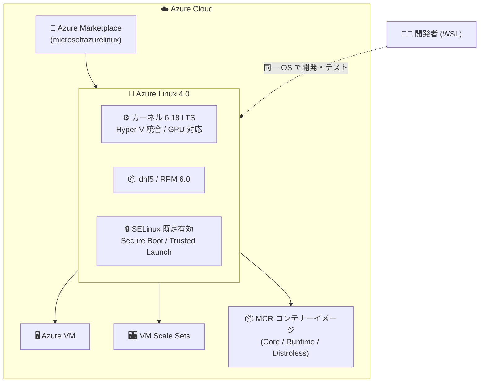

# Azure Linux: Azure Linux 4.0 の一般提供開始 (GA)

**リリース日**: 2026-11-17

**サービス**: Azure Linux

**機能**: Azure Linux 4.0 (Azure Virtual Machines / VM Scale Sets 向け)

**ステータス**: Launched (GA)

[このアップデートのインフォグラフィックを見る](https://takech9203.github.io/azure-news-summary/20261117-azure-linux-4-0-ga.html)

## 概要

Microsoft Ignite にて、**Azure Linux 4.0** が Azure Virtual Machines および VM Scale Sets 向けに一般提供 (GA) となったことが発表されました。Azure Linux は Microsoft が開発・保守するファーストパーティのオープンソース Linux ディストリビューション (Fedora 派生・RPM ベース) で、Azure のコンピューティング、ストレージ、ネットワークに最適化されています。すでに Azure 内部では AI ワークロード、AKS、App Service、Cosmos DB などで数百万コア規模の稼働実績があります。

4.0 では Linux カーネル 6.18 LTS、新パッケージマネージャー dnf5、glibc 2.42、OpenSSL 3.5、Python 3.14 などモダン化されたスタックを搭載し、パッケージ構成を最小限に絞ることで VM の起動・プロビジョニングの高速化と攻撃対象領域の削減を実現しています。OS ライセンス費用は不要で、Azure のコンピューティング料金に含まれます。

**アップデート前の課題**

- Azure Linux 4.0 はプレビュー段階では評価・テスト用途に限定されており、本番環境では利用できなかった
- 顧客の汎用 VM ワークロード向けには、サードパーティ製ディストリビューションを利用する場合、OS ライセンス料や別途のサポート契約、ベンダー間の調整が必要になるケースがあった
- 旧バージョンの Azure Linux では `tdnf` パッケージマネージャーが使われており、依存関係解決の性能に課題があった

**アップデート後の改善**

- Azure VM / VM Scale Sets 上で Azure Linux 4.0 を本番利用できるようになった (顧客 VM 向けの汎用サーバー OS として設計された初のリリース)
- OS とクラウド基盤を Microsoft が単一ベンダーとして提供し、カーネルから CVE 対応までサプライチェーンを一貫管理 (Critical/High CVE の迅速なパッチ提供と月次セキュリティ更新)
- dnf5 により依存関係解決の高速化とメモリ使用量の削減を実現
- 追加の OS ライセンス費用やサポート契約が不要

## アーキテクチャ図



Azure Marketplace から Azure Linux 4.0 イメージを取得し、VM / VM Scale Sets にデプロイできます。同一のサプライチェーンでビルドされたコンテナーイメージが MCR で提供され、WSL 上でも同じ OS を使った開発・テストが可能です。

## サービスアップデートの詳細

### 主要機能

1. **Azure チューニング済みカーネル (Linux 6.18 LTS)**
   - Hyper-V 統合の改善、GPU/AI アクセラレータ対応、新ハードウェアドライバーを搭載

2. **セキュアバイデフォルト**
   - Secure Boot、Trusted Launch、SELinux (既定で有効)、カーネル強化、署名済みドライバー、ポスト量子暗号対応
   - SBOM を SLSA Level 3 を目標として公開

3. **最小フットプリント**
   - クラウドワークロードに必要なパッケージのみを同梱し、初日から攻撃対象領域を削減。起動・プロビジョニングも高速化

4. **追加 OS ライセンス費用なし**
   - Azure コンピューティング料金に含まれ、別途の OS ライセンス料やサポート契約が不要

5. **Microsoft 管理のサプライチェーン**
   - カーネルから CVE 対応まで一貫管理。Critical/High CVE への迅速なパッチ提供と月次セキュリティ更新

6. **予測可能なライフサイクル**
   - LTS カーネルによるフルサポートと、新ハードウェア向けの年次 HWE カーネル更新

7. **コンテナーイメージの提供**
   - VM と同じサプライチェーンでビルドされた Base (Core) / Runtime (Python, Node.js, Java, .NET) / Distroless イメージを Microsoft Container Registry (MCR) で提供

8. **WSL 対応**
   - WSL 上で Azure Linux を利用でき、デプロイ先と同じ OS で VS Code や CLI を使った開発・テストが可能

## 技術仕様

| 項目 | 詳細 |
|------|------|
| カーネル | Linux 6.18 LTS (新ドライバー、Hyper-V 統合改善、GPU/AI アクセラレータ対応) |
| パッケージマネージャー | dnf5 (高速な依存解決、低メモリ使用量) |
| glibc | 2.42 (文字列操作・メモリ割り当て・スレッド処理の性能向上) |
| OpenSSL | 3.5 (ポスト量子暗号、QUIC 改善、旧暗号スイートの削除) |
| systemd | 258 (ブート高速化、サービス管理・ログの改善) |
| Python | 3.14 (JIT コンパイラ) |
| RPM | 6.0 (DB バックエンド刷新、署名検証強化) |
| コンテナーランタイム | containerd、Podman |
| FIPS 140-3 | 認証取得手続き中 (FIPS が必須のワークロードは認証済みリリースを使用) |
| ベース | Fedora 派生・RPM ベース (Microsoft ファーストパーティ) |
| OS ディスクサイズ | 既定 5 GB (`--os-disk-size-gb` で拡張可能) |

## 設定方法

### 前提条件

1. Azure サブスクリプション
2. Azure CLI (イメージの検索・VM 作成に使用)

### Azure CLI

Azure Linux 4.0 イメージは Azure Marketplace のパブリッシャー `microsoftazurelinux` から提供されています (x86_64 Gen2: `microsoftazurelinux:azurelinux-4:4:latest`、ARM64 Gen2: `microsoftazurelinux:azurelinux-4:4-arm64:latest`)。

```bash
# パブリッシャーのオファー一覧を表示
az vm image list-offers --publisher microsoftazurelinux --location eastus

# オファーの SKU 一覧を表示
az vm image list-skus --publisher microsoftazurelinux --offer azurelinux-4 --location eastus

# SKU の全バージョンを表示
az vm image list --publisher microsoftazurelinux --offer azurelinux-4 --sku 4 --all

# 特定イメージバージョンの詳細を表示
az vm image show --urn microsoftazurelinux:azurelinux-4:4:latest
```

### Azure Portal

Azure Portal の Marketplace から `microsoftazurelinux.azurelinux-4` を検索して VM を作成できます。手順の詳細は [Microsoft Learn のクイックスタート](https://learn.microsoft.com/en-us/azure/azure-linux/) を参照してください。

## メリット

### ビジネス面

- 追加の OS ライセンス費用・サポート契約が不要で、Linux VM の TCO を削減できる
- OS とクラウド基盤が単一ベンダー (Microsoft) に統一され、障害時の切り分けやサポート窓口が一本化される
- Azure 内部 (AKS、App Service、Cosmos DB など) での数百万コア規模の稼働実績がある

### 技術面

- Azure VM SKU で検証済みで、Defender for Cloud、Azure Monitor、Trusted Launch のサポートを内蔵
- 最小パッケージ構成により起動・プロビジョニングが高速で、攻撃対象領域が小さい
- SELinux 既定有効、Secure Boot、ポスト量子暗号対応などセキュリティ第一の設計
- LTS カーネル + 年次 HWE カーネル更新による予測可能なライフサイクル
- VM・コンテナー (MCR)・WSL で同一のサプライチェーンの OS を利用でき、開発から本番まで環境を統一できる

## デメリット・制約事項

- デスクトップ / GUI 用途は対象外 (サーバー OS として設計)
- 旧バージョンの Azure Linux で使われていた `tdnf` から `dnf5` に変更されたため、`tdnf` を参照するスクリプト、Dockerfile、CI パイプラインは `dnf5` または `dnf` への更新が必要
- FIPS 140-3 認証は取得手続き中のため、FIPS が必須のワークロードは認証済みリリースを使用する必要がある
- 既定の OS ディスクサイズは 5 GB と小さく、必要に応じて拡張が必要
- 最小構成のため、必要なパッケージは packages.microsoft.com から追加インストールする運用が前提

## ユースケース

### ユースケース 1: Azure 最適化された汎用サーバー OS への移行

**シナリオ**: サードパーティ製 Linux ディストリビューションで稼働している Web / アプリケーションサーバーを、ライセンスコスト削減とセキュリティ運用の簡素化のために Azure Linux 4.0 に移行する。

**実装例**:

```bash
# Azure Linux 4.0 イメージの確認
az vm image show --urn microsoftazurelinux:azurelinux-4:4:latest
```

**効果**: OS ライセンス費用の削減、Microsoft 一元管理による CVE 対応の迅速化、最小フットプリントによるセキュリティリスクの低減。

### ユースケース 2: VM Scale Sets によるスケールアウト構成

**シナリオ**: 需要に応じて自動スケールする Web フロントエンドを、起動が高速な Azure Linux 4.0 ベースの VM Scale Sets で構成する。

**効果**: 最小パッケージ構成による高速なプロビジョニングで、スケールアウト時の応答性が向上。Image Customizer と Azure Compute Gallery を組み合わせてカスタムイメージを一貫してデプロイ可能。

### ユースケース 3: 開発から本番までの OS 統一

**シナリオ**: WSL 上の Azure Linux で開発・テストを行い、MCR の Azure Linux コンテナーイメージ (Runtime / Distroless) と Azure VM 上の Azure Linux 4.0 で本番運用することで、環境差異を排除する。

**効果**: 開発環境と本番環境の OS・サプライチェーンが統一され、環境差異による不具合を削減。Distroless イメージによりコンテナーの攻撃対象領域も最小化。

## 料金

Azure Linux 自体に追加の OS ライセンス費用はなく、Azure のコンピューティング料金 (VM / VM Scale Sets の料金) のみで利用できます。

| 項目 | 料金 |
|------|------|
| Azure Linux 4.0 (OS ライセンス) | 追加費用なし (Azure コンピューティングに含まれる) |
| VM / VM Scale Sets | 選択した VM サイズに応じた通常のコンピューティング料金 |

詳細は [Linux Virtual Machines の料金ページ](https://azure.microsoft.com/pricing/details/virtual-machines/linux/) を参照してください。

## 利用可能リージョン

発表およびドキュメントに個別リージョンの記載はありません。最新の提供状況は [Azure Marketplace](https://azuremarketplace.microsoft.com/) および [Microsoft Learn ドキュメント](https://learn.microsoft.com/en-us/azure/azure-linux/) を参照してください。

対応 VM サイズは汎用 (A, Dav#, Dv# シリーズ)、メモリ最適化 (E シリーズ)、コンピューティング最適化 (F シリーズ)、ストレージ最適化 (L シリーズ)、ARM64 (v5 Ampere / v6 Cobalt)、GPU (NVIDIA V100, T4, A100, H100, H200, GB200 系) など広範な SKU をカバーしています。

## 関連サービス・機能

- **Azure Virtual Machines / VM Scale Sets**: Azure Linux 4.0 の主要なデプロイ先。単一ワークロードは VM、自動スケールアウトには VM Scale Sets を利用
- **Azure Kubernetes Service (AKS)**: Azure Linux は AKS のコンテナーホストとしても提供されており、Azure 内部でも大規模に利用
- **Microsoft Defender for Cloud / Azure Monitor**: Azure Linux 4.0 がサポートを内蔵しており、セキュリティ・監視と統合可能
- **Trusted Launch / Secure Boot**: セキュアバイデフォルト設計の一部としてサポート
- **Azure Compute Gallery / Image Customizer**: カスタマイズしたイメージの管理・一貫したデプロイに利用
- **Microsoft Container Registry (MCR)**: Core / Runtime / Distroless のコンテナーイメージを提供
- **WSL (Windows Subsystem for Linux)**: デプロイ先と同じ OS での開発・テストが可能

## 参考リンク

- [インフォグラフィック](https://takech9203.github.io/azure-news-summary/20261117-azure-linux-4-0-ga.html)
- [公式アップデート情報](https://azure.microsoft.com/updates?id=581165)
- [Azure Linux 4 is Generally Available (Tech Community Blog)](https://techcommunity.microsoft.com/blog/linuxandopensourceblog/azure-linux-4-is-generally-available/4573381)
- [Microsoft Learn: Azure Linux ドキュメント](https://learn.microsoft.com/en-us/azure/azure-linux/)
- [Microsoft Learn: What's New in Azure Linux 4.0](https://learn.microsoft.com/en-us/azure/azure-linux/whats-new-azure-linux-4)
- [Microsoft Learn: Azure Linux の VM / VM Scale Sets へのデプロイ](https://learn.microsoft.com/en-us/azure/azure-linux/azure-linux-vm-vmss-overview)
- [GitHub: microsoft/azurelinux](https://github.com/microsoft/azurelinux)
- [料金ページ (Linux Virtual Machines)](https://azure.microsoft.com/pricing/details/virtual-machines/linux/)

## まとめ

Azure Linux 4.0 の GA により、Microsoft ファーストパーティの Linux ディストリビューションを顧客の汎用 VM ワークロードで本番利用できるようになりました。OS ライセンス費用が不要で、カーネルから CVE 対応までを Microsoft が一貫管理する点は、Linux VM の TCO 削減とセキュリティ運用の簡素化の両面で大きな価値があります。Solutions Architect としては、新規 Linux VM ワークロードの OS 選定肢として Azure Linux 4.0 を評価に加えるとともに、既存の Azure Linux 利用環境では `tdnf` から `dnf5` への移行影響 (スクリプト、Dockerfile、CI パイプライン) を確認することを推奨します。FIPS 140-3 が必須のワークロードは認証取得完了まで認証済みリリースを使用してください。

---

**タグ**: Azure Linux, Virtual Machines, VM Scale Sets, Linux, GA, Microsoft Ignite, セキュリティ, オープンソース
