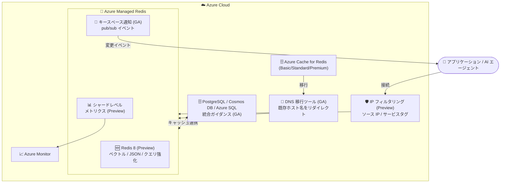

# Azure Managed Redis: Ignite 2026 アップデート群 (Redis 8 / シャードレベルメトリクス / IP フィルタリング / 移行ツール GA ほか)

**リリース日**: 2026-11-17

**サービス**: Azure Managed Redis

**機能**: Redis 8 (Preview)、シャードレベルメトリクス (Preview)、IP フィルタリング (Preview)、Azure Cache for Redis 移行ツール (GA)、agent kit (Preview)、キースペース通知 (GA)、データベース統合ガイダンス (GA)

**ステータス**: Launched (GA) 3 件 / In preview 4 件

[このアップデートのインフォグラフィックを見る](https://takech9203.github.io/azure-news-summary/20261117-azure-managed-redis-updates.html)

## 概要

Microsoft Ignite に合わせて、Azure Managed Redis に関する 7 件のアップデートが同時に発表されました。プレビューとして、最新メジャーバージョンである Redis 8 のサポート、シャード単位のメトリクス、IP フィルタリング (ファイアウォール規則)、AI 支援開発ワークフロー向けの agent kit が追加されました。GA としては、Azure Cache for Redis (Basic/Standard/Premium) から Azure Managed Redis への組み込み DNS 移行ツール、キースペース通知、データベース統合ガイダンスが一般提供となりました。

Redis 8 (8.2) のプレビューでは、より高度なクエリ、アトミックな JSON 更新、フィールドレベルの有効期限、きめ細かなセキュリティに加え、RAG・セマンティック検索・レコメンデーション・エージェントメモリといった AI アプリケーション向けのベクトル機能が利用できます。単なるキャッシュを超えた「モダン / AI 駆動アプリケーションのためのリアルタイムデータレイヤー」としての位置付けが強調されています。

また、移行ツールの GA により、既存の Azure Cache for Redis のホスト名を Azure Managed Redis インスタンスへリダイレクトでき、アプリケーションは同じホスト名・アクセスキーのまま再接続できます。Azure Cache for Redis から Azure Managed Redis への移行パスが大きく整備されたことになります。

**アップデート前の課題**

- Azure Managed Redis のメトリクスはインスタンス単位であり、個々のシャードのホットスポットや負荷の偏りを特定しにくかった
- パブリックエンドポイントへのネットワークアクセスをソース IP で制限するファイアウォール規則の仕組みがなかった
- Azure Cache for Redis から Azure Managed Redis への移行では、新キャッシュのエンドポイントに合わせたアプリケーション側の構成変更が必要だった
- キャッシュ内データの変更検知には、アプリケーションによる継続的なポーリングが必要だった

**アップデート後の改善**

- シャードレベルメトリクスにより、ワークロード分散の把握・ホットスポットの特定・パフォーマンス問題のトラブルシューティングが容易になった (Preview)
- 承認済みソース IP アドレスや Azure サービスタグによる接続制限が可能になった (Preview)
- 組み込み DNS 移行ツールにより、既存ホスト名を Azure Managed Redis へ向け直すだけで移行でき、データ保持もサポートされる (GA)
- キースペース通知の GA により、pub/sub 経由でキー変更・有効期限切れなどのイベントを受信し、ポーリングなしでイベント駆動型アプリケーションを構築できる
- Redis 8 (Preview) により、ベクトル検索などの AI 向け機能と最新の Redis イノベーションをフルマネージドで利用できる
- agent kit (Preview) とデータベース統合ガイダンス (GA) により、設計・構成・移行の各フェーズで実践的なガイダンスを利用できる

## アーキテクチャ図

既存の Azure Cache for Redis からは DNS 移行ツールで同一ホスト名のまま Azure Managed Redis へ移行でき、移行後は IP フィルタリングによるアクセス制御、シャードレベルメトリクスによる監視、キースペース通知によるイベント駆動連携が利用できます。

## サービスアップデートの詳細

### 主要機能

1. **Redis 8 サポート (Public Preview)**
   - Redis 8.2 を新規インスタンスで選択可能 (デフォルトは Redis 7.4)
   - より高度なクエリ、アトミックな JSON 更新、フィールドレベルの有効期限、きめ細かなセキュリティ
   - RAG、セマンティック検索、レコメンデーション、エージェントメモリ向けのベクトル機能を搭載し、全 Redis モジュールを含む
   - Memory Optimized / Balanced / Compute Optimized ティアの新規インスタンスで利用可能

2. **シャードレベルメトリクス (Public Preview)**
   - 個々のシャードのパフォーマンスを可視化
   - ワークロード分散の把握、ホットスポットの特定、パフォーマンス問題のトラブルシューティングに活用

3. **IP フィルタリング (Public Preview)**
   - キャッシュへのデータアクセスに対するファイアウォール規則を追加可能
   - 承認済みソース IP アドレスまたは Azure サービスタグに接続を制限
   - パブリックにアクセス可能なキャッシュエンドポイントの保護に有効

4. **Azure Cache for Redis → Azure Managed Redis 移行ツール (GA)**
   - Basic / Standard / Premium ティアからのエンドポイント移行を簡素化する組み込み DNS 移行ツール
   - 既存キャッシュのホスト名を Azure Managed Redis インスタンスへリダイレクトし、同じホスト名・アクセスキーで再接続可能
   - 移行をまたいだデータ保持をサポートし、アプリケーション構成変更を最小化

5. **Azure Managed Redis agent kit (Public Preview)**
   - 本番対応の Redis アプリケーション構築・運用ガイダンスを AI 支援開発ワークフローに直接組み込み
   - キャッシング / メッセージング / 検索 / AI パターン、クライアント構成・レジリエンス・パフォーマンス、プロビジョニング・ネットワーキング・セキュリティ・可用性・ジオレプリケーション・耐久性・可観測性をカバー
   - Azure Cache for Redis / Azure Cache for Redis Enterprise からの移行用ガイド付きワークフローにも接続可能

6. **キースペース通知 (GA)**
   - キャッシュ内のデータ変更時に pub/sub 経由でイベントを受信
   - 必要なイベントタイプを設定し、特定のキーや操作への通知をサブスクライブ可能
   - キー変更の監視、有効期限切れへの対応、ポーリング不要の下流アクションのトリガーを実現

7. **データベース統合ガイダンス (GA)**
   - Azure Database for PostgreSQL フレキシブルサーバー、Azure Cosmos DB、Azure SQL を利用するアプリケーションへのキャッシュ追加を支援
   - 実践的なガイダンス、リファレンスアーキテクチャ、ステップバイステップのチュートリアルを提供
   - データベース負荷の軽減、応答性の向上、適切なキャッシュ手法の選択に寄与

## 技術仕様

| 項目 | 詳細 |
|------|------|
| Redis バージョン | Redis 7.4 (デフォルト) / Redis 8.2 (Preview) |
| Redis 8.2 対応ティア | Memory Optimized / Balanced / Compute Optimized (新規インスタンスのみ) |
| Redis 8.2 の制限 | Flash Optimized SKU、ジオレプリケーション、カスタムデータアクセスポリシーは非対応。既存インスタンスのアップグレードは不可 |
| 移行ツール対象 | Azure Cache for Redis Basic / Standard / Premium ティア |
| 移行方式 | 組み込み DNS 移行ツール (既存ホスト名を Azure Managed Redis へリダイレクト、データ保持対応) |
| IP フィルタリング | ソース IP アドレスおよび Azure サービスタグによる接続制限 (Preview) |
| キースペース通知 | pub/sub 経由のイベント配信、イベントタイプを構成可能 (GA) |

## 設定方法

### 前提条件

1. Azure サブスクリプションと Azure Managed Redis インスタンス (移行の場合は既存の Azure Cache for Redis Basic/Standard/Premium インスタンス)
2. Redis 8 プレビューの利用にはサインアップが必要 ([aka.ms/amr-redis8-signup](https://aka.ms/amr-redis8-signup))

### Azure Portal

- **Redis 8**: インスタンス作成時に [Advanced] タブの [Redis version] ドロップダウンから 8.2 (Preview) を選択する (新規インスタンスのみ)

その他の機能の詳細な設定手順は、各アップデートの公式ドキュメント ([aka.ms/redis/whatsnew](https://aka.ms/redis/whatsnew) など) を参照してください。

## メリット

### ビジネス面

- GA となった DNS 移行ツールにより、Azure Cache for Redis (廃止予定ティア) からの移行の計画・実行コストとダウンタイムリスクを低減できる
- データベース統合ガイダンスと agent kit により、設計・実装の試行錯誤が減り、本番移行までの期間を短縮できる
- Redis 8 のベクトル機能により、専用のベクトルデータベースを追加せずに AI アプリケーションのアーキテクチャを簡素化できる

### 技術面

- シャードレベルメトリクスにより、クラスター内の負荷の偏り (ホットキー・ホットシャード) を定量的に特定できる
- IP フィルタリングにより、プライベートエンドポイントを使わない構成でもネットワークアクセスを制御できる
- キースペース通知によりポーリングが不要になり、イベント駆動アーキテクチャ (キャッシュ無効化、有効期限連動処理など) を効率的に実装できる

## デメリット・制約事項

- Redis 8.2 (Preview) は Flash Optimized SKU、ジオレプリケーション、カスタムデータアクセスポリシーに対応しておらず、既存インスタンスのアップグレードもサポートされない
- シャードレベルメトリクス、IP フィルタリング、agent kit、Redis 8 はプレビュー段階であり、GA 時期は未定
- DNS 移行ツールの対象は Azure Cache for Redis の Basic / Standard / Premium ティア (Enterprise ティアは別の移行ガイダンスを参照)

## ユースケース

### ユースケース 1: Azure Cache for Redis からの無停止志向の移行

**シナリオ**: Azure Cache for Redis Premium で稼働中のセッションストアを、アプリケーションの接続文字列を変更せずに Azure Managed Redis へ移行したい。

**実装**: GA となった組み込み DNS 移行ツールで既存キャッシュのホスト名を移行先の Azure Managed Redis インスタンスへリダイレクトする。アプリケーションは同じホスト名とアクセスキーで再接続でき、データ保持もサポートされる。

**効果**: アプリケーション構成の即時変更が不要になり、新キャッシュを検証しながらトラフィックを切り替えられる。

### ユースケース 2: Redis 8 のベクトル機能による AI エージェントメモリ

**シナリオ**: RAG やエージェントメモリのために専用ベクトルデータベースの追加を検討していたが、運用コンポーネントを増やしたくない。

**実装**: Redis 8 (Preview) を有効にした Azure Managed Redis インスタンスを作成し、ベクトル検索・JSON・フィールドレベル有効期限を組み合わせて、キャッシュとベクトルストアを 1 つのリアルタイムデータレイヤーに統合する。

**効果**: AI アーキテクチャのコンポーネント数を削減し、低レイテンシーなセマンティック検索・エージェントメモリを実現できる。

### ユースケース 3: キースペース通知によるキャッシュ無効化の自動連携

**シナリオ**: キャッシュ内の特定キーの変更や有効期限切れを検知して、下流の再計算処理や通知をトリガーしたい。

**実装**: GA となったキースペース通知で必要なイベントタイプを構成し、アプリケーションが pub/sub チャネルをサブスクライブして変更イベントを受信する。

**効果**: 継続的なポーリングが不要になり、イベント駆動でリソース効率よく下流アクションを実行できる。

## 料金

各機能固有の追加料金に関する公式情報は、今回のアップデート情報では確認できませんでした。Azure Managed Redis の料金はティア (Memory Optimized / Balanced / Compute Optimized / Flash Optimized) と SKU サイズに基づきます。詳細は [Azure Managed Redis の料金ページ](https://azure.microsoft.com/pricing/details/managed-redis/) を参照してください。

## 利用可能リージョン

リージョン別の提供状況は公式アップデート情報に記載がありません。[リージョン別提供製品の一覧](https://azure.microsoft.com/explore/global-infrastructure/products-by-region/table) を参照してください。

## 関連サービス・機能

- **Azure Cache for Redis**: 移行元サービス。Basic/Standard/Premium ティアから DNS 移行ツールで Azure Managed Redis へ移行できる
- **Azure Monitor**: シャードレベルメトリクスを含む Azure Managed Redis のメトリクス監視・アラートに使用
- **Azure Database for PostgreSQL / Azure Cosmos DB / Azure SQL**: データベース統合ガイダンス (GA) の対象。キャッシュ追加によるデータベース負荷軽減のリファレンスアーキテクチャが提供される
- **Microsoft Entra ID**: Azure Managed Redis の全ティアで利用できる認証基盤
- **Azure Private Link**: IP フィルタリング (Preview) と並ぶネットワーク分離のオプション

## 参考リンク

- [インフォグラフィック](https://takech9203.github.io/azure-news-summary/20261117-azure-managed-redis-updates.html)
- [公式アップデート情報: Redis 8 in Azure Managed Redis (Preview)](https://azure.microsoft.com/updates?id=577594)
- [公式アップデート情報: Shard-level metrics (Preview)](https://azure.microsoft.com/updates?id=577599)
- [公式アップデート情報: IP filtering (Preview)](https://azure.microsoft.com/updates?id=577589)
- [公式アップデート情報: Azure Cache for Redis migration tooling (GA)](https://azure.microsoft.com/updates?id=577579)
- [公式アップデート情報: Azure Managed Redis agent kit (Preview)](https://azure.microsoft.com/updates?id=577568)
- [公式アップデート情報: Keyspace notifications (GA)](https://azure.microsoft.com/updates?id=577558)
- [公式アップデート情報: Database integration guidance (GA)](https://azure.microsoft.com/updates?id=577553)
- [Microsoft Learn: What is Azure Managed Redis?](https://learn.microsoft.com/azure/redis/overview)
- [Microsoft Learn: Azure Cache for Redis (Basic/Standard/Premium) からの移行](https://learn.microsoft.com/azure/redis/migrate/migrate-basic-standard-premium-overview)
- [Redis 8 プレビューのサインアップ](https://aka.ms/amr-redis8-signup)
- [料金ページ](https://azure.microsoft.com/pricing/details/managed-redis/)

## まとめ

Ignite 2026 に合わせた今回の 7 件のアップデートにより、Azure Managed Redis は「Azure Cache for Redis の後継」としての移行基盤 (DNS 移行ツール GA)、運用性 (シャードレベルメトリクス)、セキュリティ (IP フィルタリング)、イベント駆動連携 (キースペース通知 GA)、そして AI 時代のデータレイヤー (Redis 8 のベクトル機能、agent kit) を一度に強化しました。Azure Cache for Redis を利用中の組織は、GA となった移行ツールとガイダンスを用いた Azure Managed Redis への移行計画の策定を推奨します。AI アプリケーションを構築中のチームは、Redis 8 プレビューへのサインアップとティア制約 (Flash Optimized・ジオレプリケーション非対応など) の確認から始めるとよいでしょう。

---

**タグ**: Azure Managed Redis, Redis 8, Azure Cache for Redis, 移行, シャードレベルメトリクス, IP フィルタリング, キースペース通知, agent kit, Microsoft Ignite, GA, Public Preview
