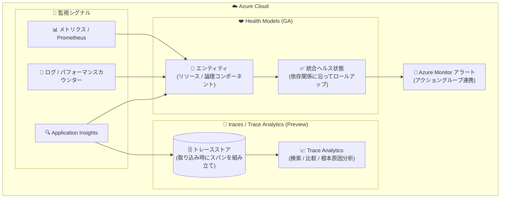

# Azure Monitor: Health Models GA / traces と Trace Analytics パブリックプレビュー

**リリース日**: 2026-11-17

**サービス**: Azure Monitor

**機能**: Health Models (GA) / traces と Trace Analytics (Public Preview)

**ステータス**: Launched (GA) / In preview

[このアップデートのインフォグラフィックを見る](https://takech9203.github.io/azure-news-summary/20261117-azure-monitor-health-models-traces.html)

## 概要

Microsoft Ignite 2026 に合わせて、Azure Monitor の可観測性を強化する 2 つのアップデートが発表された。

1 つ目は **Azure Monitor Health Models の一般提供 (GA)** である。Health Models は、ワークロードの健全性 (ヘルス) を第一級の構成要素として定義・運用できる機能で、メトリクス、ログ、依存関係にまたがるシグナルを集約し、単一の統合されたヘルス状態として表現する。リソース単位のアラートに依存した監視から、ワークロード全体の実際の状態を表す「状態ベースの監視 (state-based monitoring)」へ移行でき、アラートノイズの削減、インシデント対応の迅速化、サービス信頼性の向上につながる。

2 つ目は **Azure Monitor traces と Trace Analytics のパブリックプレビュー** である。Azure Monitor traces (preview) は分散トレース専用のトレースストアを提供し、取り込み時に関連スパンを完全なトレースとして組み立てる。Trace Analytics により、数千件規模のトレースを検索・分析・比較して重要なトランザクションを特定し、傾向の把握から根本原因の特定まで Application Insights 内で一貫して行えるようになる。なお、traces は 2026 年 9 月にプライベートプレビュー、2026 年 11 月にパブリックプレビューとなった。

**アップデート前の課題**

- 監視がリソース中心のアラートに偏り、個々のシグナルごとにアラートが発生するためアラート疲れ (alert fatigue) が起きやすく、ワークロード全体として「今健全かどうか」を把握しにくかった
- 複数のサービスや依存関係にまたがるトランザクションを大量のトレースから横断的に分析・比較する専用の仕組みがなく、傾向から根本原因へ掘り下げる調査に手間がかかった

**アップデート後の改善**

- Health Models により、エンティティ (Azure リソースや論理コンポーネント) ごとにヘルス状態を割り当て、依存関係に沿って上位へロールアップすることで、ワークロード全体の健全性を 1 つのビューで追跡できるようになった。複数シグナルを 1 つのヘルス状態に相関させることでアラートノイズを削減できる
- Azure Monitor traces により、取り込み時点でスパンがトレースとして組み立てられ、Trace Analytics でトレース群の検索、P50/P99 レイテンシ分析、ベースラインとの比較、Critical Path Analysis、Attribute Analysis などの大規模分析が可能になった
- トレース由来のメトリクス (trace-derived metrics) を SLI、ダッシュボード、アラート、長期トレンド分析に活用できるようになった

## アーキテクチャ図

メトリクス・ログ・Application Insights の既存シグナルを Health Models のエンティティに集約してワークロード全体のヘルス状態を導出し、ヘルス状態ベースのアラートへ接続する。並行して、トレースデータは専用トレースストアに格納され、Trace Analytics で大規模分析が行える。

## サービスアップデートの詳細

### 主要機能

#### Azure Monitor Health Models (GA)

1. **状態ベースの監視 (state-based monitoring)**
   - 各エンティティにヘルス状態を割り当て、複数エンティティを組み合わせてアプリケーションやワークロードを表現する
   - 複数シグナルを 1 つのヘルス状態に相関させ、アラートノイズを削減する

2. **エンティティとシグナルによるヘルス定義**
   - エンティティは Azure リソースのほか、コードコンポーネント、ユーザー/システムフロー、ビジネスチームなどの論理コンポーネントを表現できる
   - シグナルはメトリクスまたはログクエリに基づき、独自定義のほか、一般的な Azure リソース向けの推奨シグナルセットも利用できる
   - 各エンティティのヘルスは依存するエンティティへロールアップされ、ワークロード全体のヘルス状態が得られる

3. **Graph ビュー / Timeline ビュー**
   - Graph ビューでワークロードの現在のヘルスをグラフィカルに表示し、Timeline ビューで時系列のヘルス推移を確認できる
   - 任意のエンティティをドリルダウンして、ヘルス状態と寄与するシグナルの詳細を確認できる

4. **既存の監視投資の活用**
   - Azure リソースのプラットフォームメトリクス/リソースログ、Kubernetes クラスターの Prometheus メトリクス、仮想マシンのログ/パフォーマンスカウンター、Application Insights のアプリケーションデータなど、既に収集しているデータをそのまま利用できる

5. **モデル構成の柔軟性**
   - グラフィカルデザイナーでエンティティ配置、依存関係定義、シグナル追加、ヘルスロールアップ動作の調整が可能
   - Azure Resource Graph クエリ、Application Insights リソース、サービスグループに基づく自動検出 (discovery) でモデルを自動構成できる
   - Infrastructure as Code (IaC) と CLI をファーストクラスでサポート

6. **ヘルス状態ベースのアラート**
   - 個別シグナルではなくヘルス状態に基づくアラートを作成できる。非正常なエンティティや、複数の依存関係にまたがるビジネス影響を表す集約ヘルスに対してアラートを設定可能
   - 既存の Azure Monitor アラートと統合され、同じアクショングループで通知・自動化できる

#### Azure Monitor traces / Trace Analytics (Public Preview)

1. **専用トレースストア**
   - 分散トレース専用のストアを提供し、取り込み時に関連スパンを完全なトレースとして組み立てる
   - サービスや依存関係をまたぐエンドツーエンドのトランザクション分析が可能

2. **Trace Analytics による大規模分析**
   - トレース/スパン条件での検索 (検索は常にトレースレベルで実行され、結果にはトレース数と P50/P99 期間が表示される)
   - 集約結果、ヒートマップ、ヒストグラム、生レコードの表示と、Span Statistics によるスパン分析
   - **Critical Path Analysis**: スパンごとのアクティブ時間と待機時間を算出し、レイテンシへの主要な寄与箇所を特定
   - **Attribute Analysis**: 選択したトレースグループとベースラインを最も区別する属性をランク付けし、正常/異常トレースの比較から性能・障害パターンに関連する属性を発見
   - トレースグループ同士や時間範囲同士の比較、個別トレースのスパン/依存関係の詳細調査

3. **トレース由来のメトリクス (trace-derived metrics)**
   - トランザクション量、期間、エラーの監視に利用でき、SLI、ダッシュボード、アラート、長期トレンド分析に活用できる

4. **Azure Portal からのアクセス**
   - Application Insights または Azure Monitor ワークスペースの「Traces」から Trace Analytics を開ける。どちらも Azure Monitor ワークスペースに関連付けられたトレースデータを使用する
   - Application Insights リソースから開いた場合は、そのリソースに送信されたスパンを少なくとも 1 つ含むトレースに絞るフィルターが自動適用される

## 技術仕様

| 項目 | 詳細 |
|------|------|
| Health Models のエンティティ | Azure リソース、コードコンポーネント、ユーザー/システムフロー、ビジネスチームなどの論理コンポーネント |
| Health Models のシグナル | メトリクスベースまたはログクエリベース。推奨シグナルセットあり。Resource Health シグナルは無料 |
| Health Models のデータ保持 | ヘルスデータは 30 日間保持 |
| Health Models の構成方法 | グラフィカルデザイナー、自動検出 (Azure Resource Graph / Application Insights / サービスグループ)、IaC、CLI |
| traces のデータモデル | トランザクション = トレース、各操作 = スパン (サービス、操作、期間、ステータス、属性を記録)。取り込み時にスパンをトレースに組み立て |
| traces の利用前提 | Application Insights リソースを Azure Monitor ワークスペースにリンクしてオンボード |
| traces のステータス | パブリックプレビュー (SLA なし、本番ワークロード非推奨) |

## 設定方法

### 前提条件 (traces / Trace Analytics)

1. Azure Monitor ワークスペースが必要。プレビュー時点でワークスペースのオンボードは `newzealandnorth`、`westeurope`、`eastus2` のいずれかのリージョンのみ対応
2. Application Insights リソースのトレースを利用するには、リソースを Azure Monitor ワークスペースにリンクしてオンボードする (対応リージョンは「利用可能リージョン」を参照)

### Azure Portal

- **Health Models**: Azure Monitor のヘルスモデルのデザイナーでエンティティの配置、依存関係の定義、シグナルの追加、ヘルスロールアップの調整を行う。リソースの手動追加のほか、Azure Resource Graph クエリ / Application Insights リソース / サービスグループに基づく自動検出も利用できる
- **Trace Analytics**: Application Insights リソースまたは Azure Monitor ワークスペースの「Traces」メニューから開く

## メリット

### ビジネス面

- ワークロードの健全性をビジネス影響の観点で可視化でき、障害時に「どのビジネス機能が影響を受けているか」を即座に判断できる
- アラートノイズの削減により、運用チームの疲弊を防ぎ、重要なインシデントへの集中と対応の迅速化が期待できる
- 既に収集している監視データをそのまま活用するため、追加の計装コストを抑えられる

### 技術面

- リソース中心のアラートから、依存関係を考慮したヘルス状態ベースのアラートへ移行できる
- Health Models は IaC / CLI をサポートし、ヘルスモデル定義のコード管理・再現が可能
- Trace Analytics の Critical Path Analysis / Attribute Analysis により、レイテンシ要因や障害パターンの特定をデータドリブンに行える
- トレース由来のメトリクスを SLI やアラートに利用でき、SRE プラクティスとの親和性が高い

## デメリット・制約事項

- **traces / Trace Analytics はプレビュー**: SLA の提供はなく、本番ワークロードへの利用は推奨されない
- **traces のリージョン制約**: Azure Monitor ワークスペースのオンボードは `newzealandnorth`、`westeurope`、`eastus2` の 3 リージョンに限定される (Application Insights のオンボード対応リージョンはより広い)
- **Health Models のデータ保持は 30 日間**: 長期のヘルス履歴分析には別途の仕組みが必要
- Health Models はシグナルの種類と数に基づいて課金されるため、大規模モデルではシグナル設計がコストに影響する

## ユースケース

### ユースケース 1: ミッションクリティカルなワークロードのヘルス監視

**シナリオ**: 複数の Azure リソース (App Service、AKS、データベースなど) で構成される基幹アプリケーションで、リソース単位のアラートが大量に発生し、どの障害がビジネスに影響するのか判断に時間がかかっている。

**実装**: Health Models でアプリケーションのユーザーフローや論理コンポーネントをエンティティとして定義し、依存する Azure リソースのメトリクス/ログシグナルを関連付ける。ヘルス状態のロールアップにより、ワークロード最上位のヘルスに対してアラートを設定する。

**効果**: 個別リソースのアラートに振り回されず、ビジネス影響のあるヘルス劣化のみに対応を集中できる。

### ユースケース 2: マイクロサービスのレイテンシ悪化の根本原因分析

**シナリオ**: 分散アプリケーションで特定の時間帯に P99 レイテンシが悪化するが、どのサービス・操作が原因か特定できない。

**実装**: Application Insights リソースを Azure Monitor ワークスペースにリンクして traces をオンボードし、Trace Analytics で対象時間帯のトレースグループをベースラインと比較する。Critical Path Analysis でエンドツーエンド期間に寄与するスパンを特定し、Attribute Analysis で異常トレースを特徴付ける属性を抽出する。

**効果**: 数千件のトレースを横断した傾向分析から個別トレースの詳細調査まで一貫して行い、根本原因の特定を短縮できる。

## 料金

Health Models は、監視する「ヘルスシグナル」の種類と数に基づいて課金される。料金ページには以下の課金項目が記載されている (具体的な単価はリージョン・通貨により異なるため料金ページで確認のこと)。

| 項目 | 課金 |
|------|------|
| Metric Signal | 月額課金 (動的しきい値を使う場合は追加料金あり) |
| Prometheus Metric Signal | 月額課金 |
| Log Signal | 頻度 (1 分 / 5 分 / 10 分 / 15 分) 別の月額課金。15 分超の頻度は 15 分と同額 |
| Resource Health シグナル | 無料 |
| 無効化中のシグナル | 無料 |

traces / Trace Analytics 固有の料金項目は、現時点で Azure Monitor の料金ページに記載が確認できなかった。詳細は [Azure Monitor 料金ページ](https://azure.microsoft.com/pricing/details/monitor/) を参照。

## 利用可能リージョン

- **Health Models (GA)**: アナウンスにリージョン情報の記載なし。[公式ドキュメント](https://aka.ms/ahm/docs)を参照
- **traces / Trace Analytics (Preview)**:
  - Azure Monitor ワークスペースのオンボード: `newzealandnorth`、`westeurope`、`eastus2` のみ
  - Application Insights のオンボード: eastus、eastus2、westus、westus2、westus3、centralus、northcentralus、southcentralus、westcentralus、canadacentral、canadaeast、brazilsouth、brazilsoutheast、chilecentral、northeurope、westeurope、uksouth、ukwest、francecentral、francesouth、germanynorth、germanywestcentral、norwayeast、norwaywest、swedencentral、switzerlandnorth、switzerlandwest、polandcentral、spaincentral、austriaeast、israelcentral、uaecentral、uaenorth、southafricanorth、southafricawest、eastasia、southeastasia、japanwest、koreacentral、koreasouth、centralindia、southindia、jioindiawest、indonesiacentral、malaysiawest、taiwannorth、taiwannorthwest、australiacentral、australiasoutheast、newzealandnorth など多数のリージョンに対応 (日本は japanwest のみ対応、japaneast は未対応)

## 関連サービス・機能

- **Application Insights**: Health Models のアプリケーションデータのシグナルソースであり、traces のオンボード元。Trace Analytics の入口にもなる
- **Azure Monitor ワークスペース**: traces のトレースデータが関連付けられる基盤。Trace Analytics のもう 1 つの入口
- **Azure Monitor アラート / アクショングループ**: Health Models のヘルス状態ベースのアラートは既存のアラート体験に統合され、同じアクショングループで通知・自動化できる
- **Azure Resource Graph / サービスグループ**: Health Models の自動検出 (discovery) によるモデル自動構成に利用できる
- **Azure Managed Prometheus**: Kubernetes クラスターの Prometheus メトリクスを Health Models のシグナルとして利用できる

## 参考リンク

- [インフォグラフィック](https://takech9203.github.io/azure-news-summary/20261117-azure-monitor-health-models-traces.html)
- [公式アップデート情報: Generally Available: Azure Monitor Health Models](https://azure.microsoft.com/updates?id=580261)
- [公式アップデート情報: Public Preview: Azure Monitor traces and Trace Analytics](https://azure.microsoft.com/updates?id=580184)
- [Microsoft Learn: Health models in Azure Monitor](https://learn.microsoft.com/azure/azure-monitor/health-models/overview)
- [Microsoft Learn: Azure Monitor traces overview](https://learn.microsoft.com/azure/azure-monitor/app/traces-overview)
- [料金ページ: Azure Monitor](https://azure.microsoft.com/pricing/details/monitor/)

## まとめ

Azure Monitor Health Models の GA により、リソース中心のアラート運用からワークロードの健全性を軸にした状態ベースの監視へ本格的に移行できるようになった。既存の監視データをそのまま活用でき、IaC/CLI にも対応するため、ミッションクリティカルなワークロードを運用するチームはヘルスモデルの導入を検討する価値が高い。あわせてパブリックプレビューとなった Azure Monitor traces と Trace Analytics は、分散トレースの大規模分析によって根本原因分析を大きく効率化する。プレビュー段階でリージョン制約があるため、まずは非本番環境での評価から始め、Health Models と組み合わせた「検知 (ヘルス) → 調査 (トレース)」の一貫した可観測性パイプラインの構築を見据えるとよい。

---

**タグ**: Azure Monitor, Health Models, Distributed Tracing, Trace Analytics, Application Insights, Observability, DevOps, Microsoft Ignite, GA, Public Preview
