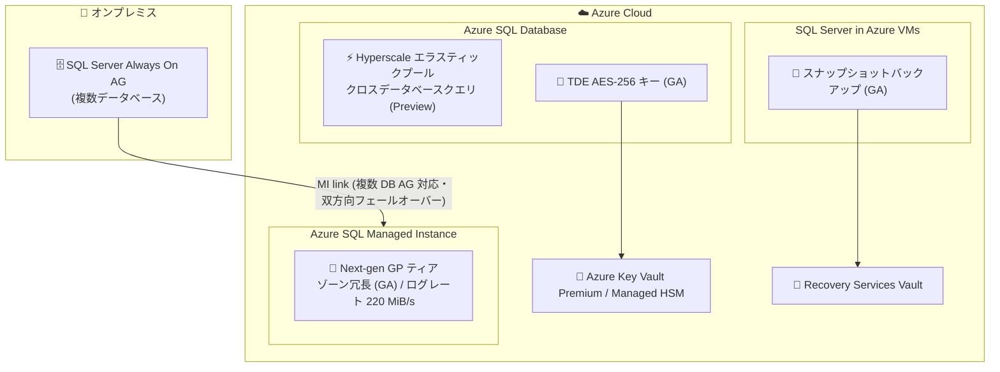

# Azure SQL: 2026 年 11 月中旬アップデートまとめ (Database / Managed Instance / SQL Server)

**リリース日**: 2026-11-17

**サービス**: Azure SQL Database / Azure SQL Managed Instance / SQL Server (Azure VM 含む)

**機能**: 2026 年 11 月中旬の GA / パブリックプレビューアップデート群

**ステータス**: Launched (GA) / In preview (項目により異なる)

[このアップデートのインフォグラフィックを見る](https://takech9203.github.io/azure-news-summary/20261117-azure-sql-mid-november-updates.html)

## 概要

Microsoft Ignite に合わせて、Azure SQL ファミリー (Azure SQL Database、Azure SQL Managed Instance、SQL Server) に関する多数のアップデートが 2026 年 11 月 17 日に一斉に発表された。本レポートでは、関連する 10 件のアナウンスを 1 つにまとめて解説する。

GA (一般提供) となった主なものは、SQL Server in Azure VMs 向けのスナップショットバックアップ、TDE (透過的データ暗号化) での AES-256 キーのサポート、Microsoft SQL 製品群横断でのあいまい文字列マッチング (Fuzzy string match)、SQL Managed Instance の Next-gen General Purpose ティアのゾーン冗長対応、Managed Instance link での複数データベース可用性グループのサポートなど。パブリックプレビューとしては、Azure SQL Database Hyperscale のクロスデータベースクエリ、SQL Server 2025 の Ubuntu 26.04 LTS サポート、SSMS の新機能群 (AI 支援チューニング、BYOM など) が発表された。

移行 (MI link、Hyperscale クロスデータベースクエリ)、セキュリティ (AES TDE、Regex DDM、LTR バックアップの不変性)、回復性 (スナップショットバックアップ、ゾーン冗長)、パフォーマンス (Next-gen GP のログレート向上) と、Solutions Architect が押さえるべき領域を広くカバーするアップデート群である。

**アップデート前の課題**

- Azure SQL Database (Hyperscale 含む) ではネイティブなクロスデータベースクエリができず、SQL Server からの移行時にクエリの書き換えやデータ統合、外部テーブルの設定が必要だった
- Azure VM 上の大規模 SQL Server データベースのフルバックアップはストリーミング方式のため時間がかかり、本番ワークロードへの負荷も大きかった
- TDE のカスタマーマネージドキーは RSA キーが前提であり、量子コンピューティング時代を見据えた暗号アジリティに課題があった
- Managed Instance link は複数データベースを含む Always On 可用性グループをまとめて拡張できず、エンタープライズアプリケーションの移行が複雑だった
- Next-gen General Purpose ティアはゾーン冗長に対応しておらず、ゾーン障害への耐性に制約があった

**アップデート後の改善**

- Hyperscale エラスティックプール内で `database.schema.object` の 3 部構成名によるクロスデータベースクエリが可能になった (プレビュー)
- Azure ディスクスナップショット + ネイティブログバックアップにより、大規模データベースでもほぼ瞬時・低負荷のフルバックアップとポイントインタイムリカバリが可能になった (GA)
- Azure Key Vault Premium / Managed HSM に保管した AES-256 キーを TDE プロテクターとして利用でき、ポスト量子時代への備えができるようになった (GA)
- 単一の MI link で複数データベースの可用性グループを Azure に拡張でき、双方向フェールオーバーによる最小ダウンタイム移行・DR が実現した (GA)
- Next-gen GP ティアがゾーン冗長に対応し、価格性能比を維持したままゾーン障害への耐性を確保できるようになった (GA)

## アーキテクチャ図

オンプレミス SQL Server から Managed Instance への移行経路 (MI link)、Hyperscale のクロスデータベースクエリ、AES キーによる TDE、スナップショットバックアップという主要アップデートの位置付けを示す。

## サービスアップデートの詳細

### 主要機能

#### GA (一般提供) になったもの

1. **Snapshot backup for SQL Server in Azure VMs** (Azure Backup)
   - Azure マネージドディスクの増分スナップショットと SQL ネイティブのトランザクションログバックアップを組み合わせ、大規模データベースでもほぼ瞬時・低負荷のフルバックアップを実現
   - SQL インスタンスレベルでスナップショットを取得し、1 回の操作で最大 12 データベースを選択可能。インスタンス全体または個別データベースの復元に対応
   - スナップショットは 6 時間間隔以上、ログバックアップは 15 分間隔以上で構成可能。スナップショットはサブスクリプション内に最大 7 日間保持後、Recovery Services Vault に長期保存
   - アプリケーション整合性スナップショット取得時のデータベース静止 (quiesce) は数秒程度で、ストリーミングバックアップのように長時間リソースを消費しない

2. **TDE での AES-256 キーのサポート** (Azure SQL Database)
   - Azure Key Vault Premium または Managed HSM に保管した AES-256 キーを TDE プロテクターとして利用可能に。従来の RSA キーの代替となる
   - AES-256 は RSA などの非対称アルゴリズムと比較して既知の量子コンピューティング脅威への耐性が高く、暗号アジリティとポスト量子時代への準備 (post-quantum readiness) に向けた実践的な選択肢となる

3. **Fuzzy string match (あいまい文字列マッチング)** (Azure SQL Database / SQL Managed Instance / SQL database in Microsoft Fabric / SQL Server 2025)
   - 完全一致ではなく類似度に基づく文字列比較を組み込み関数で実行可能。2 つの文字列を同一にするために必要な変更回数 (編集距離) の測定に対応
   - GA ロールアップのアナウンスでは Damerau-Levenshtein (OSA) や Jaro-Winkler といったアルゴリズムが言及されている
   - データマッチング、クレンジング、重複排除、ファジー検索などのシナリオで活用できる

4. **Zone-redundant Next-gen General Purpose ティア** (Azure SQL Managed Instance)
   - 重要なサービスコンポーネントを複数の可用性ゾーンに分散配置し、ゾーン障害からアプリケーションを保護
   - Next-gen GP ティアのパフォーマンス・スケーラビリティ・価格性能比の利点を維持したまま冗長性を追加できる

5. **MI link の複数データベース可用性グループ対応** (Azure SQL Managed Instance)
   - 単一の Managed Instance link で、複数データベースを含む SQL Server Always On 可用性グループを Azure SQL Managed Instance に拡張可能に
   - 既存 AG の拡張、複数データベースでの新規 AG 作成の両方に対応し、サポートされる SQL Server バージョンとの間で双方向フェールオーバーが可能
   - 最小ダウンタイム移行、リバース移行 (Azure からオンプレミスへ)、Azure を DR サイトとする構成に対応

6. **Azure SQL / SQL Managed Instance の mid-November GA ロールアップ**
   - 正規表現ベースの動的データマスキング (Regex-based DDM): 既存の DDM を拡張し、パターンベースの柔軟なマスキングをデータベース層で一元適用
   - SSMS 結果グリッドの数値表示カスタマイズ: クエリや Windows の地域設定を変更せずに桁区切り・小数点記号を設定可能
   - Next-gen GP のトランザクションスループット向上: ログレートが最大 220 MiB/s に引き上げ、vCore あたりのスループットも向上
   - ストレージとコンピュートの効率的なサイジング: ストレージと vCore の比率が改善され、より細かい単位でのストレージスケーリングが可能に
   - vCore から独立したメモリ調整: ゾーン冗長構成の Next-gen GP インスタンスで、vCore 数とは独立してメモリをサイジング可能

#### パブリックプレビューになったもの

7. **Azure SQL DB Hyperscale クロスデータベースクエリ**
   - 同一論理サーバー上の同じ Hyperscale エラスティックプール内のデータベース間で、T-SQL の 3 部構成名 (`database.schema.object`) によるネイティブなクロスデータベースクエリが可能に
   - データコピー、データベース統合、外部テーブルの設定が不要。クロスデータベースレポーティング、共有参照データ、リモートストアドプロシージャ呼び出し、SQL Server からの移行に有効
   - 限定プレビューとして提供され、参加にはサインアップが必要

8. **SQL Server 2025 の Ubuntu 26.04 LTS サポート**
   - Canonical の最新 LTS プラットフォーム上で SQL Server 2025 の評価・テスト・デプロイが可能に (GA 日は未定)

9. **Azure SQL mid-November プレビューロールアップ (SSMS / セキュリティ / AI)**
   - SSMS の新しい Create / Apply ウィザード: .dacpac / .bacpac の作成・適用を統合したモダンなガイド付き体験に刷新
   - TDE 暗号化スキャンの一時停止・再開: 高負荷時にスキャンを一時停止し、停止地点から再開可能
   - SQL Managed Instance LTR バックアップの不変性 (Immutability): 時間ベースの不変性の設定・ロック、リーガルホールドの有効化・解除に対応
   - AI 支援クエリパフォーマンスチューニング: エージェントがクエリプランを分析し、書き換え・ヒント・不足インデックスを根拠と検証付きで推奨
   - SSMS の GitHub Copilot で BYOM (独自モデルの持ち込み): Microsoft Foundry デプロイメントなどに接続可能
   - SSMS 22.12.1 の新チャット体験、クエリタブと未保存編集の保持

## 技術仕様

| アップデート | 対象 | ステータス |
|------|------|------|
| Hyperscale クロスデータベースクエリ | Azure SQL Database (Hyperscale エラスティックプール) | In preview (限定プレビュー・サインアップ制) |
| スナップショットバックアップ | SQL Server in Azure VMs (Azure Backup) | Launched (GA) |
| TDE AES-256 キー | Azure SQL Database + Key Vault Premium / Managed HSM | Launched (GA) |
| Fuzzy string match | SQL DB / SQL MI / Fabric SQL / SQL Server 2025 | Launched (GA) |
| Regex-based Dynamic Data Masking | Azure SQL Database | Launched (GA) |
| Zone-redundant Next-gen GP | Azure SQL Managed Instance | Launched (GA) |
| Next-gen GP ログレート向上 (最大 220 MiB/s) | Azure SQL Managed Instance | Launched (GA) |
| MI link 複数 DB 可用性グループ | SQL Server ⇔ Azure SQL Managed Instance | Launched (GA) |
| SQL Server 2025 on Ubuntu 26.04 LTS | SQL Server 2025 | In preview |
| SSMS 新ウィザード / AI チューニング / BYOM / LTR 不変性 / TDE スキャン制御 | SSMS / SQL DB / SQL MI | In preview |

**スナップショットバックアップの主な仕様 (Microsoft Learn より):**

| 項目 | 詳細 |
|------|------|
| スナップショット頻度 | 6 時間間隔以上 |
| ログバックアップ頻度 | 15 分間隔以上 |
| 1 回のスナップショット操作あたりのデータベース数 | 最大 12 |
| 運用層 (サブスクリプション内) での保持 | 最大 7 日間 (その後 Vault に長期保存) |
| 整合性 | アプリケーション整合性 (静止は数秒程度) |
| 前提権限 | `NT SERVICE\AzureWLBackupPluginSvc` に SQL sysadmin 権限が必要 |

## メリット

### ビジネス面

- **移行の加速**: Hyperscale クロスデータベースクエリと MI link の複数 DB AG 対応により、クロスデータベース依存を持つエンタープライズアプリケーションの Azure 移行時のクエリ書き換え・再設計コストを削減できる
- **コンプライアンス強化**: AES-256 TDE によるポスト量子対応、LTR バックアップの不変性・リーガルホールド、Regex DDM により、規制要件への対応力が向上する
- **RTO/RPO の改善**: スナップショットバックアップにより大規模データベースの復旧時間を短縮し、ランサムウェア等の災害に対する保護を強化できる

### 技術面

- **低負荷バックアップ**: ストリーミング方式と異なり本番ワークロードへの影響が最小限で、増分スナップショットによりストレージコストも最適化される
- **ゾーン冗長 + 高スループット**: Next-gen GP ティアでゾーン冗長とログレート最大 220 MiB/s、独立したメモリ・ストレージサイジングを両立できる
- **T-SQL の表現力向上**: Fuzzy string match の組み込み関数により、外部ツールなしでデータクレンジング・重複排除が可能になる
- **双方向フェールオーバー**: MI link により Azure を DR サイトとして使い、必要に応じてオンプレミスへ戻すリバース移行も可能

## デメリット・制約事項

- **Hyperscale クロスデータベースクエリ**: 同一論理サーバー上の同じ Hyperscale エラスティックプール内のデータベースに限定。読み取りは複数データベース可能だが、書き込みは 1 トランザクションにつき 1 データベースのみ。限定プレビューのためサインアップが必要
- **TDE AES キー**: キーの保管場所は Azure Key Vault Premium または Managed HSM が必要
- **スナップショットバックアップ**: スナップショット頻度は 6 時間以上、1 操作あたり 12 データベースまで。Protected Instance 料金・Vault ストレージに加え、運用層のスナップショットストレージ (マネージドディスクスナップショット料金) が別途発生する
- **MI link 複数 DB AG**: 双方向フェールオーバーは「サポートされる SQL Server バージョン」に限定される (詳細はドキュメント参照)
- **SQL Server 2025 on Ubuntu 26.04**: パブリックプレビューであり GA 日は未定
- プレビュー機能は SLA の対象外であり、本番環境への適用前に検証が必要

## ユースケース

### ユースケース 1: クロスデータベース依存を持つ SQL Server ワークロードの Hyperscale 移行

**シナリオ**: 複数データベースを 3 部構成名で参照するレガシーアプリケーションを Azure SQL Database へ移行したいが、クエリ書き換えのコストが障壁になっている。

**実装**: 対象データベース群を同一論理サーバー上の Hyperscale エラスティックプールに配置し、クロスデータベースクエリのプレビューにサインアップする。

**効果**: クエリの書き換えやアプリ再設計を最小限に抑えて移行できる。権限は各データベースで個別に適用されるため、分離も維持される。

### ユースケース 2: 複数データベースの可用性グループを使った最小ダウンタイム移行 / DR

**シナリオ**: 連携して動作する複数の関連データベースを持つエンタープライズアプリケーションを、最小ダウンタイムで Azure SQL Managed Instance に移行したい。

**実装**: 単一の MI link で既存の Always On 可用性グループ (複数 DB) を Managed Instance に拡張し、継続的レプリケーションを構成。カットオーバー時にフェールオーバーする。

**効果**: 複数データベースをまとめて移行でき、双方向フェールオーバーにより Azure を DR サイトとして利用したり、オンプレミスへのリバース移行も可能。

### ユースケース 3: 大規模 SQL Server データベースの高速バックアップ

**シナリオ**: Azure VM 上の数 TB 級 SQL Server データベースで、ストリーミングバックアップの所要時間と本番負荷が課題になっている。

**実装**: Azure Backup でスナップショットベースのバックアップポリシーを構成し、6 時間ごとのスナップショット + 15 分ごとのログバックアップを設定する。

**効果**: ほぼ瞬時のフルバックアップと秒単位のポイントインタイムリカバリを低負荷で実現し、RTO/RPO を改善できる。

## 料金

- **スナップショットバックアップ**: Recovery Services Vault に保存されるバックアップは Azure Backup の料金 (Protected Instance 料金 + Vault ストレージ) に基づく。加えて、運用層に保持されるマネージドディスクスナップショットの保管料金が保持期間分発生する
- その他のアップデート (TDE AES キー、Fuzzy string match、MI link など) は各サービスの既存料金体系の範囲で利用できる。Key Vault Premium / Managed HSM、ゾーン冗長構成は各サービスの料金に従う

| 料金ページ | URL |
|------|------|
| Azure Backup | https://azure.microsoft.com/pricing/details/backup/ |
| Managed Disks (スナップショット) | https://azure.microsoft.com/pricing/details/managed-disks/ |
| Azure SQL Database | https://azure.microsoft.com/pricing/details/azure-sql-database/single/ |
| Azure SQL Managed Instance | https://azure.microsoft.com/pricing/details/azure-sql-managed-instance/single/ |

## 関連サービス・機能

- **Azure Backup / Recovery Services Vault**: スナップショットバックアップの復元ポイント保管と長期保持を担う
- **Azure Key Vault Premium / Managed HSM**: TDE の AES-256 カスタマーマネージドキーの保管場所
- **可用性ゾーン (Availability Zones)**: Next-gen GP ティアのゾーン冗長構成の基盤
- **SQL Server Always On 可用性グループ**: MI link が拡張するオンプレミス側の高可用性構成
- **SQL Server Management Studio (SSMS) / GitHub Copilot**: 新ウィザード、AI 支援チューニング、BYOM などプレビュー機能の提供先
- **Microsoft Fabric (SQL database)**: Fuzzy string match が利用可能な SQL 製品群の 1 つ

## 参考リンク

- [インフォグラフィック](https://takech9203.github.io/azure-news-summary/20261117-azure-sql-mid-november-updates.html)
- [公式アップデート情報: Hyperscale Cross Database Querying (Preview)](https://azure.microsoft.com/updates?id=579221)
- [公式アップデート情報: Snapshot backup for SQL Server in Azure VMs (GA)](https://azure.microsoft.com/updates?id=564668)
- [公式アップデート情報: TDE AES keys (GA)](https://azure.microsoft.com/updates?id=579531)
- [公式アップデート情報: Azure SQL updates for mid-November 2026 (Preview)](https://azure.microsoft.com/updates?id=579359)
- [公式アップデート情報: Fuzzy string match (GA)](https://azure.microsoft.com/updates?id=578998)
- [公式アップデート情報: SQL Server 2025 on Ubuntu 26.04 LTS (Preview)](https://azure.microsoft.com/updates?id=578579)
- [公式アップデート情報: Azure SQL updates for mid-November 2026 (GA)](https://azure.microsoft.com/updates?id=578471)
- [公式アップデート情報: Azure SQL Managed Instance updates for mid-November 2026 (GA)](https://azure.microsoft.com/updates?id=578465)
- [公式アップデート情報: Zone-redundant Next-gen GP tier (GA)](https://azure.microsoft.com/updates?id=578033)
- [公式アップデート情報: MI link support for AGs with multiple databases (GA)](https://azure.microsoft.com/updates?id=578028)
- [Microsoft Learn: Back up SQL Server databases to Azure](https://learn.microsoft.com/azure/backup/backup-azure-sql-database)
- [Microsoft Learn: Customer-managed TDE (BYOK)](https://learn.microsoft.com/azure/azure-sql/database/transparent-data-encryption-byok-overview)

## まとめ

Microsoft Ignite に合わせた Azure SQL の 11 月中旬アップデートは、移行 (MI link 複数 DB AG、Hyperscale クロスデータベースクエリ)、セキュリティ (AES TDE、Regex DDM、LTR 不変性)、回復性 (スナップショットバックアップ、ゾーン冗長 Next-gen GP)、パフォーマンス (ログレート 220 MiB/s) の全方位にわたる大型リリースである。特に SQL Server からの移行を検討しているチームは、MI link の複数 DB 対応と Hyperscale クロスデータベースクエリにより移行の選択肢が大きく広がったため、移行計画の再評価を推奨する。Azure VM 上で大規模 SQL Server を運用している場合は、GA したスナップショットバックアップへの切り替え検証を早期に実施したい。

---

**タグ**: Azure SQL Database, Azure SQL Managed Instance, SQL Server, Hyperscale, Azure Backup, TDE, Key Vault, Managed HSM, Availability Zones, MI link, SSMS, GA, Preview, Microsoft Ignite
