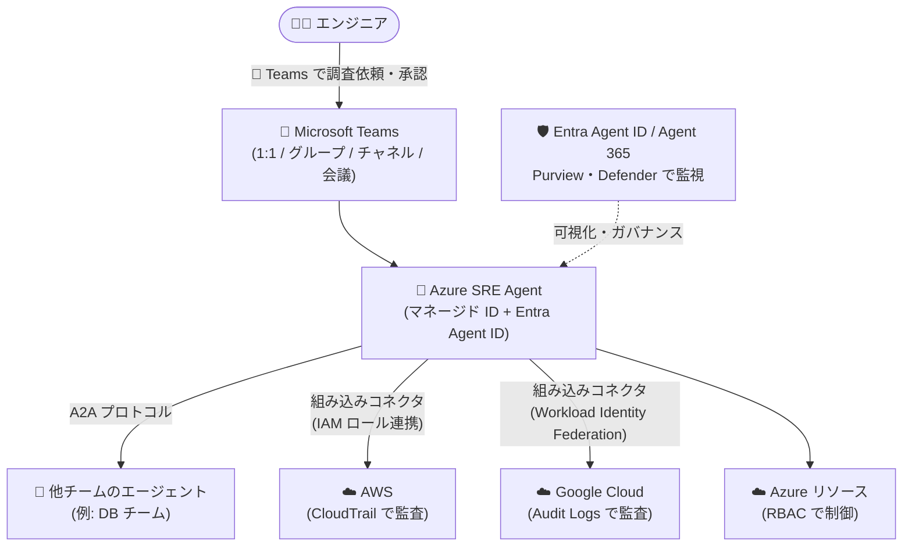

# Azure SRE Agent: マルチクラウド対応・エージェントガバナンス・A2A プロトコル・Teams 統合 (Public Preview)

**リリース日**: 2026-11-17

**サービス**: Azure SRE Agent

**機能**: AWS / Google Cloud ネイティブサポート、Microsoft Entra Agent ID と Agent 365 対応、Agent-to-Agent (A2A) プロトコル対応、Microsoft Teams 統合

**ステータス**: In preview

[このアップデートのインフォグラフィックを見る](https://takech9203.github.io/azure-news-summary/20261117-azure-sre-agent-updates.html)

## 概要

Microsoft Ignite 2026 に合わせて、Azure SRE Agent に 4 つの大型アップデートがパブリックプレビューとして同時発表された。Azure SRE Agent は、インシデントのトリアージ、スケジュールされた運用タスク、サイト信頼性ワークフローを自動化する AI エージェントサービスであり、今回のアップデートでマルチクラウド対応、エージェントの ID ガバナンス、エージェント間連携、コラボレーションツール統合という 4 つの方向に機能が拡張された。

1. **AWS / Google Cloud ネイティブサポート**: 組み込みコネクタにより、Azure に加えて AWS と Google Cloud の環境を横断してアプリケーションと依存関係を調査できるようになった。認証には Azure マネージド ID と ID フェデレーション (AWS IAM ロール / Google Cloud Workload Identity Federation) を使用し、長期キーの管理が不要。
2. **Microsoft Entra Agent ID と Agent 365 対応**: 各 SRE エージェントがマネージド ID に加えて独自の Agent ID を持てるようになり、組織内の他のエージェントと並べて可視化・ガバナンスできるようになった。Microsoft Purview や Microsoft Defender による監視にも対応する。
3. **Agent-to-Agent (A2A) プロトコル対応**: オープンな A2A プロトコルにより、SRE エージェントが他のエージェントへタスクを引き渡し、また他のエージェントからタスクを受け取れるようになった。各エージェントは自チームの権限を保持したまま協調動作する。
4. **Microsoft Teams 統合**: エンジニアが Teams を離れることなく、1 対 1 チャット、グループチャット、チャネル、会議チャットで調査の開始・フォローアップ・エージェントとの共同作業を行えるようになった。

**アップデート前の課題**

- AWS や Google Cloud のリソースを調査するには、アクセスキーやサービスアカウントキーの管理、カスタムコネクタの構築、MCP サーバーのホスティングが必要だった
- SRE エージェントの操作はマネージド ID として記録され、組織内の他の AI エージェントと統一的に可視化・ガバナンスする仕組みがなかった
- チーム間 (例: アプリケーションチームとデータベースチーム) で調査を連携するには人手によるエスカレーションが必要だった
- エージェントとの対話は SRE Agent のインターフェイス上で行う必要があり、日常のコミュニケーションツールから分断されていた

**アップデート後の改善**

- 組み込みコネクタと ID フェデレーションにより、キーレスで AWS / Google Cloud を横断した調査が可能になった
- Entra Agent ID により、エージェントのアクションが「エージェント自身」として Entra / Azure アクティビティログに記録され、Agent 365 のエージェントレジストリで組織全体のエージェントを統一管理できるようになった
- A2A プロトコルにより、各チームのエージェントが権限を保持したままタスクを委譲・受領し、調査結果を 1 つの調査に統合できるようになった
- Teams 上でエージェントとの調査・承認フロー (承認カードの投稿) が完結するようになった

## アーキテクチャ図

エンジニアは Teams からエージェントと対話し、エージェントは Entra Agent ID でガバナンスされながら Azure・AWS・Google Cloud を横断して調査し、必要に応じて A2A プロトコルで他チームのエージェントと協調する。

## サービスアップデートの詳細

### 主要機能

1. **AWS / Google Cloud 組み込みコネクタ (Public Preview)**
   - Azure マネージド ID と ID フェデレーションで認証し、AWS アクセスキーや Google Cloud サービスアカウントキーの管理が不要
   - AWS は AWS IAM ロール (OIDC フェデレーションで一時認証情報を発行)、Google Cloud は Workload Identity Federation と連携
   - AWS は複数アカウントに対して個別の接続を使用。Google Cloud はフェデレーション ID が権限を持つ複数プロジェクトに 1 つの接続で対応可能
   - 自然言語での問い合わせのほか、インシデント対応プラン・スケジュールタスク・ワークフローによる調査の自動化に対応
   - アクセスと操作はクラウド IAM、SRE Agent の実行モード (run modes)、ツール承認で制御。AWS CloudTrail / Google Cloud Audit Logs による監査が可能

2. **Microsoft Entra Agent ID / Microsoft Agent 365 対応 (Public Preview)**
   - 各エージェントがマネージド ID に加えて独自の Agent ID を保持可能
   - Agent ID に Azure ロールを割り当てると、エージェントのアクションが Entra / Azure アクティビティログ上で「エージェント自身」として記録される
   - 管理者はテナントのエージェントレジストリ (Agent 365) で SRE エージェントを検索し、Microsoft Purview と Microsoft Defender で活動を監視できる

3. **Agent-to-Agent (A2A) プロトコル対応 (Public Preview)**
   - SRE エージェントが他のエージェントにタスクを引き渡し、また受け取ることが可能。各エージェントは自チームの権限を保持
   - 例: アプリケーションチームのエージェントがレイテンシ急増を調査中に、データベースチームのエージェントへクエリパフォーマンス確認を依頼し、結果を同じ調査に取り込む
   - 管理者は SRE エージェントが呼び出せるエージェントを決定し、同一 Microsoft Entra テナント内で受信側の呼び出し元を承認。リクエストを処理するカスタムエージェントの選択も可能
   - 接続にはマネージド ID を使用し、リモートエージェントに呼び出し元のツールや権限への直接アクセスは付与されない

4. **Microsoft Teams 統合 (Public Preview)**
   - 1 対 1 チャット、グループチャット、チャネル、会議チャットで調査の開始・フォローアップ・共同作業が可能
   - 承認が必要なアクションは、エージェントが会話内に承認カードを投稿
   - エージェントが参加できる共有会話は管理者が決定。既存のツールポリシーでアクションの「許可 / 承認必須 / 拒否」を判定
   - Teams 上のプレゼンスは Microsoft Entra Agent ID により実現。Azure リソースへのアクセスは引き続きマネージド ID と Azure RBAC で管理

## 技術仕様

| 項目 | 詳細 |
|------|------|
| AWS 認証方式 | OIDC フェデレーション。マネージド ID の ID トークンを AWS STS が検証し、`SREAgentRole` の一時認証情報を発行 (長期キー不使用) |
| AWS 信頼ポリシー条件 | `aud` (クライアント ID)、`oaud` (固定値)、`sub` (プリンシパル ID) の 3 条件で対象 ID を限定 |
| AWS 提供ポリシー | 必須の `AWSMCPSignInOAuthAccessPolicy` に加え、読み取り専用の `SREAgentReadOnlyAccess`、再起動・スケーリング等を許可する `SREAgentWriteAccess` を提供 |
| AWS MCP エンドポイント | N. Virginia、Oregon、Singapore、Sydney、Tokyo、Frankfurt、Ireland、London から選択 |
| Google Cloud 認証方式 | Workload Identity Federation との連携 |
| A2A の前提 | オープンな Agent-to-Agent (A2A) プロトコル。接続にマネージド ID を使用 |
| ガバナンス | 実行モード (Review / Autonomous)、ツールレベルのアクセス制御 (allow / ask / deny)、エージェントフック |
| 監査 | AWS CloudTrail、Google Cloud Audit Logs、Entra / Azure アクティビティログ、Microsoft Purview、Microsoft Defender |

## 設定方法

### 前提条件 (AWS コネクタの場合)

1. 既存の SRE Agent (プレビュー機能のため、エージェント設定で「Early access to features」を有効化)
2. コネクタの作成・更新権限と、エージェントのセレクタで利用可能な Azure マネージド ID
3. 対象 AWS アカウントで IAM の ID プロバイダー、ロール、ポリシーを設定できるアクセス権と、12 桁のアカウント ID

### 設定手順 (AWS コネクタ)

1. SRE Agent の「Build + configure」→「Extensions > Cloud providers」→「Create connection > Amazon Web Services (AWS)」を選択
2. ウィザードでマネージド ID を選択し、表示されるテナント ID・クライアント ID・プリンシパル ID・Original audience を控える
3. AWS 側で OIDC プロバイダー (`https://login.microsoftonline.com/<TENANT_ID>/v2.0`) と IAM ロール `SREAgentRole` を作成 (Microsoft 提供の Terraform スクリプトでの自動構成も可能)
4. 接続名、AWS MCP エンドポイント、12 桁アカウント ID を入力して接続テストを実行し、「Review tools + connect」でツールを確認して保存

## メリット

### ビジネス面

- マルチクラウド環境のインシデント調査を 1 つのエージェントに集約でき、ツール切り替えや縦割りのエスカレーションによる MTTR の増大を抑制できる
- Agent 365 / Entra Agent ID により、組織内に増える AI エージェントを人間の ID と同様のガバナンス体系で統制でき、監査・コンプライアンス要件に対応しやすくなる
- Teams 統合により、エンジニアが日常的に使うツール上で調査と承認が完結し、運用フローへの導入障壁が下がる

### 技術面

- キーレス認証 (ID フェデレーション) により、クロスクラウドのシークレット管理・ローテーションの負担とキー漏えいリスクを排除できる
- A2A プロトコルにより、各チームのエージェントが最小権限を保持したまま協調でき、権限の集中を避けながら調査を自動化できる
- 実行モード、ツールポリシー (allow / ask / deny)、承認カードなど多層のガードレールの下で自動化を段階的に拡大できる

## デメリット・制約事項

- 4 機能すべてパブリックプレビューであり、本番環境での利用は推奨されない (AWS / Google Cloud コネクタは「Early access to features」の有効化が必要)
- AWS コネクタはロール固定 (`SREAgentRole`) で、ロールチェーンおよびクロスアカウントアクセスは不可。別アカウントには別コネクタの追加が必要
- AWS のロールセッションはユーザー単位ではなくエージェント単位の共有 ID であり、トークンがチャット間で再利用される可能性がある。`SREAgentRole` を信頼するすべての ID が同一権限を持つ点に注意
- MCP サインインポリシーは調査対象リソースの権限を代替しないため、最小権限からの開始と書き込み権限の慎重な付与が必要
- A2A の呼び出し元承認は同一 Microsoft Entra テナント内が対象

## ユースケース

### ユースケース 1: マルチクラウド構成のレイテンシ調査

**シナリオ**: フロントエンドは Azure、一部のバックエンド API は AWS Lambda、データ分析基盤は Google Cloud で稼働するシステムで、レイテンシの急増が発生した。

**実装例**: SRE Agent に AWS / Google Cloud コネクタを構成し、チャットで「`aws-connection` 接続を使って東京リージョンの Lambda エラーを調査して」のように自然言語で依頼する。インシデント対応プランに組み込めば、アラート発生時にクロスクラウドの証拠収集を自動化できる。

**効果**: クラウドごとのコンソールを行き来せず、1 つの調査スレッドで Azure・AWS・Google Cloud を横断した根本原因分析ができる。

### ユースケース 2: チーム間のエージェント協調による調査

**シナリオ**: アプリケーションチームのエージェントがレイテンシ急増を調査中、データベース側の問題が疑われる。

**実装例**: A2A プロトコルを有効化し、管理者が呼び出し可能なエージェントと受信側の承認を設定。アプリケーションチームのエージェントが DB チームのエージェントにクエリパフォーマンス確認のタスクを引き渡し、結果を同じ調査に取り込む。

**効果**: 各チームの権限境界を保ったまま、チーム横断の調査を自動化できる。

### ユースケース 3: Teams 上でのインシデント対応

**シナリオ**: 障害対応のブリッジ (Teams 会議・チャネル) 上でそのままエージェントに調査を依頼し、緩和アクションを承認したい。

**実装例**: 管理者がエージェントの参加可能な共有会話を設定。エンジニアはチャネルや会議チャットで調査を依頼し、承認が必要なアクションはエージェントが投稿する承認カードで承認する。

**効果**: ツールを切り替えずにインシデント対応が完結し、対応の経緯が会話として残る。

## 料金

Azure SRE Agent の課金は標準化された消費単位 **Azure Agent Unit (AAU)** に基づき、2 つのコンポーネントで構成される。

| 項目 | 料金 |
|------|------|
| 常時稼働フロー (Always-on flow) | エージェントごとに 4 AAU/時間 (作成から削除まで継続課金) |
| アクティブフロー (Active flow) | タスク実行中の LLM トークン消費量ベース (トークンタイプとモデルごとの固定 AAU レート) |

AAU あたりの具体的な単価は料金ページで確認のこと (確認時点では公開価格の記載なし)。無料枠・Dev/Test 向け AAU は現時点で提供されていないが、常時稼働チャージなしで試せるキャンペーンが案内されている。詳細は [料金ページ](https://azure.microsoft.com/pricing/details/sre-agent/) を参照。

## 関連サービス・機能

- **Microsoft Entra Agent ID / Microsoft Agent 365**: エージェントの ID 付与・レジストリ管理・ガバナンスの基盤。今回のアップデートで SRE Agent が対応
- **Microsoft Purview / Microsoft Defender**: Agent 365 経由でエージェントの活動を監視
- **Azure Monitor / Application Insights / Log Analytics**: SRE Agent が調査時に参照する監視・可観測性データソース
- **PagerDuty / ServiceNow**: インシデント管理プラットフォーム連携。調査サマリーのチケット自動作成に対応
- **GitHub / Azure DevOps**: デプロイイベントとの相関分析に使用するソース管理連携
- **MCP (Model Context Protocol)**: Datadog、Splunk、New Relic などの外部可観測性プラットフォーム接続やカスタムツール連携の標準

## 参考リンク

- [インフォグラフィック](https://takech9203.github.io/azure-news-summary/20261117-azure-sre-agent-updates.html)
- [公式アップデート情報: Native AWS and Google Cloud support](https://azure.microsoft.com/updates?id=580975)
- [公式アップデート情報: Microsoft Entra Agent ID and Agent 365](https://azure.microsoft.com/updates?id=580763)
- [公式アップデート情報: Agent-to-Agent (A2A) protocol support](https://azure.microsoft.com/updates?id=580758)
- [公式アップデート情報: Microsoft Teams integration](https://azure.microsoft.com/updates?id=580753)
- [Microsoft Learn: Azure SRE Agent の概要](https://learn.microsoft.com/azure/sre-agent/overview)
- [AWS コネクタガイド](https://sre.azure.com/docs/capabilities/aws-connector)
- [Google Cloud コネクタガイド](https://sre.azure.com/docs/capabilities/gcp-connector)
- [料金ページ](https://azure.microsoft.com/pricing/details/sre-agent/)

## まとめ

今回の 4 つのパブリックプレビューにより、Azure SRE Agent は「Azure 専用の運用エージェント」から、マルチクラウドを横断し、組織のエージェントガバナンス (Entra Agent ID / Agent 365) に組み込まれ、他のエージェントと協調 (A2A) し、日常のコラボレーションツール (Teams) に溶け込む運用プラットフォームへと進化した。マルチクラウド環境を運用する組織や、AI エージェントの統制基盤を整備中の組織は、まず読み取り専用権限 + Review モードでの PoC から評価を始めることを推奨する。いずれもプレビューのため、本番適用は GA を待って判断したい。

---

**タグ**: Azure SRE Agent, AWS, Google Cloud, Multicloud, Microsoft Entra Agent ID, Agent 365, A2A, Microsoft Teams, AI Agent, Public Preview, Microsoft Ignite
