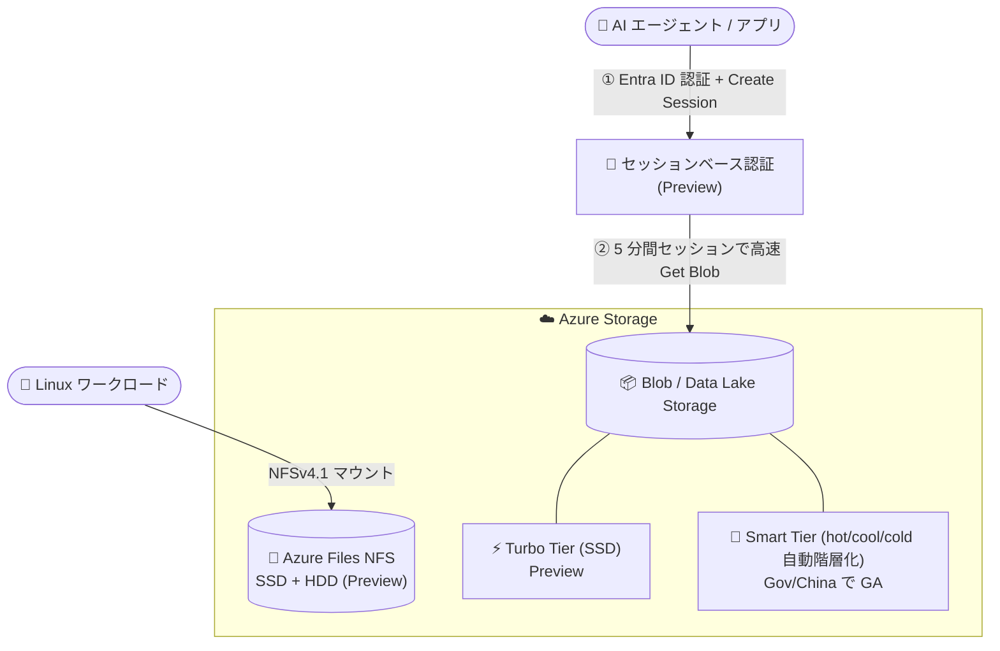

# Azure Blob Storage / Azure Files: ストレージアップデート群 (セッションベース認証、NFS on HDD、Smart Tier、Turbo Tier)

**リリース日**: 2026-11-17

**サービス**: Azure Blob Storage / Azure Data Lake Storage / Azure Files

**機能**: セッションベース認証 (Preview)、Azure Files NFS on HDD (Preview)、Smart Tier の Azure Government / China リージョン展開 (GA)、Blob Storage Turbo Tier (Preview)

**ステータス**: In preview (3 件) / Launched (1 件)

[このアップデートのインフォグラフィックを見る](https://takech9203.github.io/azure-news-summary/20261117-blob-files-storage-updates.html)

## 概要

Microsoft Ignite に合わせて、Azure Storage ファミリー (Blob Storage / Data Lake Storage / Azure Files) の 4 つのアップデートが同日に発表された。いずれもストレージの「性能」「コスト最適化」「セキュリティ」を強化するもので、特に AI ワークロードを意識した内容となっている。

1. **セッションベース認証 (Public Preview)**: Azure Blob / Data Lake Storage で、Microsoft Entra ID による 1 回の認証で短命セッションを確立し、以降の読み取りリクエストの認証・認可レイテンシを削減する新しい認証方式。AI エージェントや高頻度読み取りワークロード向け。
2. **Azure Files NFS shares on HDD (Public Preview)**: 従来 SSD のみだった Azure Files の NFS 共有に、コスト効率を優先する Linux ワークロード向けの HDD オプションが追加。
3. **Smart Tier の Azure Government / China リージョン GA**: アクセスパターンに基づいて hot / cool / cold 層間でデータを自動移動するフルマネージドな階層化機能が、Azure Government と 21Vianet 運営の Azure China リージョンで一般提供開始。
4. **Azure Blob Storage Turbo Tier (Public Preview)**: 対象の Blob Storage アカウントに SSD バックエンドの高性能層を提供。AI トレーニング・推論・分析などの高負荷ワークロード向けに高スループット・低レイテンシを実現しつつ、アクセス頻度の低いデータは HDD ベースの既存アクセス層に保持できる。

**アップデート前の課題**

- Entra ID 認証では Get Blob リクエストごとに OAuth トークン検証と認可評価が発生し、高頻度読み取りワークロードでは認証・認可のレイテンシが積み上がっていた
- Azure Files の NFS 共有は SSD のみの提供で、バックアップや共有データセットなどコスト重視の Linux ワークロードには割高だった
- Smart Tier は Azure パブリッククラウドのみの提供で、Azure Government / China リージョンでは手動の層配置やライフサイクル管理ルールの作成が必要だった
- Blob Storage の標準アクセス層は HDD ベースであり、AI トレーニングなど性能要求の高いワークロードで SSD 性能を得るには別のサービス・アカウント構成が必要だった

**アップデート後の改善**

- セッションベース認証により、コンテナー単位の 5 分間セッションで認証・認可を再利用でき、リクエストごとの認証レイテンシが削減される (SDK では設定 1 つで有効化可能)
- Azure Files NFS で HDD を選択でき、Provisioned v2 課金モデルで容量・IOPS・スループットを独立してプロビジョニング可能に
- Azure Government / China リージョンでも hot → cool (30 日) → cold (90 日) の自動階層化が利用可能になり、コスト最適化が自動化された
- 単一のストレージアカウント・名前空間・Blob API のまま、アクティブなデータに SSD 性能 (Turbo Tier)、非アクティブなデータに HDD のコスト効率を両立できるようになった

## アーキテクチャ図



AI エージェントなどの高頻度読み取りはセッションベース認証と Turbo Tier で高速化し、アクセス頻度の低いデータは Smart Tier や Azure Files の HDD オプションでコスト最適化する、という「性能とコストの使い分け」が今回のアップデート群の軸である。

## サービスアップデートの詳細

### 1. セッションベース認証 (Azure Blob / Data Lake Storage) - Public Preview

クライアントが Microsoft Entra ID で一度認証して Create Session 操作を呼び出すと、Azure Storage が RBAC / ABAC を評価して 5 分間のセッション資格情報 (セッショントークン + 署名用セッションキー) を返す。以降の Get Blob リクエストは Entra ID アクセストークンの代わりにセッショントークンと署名で認可されるため、リクエストごとの認証・認可時間が削減される。

- **性能向上**: ID と権限の検証はセッション作成時の 1 回のみ。以降の読み取りはセッションを再利用
- **最小権限の維持**: 既存の Azure RBAC / ABAC の権限モデルをそのまま使用。セッションは 1 コンテナーにスコープされ、5 分で失効し、作成元クライアント (IP) にバインドされ、全リクエストに署名が必要
- **完全なトレーサビリティ**: すべてのリクエストがセッションを作成した Entra ID の ID に紐づき、診断ログ (StorageRead カテゴリの CreateSession / GetBlob 操作) で監査可能
- **対応範囲**: 全パブリックリージョンで利用可能。対応操作は Get Blob のみ。REST API (バージョン 2026-02-06 以降) と Azure Storage SDK で利用可能。SDK ではクライアント設定 1 つで有効化でき、セッションのライフサイクル (作成・署名・期限前の更新) は SDK が自動管理する
- **利用開始**: `Microsoft.Storage` の `SessionRequest` フィーチャー登録 (プレビュー申請) が必要

### 2. Azure Files NFS shares on HDD - Public Preview

Azure Files の NFS 共有が、既存の SSD に加えて HDD でも利用可能になった (Public Preview)。汎用アプリケーション、共有データセット、バックアップなど、コスト効率を優先する Linux ワークロード向けのフルマネージドオプション。

- **ストレージ支出のワークロード適合**: コスト重視のデータは HDD、性能重視のアプリケーションデータは SSD と使い分け可能
- **使い慣れた NFS アクセス**: オンプレミスのファイルサーバーや NAS 環境の Linux ワークロードをフルマネージドサービスへ移行可能
- **容量と性能の独立構成**: Provisioned v2 課金モデルで容量・IOPS・スループットを個別にプロビジョニング
- **利用開始**: プレビュー参加には [サインアップ調査](https://go.microsoft.com/fwlink/?LinkId=2387652) による申請が必要

### 3. Smart Tier の Azure Government / China リージョン GA

Azure Blob / Data Lake Storage (ADLS) の Smart Tier が Azure Government および Azure China (21Vianet 運営) リージョンで一般提供開始。これにより、ゾーン冗長を持つ Azure パブリッククラウド・Government・China の全リージョンで GA となった。

Smart Tier はオブジェクトストレージの標準オンライン層 (hot / cool / cold) における手動の層配置を不要にするフルマネージド・自動階層化ソリューション:

- 新規データは **hot** 層に格納
- **30 日間** アクセスのないオブジェクトは **cool** 層へ移動
- さらに **60 日間** (非アクティブ合計 90 日) で **cold** 層へ移動
- アクセスが発生すると hot 層へ自動的に戻り、階層化サイクルを再開
- Get Blob / Put Blob がアクセス操作として最終アクセス時刻を更新 (Get Blob Properties / Metadata / Tags は対象外)
- 128 KiB 以下の小さいオブジェクトは効率のため hot 層に留まり階層移動しない
- Archive 層は対象外。データは常にオンライン層に保持される

### 4. Azure Blob Storage Turbo Tier - Public Preview

対象となる Azure Blob Storage アカウントに、SSD バックエンドの性能を提供する新しい層。AI トレーニング、推論、分析などの要求の厳しいデータワークロード向けに設計されている。

- アクティブなデータには高スループット・低レイテンシを提供し、アクセス頻度の低いデータはコスト効率のよい HDD ベースのアクセス層に保持
- アクセスパターンの変化に応じて Smart Placement がアクティブなワーキングセットを管理
- データ、名前空間、Blob API サーフェスは単一のストレージアカウントのまま維持
- プレビューは対象の **LRS アカウント**、**一部リージョン** で利用可能。アクセスはリージョンのキャパシティと適格性に依存

## 技術仕様

| 項目 | 詳細 |
|------|------|
| セッションベース認証: スコープ | 1 セッション = 1 コンテナー |
| セッションベース認証: 有効期限 | 5 分 (延長・更新不可、新規セッション作成が必要) |
| セッションベース認証: 対応操作 | Get Blob のみ (他の操作は Entra ID アクセストークンが必要) |
| セッションベース認証: 必要 REST バージョン | 2026-02-06 以降 (SDK: Python 12.31.1+、.NET 12.31.0-beta.1+ など) |
| セッションベース認証: 課金 | セッション作成 = 書き込みトランザクション、セッション経由の読み取り = 標準トランザクションレート |
| Azure Files NFS: プロトコル | NFSv4.1 (Linux のみ、Windows 非対応) |
| Azure Files NFS on HDD: 課金モデル | Provisioned v2 (容量・IOPS・スループットを独立プロビジョニング) |
| Smart Tier: 対応アカウント | Standard 汎用 v2 (GPv2) + ゾーン冗長 (ZRS / GZRS / RA-GZRS)、ブロック BLOB のみ |
| Smart Tier: 階層化ルール | hot → (30 日非アクセス) → cool → (さらに 60 日) → cold、アクセスで hot に復帰 |
| Smart Tier: 監視メトリック | SmartHot / SmartCool / SmartCold / SmartHot-small (Blob tier 分割で確認) |
| Turbo Tier: 対象アカウント | 対象の Blob Storage LRS アカウント (プレビュー、一部リージョン) |

## 設定方法

### 前提条件

1. **セッションベース認証**: プレビュー申請 (フィーチャー登録) の承認、Microsoft Entra ID 認証 + Azure RBAC/ABAC によるアクセス制御、最新の Blob クライアントライブラリ
2. **Azure Files NFS on HDD**: サインアップ調査によるプレビューアクセス申請
3. **Smart Tier**: Standard GPv2 アカウント + ゾーン冗長 (ZRS/GZRS/RA-GZRS)

### Azure CLI

```bash
# セッションベース認証: プレビュー登録
az feature register --namespace Microsoft.Storage --name SessionRequest

# 登録状態の確認
az feature show --namespace Microsoft.Storage --name SessionRequest

# Smart Tier: 既存アカウントの既定アクセス層を Smart に変更 (Azure CLI 2.87.0 以降)
az storage account update \
  --resource-group <resource-group> \
  --name <storage-account-name> \
  --access-tier Smart
```

### SDK でのセッションベース認証の有効化 (Python の例)

```python
from azure.identity import DefaultAzureCredential
from azure.storage.blob import BlobServiceClient

with DefaultAzureCredential() as credential:
    with BlobServiceClient(
        account_url="https://<storage-account>.blob.core.windows.net",
        credential=credential,
        use_session=True,  # これだけでセッションベース認証が有効化される
    ) as service:
        container = service.get_container_client("<container-name>")
        content = container.download_blob("<blob-name>").readall()
```

### Azure Portal

- **Smart Tier**: ストレージアカウントの「設定」>「構成」で「Blob アクセス層 (既定)」を *Smart* に設定して保存する。新規作成時は「詳細」タブの「Blob Storage」でアクセス層に *Smart* を選択する。既定の層が明示的に設定されていない BLOB が Smart Tier の管理対象になる (明示的に層が設定された BLOB は移動しない)

## メリット

### ビジネス面

- AI エージェント・AI トレーニング・分析などの読み取り集中型ワークロードで、認証オーバーヘッド削減 (セッションベース認証) と SSD 性能 (Turbo Tier) によりスループットとレイテンシの予測可能性が向上する
- Azure Files NFS の HDD オプションと Smart Tier の自動階層化により、アクセス頻度に応じたストレージコストの最適化を手運用なしで実現できる
- 規制要件で Azure Government / China リージョンを利用する組織も、パブリッククラウドと同じ自動階層化 (Smart Tier) を利用できる

### 技術面

- セッションベース認証は既存の Entra ID + RBAC/ABAC の権限モデル・監査ログをそのまま維持し、SDK なら設定 1 つで有効化できる (アプリケーションロジックの変更不要)
- Turbo Tier は単一アカウント・単一名前空間・同一 Blob API のまま SSD 性能を得られるため、データ移行や二重管理が不要
- Smart Tier は階層間移動のトランザクション、早期削除料金、データ取得料金が課金されず、ライフサイクル管理ルールの作成・保守が不要

## デメリット・制約事項

- **セッションベース認証**: Get Blob 操作のみ対応。SAS (ユーザー委任/サービス/アカウント) や Shared Key とは併用不可。認可はコンテナーレベルで評価されるため、コンテナーより細かい粒度の ABAC 条件は評価されず、セッション有効期間 (5 分) 中の権限変更は次のセッション作成まで反映されない。Blob インデックスタグの取得、セカンダリアカウントへの読み取り、Microsoft Purview は非対応。プレビュー参加の承認に数日かかる場合がある
- **Azure Files NFS on HDD**: プレビュー利用にはサインアップ調査による申請が必要。NFS 共有自体の制約 (Windows 非対応、ACL 非対応、GRS/GZRS 非対応、ユーザーベース認証なしでネットワーク制御必須、1 ユーザーあたり 16 GID 制限) は引き続き適用される
- **Smart Tier**: Standard GPv2 + ゾーン冗長アカウントのみ対応 (GPv1、Premium、LRS/GRS は非対象)。ブロック BLOB のみ対応。Archive 層へは移動しない。128 KiB 超のオブジェクトごとに月次の監視オペレーション料金が発生。Smart Tier から明示的な層へ移動したオブジェクトは Smart Tier に戻せない。有効化後、最初の階層化イベントは 30 日後に発生
- **Turbo Tier**: プレビューは対象の LRS アカウント・一部リージョンのみ。アクセスはリージョンのキャパシティと適格性に依存する

## ユースケース

### ユースケース 1: AI エージェントによる大規模・高頻度のデータ読み取り

**シナリオ**: RAG やエージェントシステムが同一コンテナー内の大量の BLOB を同一 ID で高頻度に読み取る。リクエストごとの Entra ID トークン検証がレイテンシのボトルネックになっている。

**実装例**:

```bash
# プレビュー登録後、SDK クライアントでセッションを有効化するだけ
az feature register --namespace Microsoft.Storage --name SessionRequest
# アプリ側: BlobServiceClient(..., use_session=True)  # Python の例
```

**効果**: 認証・認可はセッション作成時の 1 回に集約され、読み取りレイテンシの削減と安定化が期待できる。監査ログでの ID 追跡性は維持される。

### ユースケース 2: アクセスパターンが不明なデータのコスト自動最適化 (Gov/China)

**シナリオ**: Azure Government リージョンで運用する部門が、アクセスパターンの読めない大量のブロック BLOB をライフサイクルルールなしでコスト最適化したい。

**実装例**:

```bash
az storage account update \
  --resource-group rg-gov-data \
  --name stgovdata001 \
  --access-tier Smart
```

**効果**: 30 日 / 90 日の非アクセスで cool / cold 層へ自動移動し、アクセス時は hot 層へ自動復帰。階層移動・取得・早期削除の追加料金なしでストレージコストを削減できる。

### ユースケース 3: コスト重視の Linux 共有ストレージ

**シナリオ**: オンプレミス NAS 上のバックアップ・共有データセットを Azure へ移行したいが、SSD ベースの NFS 共有ではコストが見合わない。

**効果**: Azure Files NFS on HDD により、NFSv4.1 のまま低コストでフルマネージド化。Provisioned v2 で容量と性能を個別に調整し、性能が必要な共有のみ SSD を選択する使い分けができる。

## 料金

- **セッションベース認証**: セッション作成は標準の書き込みトランザクションとして課金。セッション経由の Get Blob はアカウントタイプの標準トランザクションレートで課金
- **Smart Tier**: 容量は基盤となる層 (hot/cool/cold) の既存メーターで課金 (Smart Tier 専用の容量料金はなし)。128 KiB 超のオブジェクトに月次の監視オペレーション料金 (1 万オブジェクト単位)。Smart Tier 内の階層移動・早期削除・データ取得は無料。アクセス操作は hot 層レートで課金。Smart Tier から外部の層へ移動する際はオブジェクトごとに cool 書き込み操作が発生
- **Azure Files NFS on HDD**: Provisioned v2 課金モデル (容量・IOPS・スループットを独立プロビジョニング)
- **Turbo Tier**: プレビュー発表時点で個別の料金情報は未確認

詳細は公式料金ページを参照: [Azure Blob Storage の料金](https://azure.microsoft.com/pricing/details/storage/blobs/) / [Azure Files の料金](https://azure.microsoft.com/pricing/details/storage/files/)

## 利用可能リージョン

- **セッションベース認証**: 全パブリックリージョン (プレビュー)
- **Azure Files NFS on HDD**: プレビュー (サインアップ制。対象リージョンの公式情報は発表内では未記載)
- **Smart Tier**: ゾーン冗長対応の全リージョン (Azure パブリッククラウド、Azure Government、Azure China (21Vianet)) で GA
- **Turbo Tier**: 一部リージョンの対象 LRS アカウント (プレビュー)

## 関連サービス・機能

- **Microsoft Entra ID / Azure RBAC / ABAC**: セッションベース認証の認証・認可基盤。セッションは既存の権限モデルを継承する
- **Azure Monitor / Log Analytics**: セッションの監査 (StorageRead ログの CreateSession / GetBlob) や Smart Tier の層分布メトリック (SmartHot / SmartCool / SmartCold) の監視に使用
- **Blob ライフサイクル管理**: Smart Tier 対象オブジェクトには階層化操作は作用しないが、削除操作は引き続き有効。明示的な層管理をしたい場合の代替手段
- **Azure Data Lake Storage**: セッションベース認証、Smart Tier、Turbo Tier はいずれも ADLS (階層型名前空間) を含む発表
- **Private Link / VNet サービスエンドポイント**: Azure Files NFS はユーザーベース認証がないため、プライベートエンドポイントまたはサービスエンドポイントによるネットワーク制御が必須

## 参考リンク

- [インフォグラフィック](https://takech9203.github.io/azure-news-summary/20261117-blob-files-storage-updates.html)
- [公式アップデート情報: Session-based authentication for Azure Blob and Data Lake Storage (Public Preview)](https://azure.microsoft.com/updates?id=580306)
- [公式アップデート情報: Azure Files NFS shares on HDD (Public Preview)](https://azure.microsoft.com/updates?id=579369)
- [公式アップデート情報: Smart Tier in Azure Government and China regions (GA)](https://azure.microsoft.com/updates?id=579040)
- [公式アップデート情報: Azure Blob Storage turbo tier (Public Preview)](https://azure.microsoft.com/updates?id=579031)
- [Microsoft Learn: Session-based authentication (preview)](https://learn.microsoft.com/azure/storage/blobs/session-based-authentication)
- [Microsoft Learn: Optimize Azure Blob Storage costs with smart tier](https://learn.microsoft.com/azure/storage/blobs/access-tiers-smart)
- [Microsoft Learn: NFS file shares in Azure Files](https://learn.microsoft.com/azure/storage/files/files-nfs-protocol)
- [Azure Blog: Session-based authentication](https://aka.ms/sessionauthblog)
- [Azure Blog: Turbo tier preview](https://aka.ms/TurboTierPreviewBlog)
- [料金ページ: Azure Blob Storage](https://azure.microsoft.com/pricing/details/storage/blobs/)
- [料金ページ: Azure Files](https://azure.microsoft.com/pricing/details/storage/files/)

## まとめ

今回の 4 アップデートは、Azure Storage を AI 時代のデータ基盤として強化する一貫した方向性を示している。性能面ではセッションベース認証と Turbo Tier が高頻度・低レイテンシの読み取り要件に応え、コスト面では Smart Tier のソブリンクラウド展開と Azure Files NFS の HDD オプションが自動化された・きめ細かなコスト最適化を可能にする。

Solutions Architect としては、(1) 読み取り集中型の AI / 分析ワークロードを持つ顧客にはセッションベース認証と Turbo Tier のプレビュー評価を提案し、(2) ゾーン冗長の GPv2 アカウントでは既定アクセス層の Smart Tier 化を検討し、(3) コスト重視の Linux NFS ワークロードには HDD プレビューへのサインアップを案内することを推奨する。いずれのプレビューも本番利用前に制約事項 (対応操作、リージョン、アカウント要件) の確認が必要である。

---

**タグ**: Azure Blob Storage, Azure Data Lake Storage, Azure Files, Storage, Security, Microsoft Ignite, In preview, Launched, NFS, Smart Tier, Turbo Tier, セッションベース認証
