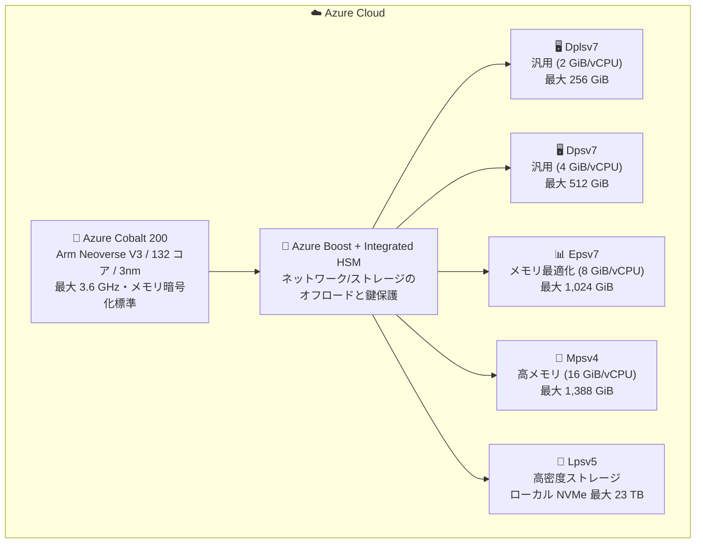

# Azure Virtual Machines: Cobalt 200 Arm ベース Dplsv7 / Dpsv7 / Epsv7 / Mpsv4 / Lpsv5 シリーズ VM の一般提供開始 (GA)

**リリース日**: 2026-11-17

**サービス**: Azure Virtual Machines

**機能**: Cobalt 200 Arm ベース Dplsv7, Dpsv7, Epsv7, Mpsv4, Lpsv5 シリーズ VM

**ステータス**: Launched (GA)

[このアップデートのインフォグラフィックを見る](https://takech9203.github.io/azure-news-summary/20261117-cobalt-200-vm-series-ga.html)

## 概要

Microsoft 第 2 世代の自社開発 Arm プロセッサ「Azure Cobalt 200」を搭載した VM シリーズが一般提供 (GA) となりました。対象は汎用の Dplsv7 / Dpsv7、メモリ最適化の Epsv7、高メモリの Mpsv4、高密度ストレージの Lpsv5 の 5 系統です (Microsoft Ignite に合わせた発表)。Mpsv4 (高メモリ) と Lpsv5 (ストレージ最適化) は Cobalt 世代で新たに追加されたカテゴリです。

Cobalt 200 プロセッサは TSMC 3nm プロセスで製造され、Arm Neoverse V3 コアを 132 基搭載したマルチチップレット構成です。各 vCPU に物理コア 1 個を割り当てる設計 (SMT なし) で、Deterministic モードでは一貫した 3.2 GHz、Opportunistic モードでは最大 3.6 GHz で動作します。前世代の Cobalt 100 VM と比較して、CPU 性能が最大 50% 向上 (ワークロード依存)、NVMe によるリモートストレージ IOPS が 20% 向上、リモートストレージスループットが 10% 向上、ネットワーク帯域が 15% 向上しています。

すでに OpenAI (ChatGPT ワークロード)、Databricks、Snowflake、Amadeus、InMobi などの顧客や、Azure SQL、Microsoft 365、Teams、GitHub Actions といった Microsoft 自社サービスで実績があり、Microsoft は「価格性能比で Azure フリート最高の汎用 VM」と位置付けています。

**アップデート前の課題**

- Arm ベース VM は Cobalt 100 世代 (Dpsv6 / Dplsv6 / Epsv6 など) が最新で、最大 96 vCPU / 672 GiB メモリ程度の構成が上限だった
- Arm ベース VM には高メモリ (M シリーズ相当) やローカル NVMe の高密度ストレージ (L シリーズ相当) のカテゴリが存在せず、インメモリ DB やストレージ集約型ワークロードを Arm に移行しにくかった

**アップデート後の改善**

- CPU 性能最大 50% 向上、最大 128 vCPU / 1,388 GiB メモリ、最大 85 Gbps のネットワーク帯域へスケールアップ
- 高メモリの Mpsv4 (16 GiB/vCPU)、ローカル NVMe 最大 23 TB の Lpsv5 が加わり、Arm で対応できるワークロードの幅が大きく拡大
- メモリ暗号化のデフォルト有効化、全サーバーへの Azure Integrated HSM / Azure Boost 搭載によりセキュリティと I/O 性能が強化

## アーキテクチャ図



Cobalt 200 プロセッサと Azure Boost / Integrated HSM を共通基盤として、ワークロード特性に応じた 5 系統の VM シリーズが提供されます。

## サービスアップデートの詳細

### 主要機能

1. **Cobalt 100 比で大幅な性能向上**
   - CPU 性能最大 50% 向上 (ワークロード依存)。Web サービングで最大 1.5 倍、Java 系で最大 1.6 倍、データベースで 1.9 倍、Teams メディア処理で 1.65 倍などの実測値が公表されている
   - NVMe リモートストレージ IOPS +20%、スループット +10%、ネットワーク帯域 +15%

2. **Processor Mode (動作モード切替)**
   - Deterministic モード: 一貫した 3.2 GHz で予測可能な性能
   - Opportunistic モード: 最大 3.6 GHz までブーストし最大 12% の性能向上 (周波数は変動)

3. **新カテゴリの追加 (Mpsv4 / Lpsv5)**
   - Mpsv4: 16 GiB/vCPU・最大 1,388 GiB の高メモリ VM。インメモリ DB、ERP、大規模ベクトル検索向け
   - Lpsv5: ローカル NVMe 最大 23 TB の高密度ストレージ VM。AI 学習データ準備、検索・インデックスエンジン向け

4. **セキュリティの標準強化**
   - メモリ暗号化がデフォルトで有効 (遅延はごくわずか)
   - 全サーバーに Azure Integrated HSM を搭載し、暗号鍵をハードウェアで保護
   - 圧縮・暗号化アクセラレータを内蔵し、Azure SQL のバックアップ時間を最大 2.5 倍短縮

5. **エージェント型 AI ワークロードへの対応**
   - CPU ベースのエージェントサンドボックス、ツール実行、オーケストレーションサービス向けを明示。AI エージェントのツール実行で最大 1.5 倍の性能向上

## 技術仕様

| 項目 | 詳細 |
|------|------|
| プロセッサ | Azure Cobalt 200 (Arm Neoverse V3、Arm64、TSMC 3nm、132 コア、L2 3 MB/コア、システムレベルキャッシュ 192 MB、DDR5 12 チャネル) |
| クロック | Opportunistic モード最大 3.6 GHz / Deterministic モード 3.2 GHz |
| Dplsv7 (汎用・低メモリ) | 1〜128 vCPU、2 GiB/vCPU、最大 256 GiB |
| Dpsv7 (汎用) | 1〜128 vCPU、4 GiB/vCPU、4〜512 GiB、ローカルディスクなし |
| Epsv7 (メモリ最適化) | 1〜128 vCPU、8 GiB/vCPU、8〜1,024 GiB、ローカルディスクなし |
| Mpsv4 (高メモリ・新) | 1〜128 vCPU、最大 16 GiB/vCPU、16〜1,388 GiB、ローカルディスクなし |
| Lpsv5 (高密度ストレージ・新) | 8 GiB/vCPU、ローカル NVMe 最大 23 TB |
| リモートストレージ | 最大 64 ディスク、最大 320,000 IOPS / 8,770 MBps (Ultra Disk / Premium SSD v2)。Standard SSD/HDD、Premium SSD、Premium SSD v2、Ultra Disk 対応 |
| ネットワーク | 最大 15 NIC、最大 85,000 Mbps (85 Gbps)、Accelerated Networking 必須 (デフォルト有効)、MANA 対応 |
| ローカルディスク付きバリアント | Dpldsv7 / Dpdsv7 / Epdsv7 / Mpdsv4 |
| 対応 OS | Ubuntu、RHEL、SUSE、Debian、AlmaLinux、Rocky Linux、Oracle Linux、Azure Linux、Windows 11 Client (NVMe 対応イメージが必要) |
| デプロイ手段 | Azure Portal / CLI / PowerShell / ARM・Bicep テンプレート、VM Scale Sets、AKS ノードプール |

## 設定方法

### 前提条件

1. NVMe 対応の OS イメージを使用すること (非対応イメージではデプロイ時にエラーとなる)
2. Arm64 アーキテクチャ対応の OS イメージ・アプリケーションを使用すること
3. 対象リージョンで該当 VM サイズの vCPU クォータを確保していること

### Azure CLI

```bash
# Cobalt 200 搭載の Dpsv7 シリーズ VM を作成する例
az vm create \
  --resource-group myResourceGroup \
  --name myCobalt200VM \
  --image Ubuntu2404 \
  --size Standard_D4ps_v7 \
  --location eastus2 \
  --admin-username azureuser \
  --generate-ssh-keys

# リージョンで利用可能な Cobalt 200 VM サイズを確認
az vm list-sizes --location eastus2 --output table | grep -E "ps_v7|ps_v4|ps_v5"
```

## メリット

### ビジネス面

- Microsoft が「価格性能比で Azure フリート最高の汎用 VM」と位置付けており、x86 ベース VM や Cobalt 100 からの移行でコスト効率の改善が期待できる
- OpenAI、Databricks、Snowflake、Amadeus (フライト検索スループット 30% 以上改善)、InMobi など実ワークロードでの実績が公表されており、採用判断の材料が豊富
- Azure SQL、Microsoft 365、Teams、GitHub Actions など Microsoft 自社サービスでの運用実績がある

### 技術面

- Cobalt 100 比で CPU 性能最大 50%、ストレージ IOPS 20%、ネットワーク帯域 15% の向上
- 1 vCPU = 1 物理コア (SMT なし) のため、性能の予測可能性が高い
- メモリ暗号化デフォルト有効 + Azure Integrated HSM によりセキュリティが標準で強化
- 高メモリ (Mpsv4) と高密度ストレージ (Lpsv5) の追加で、Arm に移行できるワークロードの範囲が拡大
- 既に Arm64 対応済みのワークロードは Cobalt 100 からそのまま移行可能

## デメリット・制約事項

- Arm64 アーキテクチャのため、x86 専用のソフトウェア・エージェント類は再ビルドまたは代替が必要
- NVMe 対応 OS イメージが必須 (非対応イメージではデプロイ不可)
- Dplsv7 / Dpsv7 / Epsv7 / Mpsv4 はローカル (一時) ディスクなし。必要な場合は Dpldsv7 / Dpdsv7 / Epdsv7 / Mpdsv4 を選択する
- Ephemeral OS ディスク、入れ子仮想化 (Nested Virtualization)、Azure Disk Encryption (ADE)、Live Migration、第 1 世代 VM は非サポート (Dpsv7 / Epsv7 / Mpsv4 のドキュメントで確認)
- GA 時点の提供リージョンは 14 リージョンで、日本リージョンは含まれていない (2026 年末までに 23 リージョンへ拡大予定)

## ユースケース

### ユースケース 1: スケールアウト型 Web / アプリケーションサーバーの価格性能改善

**シナリオ**: Cobalt 100 (Dpsv6) や x86 VM で稼働中の Web / アプリケーションサーバー層を Dpsv7 に移行し、同一コスト帯でスループットを向上させる。

**実装例**:

```bash
# VM Scale Set を Dpsv7 で作成
az vmss create \
  --resource-group myResourceGroup \
  --name myWebScaleSet \
  --image Ubuntu2404 \
  --vm-sku Standard_D8ps_v7 \
  --instance-count 3 \
  --location eastus2
```

**効果**: Web サービングで最大 1.5 倍、Java 系ワークロードで最大 1.6 倍の性能向上 (Cobalt 100 比) が公表されており、インスタンス数削減やレスポンス改善が期待できる。

### ユースケース 2: インメモリ DB・大規模キャッシュの Arm 移行

**シナリオ**: これまで Arm VM では対応できなかった大容量メモリ要件 (1 TB 超) のインメモリ DB や ERP、ベクトル検索を、新設の Mpsv4 (最大 1,388 GiB) で稼働させる。

**効果**: データベースワークロードで 1.9 倍 (Cobalt 100 比) の性能向上が公表されており、高メモリ領域でも Arm の価格性能メリットを享受できる。

### ユースケース 3: AI エージェント基盤 (ツール実行サンドボックス)

**シナリオ**: エージェント型 AI のオーケストレーション、ツール実行サンドボックスなど CPU ベースの処理を Dpsv7 / Dplsv7 で実行する。

**効果**: AI エージェントのツール実行で最大 1.5 倍の性能向上。GPU を使わない周辺処理のコスト効率を高められる。

## 料金

GA 発表時点で具体的な単価は公式ブログ・Updates に記載されていません。Microsoft は「価格性能比で Azure フリート最高の汎用 VM」としています。最新の料金は以下で確認してください。

- [Linux Virtual Machines の料金](https://azure.microsoft.com/pricing/details/virtual-machines/linux/)
- [料金計算ツール](https://azure.microsoft.com/pricing/calculator/)

なお、Dpsv7 / Epsv7 / Mpsv4 はローカルディスクなしの構成であり、ディスクストレージは VM と別課金です ([Managed Disks の料金](https://azure.microsoft.com/pricing/details/managed-disks/))。

## 利用可能リージョン

GA 時点で以下の 14 リージョンで利用可能です (2026 年末までに 23 リージョンへ拡大予定)。

Australia East、Canada Central、Central US、East US、East US 2、Indonesia Central、Italy North、Korea Central、South Central US、Spain Central、Sweden Central、UK South、West US 2、West US 3

## 関連サービス・機能

- **Azure Kubernetes Service (AKS)**: Cobalt 200 VM をノードプールとして利用可能。Arm ノードによるコンテナワークロードのコスト最適化に有効
- **Virtual Machine Scale Sets**: Flexible / Uniform 両オーケストレーションモードに対応し、スケールアウト構成を構築可能
- **Azure Boost**: 全 Cobalt 200 VM に搭載。ネットワーク / ストレージ処理をホストからオフロードし、最大 85 Gbps ネットワーク・320,000 IOPS を実現
- **Azure Managed Disks (Premium SSD v2 / Ultra Disk)**: ローカルディスクなし構成のため、リモートディスクの選定が性能設計の要点になる
- **Cobalt 100 VM (Dpsv6 / Dplsv6 / Epsv6 など)**: 前世代シリーズ。Arm64 対応済みワークロードはそのまま Cobalt 200 へ移行可能

## 参考リンク

- [インフォグラフィック](https://takech9203.github.io/azure-news-summary/20261117-cobalt-200-vm-series-ga.html)
- [公式アップデート情報](https://azure.microsoft.com/updates?id=581298)
- [Azure Blog: Azure Cobalt 200 VMs now available](https://azure.microsoft.com/en-us/blog/azure-cobalt-200-vms-now-available-proven-on-real-workloads-and-built-for-the-agentic-era/)
- [Microsoft Learn: Dpsv7 シリーズ](https://learn.microsoft.com/azure/virtual-machines/sizes/general-purpose/dpsv7-series)
- [Microsoft Learn: Epsv7 シリーズ](https://learn.microsoft.com/azure/virtual-machines/sizes/memory-optimized/epsv7-series)
- [Microsoft Learn: Mpsv4 シリーズ](https://learn.microsoft.com/azure/virtual-machines/sizes/memory-optimized/mpsv4-series)
- [料金ページ (Linux VM)](https://azure.microsoft.com/pricing/details/virtual-machines/linux/)

## まとめ

Azure の第 2 世代 Arm プロセッサ Cobalt 200 を搭載した 5 系統の VM シリーズが GA になりました。CPU 性能最大 50% 向上という世代間の伸びに加え、高メモリの Mpsv4 と高密度ストレージの Lpsv5 が新設されたことで、Arm VM の適用範囲が汎用ワークロードからインメモリ DB・ストレージ集約型まで大きく広がった点が重要です。OpenAI や Databricks など大規模顧客での実績も公表されており、Arm 採用のリスクは世代を追うごとに下がっています。

Solutions Architect としては、(1) Arm64 対応済みワークロード (コンテナ、Java、OSS DB など) のコスト最適化候補として Cobalt 200 を評価する、(2) NVMe 対応イメージ・ローカルディスクなし構成・ADE 非対応などの制約を移行アセスメントに織り込む、(3) 日本リージョンは GA 時点で未提供のため、リージョン拡大 (2026 年末までに 23 リージョン) のロードマップを注視する、の 3 点を推奨します。

---

**タグ**: Compute, Virtual Machines, Arm, Cobalt 200, Microsoft Ignite, GA
