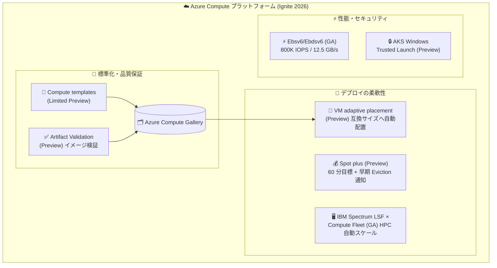

# Azure Compute/VM プラットフォーム: Microsoft Ignite 2026 アップデート群 (配置最適化・新 VM シリーズ・構成標準化・セキュリティ)

**リリース日**: 2026-11-17

**サービス**: Azure Virtual Machines / Azure Compute Fleet / Azure Kubernetes Service (AKS)

**機能**: Compute/VM プラットフォームアップデート群 (IBM Spectrum LSF 統合、Artifact Validation、VM adaptive placement、Ebsv6/Ebdsv6、Spot plus、Windows Trusted Launch、Compute templates)

**ステータス**: Launched (GA) 2 件 / In preview 5 件

[このアップデートのインフォグラフィックを見る](https://takech9203.github.io/azure-news-summary/20261117-compute-vm-platform-updates.html)

## 概要

Microsoft Ignite 2026 に合わせて、Azure の Compute/VM プラットフォームに関する 7 件のアップデートが発表されました。VM のデプロイ成功率と柔軟性を高める機能 (VM adaptive placement、Spot plus、IBM Spectrum LSF と Compute Fleet の統合)、VM 構成の標準化と品質保証を支援する機能 (Compute templates、Artifact Validation)、ストレージ性能を強化した新 VM シリーズ (Ebsv6/Ebdsv6 の GA)、および AKS Windows ノードのブートチェーン保護 (Windows Trusted Launch) が含まれます。

一般提供 (GA) となったのは「IBM Spectrum LSF integration with Azure Compute Fleet」と「Azure Ebsv6/Ebdsv6 VM シリーズ」の 2 件です。残り 5 件はパブリックプレビューまたは限定プレビューであり、本番環境以外での検証用途に位置付けられます。

いずれも「必要なときに必要なキャパシティを確実に確保する」「VM 構成をコードとして標準化・検証する」という Solutions Architect にとって重要なテーマに直結するアップデートです。

**アップデート前の課題**

- 標準の VM 作成では単一サイズしか指定できず、そのサイズのキャパシティがないとデプロイが失敗していた (カスタムのリトライループやフォールバックリストを自前実装する必要があった)
- VM イメージの認定レベルの品質・セキュリティチェックは、Partner Center で Azure Marketplace オファーを提出したときにしか実行できなかった
- 標準 Spot VM は実行時間の予測が難しく、Eviction 通知も短く、中断耐性のあるワークロードでも対応時間が不足しがちだった
- AKS の Trusted Launch サポートは Windows ノードプールには提供されていなかった
- OS・ストレージ・セキュリティなどの共通 VM 設定をデプロイ要求ごとに繰り返し記述する必要があり、構成ドリフトが発生しやすかった

**アップデート後の改善**

- adaptive placement により、優先サイズが利用できない場合は同一 vCPU 数・同等以上の世代・同等性能の互換サイズに Azure が自動で配置 (追加料金なし)
- Artifact Validation により、自分のサブスクリプション内でビルドプロセスの任意の時点で認定レベルの検証を CI/CD のリリースゲートとして実行可能
- Spot plus により、ベストエフォートで最低 60 分の実行時間を目標とし、最大 2 分前の Eviction 通知と 30 秒〜15 分前の Rebalance 通知を提供。最初の 60 分以内に Eviction された場合は課金なし
- AKS の Windows Server 2025 ノードプールで Secure Boot と vTPM ベースの Measured Boot が利用可能に
- Compute templates により、VM 構成を Azure Compute Gallery にバージョン管理された instance profile として定義・再利用可能
- Ebsv6/Ebdsv6 は Azure Boost により最大 800K IOPS / 12.5 GB/s のリモートストレージ性能を提供し、前世代比で vCPU あたり最大 15% のストレージ性能向上と 15〜30% の CPU 性能向上を実現

## アーキテクチャ図

7 件のアップデートは「デプロイの柔軟性」「構成の標準化・品質保証」「性能・セキュリティ」の 3 領域に整理できます。Compute templates は Azure Compute Gallery に構成を格納し、adaptive placement と組み合わせて利用できます。

## サービスアップデートの詳細

### 1. IBM Spectrum LSF integration with Azure Compute Fleet (GA)

IBM Spectrum LSF が Azure Compute Fleet と統合され、弾力的でコスト効率の高い HPC ワークロードオーケストレーションが可能になりました。IBM LSF Resource Connector for Azure Compute Fleet が、ワークロード需要に応じてコンピュートキャパシティをプロビジョニング・解放します。

- LSF ジョブ需要に応じて Azure VM を自動的にプロビジョニング・解放
- 1 つの Fleet リクエストで複数の VM ファミリー・サイズを指定し、ピーク時のキャパシティ確保の成功率を向上
- フォールトトレラントで再実行可能なジョブは Azure Spot VM で、継続性が必要なワークロードは従量課金キャパシティで実行
- 既存のキュー階層、フェアシェアポリシー、ライセンス対応スケジューリングを維持 (ジョブ投入ワークフローの変更不要)
- 対象ワークロード: 半導体設計/EDA、ゲノミクス、自動車シミュレーション、エネルギー研究、金融リスクモデリング
- Azure Marketplace から Azure Compute Fleet plugin for IBM Spectrum LSF をダウンロードし、IBM の構成ガイダンスに従って利用

### 2. Azure Artifact Validation for VM images (Public Preview)

VM イメージの発行者やエンタープライズのプラットフォームチームが、Azure の認定レベル (certification-grade) の品質・セキュリティチェックを、自分の Azure サブスクリプション内でビルドプロセスの任意の時点で実行できるようになりました。

- セルフサービスの検証を自分のサブスクリプションで実行 (テスト項目とタイミングを選択可能)
- ブート可能性、OS 構成、プラットフォーム互換性のチェックに加え、Microsoft Defender によるマルウェア・脆弱性スキャン
- API を持つネイティブ Azure リソースとして提供され、CI/CD パイプラインのリリースゲートとして組み込み可能
- テストごとの結果に安定したエラーコードと明確な理由を提供
- Azure Marketplace 認定を補完するものであり、置き換えるものではない (最終認定は引き続き Partner Center で実施)
- 提供リージョン: Central US、North Central US、South Central US、Sweden Central、Japan East、Australia East (REST API、ARM テンプレート、Azure SDK 経由)

### 3. VM adaptive placement (Public Preview)

キャパシティが逼迫している状況での VM デプロイ成功率を高める機能です。標準の VM 作成では 1 つの正確なサイズを指定し、そのサイズが利用できないとデプロイが失敗しますが、adaptive placement では「優先サイズ」を指定します。優先サイズが利用可能であればそれをデプロイし、利用できない場合は同一 vCPU 数・同一または新しい世代・同等性能の互換サイズをデプロイします。

- 新しい VM タイプや料金オファーではなく、通常の Azure VM としてデプロイされたサイズの標準料金で課金 (追加料金なし)
- カスタムのリトライループやフォールバックリストを、Azure がリクエスト時に行う配置判断で置き換え
- VM 上で優先サイズとデプロイされたサイズの両方を確認可能
- 新規 VM にも既存 VM の更新にも利用可能
- プレビュー期間中の制約: 優先サイズは D/E/F シリーズのみ。単一 VM 向けで、Capacity Reservations、Dedicated Hosts、Availability Sets、Proximity Placement Groups とは併用不可。クォータの範囲内で動作し、キャパシティ保証ではない
- 利用方法: REST API、Azure PowerShell、.NET/Python SDK (プレビューでは Azure Portal 非対応)

### 4. Azure Ebsv6 / Ebdsv6 VM シリーズ (GA)

第 5 世代 Intel Xeon プロセッサ (Platinum 8573C "Emerald Rapids") と Azure Boost を搭載した、リモートストレージ最適化 VM シリーズが一般提供になりました。リレーショナルデータベース、インメモリ分析、データウェアハウスなど I/O 集約型ワークロード向けです。

- **ストレージ性能強化**: Azure Boost により最大 800K IOPS / 12.5 GB/s のリモートストレージスループット (Premium SSD v2、Ultra Disk 対応)
- **効率向上**: vCPU あたりのリモートストレージ性能が最大 15% 向上、CPU 性能が 15〜30% 向上
- **高いスケーラビリティ**: 最大 96 vCPU / 768 GiB メモリ (192 vCPU / 最大 1.8 TB メモリのサイズは近日提供予定)
- **柔軟な構成**: メモリ集約型ワークロードには Ebsv6、ローカル NVMe 一時ストレージが必要な場合は Ebdsv6
- **セキュリティと接続性**: 最大 200 Gbps ネットワーク、Intel Total Memory Encryption を既定で有効化
- 複数の Azure リージョンで一般提供

### 5. Azure Compute Spot plus (Public Preview)

標準 Spot VM の強化ティアです。中断耐性のあるワークロードに対して、より高いランタイムの一貫性と早期の Eviction シグナルを提供します。

- ベストエフォートで最低 60 分の実行時間を目標 (Eviction 対象であることは変わらない)
- 最初の 60 分以内に Azure がキャパシティ回収のために Eviction した場合、その VM の使用分は課金されない
- 最大 2 分前の Eviction 通知により、チェックポイント保存や作業のドレインが可能
- Rebalance 通知 (通常 30 秒〜15 分前) により Eviction リスクの高まりを事前に通知
- 料金は標準 Spot より高いが、従量課金 (PAYG) よりは大幅に低い
- デプロイ方法: Compute API、ARM テンプレート、Azure Portal、Azure CLI、Azure PowerShell、Azure SDK。単一 VM および VMSS (Flexible/Uniform オーケストレーション) に対応
- 利用手順: サブスクリプションで Spot plus プレビュー機能を登録し、API バージョン `2026-04-01` 以降で `SpotPlus` priority を指定してデプロイ

### 6. Windows Trusted Launch for AKS (Public Preview)

規制対象や高セキュリティ環境で Windows ワークロードを AKS 上で実行するチーム向けに、Windows ノードプールのブートチェーン保護が強化されます。これまで Trusted Launch のサポートは Windows ノードプールには提供されていませんでした。

- Windows Server 2025 により、AKS は Windows ノードの Trusted Launch をプレビュー提供
- Secure Boot と vTPM ベースの Measured Boot を追加し、基盤となる VM が署名済みブートコンポーネントを検証し、ブート整合性シグナルを提供
- ブートキット、ルートキット、低レベルマルウェアへの露出を低減し、AKS ノードプールモデルを維持したまま、より信頼性の高い Windows ホストベースラインを実現

### 7. Compute templates for Azure (Limited Preview)

VM 構成管理を簡素化する新機能です。標準化された VM 構成を定義・バージョン管理・再利用できます。OS、ストレージ、セキュリティなどの共通 VM 設定の再利用可能な構成ベースラインを作成し、Azure Compute Gallery にバージョン管理された instance profile として保存します。

- **デプロイの簡素化**: 共通構成を 1 度定義し、サポートされる VM デプロイ全体で再利用
- **一貫性の向上**: 標準化・バージョン管理された構成により構成ドリフトとメンテナンス負荷を削減
- **柔軟なデプロイ**: 単一 VM と VM adaptive placement に適用可能。デプロイ固有の設定やオーバーライドもサポート (インライン作成リクエストの値が instance profile の値を上書き)
- **独立した管理**: 再利用可能な構成を個々のデプロイ要求とは独立して管理
- instance profile で定義可能なセクション: `hardwareProfile`、`storageProfile`、`osProfile`、`networkProfile`、`securityProfile`、`priority`/`evictionPolicy`/`billingProfile` (Spot)、`tags`、`zones` など
- 主な制限 (限定プレビュー): REST API のみ (SDK/PowerShell/CLI/Portal 非対応)。VM 作成時のみ参照可能 (既存 VM への追加・変更・削除は不可)。instance profile バージョンは不変。拡張機能 (extensions) を含む instance profile は利用不可。`adminPassword` や `protectedSettings` などの暗号化セキュリティフィールドは instance profile に含めず、インラインリクエストで指定
- VM スケールセット、AKS、Azure Compute Fleet は現時点で非対応
- プレビュー登録とサブスクリプションの有効化が必要

## 技術仕様

### Ebsv6 シリーズ主要スペック (Microsoft Learn より)

| 項目 | 詳細 |
|------|------|
| プロセッサ | Intel Xeon Platinum 8573C (Emerald Rapids) [x86-64] |
| vCPU / メモリ | 2〜192 vCPU / 16〜1,832 GiB (E2bs_v6〜E192ibs_v6) |
| ローカルストレージ | なし (Ebdsv6 はローカル NVMe 一時ストレージあり) |
| リモートストレージ | 最大 64 ディスク、最大 800,000 IOPS / 12,500 MBps (Ultra Disk・Premium SSD v2、E192ibs_v6) |
| ネットワーク | 最大 8 NIC、12,500〜200,000 Mbps (MANA 対応) |
| 代表サイズ例 | E96bs_v6: 96 vCPU / 768 GiB / 非キャッシュ 429,000 IOPS (Ultra/Pv2) / 41,000 Mbps |
| 機能サポート | Premium Storage: 対応、第 2 世代 VM: 対応、Accelerated Networking: 必須、Ephemeral OS Disk: 非対応 |

### Compute templates 前提条件

| 項目 | 詳細 |
|------|------|
| 機能登録 | `Microsoft.Compute/InstanceProfile` および `Microsoft.Compute/InstanceProfiles` のプレビュー登録 |
| API バージョン | instance profile リソースには `2026-03-03` 以降 |
| 対応リージョン | East US 2 EUAP、West US 3、Central US、South Central US、East Asia |
| 必要リソース | Azure Compute Gallery (instance profile の定義とバージョンを格納) |

## メリット

### ビジネス面

- adaptive placement と Spot plus により、キャパシティ逼迫時のデプロイ失敗や中断による機会損失・運用コストを低減
- Spot plus は最初の 60 分以内の Eviction で課金されないため、バッチ/CI などのコスト予測性が向上
- LSF 統合により、既存のオンプレミス HPC 環境のワークフローを変えずに Azure へバースト可能
- Artifact Validation により、Marketplace 提出後の手戻りを防ぎ、修正コストが安い早期段階で問題を発見

### 技術面

- 自前のリトライ/フォールバック実装が不要になり、デプロイロジックが簡素化
- Compute templates により VM 構成の標準化・バージョン管理・共有が可能になり、構成ドリフトを抑制
- Ebsv6/Ebdsv6 は Premium SSD v2 / Ultra Disk と組み合わせて I/O 集約型 DB ワークロードの性能要件に対応
- AKS Windows ノードのブート整合性検証により、規制環境のコンプライアンス要件に対応しやすくなる

## デメリット・制約事項

- **adaptive placement**: 優先サイズは D/E/F シリーズのみ。単一 VM 専用で Capacity Reservations、Dedicated Hosts、Availability Sets、Proximity Placement Groups と併用不可。キャパシティ保証ではない。プレビューでは Portal 非対応
- **Spot plus**: 60 分はベストエフォートの目標であり保証ではない。標準 Spot より料金が高い。プレビュー機能の登録が必要
- **Compute templates**: 限定プレビューで REST API のみ。VM 作成時のみ参照可能でバージョン変更不可。VMSS/AKS/Compute Fleet 非対応。対応リージョンが限定的
- **Artifact Validation**: 最終的な Marketplace 認定の代替にはならない (Partner Center での認定は引き続き必要)。提供リージョンは 6 リージョンに限定
- **Windows Trusted Launch (AKS)**: Windows Server 2025 ノードプールが前提のプレビュー機能
- **Ebsv6/Ebdsv6**: 192 vCPU / 1.8 TB メモリのサイズは「近日提供予定」であり、現時点の GA 範囲は最大 96 vCPU / 768 GiB。Ebsv6 はローカル一時ディスクなし、Ephemeral OS Disk 非対応

## ユースケース

### ユースケース 1: キャパシティ逼迫リージョンでの確実な VM デプロイ

**シナリオ**: 特定リージョンで E シリーズ VM のキャパシティが断続的に逼迫しており、デプロイ失敗時のリトライ処理を自前実装している。

**実装例**: adaptive placement で優先サイズを指定して VM を作成する (REST API / PowerShell / .NET / Python SDK)。Azure が優先サイズを配置できない場合、同一 vCPU 数・同等以上の世代・同等性能の互換サイズを自動選択する。

**効果**: リトライループとフォールバックリストの自前実装を排除し、デプロイ成功率を向上。デプロイされたサイズの標準料金のみで追加コストなし。

### ユースケース 2: CI/CD パイプラインでのゴールデンイメージ品質ゲート

**シナリオ**: 社内標準の VM イメージを Azure Compute Gallery で配布しているが、品質・セキュリティ検証が手動で属人的になっている。

**実装例**: イメージビルドパイプライン (例: Packer + GitHub Actions) の最終ステージに Artifact Validation の REST API 呼び出しを追加し、ブート可能性・OS 構成・Defender によるマルウェア/脆弱性スキャンをリリースゲートとして実行する。

**効果**: 認定レベルのチェックを早期に自動実行し、問題を修正コストの安い段階で検出。テストごとの安定したエラーコードにより失敗原因の追跡が容易。

### ユースケース 3: 中断耐性バッチの Spot plus 移行

**シナリオ**: 標準 Spot VM でバッチ処理を実行しているが、Eviction 通知が短くチェックポイント保存が間に合わないことがある。

**実装例**: サブスクリプションで Spot plus プレビューを登録し、API バージョン `2026-04-01` 以降で `SpotPlus` priority を指定して VMSS をデプロイ。Rebalance 通知と最大 2 分前の Eviction 通知を監視してチェックポイント保存・ドレイン処理を実行する。

**効果**: 最低 60 分のランタイム目標により処理単位の完走率が向上。60 分以内の Eviction は課金されないため、コスト効率も改善。

## 料金

今回確認できた料金に関する公式情報は以下のとおりです。

| 項目 | 料金 |
|------|------|
| VM adaptive placement | 追加料金なし (デプロイされたサイズの標準料金で課金) |
| Spot plus | 標準 Spot より高く、従量課金 (PAYG) より大幅に低い。最初の 60 分以内に Eviction された場合はその VM の使用分は課金なし |
| Ebsv6/Ebdsv6 | 標準の VM 料金体系 (詳細は料金ページを参照) |

具体的な単価は [Azure Virtual Machines 料金ページ](https://azure.microsoft.com/pricing/details/virtual-machines/) および [料金計算ツール](https://azure.microsoft.com/pricing/calculator/) を参照してください。

## 利用可能リージョン

- **Artifact Validation (Preview)**: Central US、North Central US、South Central US、Sweden Central、Japan East、Australia East
- **Compute templates (Limited Preview)**: East US 2 EUAP、West US 3、Central US、South Central US、East Asia
- **Ebsv6/Ebdsv6 (GA)**: 複数の Azure リージョンで一般提供 (具体的なリージョン一覧はドキュメントを参照)
- その他のアップデートのリージョン情報は公式情報で確認できませんでした

## 関連サービス・機能

- **Azure Compute Fleet**: 複数の VM ファミリー・サイズ・購入オプションを 1 つのリクエストで指定しキャパシティを確保する機能。LSF 統合の基盤
- **Azure Compute Gallery**: Compute templates (instance profile) と VM イメージの格納・バージョン管理・共有基盤
- **Azure Boost**: Ebsv6/Ebdsv6 のストレージ・ネットワーク性能を支えるオフロード基盤
- **Premium SSD v2 / Ultra Disk**: Ebsv6/Ebdsv6 の公称ディスク性能 (最大 800K IOPS) を達成するために利用するマネージドディスク
- **Microsoft Defender**: Artifact Validation のマルウェア・脆弱性スキャンを提供
- **Azure Spot Virtual Machines**: Spot plus の基盤となる割引キャパシティモデル
- **Trusted Launch (Azure VM)**: Secure Boot / vTPM による VM のブート保護機能。今回 AKS Windows ノードプールに拡大

## 参考リンク

- [インフォグラフィック](https://takech9203.github.io/azure-news-summary/20261117-compute-vm-platform-updates.html)
- [公式アップデート情報: IBM Spectrum LSF integration with Azure Compute Fleet (GA)](https://azure.microsoft.com/updates?id=581259)
- [公式アップデート情報: Azure Artifact Validation for VM images (Preview)](https://azure.microsoft.com/updates?id=581249)
- [公式アップデート情報: VM adaptive placement (Preview)](https://azure.microsoft.com/updates?id=581244)
- [公式アップデート情報: Azure Ebsv6 and Ebdsv6 (GA)](https://azure.microsoft.com/updates?id=581160)
- [公式アップデート情報: Azure Compute Spot plus (Preview)](https://azure.microsoft.com/updates?id=581145)
- [公式アップデート情報: Windows Trusted Launch (Preview)](https://azure.microsoft.com/updates?id=572591)
- [公式アップデート情報: Compute templates for Azure (Limited Preview)](https://azure.microsoft.com/updates?id=580624)
- [Tech Community Blog: IBM Spectrum LSF と Azure Compute Fleet](https://techcommunity.microsoft.com/blog/azurecompute/microsoft-and-ibm-bring-elastic-hpc-workload-orchestration-to-azure-with-ibm-spe/4573300)
- [Tech Community Blog: Azure Artifact Validation](https://techcommunity.microsoft.com/blog/azurecompute/public-preview-azure-artifact-validation-%E2%80%93-self-serve-validation-for-vm-images/4573178)
- [Tech Community Blog: VM adaptive placement](https://techcommunity.microsoft.com/blog/azurecompute/announcing-public-preview-of-vm-adaptive-placement/4572196)
- [Tech Community Blog: Azure Compute Spot plus](https://techcommunity.microsoft.com/blog/azurecompute/public-preview-azure-compute--spot-plus/4573059)
- [Microsoft Learn: Ebsv6 シリーズ](https://learn.microsoft.com/en-us/azure/virtual-machines/sizes/memory-optimized/ebsv6-series)
- [Microsoft Learn: Ebdsv6 シリーズ](https://learn.microsoft.com/en-us/azure/virtual-machines/sizes/memory-optimized/ebdsv6-series)
- [Microsoft Learn: Compute templates 概要](https://learn.microsoft.com/en-us/azure/virtual-machines/overview-compute-templates)
- [AKS Trusted Launch ドキュメント](https://aka.ms/aks/trusted-launch)
- [料金ページ: Azure Virtual Machines](https://azure.microsoft.com/pricing/details/virtual-machines/)

## まとめ

Microsoft Ignite 2026 に合わせた Compute/VM プラットフォームの 7 件のアップデートは、「キャパシティ確保の柔軟性」(adaptive placement、Spot plus、LSF × Compute Fleet)、「構成の標準化と品質保証」(Compute templates、Artifact Validation)、「性能とセキュリティ」(Ebsv6/Ebdsv6 GA、AKS Windows Trusted Launch) という 3 つの方向で Azure の VM 基盤を強化するものです。

Solutions Architect としては、(1) I/O 集約型 DB ワークロードの Ebsv6/Ebdsv6 への移行評価、(2) キャパシティ逼迫リージョンでの adaptive placement の検証、(3) 中断耐性バッチの Spot plus への移行検証、(4) ゴールデンイメージパイプラインへの Artifact Validation の組み込み検討、を次のアクションとして推奨します。プレビュー機能は本番環境以外での検証から始めてください。

---

**タグ**: Azure Virtual Machines, Azure Compute Fleet, AKS, Ebsv6, Ebdsv6, Spot VM, Trusted Launch, Compute Gallery, HPC, Microsoft Ignite, GA, Public Preview
