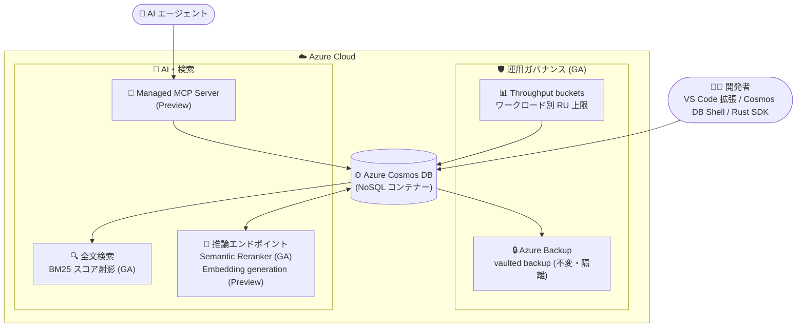

# Azure Cosmos DB: Microsoft Ignite 2026 アップデート群 (throughput buckets GA、Semantic Reranker GA、Azure Backup 対応ほか)

**リリース日**: 2026-11-17

**サービス**: Azure Cosmos DB

**機能**: Microsoft Ignite 発表のアップデート群 (throughput buckets、Semantic Reranker、Azure Backup 対応、VS Code 拡張、Cosmos DB Shell、Managed MCP Server、Rust SDK、embedding generation、BM25 スコア射影)

**ステータス**: Launched (GA) / In preview (機能により異なる)

[このアップデートのインフォグラフィックを見る](https://takech9203.github.io/azure-news-summary/20261117-cosmos-db-ignite-updates.html)

## 概要

Microsoft Ignite 2026 にあわせて、Azure Cosmos DB に関する多数のアップデートが同時に発表されました。本レポートでは 2026 年 11 月 17 日に Azure Updates で公開された 9 件の機能を 1 つにまとめて解説します。

**GA (一般提供) になった機能:**

- **Throughput buckets**: 同一コンテナーを共有する複数ワークロードのスループット消費を、コンテナー全体のスループットに対する割合 (%) で制限
- **Semantic Reranker**: AI モデルで検索候補を意味に基づき再ランキングし、検索関連性を向上
- **Azure Backup for Azure Cosmos DB**: 論理的にエアギャップされたバックアップボールトへの不変 (immutable) な長期バックアップ (vaulted backup)
- **Azure Cosmos DB Shell**: 人間と AI エージェントの両方が利用できるスクリプタブルなコマンドライン体験
- **Azure Cosmos DB SDK for Rust**: NoSQL 向けネイティブ Rust クライアント (バージョン 1.0.0)
- **全文検索の BM25 スコア射影**: `FullTextScore` の関連性スコアをクエリ結果に射影可能に

**Public Preview になった機能:**

- **AI-assisted Data Modeler (VS Code 拡張)**: AI 支援によるデータモデル設計
- **Managed MCP Server**: マネージドな Model Context Protocol エンドポイントで AI エージェントをデータに接続
- **Embedding generation**: Microsoft Embedding 1 モデルによるベクトル埋め込み生成

これらは「運用ガバナンスの強化」「AI エージェント・セマンティック検索対応」「開発者体験の向上」という 3 つの方向性に整理でき、Cosmos DB を AI アプリケーションのデータ基盤として強化する Ignite 発表の中核をなしています。なお、Azure Updates には「Azure Backup for Azure Cosmos DB」のアイテムが 2 件 (guid 579147 / 578044) 掲載されていますが、同一機能の発表のため本レポートでは 1 つの機能として扱います。

**アップデート前の課題**

- 同一コンテナーを共有するワークロード間でリソース競合が発生し、特定ワークロード (ETL、一括処理など) がスループットを占有してスロットリングや遅延を引き起こしていた
- 検索結果の意味的な再ランキングには外部の検索サービスやカスタムランキングパイプラインの構築が必要だった
- ネイティブバックアップは本番アカウントと同一環境にあり、規制要件で求められる隔離された長期保持バックアップに対応していなかった
- ベクトル埋め込みの生成には外部の埋め込みサービス (Azure OpenAI など) の呼び出しと管理が別途必要だった
- AI エージェントから Cosmos DB のデータへアクセスするには、自前で MCP サーバーのインフラを構築・運用する必要があった
- 全文検索の `FullTextScore` は並べ替え (`ORDER BY RANK`) にのみ使え、スコア自体をアプリケーションから参照できなかった

**アップデート後の改善**

- Throughput buckets により、最大 5 個のバケットでワークロードごとのスループット上限 (%) を設定し、リソース占有を防止できるようになった
- Semantic Reranker により、Microsoft AI Semantic Ranker モデル (Azure AI Search と同じモデル) を使った再ランキングを Cosmos DB と連携するマネージドな推論エンドポイントで実行できるようになった
- Azure Backup の vaulted backup により、不変かつエアギャップされた長期バックアップでランサムウェア対策・コンプライアンス要件に対応できるようになった
- Embedding generation により、Cosmos DB と連携する推論エンドポイントでテキスト・画像のマルチモーダル埋め込みを生成できるようになった
- Managed MCP Server により、Microsoft 管理のエンドポイント経由でエージェントがスキーマ検出・ドキュメント取得・全文/ベクトル/ハイブリッド検索を実行できるようになった
- BM25 スコア射影により、`SELECT` 句で関連性スコアを取得し、しきい値フィルタリングやデバッグが可能になった

## アーキテクチャ図



Cosmos DB コンテナーを中心に、運用ガバナンス (throughput buckets、vaulted backup)、AI・検索 (推論エンドポイント、MCP、BM25)、開発者ツール (VS Code 拡張、Shell、Rust SDK) の 3 領域が強化されています。

## サービスアップデートの詳細

### 主要機能

1. **Throughput buckets (GA)**
   - コンテナーごとに最大 5 個のバケットを定義し、各バケットにコンテナー全体スループットに対する最大消費割合 (%) を設定
   - スループットの「予約」ではなく「上限」であり、上限超過時は当該バケットのリクエストのみがスロットリングされる
   - SDK のリクエストオプション (.NET `ThroughputBucket`、Python `throughput_bucket` など) またはクライアントオプションでバケットを割り当て
   - バケット未指定のリクエスト用に既定バケットも設定可能
   - ISV のマルチテナント、ETL の一括実行、データ移行、Change Feed 処理などの用途を想定

2. **Semantic Reranker (GA)**
   - ベクトル検索・全文検索・ハイブリッド検索で取得した候補を、Azure Data AI SDK の `InferenceClient` 経由で再ランキング
   - Azure AI Search の Semantic Ranker と同じ Microsoft AI Semantic Ranker モデルを使用
   - 0〜1 の関連性スコア、文単位スコア (上位 2 文)、トークン使用量、レイテンシ情報を返却
   - Azure portal の「Semantic Reranker」メニューから有効化でき、Cosmos DB アカウントと対になる推論アカウント (`Microsoft.InferenceService/inferenceAccounts`) が作成される
   - 認証は Microsoft Entra ID。「Semantic Reranker User」ロールが必要

3. **Azure Backup for Azure Cosmos DB (GA)**
   - vaulted backup により、ソースアカウントから隔離 (論理的エアギャップ) されたバックアップボールトに不変のバックアップコピーを保存
   - バックアップポリシーの集中管理と長期保持 (long-term retention) に対応
   - ネイティブの継続バックアップ (continuous backup) を置き換えるのではなく補完する追加の保護レイヤー
   - 規制コンプライアンスやランサムウェア対策の要件に対応

4. **AI-assisted Data Modeler ほか VS Code 拡張の更新 (Public Preview)**
   - ドキュメント構造、クエリパターン、書き込み分散、想定スケール、データ成長を分析してデータモデル設計を支援
   - ホットパーティションやクロスパーティションクエリの検出、パーティションキー戦略の比較が可能
   - 拡張機能にはアカウントダッシュボード、Query Advisor、IntelliSense (Preview)、Migration Assistant (Preview) なども含まれる

5. **Azure Cosmos DB Shell (GA)**
   - ドキュメントのクエリ・管理、データセットのインポート/エクスポート、インデックス・スループット構成の確認を一貫したスクリプタブルな CLI で実行
   - ターミナル、VS Code、Azure portal で利用可能
   - AI エージェントワークフロー向けの MCP 統合をサポート

6. **Managed MCP Server (Public Preview)**
   - Microsoft 管理の MCP エンドポイント経由で AI エージェントが Cosmos DB のビジネスデータに安全に接続
   - スキーマ検出、ドキュメント取得、全文・ベクトル・ハイブリッド検索を利用可能
   - Azure の ID 基盤と RBAC によるアクセス制御。自前の MCP サーバーインフラの構築・運用が不要

7. **Azure Cosmos DB SDK for Rust (GA)**
   - `azure_data_cosmos` クレート バージョン 1.0.0 として GA
   - 自動リトライ、パーティションレベルフェイルオーバー、サーキットブレーキング、効率的なバイナリエンコーディングを内蔵
   - `azure_identity` クレートによる Microsoft Entra ID 認証に対応
   - OpenTelemetry サポート (`unstable_opentelemetry`) とパッチ操作 (`unstable_patch`) は引き続き Preview

8. **Embedding generation (Public Preview)**
   - Microsoft Embedding 1 (`microsoft-embedding-1-large`) によるマルチモーダル埋め込み生成。テキスト・検索クエリ・画像を同一ベクトル空間に埋め込み可能
   - Dense (最大 2,560 次元) と multi-vector (late-interaction 用) の両出力形式に対応
   - Azure portal の「AI Capabilities」>「Embedding generation (Preview)」から有効化。Azure Data AI SDK の `InferenceClient` で呼び出し
   - 生成したベクトルはアプリケーションが Cosmos DB に格納し、ベクトル検索・ハイブリッド検索で利用

9. **全文検索 BM25 スコア射影 (GA)**
   - `FullTextScore` を `SELECT` 句に射影し、各結果の BM25 関連性スコアを直接取得可能に
   - `WHERE` 句でのスコアによるフィルタリング (しきい値適用) にも対応
   - 同一クエリの `ORDER BY RANK` に同じスコアリング式を含めることが条件

## 技術仕様

| 項目 | 詳細 |
|------|------|
| Throughput buckets の上限 | コンテナーあたり最大 5 バケット |
| Throughput buckets 対応 SDK | .NET v3 3.63.0+ / Java v4 4.83.0+ / JavaScript v4 4.8.0+ / Python 4.16.4+ |
| Throughput buckets の制約 | 共有スループットデータベース内のコンテナーとサーバーレスアカウントは非対応 |
| Semantic Reranker の上限 | 1 回の呼び出しで最大 50 ドキュメント、コンテキスト + ドキュメントのペアで最大 2,048 トークン、JSON の targetPaths は最大 100 パス |
| Semantic Reranker の認証 | Microsoft Entra ID (「Semantic Reranker User」ロール + Cosmos DB データプレーンロール) |
| Embedding generation のモデル | `microsoft-embedding-1-large` (dense: 1,536 / 2,560 次元、multi-vector: 128 / 256 次元) |
| Embedding generation の入力上限 | テキスト/クエリは 1 リクエスト 1 件 (8,192 トークン超は切り詰め)、画像は最大 8 件 (JPEG/PNG/GIF/WebP、1 画像 20 MiB・50 メガピクセルまで) |
| Rust SDK | クレート `azure_data_cosmos` 1.0.0 (Rust 1.88 以降、API は NoSQL) |
| BM25 スコア射影の条件 | `SELECT` 句への射影には同一クエリの `ORDER BY RANK` に同じ `FullTextScore` 式が必要 |

## 設定方法

### Throughput buckets (Azure Portal)

1. Azure Cosmos DB アカウントの **Data Explorer** を開く
2. 対象コンテナーの **Scale & Settings** を開く
3. **Throughput Buckets** タブでバケットを **Active** に変更
4. 各バケットの最大スループット割合 (%) を設定して保存 (最大 5 バケット)

### Throughput buckets (.NET SDK)

```csharp
// リクエスト単位でバケット 1 を割り当て
ItemRequestOptions options = new ItemRequestOptions { ThroughputBucket = 1 };
ItemResponse<Product> response = await container.ReadItemAsync<Product>(
    itemId, partitionKey, options);
```

### BM25 スコア射影 (NoSQL クエリ)

```sql
SELECT TOP 10
    c.id,
    c.text,
    FullTextScore(c.text, "bicycle", "mountain") AS score
FROM c
WHERE FullTextScore(c.text, "bicycle", "mountain") > 0
ORDER BY RANK FullTextScore(c.text, "bicycle", "mountain")
```

### Semantic Reranker (Azure Portal)

1. Azure Cosmos DB アカウントのリソースメニューで **Semantic Reranker** を開く
2. **Semantic Reranker** を有効化 (同名の推論アカウントが作成される)
3. **Reranker Permissions** でアクセス権を付与し、エンドポイントが利用可能になるまで待機

### Embedding generation (Azure Portal)

1. Azure Cosmos DB アカウントの **AI Capabilities** > **Embedding generation (Preview)** を開く
2. デプロイ先リージョンを選択して有効化し、エンドポイントをコピー
3. 呼び出す ID に **Embedding User** ロールを割り当て

### Rust SDK

```bash
cargo add azure_data_cosmos@1.0.0
cargo add azure_identity@1.0.0
```

## メリット

### ビジネス面

- vaulted backup により、規制業種 (金融・医療など) で求められる隔離された不変バックアップの要件を満たし、ランサムウェア対策を強化できる
- マルチテナント SaaS で特定テナントによるスループット占有を防ぎ、SLA の安定性を向上できる
- 外部検索サービスを追加導入せずにセマンティック検索・再ランキングを実現でき、アーキテクチャとコストを簡素化できる
- Rust SDK の GA により、高性能・省リソースなバックエンド (OpenAI の事例では Python から Rust への移行で CPU 効率 6 倍、メモリ効率 15 倍と紹介) の選択肢が広がる

### 技術面

- Throughput buckets はスループットを予約せず上限のみを設定するため、全体の RU/s を無駄にせずワークロード分離ができる
- Semantic Reranker / Embedding generation は Microsoft Entra ID 認証のマネージド推論エンドポイントとして提供され、キー管理が不要
- BM25 スコア射影により検索品質のデバッグ・チューニング・しきい値制御がクエリだけで完結する
- Managed MCP Server と Cosmos DB Shell の MCP 統合により、AI エージェントからのデータアクセスを標準プロトコルで統一できる

## デメリット・制約事項

- Throughput buckets は共有スループットデータベースのコンテナーとサーバーレスアカウントでは利用できない
- Semantic Reranker は 1 回の呼び出しで最大 50 ドキュメント、ペアあたり 2,048 トークンの制限があり、再ランキングによるネットワーク呼び出しと推論時間分のレイテンシが加算される
- Semantic Reranker / Embedding generation は別リソースの推論アカウント (`Microsoft.InferenceService`) の作成とロール割り当てが必要で、利用可能リージョンが限定されている
- Embedding generation は Preview であり、テキスト入力は 1 リクエスト 1 件、8,192 トークン超は切り詰められる。生成ベクトルの格納・再生成・インデックス構成はアプリケーション側の責務
- BM25 スコアの射影には同一クエリに `ORDER BY RANK` の同一スコアリング式が必須
- Rust SDK の OpenTelemetry サポートとパッチ操作は Preview のままで本番利用は非推奨
- AI-assisted Data Modeler、Managed MCP Server は Public Preview であり、本番運用前に仕様変更の可能性を考慮する必要がある

## ユースケース

### ユースケース 1: マルチテナント SaaS でのワークロード分離

**シナリオ**: ISV が単一コンテナーで複数テナントのデータを管理しており、夜間の ETL バッチがオンライントランザクションのスループットを圧迫している。

**実装例**:

```csharp
// ETL 用クライアントはバケット 1 (例: 最大 30%) に固定
CosmosClient etlClient = new CosmosClientBuilder(endpoint, credential)
    .WithBulkExecution(true)
    .WithThroughputBucket(1)
    .Build();
```

**効果**: ETL の消費がバケット上限で頭打ちになり、オンライン処理のスロットリングを防止できる。

### ユースケース 2: RAG アプリケーションの検索品質向上

**シナリオ**: Cosmos DB をベクトルストアとする RAG チャットボットで、検索上位の関連性が不十分なことがある。

**実装例**:

```sql
-- 1. 全文検索で候補を取得 (BM25 スコアも射影)
SELECT TOP 10 c.id, c.title, c.text,
    FullTextScore(c.text, "space", "adventure") AS score
FROM c
WHERE FullTextScore(c.text, "space", "adventure") > 0
ORDER BY RANK FullTextScore(c.text, "space", "adventure")
```

続けて Azure Data AI SDK の `InferenceClient.semantic_rerank` で候補を再ランキングし、上位結果のみを LLM のコンテキストに渡す。

**効果**: BM25 による高速な一次検索と意味ベースの再ランキングを組み合わせ、外部検索サービスなしで回答品質を向上できる。

### ユースケース 3: コンプライアンス要件を満たす長期バックアップ

**シナリオ**: 金融系システムで、本番環境から隔離された改ざん不可能なバックアップを長期保持する規制要件がある。

**実装**: Azure Backup のバックアップボールトに Cosmos DB アカウントの vaulted backup を構成し、継続バックアップ (PITR) と併用する。

**効果**: 運用ミスやランサムウェアで本番アカウントが侵害されても、エアギャップされた不変バックアップから復旧できる。

## 料金

| 項目 | 料金 |
|------|------|
| Semantic Reranker | 1,000 再ランキング呼び出しあたり 1 米ドル (リージョン・クラウドにより変動の可能性あり) |
| Embedding generation | 入力トークン単位の課金 (Cosmos DB の操作とは別課金。画像もトークン換算) |
| Throughput buckets / BM25 スコア射影 / Rust SDK / Shell / VS Code 拡張 | 機能自体の追加料金に関する記載なし (通常の RU 消費・利用料金が適用) |

最新の料金は [Azure Cosmos DB 料金ページ](https://azure.microsoft.com/pricing/details/cosmos-db/) および [Azure Backup 料金ページ](https://azure.microsoft.com/pricing/details/backup/) を参照してください。

## 利用可能リージョン

- **Semantic Reranker の推論アカウント**: East US 2、West US 3、UK South (ドキュメント記載の利用可能リージョン)
- **Embedding generation の推論アカウント**: East US、East US 2、North Central US、West Central US、West US 2、West US 3、Poland Central
- その他の機能のリージョン情報は各ドキュメントを参照してください

## 関連サービス・機能

- **Azure Backup**: vaulted backup の保存先となるバックアップボールトを提供し、ポリシー管理・監視を集中化
- **Azure AI Search**: Semantic Reranker は Azure AI Search の Semantic Ranker と同じモデルを使用。Cosmos DB 内で完結する検索とフル機能の検索サービスの使い分けが可能
- **Microsoft Entra ID / Azure RBAC**: 推論エンドポイント・MCP Server・各 SDK の認証基盤。Ignite では Cosmos DB の Azure RBAC 統合 (2026 年 12 月中旬 Preview 予定) も発表
- **Azure Monitor**: Throughput buckets のバケット別リクエスト数・RU 消費を「Total Requests (Preview)」「Total Request Units (Preview)」メトリックで監視可能
- **Visual Studio Code**: Azure Cosmos DB 拡張 (Data Modeler、Query Advisor、Migration Assistant など) の実行環境

## 参考リンク

- [インフォグラフィック](https://takech9203.github.io/azure-news-summary/20261117-cosmos-db-ignite-updates.html)
- [公式アップデート情報: Throughput buckets GA](https://azure.microsoft.com/updates?id=571488)
- [公式アップデート情報: Semantic Reranker GA](https://azure.microsoft.com/updates?id=577520)
- [公式アップデート情報: Azure Backup for Azure Cosmos DB GA](https://azure.microsoft.com/updates?id=579147) / [同一発表 (guid 578044)](https://azure.microsoft.com/updates?id=578044)
- [公式アップデート情報: AI-assisted Data Modeler ほか VS Code 拡張 Preview](https://azure.microsoft.com/updates?id=578444)
- [公式アップデート情報: Azure Cosmos DB Shell GA](https://azure.microsoft.com/updates?id=578439)
- [公式アップデート情報: Managed MCP Server Preview](https://azure.microsoft.com/updates?id=578434)
- [公式アップデート情報: SDK for Rust GA](https://azure.microsoft.com/updates?id=578054)
- [公式アップデート情報: Embedding generation Preview](https://azure.microsoft.com/updates?id=578049)
- [公式アップデート情報: BM25 スコア射影 GA](https://azure.microsoft.com/updates?id=577531)
- [Azure Cosmos DB Blog: What's new in Azure Cosmos DB at Microsoft Ignite 2026](https://devblogs.microsoft.com/cosmosdb/whats-new-azure-cosmos-db-ignite-2026/)
- [Azure Cosmos DB Blog: Rust SDK GA](https://devblogs.microsoft.com/cosmosdb/announcing-the-general-availability-of-the-azure-cosmos-db-sdk-for-rust/)
- [Azure Cosmos DB Blog: Throughput buckets GA](https://devblogs.microsoft.com/cosmosdb/generally-available-control-shared-workloads-with-throughput-buckets-in-azure-cosmos-db/)
- [Azure Cosmos DB Blog: Semantic reranking と BM25 スコア射影](https://devblogs.microsoft.com/cosmosdb/improve-search-relevance-with-semantic-reranking-and-bm25-score-projection-in-azure-cosmos-db/)
- [Microsoft Learn: Throughput buckets](https://learn.microsoft.com/azure/cosmos-db/nosql/throughput-buckets)
- [Microsoft Learn: Semantic reranker](https://learn.microsoft.com/azure/cosmos-db/gen-ai/semantic-reranker)
- [Microsoft Learn: Full-text search (BM25)](https://learn.microsoft.com/azure/cosmos-db/gen-ai/full-text-search)
- [Microsoft Learn: Embedding generation (Microsoft Embedding 1)](https://learn.microsoft.com/azure/cosmos-db/gen-ai/generate-embedding)
- [Microsoft Learn: VS Code 拡張の概要](https://learn.microsoft.com/azure/cosmos-db/vscode-extension/overview)
- [Microsoft Learn: Rust SDK クイックスタート](https://learn.microsoft.com/azure/cosmos-db/nosql/quickstart-rust)
- [料金ページ: Azure Cosmos DB](https://azure.microsoft.com/pricing/details/cosmos-db/)

## まとめ

Microsoft Ignite 2026 での Azure Cosmos DB のアップデート群は、同サービスを「AI エージェント時代のオペレーショナルデータベース」として位置付ける大規模な機能強化です。運用面では throughput buckets と Azure Backup (vaulted backup) の GA により、マルチテナント環境のガバナンスと規制対応のバックアップ戦略が標準機能で実現できるようになりました。AI・検索面では Semantic Reranker と BM25 スコア射影の GA、embedding generation と Managed MCP Server の Preview により、外部サービスに依存しないセマンティック検索・RAG・エージェント統合の構成が可能になっています。開発者体験でも Rust SDK と Cosmos DB Shell の GA、VS Code 拡張の AI-assisted Data Modeler が加わりました。

Solutions Architect としては、(1) 共有コンテナーを使うマルチテナント設計での throughput buckets の適用、(2) コンプライアンス要件がある案件での vaulted backup の採用、(3) RAG/エージェント案件での「Cosmos DB 内完結の検索スタック (全文検索 + ベクトル検索 + Reranker)」と Azure AI Search の使い分け、の 3 点をまず検討することを推奨します。Preview 機能 (MCP Server、embedding generation、Data Modeler) は検証環境での評価から始めてください。

---

**タグ**: Azure Cosmos DB, Microsoft Ignite, Throughput Buckets, Semantic Reranker, Azure Backup, MCP, Rust SDK, Embedding Generation, BM25, Full-Text Search, GA, Public Preview
