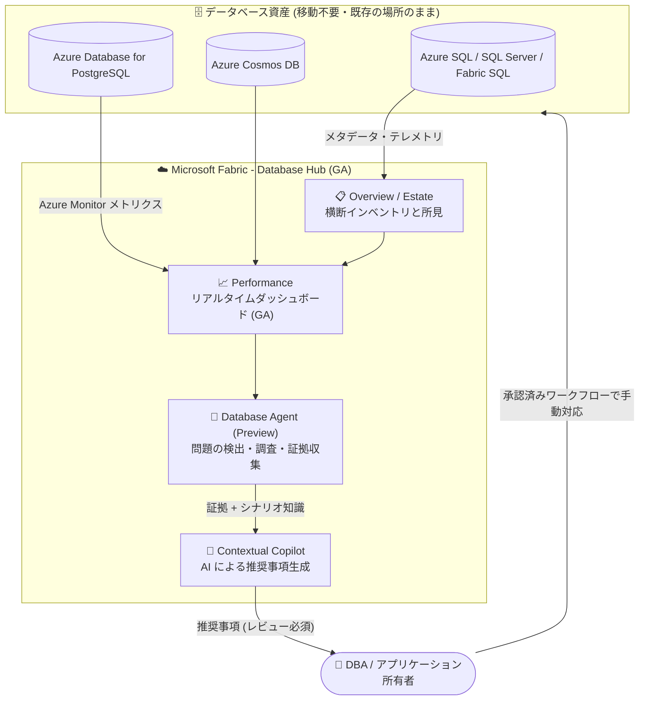

# Database Hub in Microsoft Fabric: Database Hub GA / リアルタイムパフォーマンスダッシュボード GA / Database Agent for SQL (contextual Copilot) プレビュー

**リリース日**: 2026-11-17

**サービス**: Database Hub in Microsoft Fabric (Azure SQL Database / Azure SQL Managed Instance / SQL Server on Azure VM / Azure Database for PostgreSQL / Azure Cosmos DB / Fabric SQL)

**機能**: Database Hub の一般提供開始、リアルタイムパフォーマンスダッシュボードの一般提供開始、contextual Copilot を備えた Database Agent for SQL のパブリックプレビュー

**ステータス**: Launched (GA) / In preview

[このアップデートのインフォグラフィックを見る](https://takech9203.github.io/azure-news-summary/20261117-database-hub-copilot-agent.html)

## 概要

Microsoft Ignite 2026 に合わせて、Microsoft Fabric 内の統合データベース運用体験である **Database Hub** が一般提供 (GA) となりました。Database Hub は、SQL Server、Azure SQL、PostgreSQL、Azure Cosmos DB、Fabric SQL といった複数のデータベースエンジンを横断して「検出 (Discover)・管理 (Manage)・監視 (Monitor)・最適化 (Optimize)」を行うための単一のコントロールプレーンです。データベースは Azure・オンプレミスなど既存の場所に置いたまま利用でき、データ移動やミラーリング、監視インフラの追加構築は不要です。

同時に、Database Hub の **リアルタイムパフォーマンスダッシュボード** も GA となりました。Performance ページから、Microsoft SQL、Azure Database for PostgreSQL フレキシブルサーバー、Azure Cosmos DB の CPU・メモリ・ストレージ・IO・接続数などの主要シグナルを 1 か所で追跡し、問題のあるサーバーやアカウントへドリルダウンできます。アクセスには Fabric 容量 (capacity) が不要で、既存の Microsoft Entra ID と Azure RBAC の権限がそのまま適用されます。

さらに、**Database Agent for SQL with contextual Copilot** がパブリックプレビューとして発表されました。Database Agent は、検出されたデータベースの問題に対して、「なぜその問題が重要か」「考えられる原因」「推奨される次のステップ」を含む、AI 生成かつ証拠 (エビデンス) に基づいた推奨事項を提供します。推奨事項は、観測された証拠と AI が生成した結論を区別して提示され、状態を変更するアクションの前に必ずユーザーのレビューに供されます。

**アップデート前の課題**

- 複数のデータベースエンジン (SQL Server、Azure SQL、PostgreSQL、Cosmos DB など) を監視するには、Azure ポータルや各サービスの管理ツールを行き来して情報を手動で突き合わせる必要があった
- データベース資産全体 (エステート) を横断したインベントリや、パフォーマンス・セキュリティ・ベストプラクティスの所見を一元的に把握する手段がなかった
- パフォーマンス問題の検出後、原因分析や対処方針の判断は担当者の経験と手作業の調査に依存していた

**アップデート後の改善**

- Database Hub の Estate / Performance ページで、Azure・Fabric・オンプレミスのデータベースをデータ移動なしに 1 か所で監視・調査できるようになった (GA)
- CPU、メモリ、ストレージ、IO、接続数などのリアルタイム・履歴メトリクスをエンジン横断で比較し、ドリルダウンできるようになった (GA)
- Database Agent が問題の検出・調査・証拠収集を自動化し、contextual Copilot による AI 支援で原因と次のステップの推奨を提示するようになった (プレビュー)

## アーキテクチャ図

データベースは既存の環境に置いたまま、Database Hub がメタデータとテレメトリを集約します。Database Agent が問題を検出・調査し、contextual Copilot が証拠に基づく推奨事項を生成しますが、変更の実行は必ず人間のレビューと承認済みワークフローを経由します。

## サービスアップデートの詳細

### 1. Database Hub in Microsoft Fabric (GA)

Microsoft Fabric 内の統合データベース運用体験が一般提供となりました。

- **Estate ページ**: Azure・Fabric・オンプレミス・サポート対象マルチクラウド環境のデータベースを横断するインベントリ。特性・所有者・環境・所見によるフィルタリング、ビューの保存・共有、リソース作成が可能
- **Overview ページ**: データベース資産全体の Issues (早急な対応が必要な問題) と Suggestions (セキュリティ・パフォーマンス・使用率・コスト効率の改善機会) を優先度付きで表示
- **権限モデル**: 既存の Microsoft Entra ID と Azure RBAC をそのまま使用。Database Hub がリソースを検出しても追加のアクセス権は付与されない。共有ビューは構成のみを共有し、各ユーザーは自身の権限で見えるリソースのみ閲覧可能
- **拡張性**: テレメトリを Power BI、OneLake、Fabric Real-Time Dashboards、アラート、カスタムアプリケーションへ拡張可能。SSMS、VS Code の MSSQL 拡張機能、GitHub Copilot CLI / Claude Code などのエージェントから利用できるスキルも提供

### 2. Database Hub リアルタイムパフォーマンスダッシュボード (GA)

- Performance ページで Microsoft SQL、Azure Database for PostgreSQL フレキシブルサーバー、Azure Cosmos DB の CPU・メモリ・ストレージ・IO・接続数などの主要シグナルを一元的に追跡
- 問題のあるサーバー・アカウントへのドリルダウンが可能
- データベースは Azure でもオンプレミスでもそのままの場所で監視でき、データ移動・ミラーリング・監視インフラの構築は不要
- Microsoft SQL では、テンプレートから Fabric Real-Time Dashboards としてカスタムモニターを作成しチームと共有可能
- サポート対象リソースでは、Azure Data Explorer 互換エンドポイント経由でクエリパフォーマンス監視テレメトリにアクセスし、KQL によるアドホック分析が可能 (現時点では Microsoft SQL のみ)

### 3. Database Agent for SQL with contextual Copilot (パブリックプレビュー)

- 検出されたデータベースの問題に対して、「なぜ重要か」「考えられる原因」「推奨される次のステップ」を含む AI 生成・証拠ベースの推奨事項を提供
- 推奨事項は、利用可能な問題の証拠と Microsoft 作成のシナリオ知識に基づいて生成される
- 観測された証拠と AI が生成した結論を区別して提示し、証拠が不完全・古い・矛盾している場合は不確実性を明示
- 状態を変更するアクションの前に、推奨事項が必ずユーザーのレビュー用として提示される
- Azure SQL Database の検出・調査のコアロジックは LLM を使わずに動作し、Copilot 容量を消費しない。高 CPU および長時間実行クエリの問題に対してのみ、オプションの contextual AI 支援 (「Explain why」「Analyze slow query」などのプロンプト) が LLM と管理者が割り当てた Copilot 容量を使用する
- Azure SQL Database でサポートされる問題シナリオ: 高 CPU、高メモリ、高 I/O、長時間実行クエリ、ブロッキングクエリ、欠落インデックス、未使用/重複インデックスの削除、クエリプランのリグレッション

## 技術仕様

| 項目 | 詳細 |
|------|------|
| 提供形態 | Microsoft Fabric 内の統合エクスペリエンス (Fabric ポータル、Power BI、Azure、直接 URL からアクセス可能) |
| 対応データベース (Estate) | Azure SQL Database、Azure SQL Elastic Pools、Azure SQL Managed Instance、SQL database in Fabric、SQL Server enabled by Azure Arc、SQL Server on Azure VM、Azure Database for PostgreSQL フレキシブルサーバー、Azure Cosmos DB |
| Performance ダッシュボード対象 | Microsoft SQL、Azure Database for PostgreSQL フレキシブルサーバー、Azure Cosmos DB (Elastic Pools / SQL MI / Fabric SQL は Estate のみで Performance 未対応) |
| 監視メトリクス | CPU、メモリ、ストレージ、IO、接続数ほか |
| 認証・認可 | Microsoft Entra ID + Azure RBAC (既存権限をそのまま使用、追加権限の付与なし) |
| ライセンス | Fabric Free ライセンスで利用可能。Fabric 容量や個別の Database Hub ライセンスは不要 |
| Database Agent 対応 DB (プレビュー) | Azure SQL Database (serverless、Hyperscale 含む)。Elastic Pools、1 vCore serverless、SQL MI、SQL Server on Azure VM / Arc は未対応 |
| Database Agent (PostgreSQL) | VS Code での限定プレビュー (PostgreSQL 16 以降、South Central US / West US 3 / Sweden Central)。Database Hub での対応は今後提供予定 |
| AI の利用 | SQL のコア調査は LLM 不使用。contextual AI 支援 (高 CPU・長時間実行クエリ) のみ LLM + Copilot 容量を使用 |

## 設定方法

### 前提条件

1. Microsoft Entra ID アカウントで Fabric にサインインできること (Fabric Free でも可)
2. 監視対象の Azure サブスクリプションに対して少なくとも **Reader** ロール (または同等以上) を保有していること
3. 対象サブスクリプションで必要な Azure リソースプロバイダーが登録されていること (Microsoft SQL リソースを Overview / Estate に表示するために必要)
4. Azure SQL Database のパフォーマンス監視には、Estate ページの「Enable Performance Monitoring」または T-SQL スクリプトで拡張プロパティを追加すること
5. Database Agent (SQL) の利用には、データベースが Fabric テナントのホームリージョンに対応するサポート対象リージョンにあること、対象データベースへの読み取り権限、およびエージェント保存時に選択した各データベースの Azure リソースに対する RBAC 書き込み権限が必要

### 利用手順 (ポータル)

1. Microsoft Fabric (または Power BI) を開き、ナビゲーションから **Database Hub** を選択 (直接 URL: `https://powerbi.com/workloads/fdh/databaseHub`)
2. **Overview** / **Estate** ページでアクセス可能なデータベース資産と Issues / Suggestions を確認
3. **Performance** ページでリアルタイム・履歴メトリクスを確認し、問題のあるリソースへドリルダウン
4. Database Agent を使う場合は **Manage agents** → **Database agent settings** から対象の Azure SQL データベースを選択し、エージェントポリシーを確認して保存 (有効化後、新しい Issue の生成まで約 15 分かかる場合がある)

## メリット

### ビジネス面

- 監視インフラの追加構築・データ移動・個別ライセンスが不要で、Fabric Free から無償で開始できるため導入コストが低い
- データベース・アプリケーション・プラットフォーム・セキュリティの各チームが共通の運用ビューを持てるため、障害対応や最適化の意思決定が迅速になる
- AI による証拠ベースの推奨事項で、問題のトリアージと一次調査にかかる時間を削減できる

### 技術面

- 複数のデータベースエンジンを横断したリアルタイム・履歴パフォーマンス監視を、ポータルを行き来せずに実施できる
- 既存の Entra ID / Azure RBAC 権限をそのまま使用するため、新たな権限管理の仕組みが不要
- ADX 互換エンドポイントによる KQL でのアドホック分析、Fabric Real-Time Dashboards によるカスタムモニター作成、Power BI / OneLake への拡張など、段階的に高度化できる
- Database Agent のコア調査は LLM を使用しないため、Copilot 容量を消費せずに問題検出・調査を自動化できる

## デメリット・制約事項

- Database Hub 本体は GA だが、Database Agent はプレビューであり、サポートされる問題・構成・リージョンは変更される可能性がある
- Database Agent は Issue から直接データベース変更を適用できない。すべてのシナリオで、承認済みのデータベースワークフローを通じた手動対応が必要
- Cosmos DB in Fabric、Fabric のミラーリングされたデータベース、Fabric Data Warehouse は現時点で Database Hub 未対応
- Azure SQL Elastic Pools、Azure SQL Managed Instance、SQL database in Fabric は Estate には表示されるが Performance ページには未対応
- PostgreSQL フレキシブルサーバーの Performance 監視は既存の Azure Monitor メトリクスを使用し、Database Hub 内での対話的なクエリレベル診断は提供されない
- Database Agent (SQL) はデータベースが Fabric テナントホームリージョンに対応するリージョンにある必要があり、クロスリージョンの登録は不可
- 生成された所見・推奨事項はオペレーターによるレビューが必須。既存の承認プロセス・変更管理・本番検証を代替するものではない

## ユースケース

### ユースケース 1: マルチエンジン環境の一元パフォーマンス監視

**シナリオ**: Azure SQL Database、PostgreSQL フレキシブルサーバー、Cosmos DB を併用するアプリケーションで、パフォーマンス劣化時に複数ポータルを行き来して原因を特定している。

**実装例**: Database Hub の Performance ページで全エンジンの CPU / メモリ / IO / 接続数を比較し、異常のあるリソースにドリルダウン。Microsoft SQL についてはテンプレートからカスタムモニターを作成してチームと共有する。

**効果**: ツールの切り替えと手動相関作業が不要になり、障害の初動調査時間を短縮できる。

### ユースケース 2: Database Agent による Azure SQL の問題トリアージ自動化

**シナリオ**: DBA が不足しており、高 CPU やブロッキングクエリ、欠落インデックスといった典型的な問題の検出と一次分析を自動化したい。

**実装例**: Database Hub の Manage agents から対象 Azure SQL データベースを登録し、エージェントポリシーを有効化。検出された Issue で証拠と推奨事項をレビューし、高 CPU / 長時間実行クエリでは contextual Copilot の「Explain why」「Analyze slow query」で分析を深め、承認済みワークフローで対処する。

**効果**: 問題の検出から証拠収集・推奨事項の提示までが自動化され、DBA はレビューと対処判断に集中できる。

### ユースケース 3: データベース資産全体の棚卸しと最適化機会の発見

**シナリオ**: 複数サブスクリプションに散在するデータベースのインベントリが整備されておらず、セキュリティ所見や低使用率リソースを把握できていない。

**実装例**: Estate ページで環境・所有チーム・所見でフィルタした保存ビュー (例: 「パフォーマンス所見のある本番 DB」「低使用率リソース」) を作成し、チームと共有する。

**効果**: データ資産の可視化とコスト最適化・セキュリティ改善の機会発見を、追加インフラなしで実現できる。

## 料金

- Database Hub は **Fabric Free ライセンスで利用可能**。アクセスに Fabric 容量 (capacity) や個別の Database Hub ライセンスは不要
- Database Agent (Azure SQL) のコアの検出・調査は LLM を使用せず、Copilot 容量を消費しない。オプションの contextual AI 支援は、管理者が割り当てた **Copilot 容量** を使用する
- Database Agent (PostgreSQL、限定プレビュー) は現時点で無償。課金は GA 前に開始され、事前に登録顧客へ通知される
- Database Hub から開いたり作成したりするデータベースリソース自体には、それぞれのライセンス・容量・サブスクリプション要件が適用される

詳細は [Microsoft Fabric の料金ページ](https://azure.microsoft.com/pricing/details/microsoft-fabric/) を参照。

## 利用可能リージョン

- Database Hub のテナント・リージョン別の提供状況は [Fabric のリージョン可用性ドキュメント](https://learn.microsoft.com/fabric/admin/region-availability) を参照
- Database Agent (Azure SQL、プレビュー): データベースが Fabric テナントホームリージョンに対応するサポート対象リージョンにある必要がある
- Database Agent (PostgreSQL、限定プレビュー): South Central US、West US 3、Sweden Central (AI 処理は US Data Zone / EU Data Zone で実行)

## 関連サービス・機能

- **Microsoft Fabric / Power BI**: Database Hub の提供基盤。テレメトリを Real-Time Dashboards、Power BI レポート、OneLake に拡張可能
- **Azure SQL Database / SQL Managed Instance / SQL Server on Azure VM**: Database Hub の主要な監視対象。Azure Arc 対応 SQL Server も Estate に表示可能
- **Azure Database for PostgreSQL フレキシブルサーバー**: Performance ページで Azure Monitor メトリクスによる監視に対応。Database Agent は VS Code の限定プレビューで提供
- **Azure Cosmos DB**: Performance ダッシュボードの監視対象。Database Hub からのアカウント作成にも対応
- **Azure Monitor**: PostgreSQL の Performance 監視は既存の Azure Monitor メトリクスを利用
- **Azure Data Explorer (KQL)**: ADX 互換エンドポイント経由で Microsoft SQL のクエリパフォーマンステレメトリをアドホック分析可能
- **GitHub Copilot CLI / VS Code / SSMS**: Database Hub スキルや拡張機能経由で自然言語によるエステート調査が可能

## 参考リンク

- [インフォグラフィック](https://takech9203.github.io/azure-news-summary/20261117-database-hub-copilot-agent.html)
- [公式アップデート情報: Generally Available: Database Hub in Microsoft Fabric](https://azure.microsoft.com/updates?id=579216)
- [公式アップデート情報: Generally Available: Database Hub real-time performance dashboards](https://azure.microsoft.com/updates?id=579644)
- [公式アップデート情報: Public Preview: Database Agent for SQL with contextual Copilot](https://azure.microsoft.com/updates?id=580091)
- [Microsoft Learn: Database Hub in Microsoft Fabric](https://learn.microsoft.com/fabric/database/hub/overview)
- [Microsoft Learn: Database Agents (Preview)](https://learn.microsoft.com/fabric/database/hub/database-agents)
- [料金ページ: Microsoft Fabric](https://azure.microsoft.com/pricing/details/microsoft-fabric/)

## まとめ

Database Hub の GA により、SQL Server、Azure SQL、PostgreSQL、Cosmos DB、Fabric SQL を横断するデータベース運用の単一コントロールプレーンが、Fabric Free ライセンス・Fabric 容量不要・データ移動不要で利用可能になりました。リアルタイムパフォーマンスダッシュボードの GA と Database Agent for SQL (contextual Copilot) のプレビューにより、「検出 → 調査 → 推奨 → 人間によるレビューと対応」という AI 支援の運用ワークフローが実用段階に入っています。

複数のデータベースエンジンを運用している組織は、既存の Entra ID / Azure RBAC 権限のまま無償で開始できるため、まず Estate / Performance ページでの可視化から試すことを推奨します。Database Agent はプレビューであり変更の自動適用はできないため、本番への適用は検出・調査・証拠収集の自動化から段階的に進め、推奨事項には必ずオペレーターのレビューと既存の変更管理プロセスを組み合わせてください。

---

**タグ**: Microsoft Fabric, Database Hub, Database Agent, Copilot, Azure SQL Database, Azure Database for PostgreSQL, Azure Cosmos DB, Monitoring, AI, GA, Preview, Microsoft Ignite
