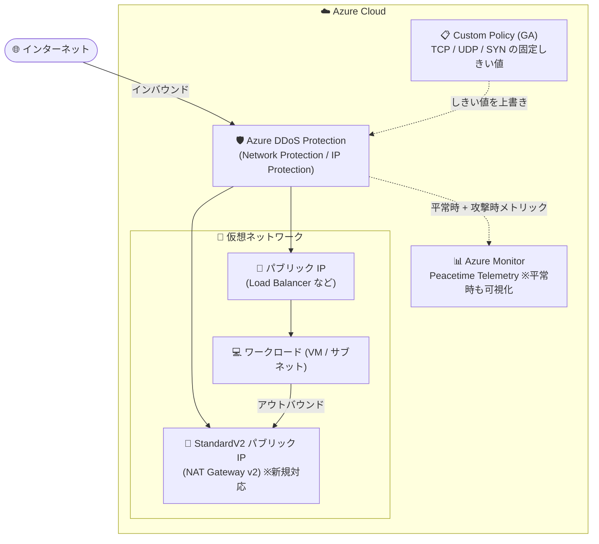

# Azure DDoS Protection: Peacetime Telemetry (Preview) / NAT Gateway v2 IP サポート (Preview) / Custom Policy (GA)

**リリース日**: 2026-11-17

**サービス**: Azure DDoS Protection

**機能**: Peacetime Telemetry、NAT Gateway StandardV2 IP サポート、Custom Policy

**ステータス**:

- Peacetime Telemetry: In preview
- NAT Gateway StandardV2 IP サポート: In preview
- Custom Policy: Launched (GA)

[このアップデートのインフォグラフィックを見る](https://takech9203.github.io/azure-news-summary/20261117-ddos-protection-updates.html)

## 概要

Microsoft Ignite に合わせて、Azure DDoS Protection に関する 3 つのアップデートが発表された。いずれも Networking / Security カテゴリの機能強化で、DDoS Protection の可視性・保護範囲・チューニング性をそれぞれ拡張する内容となっている。

1. **Peacetime Telemetry (パブリックプレビュー)**: DDoS 緩和 (mitigation) がアクティブな間だけでなく、平常時にも保護対象のパブリック IP アドレスに到達するトラフィックのメトリックを確認できるようになった。既存のメトリック名・監視インターフェイスをそのまま使用し、登録作業や追加コストは不要。
2. **NAT Gateway StandardV2 IP サポート (パブリックプレビュー)**: Azure NAT Gateway StandardV2 の背後にあるパブリック IP (IPv4/IPv6) を、既存の DDoS Network Protection / IP Protection でネットワーク層 DDoS 攻撃から保護できるようになった。新しい API や機能登録、アプライアンスの管理は不要。
3. **Custom Policy (GA)**: 最も要望の多かった機能の 1 つであるカスタムポリシーが一般提供開始。プロトコル (TCP / UDP / TCP SYN) ごとに固定の検知しきい値 (packets per second) を設定でき、機械学習による自動チューニングを特定プロトコルのみ上書きできる。

**アップデート前の課題**

- 緩和がアクティブでない間は、保護対象パブリック IP のメトリックは緩和トリガーのメトリックしか表示されず、平常時のトラフィックパターンを把握できなかった。ダッシュボードやアラートの検証には攻撃シミュレーションが必要だった
- NAT Gateway のパブリック IP はインバウンド接続を受け付けないものの、インターネットから到達可能であり、パートナーや SaaS プロバイダーに許可リスト登録されることも多い。この IP への大量トラフィック (フラッド) により、背後のすべての VM のアウトバウンド通信 (API 呼び出し、パートナー連携、更新、テレメトリ) が一度に遮断されるリスクがあったが、DDoS Protection の対象外だった。「すべてのパブリック IP に DDoS 保護を必須とする」ポリシーにも NAT Gateway の例外が必要だった
- 検知しきい値は機械学習の自動チューニングのみで、レイテンシに敏感なアプリ、高スループットサービス、ゲームやイベントなど計画的なスパイクがあるワークロードでは固定しきい値を設定できなかった

**アップデート後の改善**

- 既存の受信 DDoS トラフィックメトリック (合計、TCP、SYN、UDP、その他) が平常時にもデータを表示するようになり、通常のトラフィックパターンの把握、緩和トリガーとの比較、ワークロード固有のしきい値での Azure Monitor メトリックアラート作成、攻撃をシミュレートせずにダッシュボード・アラートをテスト可能になった
- NAT Gateway StandardV2 のアウトバウンド用パブリック IP が自動的にネットワーク層の緩和対象となり、既存の DDoS メトリック・診断・アラートも利用可能に。コンプライアンスポリシーの例外も不要になった
- カスタムポリシーでプロトコル単位の固定しきい値を自分で設定・管理できるようになった。1 つのポリシーを最大 1,000 リソースに関連付け可能。しきい値を設定したプロトコルのみ自動チューニングが無効化され、他のプロトコルは機械学習によるチューニングが継続される。設定はリソースとともに永続化され、ワークロードの削除や VM シャットダウン後も維持される

## アーキテクチャ図

DDoS Protection の保護範囲が NAT Gateway StandardV2 のパブリック IP まで拡大し、カスタムポリシーで検知しきい値を制御、Peacetime Telemetry で平常時のトラフィックも Azure Monitor で可視化できる構成を示している。

## サービスアップデートの詳細

### 1. Peacetime Telemetry (パブリックプレビュー)

1. **平常時のトラフィック可視化**
   - 保護対象パブリック IP への受信・転送・ドロップトラフィック、緩和トリガー、攻撃ステータスを平常時にも確認できる。「Under DDoS attack or not」が 0 を示している間もトラフィックメトリックにデータが入る
2. **既存メトリック・インターフェイスをそのまま利用**
   - 新しいメトリック名はなく、既存の監視インターフェイスを使用。メトリックの閲覧に Log Analytics や診断設定は不要
3. **自動有効化**
   - DDoS Network Protection または DDoS IP Protection で保護されている対象リソースで自動的に有効。登録作業は不要。保護・緩和の動作自体は変更されない
4. **アラートとテスト**
   - ワークロード固有のしきい値による Azure Monitor メトリックアラートの作成や、攻撃シミュレーションなしでのダッシュボード・アラートの検証が可能

### 2. NAT Gateway StandardV2 IP サポート (パブリックプレビュー)

1. **アウトバウンド用パブリック IP の保護**
   - NAT Gateway StandardV2 が使用する StandardV2 パブリック IP (IPv4/IPv6) をネットワーク層 DDoS 攻撃から保護。保護の設定は NAT Gateway リソースではなく、関連付けられた仮想ネットワーク (Network Protection) または個々の StandardV2 パブリック IP (IP Protection) に対して行う
2. **既存ワークフローで構成**
   - 新しい API、機能登録、専用 CLI コマンド、アプライアンスは不要。既存の DDoS 構成・監視ワークフローをそのまま使用
3. **パブリック IP プレフィックス対応**
   - 仮想ネットワークの DDoS Network Protection を有効化すると、パブリック IP プレフィックスは保護を自動的に継承 (プレフィックスへの直接の IP Protection は非サポート)
4. **動作への影響なし**
   - 保護を有効にしても、未承諾のインバウンド接続は開放されず、ルーティングや SNAT の動作も変更されない。レイヤー 7 保護は提供しないため、Web アプリにはアプリケーション層の保護アーキテクチャを併用する

### 3. Custom Policy (GA)

1. **プロトコル単位の固定検知しきい値**
   - 各ポリシーは 1 つ以上のルールで構成され、ルールはプロトコル (TCP / UDP / TCP SYN)、インバウンド方向、緩和をトリガーする packets per second のしきい値を定義する
2. **柔軟な関連付け**
   - 1 つのポリシーを最大 1,000 リソースに関連付け可能。ポリシーを先に作成して後から関連付けを追加することもできる。パブリック IP エンドポイントを持つ Azure リソースに対応し、Network Protection / IP Protection の両 SKU で利用可能
3. **自動チューニングとの併用**
   - しきい値を設定したプロトコルのみ自動チューニングが無効化され、他のプロトコルは機械学習によるチューニングを維持。カスタムポリシーは自動チューニングの置き換えではなく補完
4. **設定の永続化とセルフサービス管理**
   - 設定はリソースとともに永続化され、ワークロードの削除や VM シャットダウン後も維持される。オンコールサポートに頼らず自分で管理できる

## 技術仕様

| 項目 | 詳細 |
|------|------|
| Peacetime Telemetry の対象 | DDoS Network Protection / IP Protection で保護された対象パブリック IP (DDoS Protection と同じリソースタイプをサポート) |
| Peacetime Telemetry のメトリック | 既存の受信 DDoS トラフィックメトリック (Inbound packets/bytes DDoS、TCP、SYN、UDP、その他)、転送・ドロップメトリック、攻撃ステータス |
| NAT Gateway 対応 SKU | StandardV2 のみ (Standard SKU は非サポート) |
| NAT Gateway 用パブリック IP | StandardV2 パブリック IP (IPv4/IPv6)。Standard/Basic パブリック IP は StandardV2 NAT Gateway と非互換 |
| NAT Gateway とカスタムポリシー | 本プレビューでは NAT Gateway StandardV2 のパブリック IP へのカスタムポリシー関連付けは非サポート |
| Custom Policy のプロトコル | TCP、UDP、TCP SYN (インバウンド方向) |
| Custom Policy のしきい値範囲 (ドキュメント記載値) | TCP: 50,000〜2,000,000 pps / UDP: 20,000〜200,000 pps / TCP SYN: 1,000〜100,000 pps |
| Custom Policy の関連付け上限 | 1 ポリシーあたり最大 1,000 リソース |
| Custom Policy の管理手段 | Azure Portal、Azure CLI、ARM テンプレート、REST API |

注: Custom Policy のしきい値範囲と Load Balancer フロントエンド IP 構成への言及は、プレビュー時点の Microsoft Learn ドキュメント (2026-10-08 時点) の記載に基づく。GA 発表ではパブリック IP エンドポイントを持つ Azure リソース全般への対応が明記されており、最新のドキュメントで対応リソースの範囲を確認することを推奨する。

## 設定方法

### Peacetime Telemetry の確認手順 (Azure Portal)

1. Azure Portal で **Public IP addresses** を開き、保護対象のパブリック IP を選択
2. **Monitoring** > **Metrics** を選択し、スコープが目的のパブリック IP であることを確認
3. 直近の時間範囲 (例: 過去 1 時間) を選択し、**Time granularity** を **1 minute** に設定
4. **Inbound TCP packets DDoS** を **Max** 集計で追加。同様に **Inbound UDP packets DDoS**、**Inbound SYN packets DDoS** も追加
5. 別チャートで **Under DDoS attack or not** (Max 集計) を追加し、トラフィックと攻撃ステータスを比較。平常時はトラフィックメトリックにデータが入り、攻撃ステータスは 0 を示す

データが表示されない場合は、保護状態と機能の対象可否、パブリック IP のスコープ、権限、時間範囲、レポート遅延を確認する (欠損はゼロと同義ではない)。

### NAT Gateway StandardV2 の保護有効化

**Network Protection (仮想ネットワーク単位)**

1. StandardV2 NAT Gateway を StandardV2 パブリック IP またはパブリック IP プレフィックスで構成
2. ゲートウェイを仮想ネットワーク内のワークロードサブネットに関連付け
3. その仮想ネットワークで DDoS Network Protection を有効化
4. 対象パブリック IP の保護状態とアウトバウンド接続を検証

**IP Protection (パブリック IP 単位)**

1. 個々の StandardV2 パブリック IP を選択し、DDoS IP Protection を有効化
2. その IP を StandardV2 NAT Gateway にアタッチし、ゲートウェイをワークロードサブネットに関連付け
3. 保護状態とアウトバウンド接続を検証

NAT Gateway 専用の API バージョン、機能登録、CLI コマンド、PowerShell コマンドレットは不要で、既存の DDoS ワークフローをそのまま使用する。

### Custom Policy

Azure Portal、Azure CLI、ARM テンプレート、REST API から管理できる。ポリシーにプロトコル・方向・しきい値 (pps) を定義するルールを作成し、保護対象リソースに関連付ける。関連付けはポリシー作成後に **Policy settings** ページから追加・変更できる。カスタムしきい値は自動チューニングを置き換えるため、アプリケーションのトラフィックベースラインに基づいて値を設定し、非運用環境で検証のうえ、適用後は緩和テレメトリを監視することが推奨されている。

## メリット

### ビジネス面

- 攻撃をシミュレートせずにダッシュボード・アラート体制を検証でき、DDoS 対応の準備コストとリスクが低減する
- NAT Gateway のパブリック IP が保護対象になることで、「すべてのパブリック IP に DDoS 保護」を求めるコンプライアンスポリシーの例外管理が不要になる
- カスタムポリシーの設定をオンコールサポートに依頼せずセルフサービスで管理でき、運用の自律性が向上する

### 技術面

- 平常時のトラフィックベースラインを把握し、緩和トリガーとの比較やワークロード固有しきい値のアラート設計が可能になる (Log Analytics や診断設定なしで閲覧可能)
- アウトバウンド経路の単一障害点だった NAT Gateway の IP にネットワーク層の自動緩和が適用され、既存の DDoS メトリック・診断・アラートも利用できる
- レイテンシ敏感・高スループット・計画スパイクのあるワークロードで、プロトコル単位の固定しきい値と機械学習チューニングを組み合わせた最適な検知設定を実現できる

## デメリット・制約事項

- **Peacetime Telemetry (プレビュー)**: プレビュー期間中は Azure パブリッククラウドで利用可能。保護されていることだけでは、すべてのリージョン・クラウド・IP バージョンでのプレビュー利用可否は保証されない
- **NAT Gateway サポート (プレビュー)**: Standard SKU の NAT Gateway は非サポート。StandardV2 NAT Gateway + StandardV2 パブリック IP が必須。カスタムポリシーの関連付けは非サポート (すべての管理インターフェイスに適用)。パブリック IP プレフィックスへの直接の IP Protection は非サポートで、プレフィックス内の個々の IP の保護を個別に有効/無効化できない。レイヤー 7 保護は提供されない。リージョン・クラウドの利用可否は必要なプラットフォームコンポーネントすべてのロールアウトに依存する
- **Custom Policy**: しきい値を設定したプロトコルは自動チューニングが無効になるため、不適切な値を設定すると検知が過敏または鈍感になるリスクがある。ベースラインに基づく設定と非運用環境での検証が推奨される。しきい値はインバウンドトラフィックのみに適用される
- サブネットに関連付けられていない NAT Gateway は、仮想ネットワーク経由の Network Protection を継承しない

## ユースケース

### ユースケース 1: 攻撃シミュレーションなしでのアラート検証

**シナリオ**: 金融系ワークロードで DDoS アラート体制を整備したいが、本番環境での攻撃シミュレーションは実施しにくい。

**実装**: Peacetime Telemetry で平常時の Inbound TCP/UDP/SYN packets DDoS メトリックを確認してベースラインを把握し、ワークロード固有のしきい値で Azure Monitor メトリックアラートを作成。通常トラフィックでアラートとダッシュボードの動作を検証する。

**効果**: 攻撃を待ったりシミュレートしたりすることなく、監視体制の有効性を事前に確認できる。

### ユースケース 2: パートナー連携のアウトバウンド IP 保護

**シナリオ**: NAT Gateway StandardV2 のパブリック IP がパートナー企業や銀行の許可リストに登録されており、この IP へのフラッド攻撃でアウトバウンド通信全体が停止するリスクがある。

**実装**: NAT Gateway StandardV2 が関連付けられた仮想ネットワークで DDoS Network Protection を有効化 (または個々の StandardV2 パブリック IP に IP Protection を適用) し、保護状態とアウトバウンド接続を検証する。

**効果**: アウトバウンド IP にネットワーク層の自動緩和が適用され、API 呼び出し・パートナー連携・テレメトリ送信の経路が保護される。

### ユースケース 3: ゲームイベントの計画スパイク対応

**シナリオ**: ゲームプラットフォームで新タイトルのローンチ時に UDP トラフィックの急増が計画されており、自動チューニングによる誤検知 (不要な緩和発動) を避けたい。

**実装**: カスタムポリシーで UDP プロトコルに想定ピークを踏まえた固定しきい値 (pps) を設定し、対象リソースに関連付ける。TCP / TCP SYN は自動チューニングを維持する。

**効果**: 計画されたスパイクで不要な緩和がトリガーされることを防ぎつつ、他プロトコルは機械学習ベースの保護を継続できる。

## 料金

- **Peacetime Telemetry**: 既存の DDoS Protection の料金に追加コストなし。アラートルールには標準の Azure Monitor 料金が適用される
- **NAT Gateway サポート / Custom Policy**: 既存の DDoS Network Protection / IP Protection の SKU で利用する。詳細は料金ページを参照

料金の詳細: [Azure DDoS Protection の料金](https://azure.microsoft.com/pricing/details/ddos-protection/)

## 利用可能リージョン

- **Peacetime Telemetry**: プレビュー期間中は Azure パブリッククラウドで利用可能 (すべてのリージョン・IP バージョンでの利用可否は個別に確認が必要)
- **NAT Gateway StandardV2 サポート**: 対象リージョン・クラウドは、NAT Gateway・パブリック IP・DDoS プラットフォームの必要なコンポーネントすべてのロールアウト状況に依存する。Government クラウドのポータル対応は別途ロールアウト
- **Custom Policy**: 公式情報でのリージョン明記は確認できなかったため、最新のドキュメントを参照

## 関連サービス・機能

- **Azure Monitor**: Peacetime Telemetry のメトリック閲覧、メトリックアラートの作成、ダッシュボード化に使用。Metrics Explorer で閲覧でき、診断設定で Log Analytics へのルーティングも可能
- **Azure NAT Gateway (StandardV2)**: 今回保護対象に加わったアウトバウンド接続サービス。SNAT 動作の監視には引き続き NAT Gateway メトリックを使用
- **Azure Load Balancer (Standard)**: カスタムポリシーのプレビュー時点での主な関連付け対象 (フロントエンド IP 構成)
- **Microsoft Sentinel**: DDoS Protection のログを診断設定経由で統合し、高度な分析が可能
- **Azure Policy**: 「すべてのパブリック IP に DDoS 保護を必須とする」ガバナンスの実装。NAT Gateway の例外が不要になる

## 参考リンク

- [インフォグラフィック](https://takech9203.github.io/azure-news-summary/20261117-ddos-protection-updates.html)
- [公式アップデート情報: Peacetime Telemetry (Preview)](https://azure.microsoft.com/updates?id=581175)
- [公式アップデート情報: NAT Gateway v2 IP サポート (Preview)](https://azure.microsoft.com/updates?id=580862)
- [公式アップデート情報: Custom Policy (GA)](https://azure.microsoft.com/updates?id=580852)
- [Microsoft Learn: Monitor Azure DDoS Protection (Peacetime Telemetry)](https://learn.microsoft.com/azure/ddos-protection/monitor-ddos-protection#peacetime-telemetry-availability-preview)
- [Microsoft Learn: 平常時のトラフィック条件アラート設定](https://learn.microsoft.com/azure/ddos-protection/alerts#traffic-condition-alerts-during-peacetime-preview)
- [Microsoft Learn: Azure DDoS Protection for NAT Gateway StandardV2](https://learn.microsoft.com/en-us/azure/ddos-protection/ddos-protection-nat-gateway-standardv2)
- [Microsoft Learn: Azure DDoS Protection custom policy](https://learn.microsoft.com/en-us/azure/ddos-protection/ddos-custom-policy-overview)
- [料金ページ: Azure DDoS Protection](https://azure.microsoft.com/pricing/details/ddos-protection/)

## まとめ

Azure DDoS Protection の 3 つのアップデートにより、可視性 (Peacetime Telemetry)、保護範囲 (NAT Gateway StandardV2)、チューニング性 (Custom Policy) が同時に強化された。特に Custom Policy の GA は長く要望されていた機能であり、レイテンシ敏感なワークロードや計画スパイクを持つサービスの運用者はしきい値設計の検討を始める価値がある。Peacetime Telemetry は追加コスト・設定なしで自動有効化されるため、まず保護対象 IP のメトリックで平常時ベースラインを確認し、ワークロード固有のアラートを整備することを推奨する。NAT Gateway を利用中の場合、StandardV2 への移行計画と合わせて DDoS 保護の適用を検討したい。

---

**タグ**: Azure DDoS Protection, Networking, Security, NAT Gateway, Azure Monitor, Custom Policy, Peacetime Telemetry, Microsoft Ignite, Public Preview, GA
