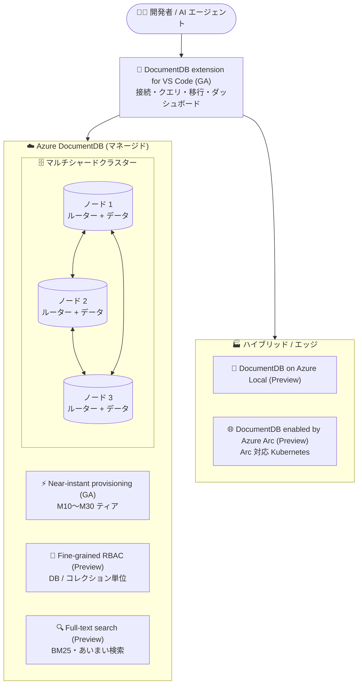

# Azure DocumentDB: Microsoft Ignite 2026 アップデート群 (プロビジョニング高速化・エラスティシティ・RBAC・ハイブリッド対応・開発ツール・全文検索)

**リリース日**: 2026-11-17

**サービス**: Azure DocumentDB

**機能**: Near-instant provisioning (GA) / Query from any node (GA) / Fine-grained RBAC (Preview) / DocumentDB on Azure Local (Preview) / DocumentDB enabled by Azure Arc (Preview) / VS Code 拡張 (GA) / Full-text search (Preview)

**ステータス**: Launched (GA) 3 件 / In preview 4 件

[このアップデートのインフォグラフィックを見る](https://takech9203.github.io/azure-news-summary/20261117-documentdb-updates.html)

## 概要

Microsoft Ignite 2026 に合わせて、Azure DocumentDB (MongoDB 互換のフルマネージドドキュメントデータベース、旧 vCore ベース Azure Cosmos DB for MongoDB) に関する 7 件のアップデートが発表されました。GA (一般提供) が 3 件、パブリックプレビューが 4 件という大規模な発表で、プロビジョニング速度、クエリ性能、セキュリティ、ハイブリッド/マルチクラウド展開、開発者ツール、検索機能と、サービスのほぼ全領域が強化されています。

GA となったのは、(1) M10〜M30 コンピュートティアでのほぼ瞬時のクラスタープロビジョニング、(2) マルチシャードクラスターの任意のノードからクエリを実行できるエラスティシティ強化、(3) VS Code 向け DocumentDB 拡張機能の 3 件です。パブリックプレビューとしては、(4) データベース/コレクション単位のきめ細かな RBAC、(5) Azure Local 上での DocumentDB 実行、(6) Azure Arc 対応 Kubernetes クラスターへの DocumentDB デプロイ、(7) BM25 インデックスによる全文検索の 4 件が発表されました。

Azure DocumentDB はオープンソースの DocumentDB エンジン (Linux Foundation 管理、MIT ライセンス、PostgreSQL ベース) 上に構築されており、今回の Azure Local / Azure Arc 対応により、クラウド・オンプレミス・エッジ・マルチクラウドで同一の MongoDB 互換 API を利用できる体制が大きく前進しました。

**アップデート前の課題**

- 無料ティア以外のクラスターのプロビジョニングには 10〜15 分の待ち時間が発生し、検証や AI エージェントによる実験のサイクルを阻害していた
- マルチシャードクラスターのリクエストルーティングは単一のコーディネーターに依存しており、スケール時のボトルネックとなり得た
- アクセス制御はクラスターレベルの権限のみで、データベースやコレクション単位の最小権限アクセスを実現できなかった
- MongoDB 互換ワークロードをオンプレミスやエッジで実行する場合、マネージドな選択肢が限られていた
- 全文検索を行うには別途検索サービスの導入が必要だった

**アップデート後の改善**

- M10〜M30 ティアがほぼ瞬時にプロビジョニングされ、検証・実験・本番導入の立ち上がりが高速化
- マルチシャードクラスターの全ノードがシャードを認識したルーターとして機能し、シャード数やサイズによらず一貫した性能を保証
- データベース/コレクション単位のカスタムロールにより最小権限アクセスを実現
- Azure Local および Azure Arc 対応 Kubernetes により、オンプレミス・エッジ・マルチクラウドで MongoDB 互換ワークロードを実行可能に
- 無料・オープンソースの VS Code 拡張が GA となり、接続からクエリ、移行までを IDE 内で完結
- BM25 インデックスによる全文検索が組み込まれ、別途検索サービスを構築せずに関連度ベースの検索を実装可能に

## アーキテクチャ図

マルチシャードクラスターでは全ノードがシャードを認識したルーターとして機能し、任意のノードがクエリをローカル処理または適切なシャードへルーティングします。同一の MongoDB 互換エンジンが Azure マネージドサービス、Azure Local、Arc 対応 Kubernetes のいずれでも動作します。

## サービスアップデートの詳細

### 主要機能

1. **Near-instant provisioning for Azure DocumentDB clusters (GA)**
   - 従来は無料ティアのみ瞬時プロビジョニングに対応しており、他ティアではクラスターが利用可能になるまで 10〜15 分の待機が必要だった
   - M10〜M30 コンピュートティアがほぼ瞬時のプロビジョニングに対応
   - M10 は基本的な機能テストや実験用途、M30 は本番ティアアプリケーションのエントリーポイントとして位置づけられ、成長に応じて上位ティアへスケール可能
   - AI エージェントがクラスターのプロビジョニング待ちでサイクルを浪費せずに実験を開始できる点も訴求されている

2. **Azure DocumentDB elasticity — query from any node (GA)**
   - マルチシャードクラスターの任意のノードにクエリを送信可能に
   - 各ノードは完全にシャードを認識し、リクエストをローカルで処理するか、データを持つシャードへルーティングするか、複数シャードにまたがるクエリを実行して結果を集約して返すかを判断する
   - 従来はリクエストルーティングが単一のコーディネーターに依存していたが、全ノードがルーティング可能になった
   - シャード数やシャードサイズによらず性能を保証し、定常時の 1 倍から 100 倍のリクエスト量まで一貫した性能を実現

3. **Fine-grained role-based access control (Public Preview)**
   - 従来のクラスターレベル権限を超えた、データベースレベル・コレクションレベルの RBAC を提供
   - 特定のデータベースや個々のコレクションに対するカスタムロールを作成し、ユーザーやアプリケーションに必要なデータ権限を割り当て可能
   - 最小権限アクセスをデータベース・アプリケーション・ワークロード横断で適用しつつ、権限を必要な範囲にスコープできる

4. **DocumentDB on Azure Local (Public Preview)**
   - MongoDB 互換のドキュメントワークロードを自社インフラ (Azure Local) 上で実行可能に
   - アプリケーションとデータを近接配置し、データセンター・小売店舗・産業環境におけるレイテンシーやデータ所在地の要件に対応
   - PostgreSQL 上に構築された DocumentDB エンジンが MongoDB 互換 API とツールをサポートし、Azure Local がインフラプラットフォームを提供

5. **DocumentDB enabled by Azure Arc (Public Preview)**
   - サポート対象の Azure Arc 対応 Kubernetes クラスター上に DocumentDB をデプロイ可能に
   - オンプレミス・エッジ・マルチクラウド環境で MongoDB 互換ワークロードを実行しつつ、基盤となる Kubernetes インフラのインベントリ・構成・ガバナンスに Azure Arc を活用できる

6. **DocumentDB extension for VS Code (GA)**
   - 無料・オープンソースの拡張機能で、Azure DocumentDB とオープンソース DocumentDB プロジェクトを VS Code に統合。MongoDB API 互換の任意のワークロードをサポート
   - 接続先: Azure DocumentDB クラスター、Azure Cosmos DB for MongoDB アカウント、Kubernetes ホストのデータベース、MongoDB Atlas、セルフホストサーバー
   - 認証: Microsoft Entra ID およびマネージド ID をサポート
   - 機能: 既存接続を再利用する組み込みインタラクティブシェル、テーブル/ツリー/JSON ビューでのクエリ、スキーマ対応の自動補完、Query Playground でのスクリプト保存、Docker によるローカル実行 (DocumentDB Local) とサンプルデータ、実行プランと統計を確認できる Query Insights、GitHub Copilot 連携 (オプション)、インデックス管理、クラスターダッシュボード、データベース/クラスター間のコレクションとインデックスのコピー&ペースト移行

7. **Full-text search in Azure DocumentDB (Public Preview)**
   - BM25 インデックス、関連度ベースのソート、関連度スコアへのアクセスを提供
   - あいまい検索 (fuzzy search) によるタイプミス対応、近接検索 (proximity search) による検索語が近接して出現するドキュメントの検索が可能
   - 追加データ型のサポートとフィルタリング用の compound オペレーターにより、表現力の高い検索クエリを構築可能
   - 別途検索サービスをデプロイせずに、返却結果とランキングを細かく制御できる

## 技術仕様

| 項目 | 詳細 |
|------|------|
| サービス | Azure DocumentDB (with MongoDB compatibility)。旧称 vCore ベース Azure Cosmos DB for MongoDB |
| エンジン | オープンソース DocumentDB (PostgreSQL ベース、Linux Foundation 管理、MIT ライセンス) |
| MongoDB 互換性 | MongoDB ワイヤプロトコルを実装。クエリ/プロジェクション/更新/集計オペレーターの 99.03% をサポート。MongoDB 4.0〜8.0 に対応 |
| 瞬時プロビジョニング対象 | 無料ティア (従来から対応) + M10〜M30 ティア (今回 GA) |
| バックアップ | 非バースタブルティアは 35 日間、バースタブルティア (M10/M20/M25) は 7 日間のポイントインタイムリストア。追加費用なし (無料ティアは非対応) |
| SLA | 99.995% の可用性 SLA |
| ストレージ | 単一ノードあたり最大 32 TB。Premium SSD v2 を追加費用なしで利用 |
| ハイブリッド展開 | Azure Local (Preview)、Azure Arc 対応 Kubernetes (Preview)、DocumentDB Kubernetes オペレーター (OSS) |
| VS Code 拡張 | 無料・オープンソース。Visual Studio Marketplace から入手。Entra ID / マネージド ID 認証対応 |
| 全文検索 | BM25 インデックス、関連度スコア、あいまい検索、近接検索、compound オペレーター (Preview) |

## メリット

### ビジネス面

- プロビジョニング待ち時間の解消により、PoC や検証の立ち上がりが高速化し、開発サイクル全体が短縮される
- MongoDB Atlas (AWS) 比で平均 40% 低いとされる料金に加え、バックアップ・データベースノードのネットワーク・テキスト/ベクトル検索が追加費用なしで含まれる
- Azure Local / Azure Arc 対応により、データ所在地要件や低レイテンシー要件を持つ業種 (小売、製造など) でも同一エンジン・同一 API で展開できる
- 全文検索の組み込みにより、別途検索サービスの構築・運用コストが不要になる

### 技術面

- 任意ノードからのクエリにより、単一コーディネーターのボトルネックが解消され、シャード数に依存しない一貫した性能が得られる
- データベース/コレクション単位の RBAC で最小権限の原則を適用でき、マルチテナントや複数チームでの共有クラスター運用のセキュリティが向上する
- VS Code 拡張の GA により、接続・クエリ・実行プラン分析・インデックス管理・移行が IDE 内で完結する
- クラウドとオンプレミス/エッジで同一の MongoDB 互換 API を使うため、アプリケーションを変更せずに環境間を移行できる

## デメリット・制約事項

- Fine-grained RBAC、Azure Local 対応、Azure Arc 対応、全文検索はパブリックプレビュー段階であり、本番利用には GA を待つか慎重な評価が必要
- 瞬時プロビジョニングの GA 対象は M10〜M30 ティアであり、それより上位のティアについては言及がない
- Azure Arc 対応はサポート対象の Arc 対応 Kubernetes クラスターに限定される
- 既存クラスターのストレージは縮小できない (サービス全般の制約)

## ユースケース

### ユースケース 1: AI エージェントによる実験・検証の高速化

**シナリオ**: AI エージェントやスクリプトが機能テストのたびにクラスターを作成する開発ワークフローで、従来は 10〜15 分のプロビジョニング待ちがボトルネックになっていた。

**効果**: M10 ティアのほぼ瞬時プロビジョニングにより、エージェントが待機サイクルなしで実験を開始できる。本番移行時は M30 から始めて上位ティアへスケールする。

### ユースケース 2: 小売・産業環境でのエッジデータ処理

**シナリオ**: 店舗や工場でレイテンシー要件・データ所在地要件により、ドキュメントデータをローカルに保持する必要がある。

**効果**: DocumentDB on Azure Local または Azure Arc 対応 Kubernetes 上の DocumentDB により、クラウドと同じ MongoDB 互換 API でローカル実行が可能。Azure Arc によるインベントリ・構成・ガバナンス管理も利用できる。

### ユースケース 3: 共有クラスターでの最小権限アクセス

**シナリオ**: 複数のアプリケーション・チームが 1 つの DocumentDB クラスターを共有しており、クラスターレベルの権限では権限が過剰になる。

**効果**: データベース/コレクション単位のカスタムロールにより、各アプリケーションに必要なデータ権限のみを付与し、最小権限アクセスを実現する。

### ユースケース 4: 検索サービスを追加せずに全文検索を実装

**シナリオ**: ドキュメントデータに対する関連度ベースの検索機能が必要だが、別途検索サービスを構築・同期する運用負荷を避けたい。

**効果**: BM25 インデックスによる全文検索、関連度スコア、あいまい検索・近接検索をデータベース内で直接利用でき、ETL パイプラインや別サービスが不要になる。

## 料金

Azure DocumentDB の料金は vCore とストレージに基づき、それぞれ独立してスケールできます。バックアップ (アクティブな有料クラスター)、データベースノードからアプリケーションへの egress、Premium SSD v2 ストレージの性能、テキスト/ベクトル検索は追加費用なしで含まれます。リザーブドキャパシティにより 1 年コミットで最大 40%、3 年で最大 60% の割引があり、データベース向け節約プランの対象でもあります。

無料枠: 32 GB ストレージの無料ティアクラスターがアカウントの存続期間中無料で利用可能 (バックアップ/リストアは非対応)。

最新の詳細は [Azure DocumentDB 料金ページ](https://azure.microsoft.com/pricing/details/documentdb/) を参照してください。

## 関連サービス・機能

- **Azure Local**: DocumentDB をオンプレミスで実行するためのインフラプラットフォーム (今回 Preview で対応)
- **Azure Arc**: Arc 対応 Kubernetes 上の DocumentDB デプロイと、インフラのインベントリ・構成・ガバナンスを提供
- **Azure Cosmos DB for MongoDB (RU)**: 別サービス。Azure DocumentDB は旧 vCore ベース Azure Cosmos DB for MongoDB の新名称
- **Microsoft Entra ID**: VS Code 拡張やサービス本体の認証 (マネージド ID 含む) に利用
- **Azure Database Migration Service / DocumentDB 移行拡張**: MongoDB Atlas、Amazon DocumentDB、セルフホスト MongoDB からの無料移行ツール
- **GitHub Copilot**: VS Code 拡張でオプションの推奨機能として連携

## 参考リンク

- [インフォグラフィック](https://takech9203.github.io/azure-news-summary/20261117-documentdb-updates.html)
- [公式アップデート情報: Near-instant provisioning (GA)](https://azure.microsoft.com/updates?id=579349)
- [公式アップデート情報: Elasticity — query from any node (GA)](https://azure.microsoft.com/updates?id=579354)
- [公式アップデート情報: Fine-grained RBAC (Preview)](https://azure.microsoft.com/updates?id=578262)
- [公式アップデート情報: DocumentDB on Azure Local (Preview)](https://azure.microsoft.com/updates?id=578255)
- [公式アップデート情報: DocumentDB enabled by Azure Arc (Preview)](https://azure.microsoft.com/updates?id=578242)
- [公式アップデート情報: DocumentDB extension for VS Code (GA)](https://azure.microsoft.com/updates?id=578237)
- [公式アップデート情報: Full-text search (Preview)](https://azure.microsoft.com/updates?id=578232)
- [Microsoft Learn: What is Azure DocumentDB](https://learn.microsoft.com/en-us/azure/documentdb/overview)
- [オープンソース DocumentDB プロジェクト (GitHub)](https://github.com/documentdb/documentdb)
- [DocumentDB Kubernetes オペレーター (GitHub)](https://github.com/documentdb/documentdb-kubernetes-operator)
- [料金ページ](https://azure.microsoft.com/pricing/details/documentdb/)

## まとめ

Microsoft Ignite 2026 での Azure DocumentDB の 7 件のアップデートは、同サービスが MongoDB 互換データベースの包括的なプラットフォームへ進化していることを示しています。プロビジョニングの高速化 (M10〜M30) と任意ノードからのクエリの GA により開発体験とスケール時の性能が底上げされ、VS Code 拡張の GA で開発ツールチェーンも成熟しました。さらに Azure Local / Azure Arc 対応のプレビューにより、クラウド・オンプレミス・エッジで同一エンジンを使うハイブリッド戦略が現実的になっています。

MongoDB ワークロードを運用している、または新規に検討している Solutions Architect は、まず無料ティアや M10 ティアでの検証を推奨します。共有クラスターを運用している場合は fine-grained RBAC のプレビュー評価を、検索要件がある場合は全文検索プレビューの評価を開始するとよいでしょう。プレビュー機能 (RBAC、Azure Local、Azure Arc、全文検索) は本番導入前に GA のタイムラインと制約を確認してください。

---

**タグ**: Azure DocumentDB, Databases, MongoDB, Azure Arc, Azure Local, RBAC, Full-text Search, VS Code, Microsoft Ignite, GA, Public Preview
