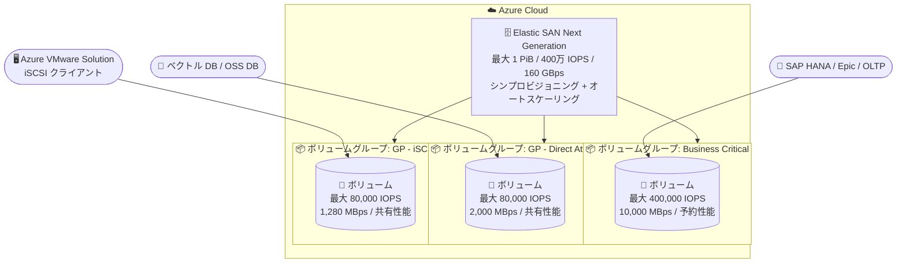

# Azure Elastic SAN: Next Generation (Public Preview)

**リリース日**: 2026-11-17

**サービス**: Azure Elastic SAN

**機能**: Elastic SAN Next Generation

**ステータス**: In preview

[このアップデートのインフォグラフィックを見る](https://takech9203.github.io/azure-news-summary/20261117-elastic-san-next-generation.html)

## 概要

Azure Elastic SAN Next Generation が Public Preview になりました。Elastic SAN は、ブロックストレージワークロードを単一の SAN リソース階層に集約し、パフォーマンスを動的に共有できるクラウド SAN サービスです。Next Generation は、この「ストレージ管理の簡素化」と「大規模運用時の TCO 低減」という従来のコアメリットを維持しつつ、ミッションクリティカルワークロードへの対応と、シンプロビジョニング・オートスケーリングなどの高度なストレージ機能を追加しています。

最大の特徴は、ボリュームグループレベルで選択できる QoS (Quality of Service) ティアの導入です。予約性能とサブミリ秒レイテンシを備えた Business Critical ティア (SAP HANA、Epic、I/O 集約型 OLTP 向け) から、iSCSI 接続の General Purpose ティアまで、ワークロード要件に応じた性能を同一 SAN 上で使い分けられます。ノイジーネイバー保護により、ミッションクリティカルと汎用ワークロードの同居が可能です。

Next Generation の SAN は最大 1 PiB、400 万 IOPS、160 GBps までスケールします。プレビューの利用にはサインアップ (申し込みフォーム) が必要です。

**アップデート前の課題**

- SAN の性能は全ボリュームで共有される設計であり、ボリューム単位の性能上限は最大 80,000 IOPS にとどまるため、SAP HANA などの I/O 集約型ミッションクリティカルワークロードには性能が不足する場合があった
- ボリュームは論理容量に対してプロビジョニングする方式で、将来の成長を見込むと容量を事前に確保 (過剰プロビジョニング) する必要があった
- 容量の追加は手動で行う必要があった

**アップデート後の改善**

- QoS ティア (Business Critical) により、ボリューム単位で最大 400,000 IOPS / 10,000 MBps の予約性能とサブミリ秒未満の低レイテンシを利用可能になった
- シンプロビジョニングにより、物理容量はデータ書き込み時にのみ消費され、SAN のプロビジョニング容量の最大 5 倍まで論理ボリュームを確保できるようになった
- オートスケーリングにより、ユーザー定義のしきい値に基づいて SAN 容量を自動追加できるようになった
- 容量・IOPS・スループットを SAN レベルで独立してプロビジョニングできるようになった

## アーキテクチャ図

単一の Elastic SAN 配下に QoS ティアの異なるボリュームグループを配置し、ミッションクリティカルから汎用まで多様なワークロードをノイジーネイバー保護付きで集約する構成です。

## サービスアップデートの詳細

### 主要機能

1. **ボリュームグループレベルの QoS ティア**
   - ワークロード要件に応じて 3 つの性能ティアを選択可能
   - **Business Critical**: 予約性能。サブミリ秒未満の低レイテンシ、ボリュームあたり最大 400,000 IOPS / 10,000 MBps。SAP HANA、Epic、I/O 集約型 OLTP 向け
   - **General Purpose - Direct Attach**: 共有性能。サブミリ秒レイテンシ、ボリュームあたり最大 80,000 IOPS / 2,000 MBps。ベクトルデータベースや OSS データベース向け
   - **General Purpose - iSCSI**: 共有性能。低い 1 桁ミリ秒レイテンシ、ボリュームあたり最大 80,000 IOPS / 1,280 MBps。Azure VMware Solution (AVS) などの外部ストレージ用途や iSCSI 接続を選好する場合向け

2. **ノイジーネイバー保護**
   - ミッションクリティカルワークロードと汎用ワークロードを同一 SAN 上で実行可能

3. **シンプロビジョニング**
   - 将来の成長を見込んだサイズでボリュームを作成し、物理容量はデータ書き込み時にのみ消費
   - SAN のプロビジョニング容量の最大 5 倍まで論理容量を確保可能

4. **オートスケーリング**
   - ユーザー定義のしきい値に基づいて SAN 容量を自動追加

5. **容量と性能の独立プロビジョニング**
   - 容量、IOPS、スループットを SAN レベルでそれぞれ独立してプロビジョニング

6. **クラッシュコンシステント スナップショット**
   - ポイントインタイムのスナップショットでボリュームを保護

7. **シンクローン (近日提供予定)**
   - Business Critical ボリュームの、容量効率のよいマウント可能な開発/テスト用コピーを作成

## 技術仕様

| 項目 | 詳細 |
|------|------|
| SAN あたりの最大容量 | 1 PiB |
| SAN あたりの最大 IOPS | 400 万 IOPS |
| SAN あたりの最大スループット | 160 GBps |
| Business Critical (ボリュームあたり) | 最大 400,000 IOPS / 10,000 MBps、予約性能、サブミリ秒未満レイテンシ |
| General Purpose - Direct Attach (ボリュームあたり) | 最大 80,000 IOPS / 2,000 MBps、共有性能、サブミリ秒レイテンシ |
| General Purpose - iSCSI (ボリュームあたり) | 最大 80,000 IOPS / 1,280 MBps、共有性能、低 1 桁ミリ秒レイテンシ |
| シンプロビジョニング | プロビジョニング容量の最大 5 倍まで論理容量を確保可能 |
| QoS ティアの適用単位 | ボリュームグループレベル |

## 設定方法

### 前提条件

1. Public Preview の利用には [サインアップフォーム](https://forms.cloud.microsoft/Pages/ResponsePage.aspx?id=v4j5cvGGr0GRqy180BHbRzfznqtAchtHvj2yCSgNjMBUOEJSNlhUUUNUVEk2M0NKQk9CQU9ZS1BaSC4u) からの申し込みが必要

## メリット

### ビジネス面

- シンプロビジョニングとオートスケーリングにより、論理容量全体を事前に支払うことなくワークロードの成長に備えられ、ストレージ TCO を最適化できる
- データセンター撤退やハードウェアリフレッシュに伴う SAN 移行先として、ミッションクリティカルワークロードを含むより広い範囲をカバーできる
- 複数ワークロードのブロックストレージを単一 SAN に集約し、ストレージ管理を簡素化できる

### 技術面

- Business Critical ティアでボリュームあたり最大 400,000 IOPS / 10,000 MBps の予約性能とサブミリ秒未満レイテンシを実現 (SAP HANA、Epic、I/O 集約型 OLTP に対応)
- ノイジーネイバー保護により、性能要件の異なるワークロードを同一 SAN で安全に同居可能
- 容量・IOPS・スループットを独立してプロビジョニングでき、ワークロード特性に合わせた柔軟な設計が可能
- クラッシュコンシステント スナップショットによるデータ保護

## デメリット・制約事項

- Public Preview のため、本番環境での利用は推奨されない (SLA 対象外)
- プレビューの利用にはサインアップ (申し込みフォーム経由) が必要
- シンクローン機能は「近日提供予定」であり、プレビュー開始時点では利用できない

## ユースケース

### ユースケース 1: SAP HANA / Epic / I/O 集約型 OLTP のミッションクリティカル基盤

**シナリオ**: サブミリ秒未満のレイテンシと高い IOPS が求められるミッションクリティカルなデータベースワークロードを、Business Critical ティアのボリュームグループで稼働させる。

**効果**: ボリュームあたり最大 400,000 IOPS / 10,000 MBps の予約性能により、安定した低レイテンシを確保しつつ、他ワークロードと同一 SAN に集約できる。

### ユースケース 2: オンプレミス SAN からの移行 (データセンター撤退・ハードウェアリフレッシュ)

**シナリオ**: iSCSI 接続を用いて、オンプレミス SAN 上のワークロードを Elastic SAN に移行する。Azure VMware Solution (AVS) の外部ストレージとしても利用。

**効果**: SAN リソース階層をクラウドでそのまま再現でき、性能ティアの使い分けにより従来はクラウド移行が難しかった高性能要件のワークロードもカバーできる。

### ユースケース 3: 成長が見込まれるクラウドネイティブワークロードの容量最適化

**シナリオ**: ベクトルデータベースや OSS データベースなど、データ量の増加が見込まれるワークロードに対し、シンプロビジョニングで大きめの論理ボリュームを作成し、オートスケーリングで物理容量を自動追加する。

**効果**: 物理容量はデータ書き込み時にのみ消費されるため、事前の過剰プロビジョニングを避けてコストを最適化できる。

## 料金

Next Generation 固有の料金は、アップデート発表時点では料金ページに掲載されていません。

参考として、既存の Elastic SAN の料金体系は以下のとおりです (プロビジョニングベースの時間課金):

| 項目 | 内容 |
|------|------|
| Premium Base Unit | 1 TiB あたり 5,000 IOPS と 200 MBps のスループット付き |
| Premium Capacity Scale Unit | 容量のみ 1 TiB (IOPS/スループットなし)。Base Unit より低価格 |
| 冗長性 | LRS / ZRS (ZRS は LRS に対して 50% のプレミアム) |

最新の料金は [料金ページ](https://azure.microsoft.com/pricing/details/elastic-san/) を参照してください。

## 関連サービス・機能

- **Azure Virtual Machines**: iSCSI 経由で Elastic SAN ボリュームを接続し、VM の IOPS 上限を回避して高スループットを利用可能
- **Azure VMware Solution (AVS)**: General Purpose - iSCSI ティアの主要な外部ストレージ用途として想定
- **Azure Kubernetes Service (AKS)**: コンテナワークロードのバックエンドストレージとして利用可能
- **Managed Disks (Premium SSD / Premium SSD v2)**: 個別の VM 向けブロックストレージの代替・比較対象。多数の I/O 集約型ワークロードを集約する場合は Elastic SAN が有利な場合がある

## 参考リンク

- [インフォグラフィック](https://takech9203.github.io/azure-news-summary/20261117-elastic-san-next-generation.html)
- [公式アップデート情報](https://azure.microsoft.com/updates?id=581634)
- [Microsoft Learn: Azure Elastic SAN の概要](https://learn.microsoft.com/azure/storage/elastic-san/elastic-san-introduction)
- [料金ページ](https://azure.microsoft.com/pricing/details/elastic-san/)
- [プレビューのサインアップフォーム](https://forms.cloud.microsoft/Pages/ResponsePage.aspx?id=v4j5cvGGr0GRqy180BHbRzfznqtAchtHvj2yCSgNjMBUOEJSNlhUUUNUVEk2M0NKQk9CQU9ZS1BaSC4u)

## まとめ

Elastic SAN Next Generation は、QoS ティアによる予約性能 (最大 400,000 IOPS / 10,000 MBps per volume) とノイジーネイバー保護により、SAP HANA や Epic などのミッションクリティカルワークロードをクラウド SAN の対象に広げる大型アップデートです。シンプロビジョニング (最大 5 倍) とオートスケーリングによる TCO 最適化も加わり、オンプレミス SAN 移行と大規模ブロックストレージ集約の有力な選択肢になります。SAN 移行や AVS の外部ストレージを検討している場合は、サインアップフォームからプレビューに申し込み、対象ワークロードの性能要件と QoS ティアの対応を評価することを推奨します。Public Preview のため、本番適用は GA を待つのが安全です。

---

**タグ**: Azure Elastic SAN, Storage, In preview, Microsoft Ignite, QoS, Thin Provisioning, Autoscaling, iSCSI, SAP HANA, Azure VMware Solution
