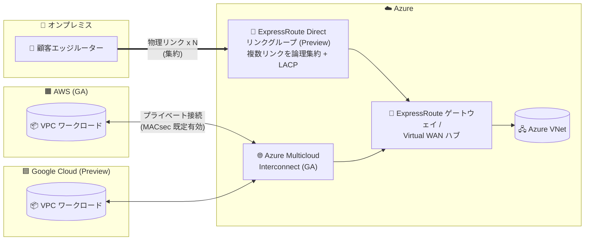

# Azure ExpressRoute / Multicloud Interconnect: ハイブリッド・マルチクラウド接続の強化 (リンクグループ プレビュー / 新 CSP サポート GA)

**リリース日**: 2026-11-17

**サービス**: Azure ExpressRoute / Azure Multicloud Interconnect

**機能**: ExpressRoute Direct リンクグループ (Public Preview) / Azure Multicloud Interconnect 新クラウドサービスプロバイダーサポート (GA)

**ステータス**: In preview (ExpressRoute Direct リンクグループ) / Launched (Azure Multicloud Interconnect - AWS GA、Google Cloud は Public Preview)

[このアップデートのインフォグラフィックを見る](https://takech9203.github.io/azure-news-summary/20261117-expressroute-multicloud-connectivity.html)

## 概要

Microsoft Ignite に合わせて、Azure のハイブリッド / マルチクラウド接続に関する 2 つのアップデートが発表されました。

1 つ目は **ExpressRoute Direct のリンクグループ (Public Preview)** です。ExpressRoute Direct は Microsoft グローバルネットワークのピアリングロケーションに直接接続する高帯域接続 (デュアル 10/100/400 Gbps) を提供しますが、今回のリンクグループにより、複数の物理リンクを 1 つの論理接続として集約できるようになります。LACP (Link Aggregation Control Protocol) による動的なリンクネゴシエーションとフェイルオーバー、グループ単位での集約管理・モニタリング、最小アクティブリンク数の設定による可用性動作のカスタマイズが可能になり、高スループットワークロードの接続を運用負荷を抑えながらスケールできます。

2 つ目は **Azure Multicloud Interconnect の一般提供 (GA)** です。Azure と対応クラウドプロバイダー間のプライベート接続を提供するマネージドサービスで、**Amazon Web Services (AWS) との接続が GA**、**Google Cloud Platform (GCP) との接続が Public Preview** になりました。Azure ポータルからクラウドプロバイダー、リージョン、帯域幅を選択し、ガイド付きの手順でマルチクラウド接続をデプロイできます。基盤技術には ExpressRoute が使用されており、回線調達、クロスコネクト、BGP ピアリングなどの個別調整なしに、アクティベーションキーの交換だけでクラウド間のプライベート接続をプロビジョニングできます。

**アップデート前の課題**

- ExpressRoute Direct で容量を拡張するには、複数の独立した ExpressRoute 接続を個別に管理する必要があった
- ExpressRoute Direct は LACP (Link Aggregation Control Protocol) をサポートしていなかった (従来ドキュメントに明記)
- クラウド間接続の構築には、プロバイダー回線、物理 / 仮想ルーター、クロスコネクト、VLAN、ポイントツーポイントアドレッシング、BGP ピアリングセッションなどを自前で調整・運用する必要があり、複雑だった
- Azure Multicloud Interconnect はプレビュー中は AWS のみ・帯域幅 1 Gbps に制限され、SLA もなかった

**アップデート後の改善**

- 複数の ExpressRoute Direct リンクをグループ化し、単一の論理接続として容量をスケールできるようになった (プレビュー)
- LACP による動的リンクネゴシエーションとフェイルオーバーで回復性が向上し、最小アクティブリンク数の設定で可用性動作をカスタマイズ可能になった
- AWS とのマネージドプライベート接続が GA となり、帯域幅は 1G〜100G に拡大、Local / Premium SKU と SLA が提供されるようになった
- GCP との接続が Public Preview (1 Gbps) として新たに利用可能になった

## アーキテクチャ図



オンプレミスからはリンクグループで集約された ExpressRoute Direct 接続、他クラウド (AWS / GCP) からは Multicloud Interconnect のマネージドプライベート接続が、それぞれ ExpressRoute ゲートウェイ経由で Azure VNet に到達します。

## サービスアップデートの詳細

### 1. ExpressRoute Direct リンクグループ (Public Preview)

アナウンスで示された主要機能は以下のとおりです。

1. **容量のスケール**
   - 複数の ExpressRoute Direct リンクをグループ化し、単一の論理接続として接続容量を拡張できる

2. **回復性の向上**
   - LACP による動的なリンクネゴシエーションとフェイルオーバーを提供

3. **運用の簡素化**
   - 個別接続ではなくリンクグループ単位での集約管理とモニタリングが可能

4. **可用性動作のカスタマイズ**
   - グループの稼働維持に必要な「最小アクティブリンク数」を設定できる

### 2. Azure Multicloud Interconnect 新 CSP サポート (GA)

1. **AWS 接続の一般提供 (GA)**
   - 帯域幅は 1G / 2G / 5G / 10G / 20G / 50G / 100G をサポート
   - GA 接続には公式 SLA が適用される

2. **Google Cloud 接続の Public Preview**
   - 帯域幅は 1G をサポート

3. **簡素化されたプロビジョニング**
   - Azure Multicloud Interconnect リソースを作成し、プロバイダー側とアクティベーションキーを交換するだけで接続を確立。プロバイダー回線、クロスコネクト、VLAN、BGP ピアリングの個別調整は不要

4. **マネージドな回復性とリンク暗号化**
   - 単一のインターコネクトは物理的に分離されたロケーションにまたがる冗長インフラで構成
   - Azure と対応クラウドプロバイダー間の物理リンクでは MACsec が既定で有効

## 技術仕様

### ExpressRoute Direct (リンクグループの基盤)

| 項目 | 詳細 |
|------|------|
| ポート帯域幅 | デュアル 10 Gbps / 100 Gbps / 400 Gbps (400 Gbps は限定ロケーション・要登録) |
| リンクグループ | 複数の物理リンクを 1 つの論理接続として集約 (Public Preview) |
| リンクアグリゲーション | LACP による動的ネゴシエーションとフェイルオーバー (リンクグループで新規サポート) |
| 可用性設定 | グループ稼働維持に必要な最小アクティブリンク数を設定可能 |
| VLAN タギング | QinQ / Dot1Q |
| 対応プロトコル | IPv4 / IPv6、IP MTU 1,500 バイト |

### Azure Multicloud Interconnect

| 項目 | 詳細 |
|------|------|
| 対応プロバイダー | AWS (GA)、Google Cloud (Public Preview) |
| 帯域幅 | AWS: 1G / 2G / 5G / 10G / 20G / 50G / 100G、Google Cloud: 1G |
| SKU | Local (関連付けられた Azure リージョンへの接続)、Premium (全 Azure リージョンへの接続) |
| 基盤技術 | ExpressRoute (リソースとしては Multicloud Interconnect リソースを管理) |
| ペアリング | アクティベーションキーで Azure 側とプロバイダー側を照合 (プロバイダー、リージョン、帯域幅、アカウントが一致しないとプロビジョニング開始されない) |
| VNet 接続 | ExpressRoute 仮想ネットワークゲートウェイ (インターコネクトあたり最大 10 接続) または Virtual WAN ハブ (認可キー方式のみ) |
| ルート上限 | 接続あたり最大 250 プレフィックス (超過すると接続がダウン) |
| 予約リソース | ASN 65515–65520、IPv4 169.254.255.0/24、IPv6 fc00:ffff:ffff:ffff/120 は Microsoft 予約のため使用不可 |
| ピアリング | プライベート接続のみ (Microsoft ピアリングは非対応) |
| リンク暗号化 | MACsec 既定有効 |

## 設定方法

### 前提条件 (Azure Multicloud Interconnect)

1. Azure サブスクリプション
2. 対応クラウドサービスプロバイダー (AWS / Google Cloud) のアカウント
3. ExpressRoute 仮想ネットワークゲートウェイ
4. Azure VNet とプロバイダー側 VPC の間で重複しないアドレス空間

### セットアップの流れ (Azure Multicloud Interconnect)

1. **ExpressRoute 回線の作成**: ExpressRoute 回線を作成し、Azure Multicloud Interconnect ポートタイプを選択する
2. **インターコネクトリソースの作成**: プライベートなクラウド間接続を提供する Azure Multicloud Interconnect リソースを作成する
3. **プロバイダー設定**: アクティベーションキーを生成または引き換え、対応クラウドプロバイダーを選択する (Azure 側・プロバイダー側のどちらからでも開始可能)
4. **ワークロードの接続**: 仮想ネットワークを接続し、アプリケーション・データ・AI ワークロードが両クラウド間で通信できるようにする

### 前提条件 (ExpressRoute Direct)

1. サブスクリプションを `AllowExpressRoutePorts` 機能に登録する

```powershell
# サブスクリプションを ExpressRoute Direct に登録
Connect-AzAccount
Select-AzSubscription -Subscription "<SubscriptionID>"
Register-AzProviderFeature -FeatureName AllowExpressRoutePorts -ProviderNamespace Microsoft.Network
```

2. Microsoft.Network リソースプロバイダーが登録済みであることを確認する

なお、リンクグループの具体的な構成手順は、本レポート作成時点で公開ドキュメントを確認できませんでした。詳細は [aka.ms/ERLinkGroup](https://aka.ms/ERLinkGroup) を参照してください。

## メリット

### ビジネス面

- 複数クラウドにまたがるアプリケーション・データ・AI ワークロードを、インターネットを経由しないプライベート接続で安全に連携できる
- 回線調達やネットワーク機器の個別調整が不要になり、マルチクラウド接続の構築期間と運用コストを削減できる
- AWS 接続は GA となり SLA が適用されるため、ミッションクリティカルなワークロードにも採用しやすくなった

### 技術面

- ExpressRoute Direct の複数リンクを単一の論理接続として扱えるため、高スループットワークロードの帯域を運用の複雑さを増やさずにスケールできる
- LACP によるフェイルオーバーと最小アクティブリンク数の設定により、障害時の可用性動作を要件に合わせて制御できる
- Multicloud Interconnect は物理的に分離されたロケーションにまたがる冗長構成と MACsec 暗号化が組み込みで提供される

## デメリット・制約事項

- **ExpressRoute Direct リンクグループはプレビュー段階**であり、本番環境での利用にはプレビュー補足条項が適用される。対応ロケーションなどの詳細仕様は公開ドキュメントで未確認
- **Google Cloud 接続は Public Preview** (帯域幅 1G のみ) で、SLA は適用されない
- Multicloud Interconnect の接続あたりのアドバタイズ可能プレフィックスは最大 250。超過すると接続がダウンするため、ルート集約の設計が必要
- Multicloud Interconnect はプライベート接続のみで、Microsoft ピアリングは利用できない
- 利用可能リージョンが限定されている (下記「利用可能リージョン」参照)。West US の AWS 接続は GA では非サポート
- Virtual WAN ハブへの接続は認可キー方式のみで、回線の直接選択は未サポート

## ユースケース

### ユースケース 1: 大容量データインジェストの帯域スケール

**シナリオ**: Azure Storage や Azure Cosmos DB への大規模データ取り込みを行う企業が、ExpressRoute Direct の複数リンクを束ねて帯域を拡張しつつ、接続の管理対象を単一の論理接続に集約する。

**効果**: 個別接続ごとの管理・監視が不要になり、LACP によるフェイルオーバーで単一リンク障害時もスループットを維持できる。

### ユースケース 2: Azure と AWS にまたがる分散ワークロードのプライベート接続

**シナリオ**: アプリケーションを Azure、データ基盤を AWS に配置している企業が、Azure ポータルから Multicloud Interconnect (AWS、GA) をプロビジョニングし、ExpressRoute ゲートウェイ経由で VNet と VPC をプライベートに接続する。

**効果**: インターネットを経由しない高帯域 (最大 100G) のクラウド間接続を、回線調達や BGP 設定の個別調整なしに短期間で構築でき、SLA に基づく運用が可能になる。

## 料金

本レポート作成時点で、両機能の具体的な料金は公式ページで確認できませんでした。以下を参照してください。

- Azure Multicloud Interconnect の料金はロケーション、SKU、帯域幅に依存します。参加プロバイダー側 (AWS / GCP) の課金が別途発生する場合があります。プレビュー価格と GA 価格は異なる可能性があります
- ExpressRoute Direct の料金は [ExpressRoute 料金ページ](https://azure.microsoft.com/pricing/details/expressroute/) を参照してください (メータード / アンリミテッドの課金タイプを選択可能)

## 利用可能リージョン

**Azure Multicloud Interconnect** (Microsoft Learn ドキュメント記載、変更される可能性あり):

| ピアリングロケーション | 対応クラウドプロバイダー |
|------|------|
| Australia East | AWS |
| East US | AWS、Google Cloud |
| Germany West Central | AWS、Google Cloud |
| West US | Google Cloud (AWS は GA 非サポート) |

追加リージョンの要望は [Multicloud Interconnect Form](https://aka.ms/MCIForm) から提出できます。

**ExpressRoute Direct リンクグループ**: 対応ピアリングロケーションは本レポート作成時点で公式情報を確認できませんでした。

## 関連サービス・機能

- **Azure ExpressRoute**: Multicloud Interconnect の基盤となる接続技術。オンプレミスから Azure への接続には引き続き ExpressRoute を推奨 (Azure から対応 CSP への接続は Multicloud Interconnect を推奨)
- **ExpressRoute 仮想ネットワークゲートウェイ**: Multicloud Interconnect / ExpressRoute 回線を Azure VNet に接続するためのゲートウェイ
- **Azure Virtual WAN**: ExpressRoute ゲートウェイを持つ Virtual WAN ハブへの Multicloud Interconnect 接続をサポート (認可キー方式)
- **MACsec**: Multicloud Interconnect の物理リンクで既定有効となるリンク層暗号化

## 参考リンク

- [インフォグラフィック](https://takech9203.github.io/azure-news-summary/20261117-expressroute-multicloud-connectivity.html)
- [公式アップデート情報: ExpressRoute Direct link groups (Public Preview)](https://azure.microsoft.com/updates?id=580926)
- [公式アップデート情報: Azure Multicloud Interconnect new CSP support (GA)](https://azure.microsoft.com/updates?id=579766)
- [ExpressRoute Direct リンクグループ詳細 (aka.ms/ERLinkGroup)](https://aka.ms/ERLinkGroup)
- [Microsoft Learn: About Azure ExpressRoute Direct](https://learn.microsoft.com/en-us/azure/expressroute/expressroute-erdirect-about)
- [Microsoft Learn: What is Azure Multicloud Interconnect?](https://learn.microsoft.com/en-us/azure/multicloud-interconnect/overview)
- [Microsoft Learn: Azure Multicloud Interconnect availability and limits](https://learn.microsoft.com/en-us/azure/multicloud-interconnect/availability-limits)
- [発表ブログ (aka.ms/Interconnect-Ignite)](https://aka.ms/Interconnect-Ignite)
- [ExpressRoute 料金ページ](https://azure.microsoft.com/pricing/details/expressroute/)

## まとめ

今回の 2 つのアップデートは、Azure のハイブリッド / マルチクラウド接続を「より太く、よりシンプルに」する方向性を示すものです。ExpressRoute Direct リンクグループは、従来サポートされていなかった LACP ベースのリンク集約を導入し、高スループットワークロードの帯域スケールと可用性制御を単一の論理接続で実現します。Azure Multicloud Interconnect の GA (AWS) は、これまで複雑だったクラウド間プライベート接続を、アクティベーションキーの交換だけで構築できるマネージドサービスとして本番利用可能にしました。

Solutions Architect としては、(1) AWS とのマルチクラウド構成を持つ案件では Multicloud Interconnect (最大 100G、SLA あり) を接続方式の第一候補として評価すること、(2) 接続あたり 250 プレフィックスの上限を踏まえたルート集約設計を行うこと、(3) ExpressRoute Direct の大容量接続を計画している場合はリンクグループのプレビューを検証し、GA 時の設計に備えることを推奨します。GCP 接続はまだプレビュー (1G のみ) のため、本番採用は GA を待つのが無難です。

---

**タグ**: #Azure #ExpressRoute #ExpressRouteDirect #MulticloudInterconnect #AWS #GoogleCloud #Networking #HybridCloud #Multicloud #Preview #GA #MicrosoftIgnite
