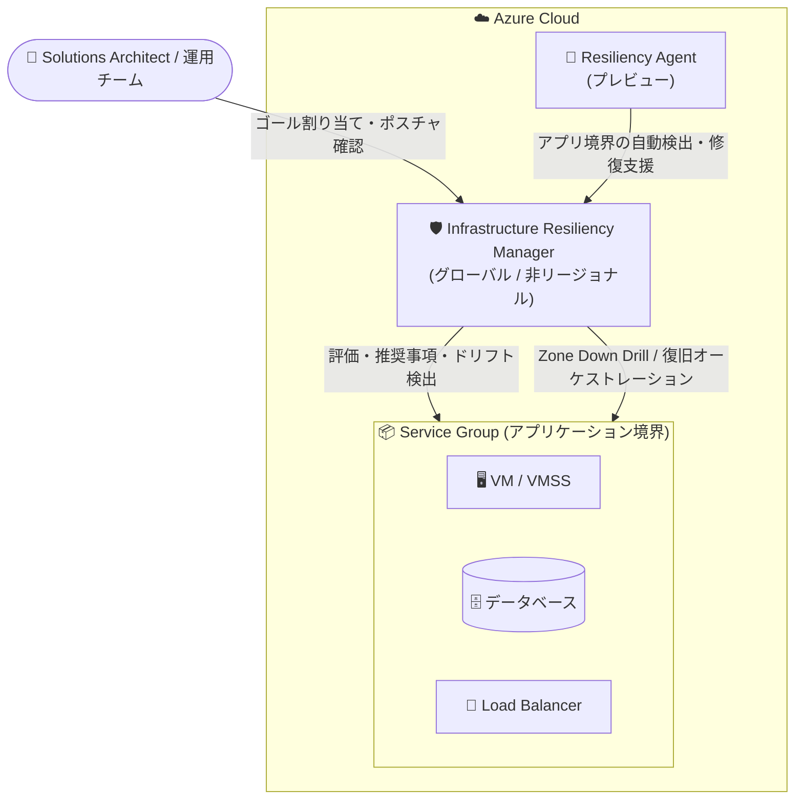

# Azure Infrastructure Resiliency Manager: 一般提供開始 (GA)

**リリース日**: 2026-11-17

**サービス**: Azure Infrastructure Resiliency Manager

**機能**: アプリケーション回復性管理の統合エクスペリエンス (GA)

**ステータス**: Launched (GA)

[このアップデートのインフォグラフィックを見る](https://takech9203.github.io/azure-news-summary/20261117-infrastructure-resiliency-manager-ga.html)

## 概要

Microsoft Ignite 2026 に合わせて、Azure Infrastructure Resiliency Manager が一般提供 (GA) となりました。Azure 全体でアプリケーションの回復性 (レジリエンシー) を強化するための、目標駆動型の統合管理エクスペリエンスを提供するサービスです。「Start Resilient (最初から回復性を組み込む)」「Get Resilient (既存ワークロードの回復性を改善する)」「Stay Resilient (変化に追随して回復性を維持する)」という 3 つのジャーニーを 1 つのポータル体験でカバーします。現時点のリリースはゾーン回復性 (Availability Zone 対応) にフォーカスしています。

具体的には、ゾーン回復性のあるデプロイテンプレートによる新規構築、Service Groups と回復性目標 (ゴール) を使った大規模なアプリケーション評価、コスト影響を考慮した推奨事項の優先順位付け、回復性ドリフトの検出、リソース/アプリケーションの監視、そして組み込みのドリル (訓練) 機能による回復可能性の検証とコンプライアンスレポートまでを一貫して提供します。あわせて、アプリケーション境界の自動検出や修復スクリプトの提示を行う Resiliency Agent (Azure Copilot / GitHub Copilot 連携) がプレビューとして利用できます。

**アップデート前の課題**

- 可用性ゾーン対応状況の把握は、リソース単位で個別に確認する必要があり、アプリケーション (ワークロード) 単位の回復性ポスチャを一元的に評価する手段がなかった
- 回復性の改善策は Azure Advisor などの推奨事項を手動で収集・優先順位付けする必要があり、ゾーン障害時の復旧手順の検証 (訓練) も個別に設計する必要があった

**アップデート後の改善**

- Service Groups でサブスクリプション・リソースグループ・タグを横断してアプリケーション境界を定義し、ゾーン回復性ゴールの割り当て、ポスチャの可視化、推奨事項のレビューを一元化
- Availability Zone Down Drills (ゾーン障害シミュレーション) と Recovery Orchestration Plan (復旧オーケストレーション) により、復旧準備状況の検証と複数リソースにまたがる復旧の自動調整が可能に

## アーキテクチャ図

Infrastructure Resiliency Manager はグローバルな非リージョナルサービスとして動作し、Service Group にまとめたアプリケーションのゾーン回復性を評価・改善・検証します。

## サービスアップデートの詳細

### 主要機能

1. **Start Resilient: 回復性を組み込んだ新規構築**
   - Resiliency Agent に自然言語での説明、アーキテクチャ図のアップロード、既存の IaC テンプレートの提供を行うと、アーキテクチャガイダンスのレビューと、回復性を考慮した Bicep / ARM JSON / Terraform テンプレートの生成が可能
   - GitHub Copilot (VS Code / CLI) からローカルリポジトリの IaC を評価・生成する体験も限定プレビューで提供

2. **Get Resilient: 既存アプリケーションの評価と改善**
   - Service Group を作成しなくてもリソース単位のゾーン回復性ポスチャを確認可能
   - Service Groups でアプリケーション境界を定義し、ゾーン回復性ゴールを割り当ててアプリケーション単位のポスチャを評価
   - 推奨事項を影響度 (高・中・低) 別にレビューし、ポータルまたはエージェント支援の修復で改善

3. **Stay Resilient: 継続的な検証と復旧準備**
   - Service Group の再評価によりポスチャ・可観測性・ドリル・復旧計画のギャップ (ドリフト) を特定
   - **Availability Zone Down Drills**: ゾーン障害をシミュレートして回復準備状況を検証
   - **Recovery Orchestration Plan**: アクティブなフェールオーバーが必要な複数リソースの復旧を調整

4. **Resiliency Agent (プレビュー)**
   - アプリケーションのリソースと依存関係を自動検出して Service Group の境界を提案
   - 修復スクリプトの提示や、ドリル・復旧計画の準備、構成ブロッカーの調査を会話形式で支援 (ドリルやフェールオーバーの実行自体はポータルから行う)

## 技術仕様

| 項目 | 詳細 |
|------|------|
| サービス種別 | グローバル / 非リージョナルサービス (全リージョンのリソースを横断管理) |
| 現リリースの対象 | ゾーン回復性 (Availability Zone) |
| アプリケーション境界 | Service Groups (サブスクリプション・リソースグループ・タグ横断、リソースの複数グループ共有可) |
| 無料機能 | ゴール割り当て、大規模ポスチャ表示、推奨事項レビュー |
| 有料機能 | Availability Zone Down Drills、Recovery Orchestration Plans (Usage Plan への登録が必要) |
| 課金単位 | 時間単位で計算し月額レートに比例配分 (Usage Plan のリソース ID に対して課金) |
| リソースプロバイダー | Microsoft.AzureResilienceManagement |
| GA 時期 | 2026 年 11 月 |

## 設定方法

### 前提条件

1. Usage Plan を作成するサブスクリプションで `Microsoft.AzureResilienceManagement` リソースプロバイダーが登録されていること (有料機能を使う場合)
2. アプリケーション単位の評価を行う場合は Service Group の作成とゴールの割り当て

### Azure Portal

1. Azure Portal で **Resiliency** を開き、**Overview** からポスチャを確認 (Resource resiliency / Service group resiliency タブ)
2. **Resource resiliency** タブの **Create service group** でリソースをアプリケーションとしてグループ化
3. Service Group にゾーン回復性ゴールを割り当て、推奨事項をレビュー
4. 有料機能を使う場合: Service Group の **Resiliency** > **Usage Plans** から **Create and Upgrade** を選択し、新規または既存の Usage Plan に登録
5. 登録後に Zone Down Drill の定義や Recovery Orchestration Plan の作成・構成が可能

## メリット

### ビジネス面

- アプリケーション単位で回復性ポスチャと対応ギャップを可視化でき、投資の優先順位付けをコスト影響とあわせて判断できる
- ドリルの実行結果をコンプライアンスレポートに活用でき、回復性に関する説明責任 (監査・規制対応) を果たしやすい
- ゴール・ポスチャ・推奨事項は追加コストなしで利用でき、スモールスタートが可能

### 技術面

- サブスクリプションやリソースグループを横断した Service Groups により、実際のアプリケーション境界に即した評価ができる
- Availability Zone Down Drills で本番前にゾーン障害時の復旧可否を検証でき、Recovery Orchestration Plan で複数リソースの復旧手順を自動調整できる
- 回復性ドリフト検出により、構成変更後も回復性の劣化を継続的に検知できる

## デメリット・制約事項

- 現リリースはゾーン回復性にフォーカスしており、リージョン間 DR などは対象のスコープが異なる
- 有効な Usage Plan に登録済みの Service Group は、ゴールの割り当てのみでも課金対象となる (無料機能のみ使いたい場合は Usage Plan への登録を解除する必要がある)
- ドリルや復旧計画を「構成した」だけでは復旧成功は保証されない。ドリルを実行して結果を検証し、構成を更新する運用が必要
- Resiliency Agent (アプリ境界の自動検出・修復支援) および GitHub Copilot 連携はプレビュー / 限定プレビューであり、GA 機能とはサポートレベルが異なる
- ドリル・フェールオーバー・再保護の実行はポータルから行う必要があり、エージェント経由では実行できない
- ゴールと推奨事項の対応リソースには制限がある (サポートマトリクスを参照)

## ユースケース

### ユースケース 1: 既存ミッションクリティカルアプリのゾーン回復性評価

**シナリオ**: 複数サブスクリプションにまたがる基幹アプリケーションについて、可用性ゾーン対応状況を棚卸しし、ギャップを計画的に解消したい。

**実装例**: Resiliency Agent でアプリケーションのリソースと依存関係を検出し、提案された境界をレビューして Service Group を作成。ゾーン回復性ゴールを割り当て、影響度別の推奨事項をコスト影響とあわせて優先順位付けして修復する。

**効果**: リソース単位の場当たり的な対応ではなく、アプリケーション単位で回復性ポスチャを管理でき、非クリティカルなリソースを評価から除外してノイズを削減できる。

### ユースケース 2: ゾーン障害を想定した復旧訓練とコンプライアンス報告

**シナリオ**: 規制要件により、ゾーン障害時に基幹システムが復旧可能であることを定期的に検証・報告する必要がある。

**実装例**: Service Group を Usage Plan に登録し、Availability Zone Down Drill を定義・実行。アクティブフェールオーバーが必要なリソースには Recovery Orchestration Plan を構成し、ドリル結果をレビューして構成を更新する。

**効果**: ゾーン障害シミュレーションにより実際の復旧可否を事前に検証でき、ドリル結果を監査・コンプライアンスレポートに活用できる。

## 料金

ゴール割り当て・大規模ポスチャ表示・推奨事項レビューは追加コストなしで利用できます。Availability Zone Down Drills と Recovery Orchestration Plans は有料機能で、Service Group を Usage Plan に登録する必要があります (Usage Plan にティアはありません)。

| 条件 | 課金 |
|------|------|
| Usage Plan 未登録 + ゴール割り当てのみ | 無料 (ポスチャ・推奨事項も無料) |
| Usage Plan 登録済み + 回復性アーティファクトなし | 無料 (登録のみでは課金されない) |
| Usage Plan 登録済み + ゴールのみ割り当て | 課金対象 (ドリル・復旧計画がなくても課金) |
| Usage Plan 登録済み + ドリルまたは復旧計画あり | 課金対象 |

課金は両条件 (有効な Usage Plan への登録 + 回復性アーティファクトの存在) を満たした時間に対して時間単位で計算され、月の途中でアーティファクトをすべて削除した場合は実時間で按分されます。ドリルや復旧計画の「実行」有無ではなく「存在」で課金が決まる点に注意してください。具体的な料金レートは [料金ページ](https://azure.microsoft.com/products/infrastructure-resiliency-manager#pricing) を参照してください。

## 利用可能リージョン

Infrastructure Resiliency Manager はグローバルな非リージョナルサービスであり、特定のリージョンに依存せず、すべての Azure リージョンのリソースを管理・オーケストレーションできます。

## 関連サービス・機能

- **Azure Service Groups**: アプリケーション境界を定義するグループ化機能。Infrastructure Resiliency Manager の評価・ゴール割り当ての単位
- **Azure Copilot (Resiliency Agent)**: アプリ境界の自動検出、修復支援、ドリル準備を会話形式で支援するエージェント (プレビュー)
- **GitHub Copilot (Resiliency Agent)**: VS Code / CLI から回復性を考慮した IaC (Bicep / ARM / Terraform) の評価・生成を支援 (限定プレビュー)
- **Azure Backup / Business Continuity**: Resiliency の Overview ではゾーン回復性とバックアップ保護状況 (Backup Enabled) を統合的に表示
- **Azure Cost Management**: Usage Plan のリソース ID 単位で課金が記録され、タグで Service Group ごとの利用を識別可能

## 参考リンク

- [インフォグラフィック](https://takech9203.github.io/azure-news-summary/20261117-infrastructure-resiliency-manager-ga.html)
- [公式アップデート情報](https://azure.microsoft.com/updates?id=580748)
- [Infrastructure Resiliency Manager 概要 (Microsoft Learn)](https://learn.microsoft.com/en-us/azure/resiliency/infrastructure-resiliency-manager-overview)
- [クイックスタート (Microsoft Learn)](https://learn.microsoft.com/en-us/azure/resiliency/quickstart-infrastructure-resiliency-manager)
- [課金と価格 (Microsoft Learn)](https://learn.microsoft.com/en-us/azure/resiliency/infrastructure-resiliency-manager-pricing)
- [ゴールと推奨事項のサポートマトリクス (Microsoft Learn)](https://learn.microsoft.com/en-us/azure/resiliency/goals-recommendations-support-matrix)
- [料金ページ](https://azure.microsoft.com/products/infrastructure-resiliency-manager#pricing)

## まとめ

Azure Infrastructure Resiliency Manager の GA により、ゾーン回復性の評価・改善・検証をアプリケーション単位で一元管理できるようになりました。ゴール・ポスチャ・推奨事項は無料で利用できるため、まずは Service Group を作成してゾーン回復性ゴールを割り当て、自社アプリケーションの回復性ギャップを可視化することを推奨します。その上で、ミッションクリティカルなワークロードには Usage Plan を登録し、Availability Zone Down Drills と Recovery Orchestration Plan による復旧検証の定常運用を検討してください。Usage Plan 登録済みの Service Group はゴールのみでも課金される点にはご注意ください。

---

**タグ**: Azure Infrastructure Resiliency Manager, Resiliency, Availability Zones, Service Groups, Zone Down Drills, Recovery Orchestration, Microsoft Ignite, GA
