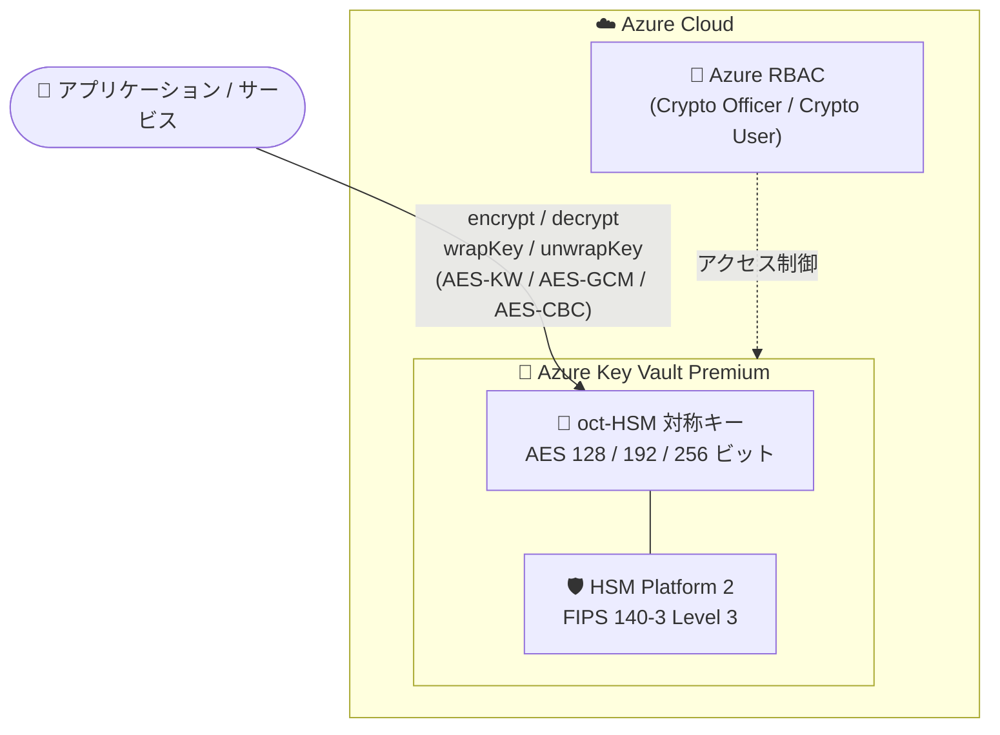

# Azure Key Vault: Key Vault Premium での対称キー (Symmetric Keys) サポート

**リリース日**: 2026-11-17

**サービス**: Azure Key Vault

**機能**: Key Vault Premium での対称キー (oct-HSM / AES) サポート

**ステータス**: Launched (GA)

[このアップデートのインフォグラフィックを見る](https://takech9203.github.io/azure-news-summary/20261117-key-vault-premium-symmetric-keys.html)

## 概要

2026 年 7 月のパブリックプレビューを経て、Azure Key Vault Premium における対称キー (oct-HSM キータイプ) のサポートが一般提供 (GA) されました。Microsoft Ignite に合わせて発表されたアップデートで、AES (Advanced Encryption Standard) アルゴリズムを使用したデータの暗号化・復号・キーラップ・アンラップを Key Vault Premium 上で直接実行できるようになります。

対称キーは HSM 保護のみ (oct-HSM) で提供され、Premium SKU の Vault が必要です。新規に作成されるキーは最新の HSM Platform 2 (FIPS 140-3 Level 3 検証済み HSM) で保護されます。また、256 ビットキーで使用する AES アルゴリズムは CNSA 2.0 (Commercial National Security Algorithm Suite 2.0) の要件に照らして耐量子 (quantum-resistant) とされており、ポスト量子暗号 (PQC) への備えとなるシナリオにも有効です。

GA に伴い、本番ワークロードに求められるパフォーマンス、スケーラビリティ、信頼性が提供され、Azure が管理するセキュリティ・コンプライアンス・運用管理の恩恵を受けながら対称キーを利用できます。

**アップデート前の課題**

- Key Vault (Vaults) がサポートするキータイプは RSA と EC (非対称キー) のみで、対称キーを扱うには単一テナントの Managed HSM (高コスト) や外部のキー管理基盤が必要だった
- AES による暗号化・キーラップを HSM 保護で行いたい場合、マルチテナントで低コストな Vault では実現できなかった

**アップデート後の改善**

- Key Vault Premium の oct-HSM キータイプで、HSM 保護された対称キー (AES 128/192/256 ビット) を作成・利用できるようになった
- encrypt / decrypt / wrapKey / unwrapKey の各操作を AES-KW、AES-GCM、AES-CBC アルゴリズムで実行でき、HMAC (HS256/HS384/HS512) による署名・検証にも対応
- 本番ワークロードでの利用がサポートされ、既存の Azure セキュリティワークフローと統合して一元的にキーを管理できる

## アーキテクチャ図



アプリケーションは Key Vault Premium のデータプレーン API を通じて、FIPS 140-3 Level 3 検証済み HSM に保護された対称キーで暗号操作を実行します。キー素材は Vault の外部に出ることはありません。

## サービスアップデートの詳細

### 主要機能

1. **HSM 保護された対称キー (oct-HSM)**
   - Key Vault Premium で 128 / 192 / 256 ビットの AES 対称キーを作成可能。対称キーは HSM 保護のみで、ソフトウェア保護版は提供されない

2. **AES による暗号操作**
   - `encrypt` / `decrypt` / `wrapKey` / `unwrapKey` 操作に対応。アルゴリズムは AES-KW (キーラップ、RFC 3394)、AES-GCM (NIST SP 800-38d)、AES-CBC (NIST SP 800-38a) をサポート

3. **HMAC による署名・検証**
   - oct-HSM キーで HS256 / HS384 / HS512 (HMAC-SHA) の Sign/Verify 操作に対応

4. **耐量子性 (CNSA 2.0 準拠)**
   - 256 ビットキーで使用する AES アルゴリズムは CNSA 2.0 の FAQ において耐量子とされ、ポスト量子暗号への移行準備に活用できる

5. **本番ワークロード対応 (GA)**
   - 2026 年 7 月のパブリックプレビューから GA に昇格し、本番環境で必要なパフォーマンス・スケーラビリティ・信頼性を提供

## 技術仕様

| 項目 | 詳細 |
|------|------|
| キータイプ | oct-HSM (HSM 保護の対称キー) |
| 対応 SKU | Key Vault Premium のみ (Standard は非対応) |
| キーサイズ | 128 / 192 / 256 ビット |
| 暗号化・ラップアルゴリズム | AES-KW、AES-GCM、AES-CBC |
| 署名・検証アルゴリズム | HS256、HS384、HS512 (HMAC) |
| 対応操作 | encrypt、decrypt、wrapKey、unwrapKey (+ HMAC Sign/Verify) |
| 入力サイズ上限 | 4,096 バイト (Base64 エンコード前)。アルゴリズム固有の制約でさらに低くなる場合あり |
| HSM 保護レベル | HSM Platform 2: FIPS 140-3 Level 3 (新規キーは自動的にこのプラットフォームで作成) |
| キーのエクスポート | 不可 (Get 操作でも対称キーのキー素材は返却されない。Backup/Restore は保護された形式のみ) |
| アクセス制御 | Azure RBAC (推奨) または Vault アクセスポリシー (レガシー) |

## 設定方法

### 前提条件

1. Premium SKU の Key Vault (対称キーは HSM 保護のみのため Standard では利用不可)
2. キー操作の権限 (Azure RBAC の場合: Key Vault Crypto Officer / Key Vault Crypto User など)

### Azure CLI

```bash
# AES 256 ビット対称キーの作成 (oct-HSM)
az keyvault key create \
    --vault-name <vault-name> \
    --name sample-aes-key \
    --kty oct-HSM \
    --size 256 \
    --ops encrypt decrypt wrapKey unwrapKey

# AES-GCM によるデータの暗号化 (値は Base64 エンコード)
az keyvault key encrypt \
    --vault-name <vault-name> \
    --name sample-aes-key \
    --algorithm A256GCM \
    --value aGVsbG8gd29ybGQ= \
    --query "{iv:iv, result:result, tag:tag}"
```

**注意**: AES-GCM 操作では、暗号化レスポンスの `iv`、`result`、`tag` の 3 つの値を保存する必要があります。復号にはこの 3 つすべてが必要です。

## メリット

### ビジネス面

- Managed HSM (単一テナント・高コスト) を導入せずに、マルチテナントで低コストな Key Vault Premium で HSM 保護の対称キーを利用でき、コンプライアンス要件 (FIPS 140-3 Level 3) を満たしやすい
- 256 ビット AES の耐量子性 (CNSA 2.0) により、ポスト量子暗号への移行を見据えたセキュリティ戦略を前倒しで実行できる
- キー管理を Azure に集約することで、セキュリティ・コンプライアンス・運用の管理負荷を軽減できる

### 技術面

- AES-GCM / AES-CBC による暗号化・復号、AES-KW によるキーラップを Key Vault の REST API / CLI / SDK から直接実行できる
- キー素材は HSM 外に出ず、エクスポート不可のため、キーの漏えいリスクを最小化できる
- `key_ops` プロパティによるキー単位の操作制限や、Azure RBAC によるきめ細かなアクセス制御が可能

## デメリット・制約事項

- 対称キーは Key Vault **Premium** のみの提供。Standard SKU では利用できない
- 暗号操作の入力サイズは 4,096 バイト (Base64 エンコード前) が上限のため、大きなデータの直接暗号化には不向き。大容量データはエンベロープ暗号化 (DEK を wrapKey で保護) が前提となる
- 対称キーのキー素材は Get 操作で取得できない (HSM 保護のみ)。ローカルでの暗号処理が必要な場合は設計の見直しが必要
- AES-GCM では `iv`・`result`・`tag` の 3 値の管理が必要で、いずれかを失うと復号できない

## ユースケース

### ユースケース 1: エンベロープ暗号化における KEK (キー暗号化キー) の HSM 保護

**シナリオ**: アプリケーションがローカルで生成したデータ暗号化キー (DEK) を、Key Vault Premium の oct-HSM キーを KEK として AES-KW でラップし、暗号化済み DEK をデータと共に保存する。

**実装例**:

```bash
# KEK として AES 256 ビット対称キーを作成
az keyvault key create \
    --vault-name my-premium-vault \
    --name envelope-kek \
    --kty oct-HSM \
    --size 256 \
    --ops wrapKey unwrapKey
```

**効果**: DEK は常に HSM 保護された KEK でラップされた状態で保存され、KEK 自体は Vault から出ないため、大容量データの暗号化と高いキー保護レベルを両立できる。

### ユースケース 2: ポスト量子暗号 (PQC) への準備

**シナリオ**: 規制の厳しい業界 (金融・公共など) で、CNSA 2.0 への準拠を見据え、暗号基盤を耐量子アルゴリズムへ移行する。

**効果**: 256 ビット AES は CNSA 2.0 において耐量子とされており、RSA ベースのキーラップから oct-HSM (AES-KW) へ移行することで、量子コンピュータ時代に向けた暗号アジリティを確保できる。

## 料金

Key Vault の料金ページでは、HSM 保護キーは Premium SKU のみで利用でき、「キーごとの月額 + 10,000 トランザクションごとの操作料金」の体系で課金されます。高度なキータイプは使用キー数に応じた段階的な従量制 (最初の 250 キー / 251〜1,500 / 1,501〜4,000 / 4,001 以上で単価が変動) です。課金対象は過去 30 日間に使用されたキーのみで、キーの各バージョンは別キーとしてカウントされます。

具体的な金額はリージョン・通貨により異なるため、[Key Vault 料金ページ](https://azure.microsoft.com/pricing/details/key-vault/) および [Azure 料金計算ツール](https://azure.microsoft.com/pricing/calculator/) を参照してください。

## 利用可能リージョン

公式アップデート情報にリージョン固有の記載はありません。最新の提供状況は [Azure 製品のリージョン別提供状況](https://azure.microsoft.com/explore/global-infrastructure/products-by-region/) を参照してください。

## 関連サービス・機能

- **Azure Key Vault Managed HSM**: 単一テナントの HSM プール。oct-HSM 対称キーを従来からサポートしており、より厳格なセキュリティ・コンプライアンス要件を持つ高価値キー向け。今回の GA により、マルチテナントの Key Vault Premium でも対称キーが利用可能になった
- **Azure RBAC**: キーへのアクセス制御の推奨モデル。Key Vault Crypto Officer / Crypto User / Service Encryption User の組み込みロールでキー操作を管理
- **カスタマーマネージドキー (CMK)**: Azure Storage や Azure SQL などのサーバー側暗号化で Key Vault のキーを利用する構成。Key Vault を軸としたキー管理の代表的なシナリオ
- **Azure Storage クライアント側暗号化**: Key Vault のキーを使ったクライアント側データ暗号化のシナリオで、対称キーのラップ操作と組み合わせて利用可能

## 参考リンク

- [インフォグラフィック](https://takech9203.github.io/azure-news-summary/20261117-key-vault-premium-symmetric-keys.html)
- [公式アップデート情報](https://azure.microsoft.com/updates?id=579374)
- [About keys - Azure Key Vault (Microsoft Learn)](https://learn.microsoft.com/azure/key-vault/keys/about-keys)
- [Key types, algorithms, and operations (Microsoft Learn)](https://learn.microsoft.com/azure/key-vault/keys/about-keys-details)
- [Key Vault 料金ページ](https://azure.microsoft.com/pricing/details/key-vault/)

## まとめ

Azure Key Vault Premium での対称キー (oct-HSM / AES) サポートが GA となり、Managed HSM を導入せずに FIPS 140-3 Level 3 の HSM 保護された AES キーを本番ワークロードで利用できるようになりました。AES-KW / AES-GCM / AES-CBC による暗号操作と HMAC 署名に対応し、256 ビットキーは CNSA 2.0 で耐量子とされるため、PQC 移行の布石としても有効です。現在 Managed HSM や外部 KMS で対称キーを管理しているワークロードについては、要件 (テナント分離・コンプライアンスレベル) を確認のうえ、Key Vault Premium への集約によるコスト最適化を検討することを推奨します。なお、暗号操作の入力上限は 4,096 バイトのため、大容量データはエンベロープ暗号化パターンで設計してください。

---

**タグ**: Azure Key Vault, Security, Symmetric Keys, oct-HSM, AES, HSM, FIPS 140-3, CNSA 2.0, Microsoft Ignite, GA
