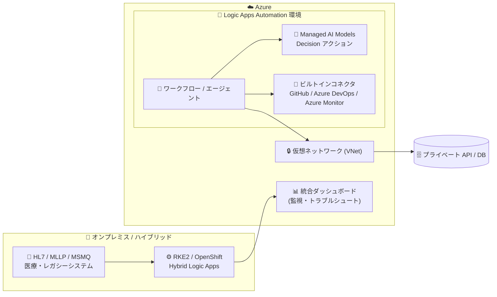

# Azure Logic Apps / Logic Apps Automation: 統合・ハイブリッド・AI 自動化に関する新機能群 (Public Preview)

**リリース日**: 2026-11-17

**サービス**: Azure Logic Apps / Azure Logic Apps Automation

**機能**: 統合・ハイブリッドデプロイ・可観測性の強化、開発者体験の向上、Managed AI Models、VNet 統合、ビルトイン Azure 自動化コネクタ、Decision アクション

**ステータス**: In preview (一部機能は GA)

[このアップデートのインフォグラフィックを見る](https://takech9203.github.io/azure-news-summary/20261117-logic-apps-automation-updates.html)

## 概要

Microsoft Ignite に合わせて、Azure Logic Apps と Azure Logic Apps Automation に関する 6 件のアップデートが発表された。Azure Logic Apps 本体では、エンタープライズシステム接続の拡充 (HL7 コネクタの GA、MLLP/MSMQ コネクタのプレビュー)、Data Mapper の強化、統合ダッシュボードによる一元的な監視、そして Hybrid Logic Apps のデプロイ柔軟性向上 (RKE2 / Red Hat OpenShift サポート、DevOps パイプライン対応、SQL Server ストレージオプション) が公開された。

Azure Logic Apps Automation は、実行時に AI が次のステップを判断する動的 (probabilistic) なワークフロー自動化サービスで、Logic Apps Standard と同じランタイム・コネクタ・管理プレーンを共有する姉妹サービスである。今回、刷新されたワークフローデザイナーや再利用可能なテンプレートなどの開発者体験の強化、モデル基盤の管理不要で AI を利用できる Managed AI Models、仮想ネットワーク (VNet) 統合、GitHub / Azure DevOps / Azure 管理サービス向けのビルトインコネクタ、AI によるビジネス判断を自動化する Decision アクションが、いずれもパブリックプレビューとして発表された。

**アップデート前の課題**

- 医療系メッセージング (HL7/MLLP) や MSMQ などのレガシーシステムとの接続に追加の統合作業が必要だった
- AI を組み込んだ自動化では、モデルのデプロイ構成、資格情報の管理、周辺インフラの維持をワークフロー開発前に行う必要があった
- ビジネス上の判断 (チケットの分類、重大度評価など) は、硬直的なルールか、追加のプロンプト設計と応答パースが必要な汎用 AI モデルに依存していた
- Logic Apps Automation のワークフローから、パブリックに公開されていない社内 API やプライベートデータベースへ安全にアクセスする手段が限られていた
- 開発・運用の自動化では、コード管理・作業追跡・リソース監視のために複数システムをカスタム統合する必要があった

**アップデート後の改善**

- HL7 (GA)、MLLP / MSMQ (プレビュー) コネクタにより、医療・レガシーシステムとの接続が標準機能で可能になった
- Managed AI Models により、モデル基盤のプロビジョニング・デプロイ・管理なしで AI 機能をワークフローやエージェントに組み込めるようになった
- Microsoft-Decision-1 を利用する Decision アクション (Yes/No、Choice、Score) により、確率・信頼度付きの構造化された判断結果をワークフローで直接利用できるようになった
- VNet 統合により、アウトバウンドトラフィックを顧客管理の仮想ネットワーク経由でルーティングし、プライベートリソースへ安全に接続できるようになった
- GitHub / Azure DevOps / Azure Monitor Logs / Azure Resource Graph / Azure Advisor のビルトインコネクタにより、開発・クラウド運用の自動化を単一ワークフローで構築できるようになった

## アーキテクチャ図

Logic Apps はオンプレミスの Kubernetes (RKE2 / OpenShift) 上でも稼働し統合ダッシュボードで監視できる。Logic Apps Automation 環境では、ワークフローとエージェントが Managed AI Models・Decision アクション・ビルトインコネクタを利用し、VNet 統合経由でプライベートリソースへ安全に接続する。

## サービスアップデートの詳細

### 1. Azure Logic Apps: 統合・ハイブリッドデプロイ・可観測性の強化

- **コネクタの拡充**: 医療メッセージを処理する HL7 コネクタが GA。MLLP および MSMQ コネクタがパブリックプレビューとなり、医療メッセージングとレガシーエンタープライズシステムへの接続が拡大
- **Data Mapper の強化**: エンタープライズアプリケーションやメッセージフォーマット間のマッピング・変換を効率化
- **統合ダッシュボード (パブリックプレビュー)**: 個別の Logic Apps を対象に、ワークフロー実行の監視と統合のトラブルシューティングを一元化
- **ハイブリッド環境への統合拡張**: 半接続 (semi-connected) 環境での Integration Account 機能の利用、RKE2 および Red Hat OpenShift Kubernetes クラスターのサポートによるデプロイ柔軟性の向上
- **ハイブリッド運用の簡素化**: DevOps パイプラインによる Hybrid Logic Apps デプロイの自動化、ワークフロー状態・ランタイムデータ向けの SQL Server ストレージオプションのサポート

### 2. Logic Apps Automation: 開発者体験の強化

- **刷新されたワークフローデザイナー**: 視覚的なナビゲーション、分岐の明瞭化、編集操作の改善により複雑なワークフローの作成・管理を効率化
- **再利用可能なテンプレート**: 統合、Azure 運用、エージェント型自動化向けのすぐに使えるテンプレートを提供。既存ワークフローをチーム間で共有可能なテンプレートに変換することも可能
- **環境・アプリケーション作成の高速化**: 最適化されたランタイム基盤により、インフラプロビジョニングのオーバーヘッドを削減
- **リージョン拡大**: Azure パブリックリージョンへの展開を順次実施中

### 3. Logic Apps Automation: Managed AI Models

- モデルのプロビジョニング・デプロイ・管理なしで、すぐに使える AI モデルをワークフローとエージェントに組み込み可能
- AI による推論と決定的 (deterministic) なワークフローアクションを組み合わせ、課題のトリアージ、コンテンツ要約、運用分析などのタスクを自動化
- モデル基盤は Logic Apps Automation 側で管理されるため、開発者はビジネスプロセスの自動化に集中できる

### 4. Logic Apps Automation: 仮想ネットワーク (VNet) 統合

- ワークフロー、ビルトインコネクタ、エージェントが、仮想ネットワーク経由で社内 API・データベース・Azure サービスへアクセス可能
- アウトバウンドの自動化トラフィックを組織の仮想ネットワーク経由でルーティングし、既存のネットワーク制御・ポリシーを適用可能
- Logic Apps Automation 環境の作成時に仮想ネットワークとサブネットを選択するだけで有効化できる

### 5. Logic Apps Automation: ビルトイン Azure 自動化コネクタ

- **開発ワークフローの自動化**: GitHub、Azure DevOps の Pipelines / Repos / Boards に接続し、Issue トリアージ、Pull Request レビュー、作業項目管理、CI/CD プロセスを自動化
- **Azure 運用の効率化**: Azure Monitor Logs、Azure Resource Graph、Azure Advisor を使用して、運用データのクエリ、リソースの検出、推奨事項への対応を実行
- **イベント駆動型自動化**: 新規 Issue、Pull Request、作業項目の更新などのイベントをトリガーにワークフローを起動し、AI エージェントと組み合わせたインテリジェントな自動化を構築

### 6. Logic Apps Automation: Decision アクション

Microsoft-Decision-1 モデルを基盤とする 3 種類のビルトインアクションにより、モデルのデプロイ・管理なしで AI によるビジネス判断を自動化できる。

- **Yes/No**: 条件が真かどうかを評価 (例: 返金リクエストの識別)
- **Choice**: 情報を事前定義されたカテゴリに分類 (例: チケットの適切なチームへのルーティング)
- **Score**: 順序付きスケールでコンテンツを評価 (例: 問題の重大度判定)

判断結果は確率・信頼度情報付きの構造化データとして返され、ルーティング、条件付き実行、人間によるレビューにそのまま利用できる。実行履歴 (run history) も組み込みで提供される。

## 技術仕様

| 項目 | 詳細 |
|------|------|
| 対象サービス | Azure Logic Apps、Azure Logic Apps Automation |
| ステータス | パブリックプレビュー (HL7 コネクタのみ GA) |
| プレビュー開始 | 2026 年 11 月 |
| Logic Apps Automation の特徴 | 実行時に AI が次のステップを選択する probabilistic なオーケストレーション。Logic Apps Standard と同一のランタイム・コネクタ (1,400 以上)・管理プレーンを共有 |
| 主要概念 (Automation) | Project (アプリケーションのグループ)、Application (ワークフロー定義と設定のパッケージ)、Workflow、Agent、Tool、Connection |
| Decision アクションの基盤モデル | Microsoft-Decision-1 |
| ハイブリッドデプロイ対応 | RKE2、Red Hat OpenShift の Kubernetes クラスター (新規サポート)。ワークフロー状態・ランタイムデータに SQL Server ストレージを利用可能 |
| VNet 統合の構成 | 環境作成時に仮想ネットワークとサブネットを選択 (アウトバウンドトラフィックのルーティング) |
| 利用ポータル | Logic Apps Automation は auto.azure.com (ブラウザー内で構築・テスト・監視が完結) |

## 設定方法

### 前提条件

1. Azure サブスクリプション
2. パブリックプレビュー機能は [Microsoft Azure プレビューの追加利用規約](https://azure.microsoft.com/support/legal/preview-supplemental-terms/) の対象

### Azure Portal / Logic Apps Automation ポータル

- Logic Apps Automation の各機能 (デザイナー、テンプレート、Managed AI Models、Decision アクション、ビルトインコネクタ) は [Logic Apps Automation ポータル](https://auto.azure.com/login) から利用する
- VNet 統合は、Logic Apps Automation 環境の作成時に仮想ネットワークとサブネットを選択することで有効化する

## メリット

### ビジネス面

- 医療 (HL7/MLLP) やレガシーシステム (MSMQ) を含むエンタープライズ統合を、カスタム開発なしで実現できる
- AI モデルの運用負担なしでビジネス判断の自動化 (トリアージ、分類、重大度評価) を導入でき、自動化の適用範囲が広がる
- テンプレートの再利用とチーム間共有により、自動化の展開スピードが向上する

### 技術面

- Hybrid Logic Apps が RKE2 / OpenShift に対応し、既存のインフラ投資を活かしたデプロイ先の選択肢が増える。DevOps パイプラインによるデプロイ自動化で CI/CD に組み込みやすい
- Decision アクションは確率・信頼度付きの構造化結果を返すため、プロンプト設計や応答パースが不要で、ワークフローの条件分岐に直接利用できる
- VNet 統合により、既存のネットワークセキュリティ制御 (ポリシー、ファイアウォール) を自動化トラフィックにも適用できる
- 統合ダッシュボードにより、ワークフロー実行の監視とトラブルシューティングを一元化できる

## デメリット・制約事項

- HL7 コネクタを除き、今回発表された機能はすべてパブリックプレビューであり、本番環境での利用は推奨されない (プレビューの追加利用規約が適用される)
- Logic Apps Automation のリージョン展開は順次実施中であり、すべてのリージョンで利用できるとは限らない
- 統合ダッシュボードのプレビューは個別の Logic Apps が対象
- Logic Apps Automation は probabilistic なオーケストレーションを特徴とするため、安定的・反復的で経路が予測可能なプロセスには従来の Logic Apps Standard / Consumption が推奨される

## ユースケース

### ユースケース 1: AI によるサポートチケットの自動トリアージ

**シナリオ**: 受信したサポートチケットを AI で分類し、適切なチームへルーティングする。重大度の判定も自動化し、高重大度の場合は人間のレビューを挟む。

**実装例**: Logic Apps Automation で受信トリガーの後に Decision アクションを配置。「Choice」アクションでチケットをカテゴリ分類し、「Score」アクションで重大度を評価。信頼度が低い場合は人間の承認ステップへエスカレーションする。

**効果**: ルールベースの硬直的な分類や、汎用 AI モデルのプロンプト設計・応答パースが不要になり、判断ロジックの構築・保守コストを削減できる。

### ユースケース 2: GitHub / Azure DevOps を横断する開発プロセス自動化

**シナリオ**: 新規 Issue や Pull Request の作成をトリガーに、作業項目の起票、レビューの依頼、CI/CD パイプラインの実行までを自動化する。

**実装例**: ビルトインの GitHub コネクタで Issue 作成イベントをトリガーにし、Azure DevOps Boards コネクタで作業項目を作成。Managed AI Models で Issue 内容を要約してチームに通知する。

**効果**: 複数システム間のカスタム統合が不要になり、開発・運用プロセスの手作業を削減できる。

### ユースケース 3: 医療システムとのハイブリッド統合

**シナリオ**: 院内のオンプレミス環境で稼働する医療システムと HL7/MLLP メッセージを交換しつつ、ワークフローを組織管理の Kubernetes クラスター上で実行する。

**実装例**: GA となった HL7 コネクタとプレビューの MLLP コネクタでメッセージを処理し、Hybrid Logic Apps を Red Hat OpenShift クラスターにデプロイ。ワークフロー状態は SQL Server に保存し、デプロイは DevOps パイプラインで自動化する。

**効果**: データの局所性やネットワーク要件を満たしながら、医療メッセージングの統合を標準コネクタで実現できる。

## 料金

今回のアップデートに伴う料金の詳細は、アナウンスでは確認できなかった。Azure Logic Apps の料金体系 (Consumption / Standard / Hybrid) は料金ページを参照。

- [Azure Logic Apps の料金](https://azure.microsoft.com/pricing/details/logic-apps/)

## 利用可能リージョン

Logic Apps Automation は Azure パブリックリージョンへの展開を順次実施中 (rollout underway) とされている。具体的なリージョン一覧はアナウンスでは確認できなかった。

## 関連サービス・機能

- **Azure Logic Apps (Standard / Consumption)**: Logic Apps Automation と同一のランタイム・コネクタ・管理プレーンを共有。経路が予測可能な安定したプロセスには Standard / Consumption が適する
- **Azure Container Apps**: Hybrid Logic Apps のランタイムは Azure Container Apps 拡張としてオンプレミスでホストされる
- **Azure Monitor / Azure Resource Graph / Azure Advisor**: 新しいビルトインコネクタの接続先として、運用データのクエリ、リソース検出、推奨事項への対応に利用
- **GitHub / Azure DevOps**: 開発ワークフロー自動化のビルトインコネクタ接続先 (Pipelines / Repos / Boards)
- **Integration Account**: B2B アーティファクト (パートナー、契約、スキーマ、マップ) の管理。半接続環境での利用が可能に
- **Azure Virtual Network**: Logic Apps Automation の VNet 統合によるプライベートリソース接続の基盤

## 参考リンク

- [インフォグラフィック](https://takech9203.github.io/azure-news-summary/20261117-logic-apps-automation-updates.html)
- [公式アップデート情報: New integration, hybrid deployment, and observability capabilities in Azure Logic Apps](https://azure.microsoft.com/updates?id=580589)
- [公式アップデート情報: Enhanced developer experience in Azure Logic Apps Automation](https://azure.microsoft.com/updates?id=580559)
- [公式アップデート情報: Managed AI Models in Logic Apps Automation](https://azure.microsoft.com/updates?id=580554)
- [公式アップデート情報: Virtual network integration in Logic Apps Automation](https://azure.microsoft.com/updates?id=580549)
- [公式アップデート情報: New built-in Azure automation connectors in Logic Apps Automation](https://azure.microsoft.com/updates?id=580544)
- [公式アップデート情報: Decision actions in Azure Logic Apps Automation](https://azure.microsoft.com/updates?id=580539)
- [Microsoft Learn: What is Azure Logic Apps?](https://learn.microsoft.com/azure/logic-apps/logic-apps-overview)
- [Microsoft Learn: Azure Logic Apps Automation の概要](https://learn.microsoft.com/azure/logic-apps/automation/dynamic-workflow-automation-introduction)
- [Logic Apps Automation ポータル](https://auto.azure.com/login)
- [料金ページ](https://azure.microsoft.com/pricing/details/logic-apps/)

## まとめ

Microsoft Ignite に合わせた今回の発表は、Azure Logic Apps を「エンタープライズ統合基盤」と「AI 駆動の動的自動化基盤」の両面で強化するものである。Logic Apps 本体では HL7 の GA や RKE2 / OpenShift 対応により医療・ハイブリッドシナリオでの採用障壁が下がり、Logic Apps Automation では Managed AI Models、Decision アクション、VNet 統合、ビルトインコネクタが揃ったことで、AI を組み込んだ業務自動化をエンタープライズ要件 (ネットワーク分離、監視、ガバナンス) を満たしつつ構築できるようになった。

Solutions Architect としては、(1) 判断を伴う可変的なプロセスには Logic Apps Automation、安定したプロセスには Standard / Consumption という使い分けの指針を押さえること、(2) プライベートリソース接続が必要な自動化は VNet 統合プレビューで検証を始めること、(3) 医療・レガシー統合案件では HL7 (GA) / MLLP / MSMQ コネクタの適用可否を評価することを推奨する。いずれも大半がパブリックプレビューのため、本番適用はプレビュー利用規約と GA 時期を確認のうえ判断されたい。

---

**タグ**: Logic Apps, Logic Apps Automation, Integration, AI, Hybrid, VNet, Connectors, Microsoft Ignite, In preview
