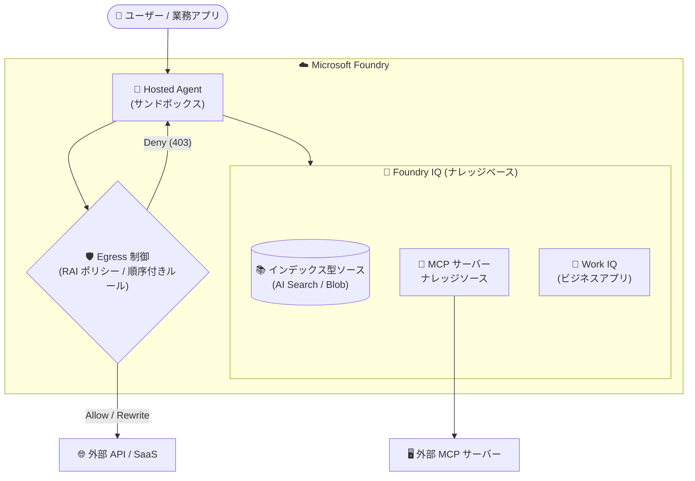

# Microsoft Foundry: ネットワーク Egress 制御・Foundry IQ MCP ナレッジソース・Work IQ Business Applications サポートが GA

**リリース日**: 2026-11-17

**サービス**: Microsoft Foundry

**機能**: ネットワーク Egress 制御 (hosted agents) / MCP サーバーナレッジソース (Foundry IQ) / Business Applications サポート (Work IQ)

**ステータス**: Launched (GA)

[このアップデートのインフォグラフィックを見る](https://takech9203.github.io/azure-news-summary/20261117-microsoft-foundry-updates.html)

## 概要

Microsoft Ignite のタイミングに合わせて、Microsoft Foundry に関する 3 つの機能が一般提供 (GA) となりました。いずれもエンタープライズでのエージェント構築・運用を支える「ガバナンス」「ナレッジ接続」「業務データ連携」に関するアップデートです。

1. **Hosted agents のネットワーク Egress 制御 (GA)**: Foundry の hosted agent が行うアウトバウンド接続を、順序付きルールで制御できるようになりました。ルールは宛先ホスト (FQDN、`*.contoso.com` のようなワイルドカード対応) でマッチし、Allow / Deny / Rewrite (別の宛先へのリダイレクト) / ヘッダー変更のアクションを適用します。ルールはエージェントの Responsible AI (RAI) ポリシーに属し、トラフィックがランタイムを出る前に Foundry 管理のエージェントサンドボックスの外側で強制されます。2026 年 7 月のプレビューを経て GA となりました。

2. **Foundry IQ の MCP サーバーナレッジソース (GA)**: Foundry IQ が Model Context Protocol (MCP) サーバーをフェデレーテッドナレッジソースとしてサポートします。MCP サーバーを読み取り専用のナレッジソースとして登録でき、Web 検索や Azure AI Search のベクトルインデックスに同期された Blob Storage の非構造化データなど、他のナレッジソースと並んでクロスソース選択に参加します。2026 年 6 月のプレビューを経て GA となりました。

3. **Work IQ の Business Applications サポート (GA)**: Work IQ の Business Applications により、開発者は Microsoft Foundry でビジネス接続型エージェントをより速く構築できます。カスタム統合作業を削減し、エンタープライズデータを実用的なワークフローに変換します。顧客のアクセス許可設定と環境制御は維持されます。2026 年 7 月のプライベートプレビュー、9 月のパブリックプレビューを経て GA となりました。

**アップデート前の課題**

- Hosted agent のアウトバウンド通信を制限する手段がプレビュー段階にとどまり、本番環境でエージェントの外部接続先を統制することが難しかった。エージェント自身のコードに依存しない通信制御の仕組みが求められていた
- Foundry IQ のナレッジソースはインデックス型 (Azure AI Search インデックス、Blob、Azure SQL など) が中心であり、社内ツールやサードパーティ API などインデックス化できないライブデータをエージェントのグラウンディングに利用するには、カスタム統合が必要だった
- ビジネスアプリケーションのデータをエージェントに接続するには、個別のカスタム統合作業が必要で、開発に時間がかかっていた

**アップデート後の改善**

- Egress 制御が GA となり、順序付きルール (先勝ち評価、既定アクション Deny/Allow、フェイルクローズ) で hosted agent の外部接続を本番品質で統制可能になった。Audit モードで拒否判定をログのみ記録して影響を確認してから Enforce モードに切り替えられる
- MCP サーバーを読み取り専用ナレッジソースとして登録するだけで、インジェストパイプラインなしにクエリ時のライブデータ取得が可能になり、他ソースと統合ランキングで結果をマージできるようになった
- Work IQ の Business Applications サポートにより、既存のビジネスアプリケーションのデータを権限制御を維持したままエージェントのワークフローに組み込めるようになった

## アーキテクチャ図



Hosted agent のすべてのアウトバウンド通信はサンドボックス外側の Egress 制御で評価され、Foundry IQ は MCP サーバーや Work IQ を含む複数のナレッジソースをクロスソース選択・統合ランキングで横断検索します。

## サービスアップデートの詳細

### 1. Hosted agents のネットワーク Egress 制御 (GA)

Microsoft Learn ドキュメントで確認できた仕様は以下のとおりです。

**ルール評価の仕組み:**

- ルールは上から順に評価され、**最初にマッチしたルールが適用される** (first match wins)
- どのルールにもマッチしない場合は既定アクションを適用。許可リスト運用なら既定 **Deny** (推奨)、拒否リスト運用なら既定 **Allow**
- Egress ポリシー適用時、エージェントランタイムが動作に必要な基盤ドメインは自動的に許可されるため、既定 Deny でもプラットフォーム接続用のルール追加は不要
- 各ルールはリクエストホストでマッチし、パスマッチも指定可能。`*.contoso.com` のようなホストワイルドカードをサポート
- アクションは **Allow** / **Deny** / **Transform** (プレビュー: リクエストを許可しヘッダーを変更) / **Rewrite** (別の宛先にリダイレクト)
- 評価は**フェイルクローズ**: ポリシーを評価できない場合、リクエストは拒否される
- ルール数の上限は **1 ポリシーあたり 480 ルール** (上限引き上げはサポートリクエストで申請可能)

**強制モード:**

| モード | 動作 | 使いどころ |
|--------|------|-----------|
| Audit | トラフィックは通常どおり流れ、拒否対象のリクエストはブロックせずログに記録 | 強制前にエージェントの接続先を観察 |
| Enforce | マッチしたルールを適用し、拒否対象のリクエストをブロック | Audit モードで検証後の本番強制 |

Audit モードが変えるのは Deny アクションの挙動のみで、Transform と Rewrite は Audit モードでも適用される点に注意が必要です。

**その他の仕様:**

- ルールはエージェントにアタッチする RAI ポリシー (`Microsoft.CognitiveServices/accounts/raiPolicies`) の `egressPolicy` プロパティに格納され、安定版 `2026-09-01` API バージョンで構成する
- ルールが拒否した場合、Egress プロキシはエージェントのネットワーククライアントに `HTTP 403` を返す
- HTTPS トラフィックの検査のため、ランタイムは Egress プロキシの CA をサンドボックスの信頼バンドルに注入する (CA は約 30 日でローテーションされるため、ピン留め・永続化は不可)
- Egress 判定はプロジェクトの Application Insights とトレースモニタリングに送信され、Foundry ポータルのプレイグラウンド (「Network egress decision」スパン) や Application Insights のログで確認できる

### 2. Foundry IQ の MCP サーバーナレッジソース (GA)

- MCP サーバーを**読み取り専用のナレッジソース**として Foundry IQ に登録できる
- MCP ナレッジソースは「リモート」ナレッジソースであり、コンテンツは Foundry IQ にインジェストされず、**クエリ時に MCP サーバーのツールを呼び出してライブデータを取得**する
- クエリ時にはナレッジベースに構成された LLM がツールを選択し、呼び出し引数を生成。Foundry IQ がツールを呼び出し、結果をランク付けされた参照として返す
- 他のナレッジソース (Web 検索、Azure AI Search ベクトルインデックスに同期した Blob の非構造化データなど) と並んで**クロスソース選択**に参加し、取得結果は統合ランキングパイプラインでスコアリング・マージ・リランクされる
- 認証オプション: `foundryConnection` (Foundry Agent Service からの呼び出し時に資格情報を注入)、`storedHeaders` (静的 API キーなど)、クエリ時のヘッダーパススルー (リクエスト単位の資格情報)
- ツールごとに出力パース (`auto` / `json` / `split` / `none`) とリランク処理 (`rerank` / `none`) を構成可能

**注意**: Azure Updates では GA と発表されていますが、執筆時点の Microsoft Learn ドキュメント (2026-11-09 版) では MCP Server knowledge source はプレビュー (REST API `2026-11-01-preview`) と記載されています。実装時は最新のドキュメントと API バージョンを確認してください。

### 3. Work IQ の Business Applications サポート (GA)

- 開発者が Microsoft Foundry でビジネス接続型エージェントをより速く構築できるようにする機能
- カスタム統合作業を削減し、エンタープライズデータを実用的なワークフローに変換する
- 顧客のアクセス許可設定と環境制御は維持される
- 提供スケジュール: プライベートプレビュー 2026 年 7 月、パブリックプレビュー 2026 年 9 月、GA 2026 年 11 月
- なお、Foundry IQ のナレッジソースとしての Work IQ (組織インテリジェンスの取得) は執筆時点の Learn ドキュメントではプレビュー扱い

## 技術仕様

| 項目 | 詳細 |
|------|------|
| Egress ルールの格納先 | RAI ポリシー (`Microsoft.CognitiveServices/accounts/raiPolicies`) の `egressPolicy` |
| Egress 構成用 API | Azure Resource Manager、安定版 `2026-09-01` |
| Egress ルール上限 | 480 ルール/ポリシー (全アクション合計、引き上げ申請可) |
| Egress ルールマッチ | ホスト (FQDN、ワイルドカード対応) + オプションでパス |
| Egress アクション | Allow / Deny / Transform (プレビュー) / Rewrite |
| Egress モード | `Enforced` (ブロック) / `Audit` (ログのみ) |
| Egress 評価方式 | 順序評価・先勝ち・フェイルクローズ |
| MCP ナレッジソース種別 | リモート (インジェストなし、クエリ時取得) |
| MCP サーバー要件 | HTTPS で Foundry IQ から到達可能、1 つ以上のツールを公開 |
| MCP の制約 | retrieval reasoning effort は `low` / `medium` のみ (`minimal` 非対応)、`alwaysQuerySource` 非対応 |
| MCP 構成ツール | Azure portal / Foundry portal / REST API / .NET / Python / Java / JavaScript SDK |

## 設定方法

### 前提条件 (Egress 制御)

1. Microsoft Foundry リソースと hosted agent
2. Foundry リソース上のガードレール (RAI ポリシー) とその完全な ARM リソース ID

### REST API での Egress ルール設定例

```bash
TOKEN=$(az account get-access-token --resource "https://management.azure.com" --query accessToken -o tsv)

curl -X PUT \
  "https://management.azure.com/subscriptions/<subscription-id>/resourceGroups/<resource-group>/providers/Microsoft.CognitiveServices/accounts/<account>/raiPolicies/<policy-name>?api-version=2026-09-01" \
  -H "Authorization: Bearer $TOKEN" \
  -H "Content-Type: application/json" \
  -d '{
    "properties": {
      "mode": "Blocking",
      "basePolicyName": "Microsoft.DefaultV2",
      "egressPolicy": {
        "mode": "Enforced",
        "defaultAction": "Deny",
        "rules": [
          {
            "name": "allow-contoso",
            "ruleType": "Fqdn",
            "match": { "host": "*.contoso.com" },
            "action": { "actionType": "Allow" }
          }
        ]
      }
    }
  }'
```

Bicep (`azd provision`) や Python SDK でも同じ RAI ポリシーを構成できます。

### Azure Portal / Foundry ポータル

1. Foundry ポータルでガードレールの **Network** コントロールを開く
2. **Egress rules** を選択し、**Outbound requests** の既定アクションを **Deny** または **Allow** に設定
3. ホストマッチ・パス・アクションを指定してルールを追加

### MCP サーバーナレッジソースの作成例 (REST)

```http
PUT {{search-endpoint}}/knowledgesources/my-mcp-server-ks?api-version=2026-11-01-preview
Authorization: Bearer {{search-access-token}}
Content-Type: application/json

{
  "name": "my-mcp-server-ks",
  "kind": "mcpServer",
  "resultsProcessing": "rerank",
  "mcpServerParameters": {
    "serverURL": "https://learn.microsoft.com/api/mcp",
    "tools": [
      {
        "name": "microsoft_docs_search",
        "outputParsing": { "kind": "auto" },
        "resultsProcessing": "none",
        "maxOutputTokens": 1000
      }
    ]
  }
}
```

作成したナレッジソースをナレッジベースに追加し、retrieve アクションまたは MCP エンドポイントで照会します。

## メリット

### ビジネス面

- エージェントの外部接続先を組織ポリシーとして統制でき、データ流出リスクやシャドー接続を低減してコンプライアンス要件に対応しやすくなる
- 社内ツールやサードパーティ API のライブデータをインジェストなしでエージェントのグラウンディングに活用でき、ナレッジ統合の開発コストを削減
- Work IQ の Business Applications サポートにより、既存のビジネスアプリケーション資産からより多くの価値を引き出せる

### 技術面

- Egress 強制はエージェントサンドボックスの外側で行われるため、エージェント自身のコードに依存しない信頼性の高い制御が可能
- Audit モード + 既定 Deny で依存先を洗い出してから Enforce に移行する段階的な導入パスが用意されている
- MCP ナレッジソースはインデックス型ソースと同じランキングパイプラインで統合され、単一の retrieve 応答で横断的な結果を得られる
- Egress 判定が Application Insights とトレースに記録され、可観測性が確保されている

## デメリット・制約事項

- **Egress 制御**: Transform ルール、シークレット参照によるヘッダー値 (`secretRef`)、Azure Policy によるガバナンスはプレビュー。Azure Policy ガバナンスは hosted agents のみ対象で、現時点では Canada Central・Spain Central・Korea Central でのプレビュー提供
- Egress 制御は prompt agents では Microsoft Copilot harness (プレビュー) 使用時のみサポートされ、その他の prompt agents やモデルデプロイには影響しない
- Egress 制御は Azure Firewall などの既存のネットワーク制御を**補完するものであり置き換えではない** (ツーリングとしての提供。宛先エンドポイントのデータ取り扱いは利用者の責任)
- RAI ポリシーへの書き込み権限はそれを使用するエージェントの挙動を変更できるため、エージェント更新権限と同等の信頼レベルで管理する必要がある
- データプレーンの Azure Policy ガバナンス変更の反映には 30〜60 分かかる
- **MCP ナレッジソース**: retrieval reasoning effort の `minimal` は非対応 (`low` / `medium` を使用)。`alwaysQuerySource` 非対応。外部ネットワーク呼び出しのため通常の検索より時間がかかる場合があり、`maxRuntimeInSeconds` の調整が推奨される。リモートソースのためバッキングインデックスがなく、citation URL は返されない
- MCP サーバーの利用にはセキュリティリスク (攻撃、連鎖障害、人間の監督の喪失など) が伴うため、サーバーの検証・承認メカニズム・モニタリングの実装が推奨される
- 利用可能リージョンは今回の発表には明記されていない (Foundry IQ は agentic retrieval 提供リージョンが前提)

## ユースケース

### ユースケース 1: コーディングエージェントを承認済みレジストリに制限

**シナリオ**: パッケージインストールやソース取得を行う hosted agent を、承認済みのパッケージレジストリとソース管理 API のみに制限したい。

**実装例**: 既定アクション Deny の許可リストを作成し、必要なレジストリ・ダウンロードホスト・ソース管理 API を Allow ルールで追加。まず Audit モードで代表的なタスクを実行し、Egress 判定を確認して不足ホストを追加してから Enforce に切り替える。

**効果**: パッケージマネージャーがリダイレクトや別のダウンロードホストを使うケースも Audit で検出でき、未承認宛先への通信を確実にブロックできる。

### ユースケース 2: エンタープライズゲートウェイ経由への強制ルーティング

**シナリオ**: 特定の外部 API への通信を社内の承認済みゲートウェイ経由にしたい。

**実装例**: Rewrite ルールでマッチしたホストをゲートウェイにリダイレクトする。非本番環境でテストしてから適用する。

**効果**: エージェントのコードを変更せずに通信経路を統制できる。

### ユースケース 3: 社内 API を MCP 経由でエージェントのナレッジに統合

**シナリオ**: Foundry IQ がネイティブ対応していない社内ツールやサードパーティ API の情報をエージェントの回答のグラウンディングに使いたい。

**実装例**: 社内システムの MCP サーバーを読み取り専用ナレッジソースとして登録し、ナレッジベースに追加。Azure AI Search インデックスや Web 検索ソースと組み合わせてクロスソース検索を構成する (テストには公開されている Microsoft Learn MCP サーバー `https://learn.microsoft.com/api/mcp` が利用可能)。

**効果**: インジェストパイプラインを構築せずにライブデータを横断検索・統合ランキングでき、ナレッジ統合の実装工数を削減できる。

## 料金

今回の発表に料金情報は含まれていません。詳細は料金ページを参照してください。

- [Microsoft Foundry の料金](https://azure.microsoft.com/pricing/details/ai-foundry/)
- [Azure AI Search の料金](https://azure.microsoft.com/pricing/details/search/)

## 利用可能リージョン

今回の発表にはリージョン情報は明記されていません。MCP ナレッジソースは agentic retrieval を提供するリージョンの Foundry IQ サービスが前提です。Egress ガードレールの Azure Policy ガバナンス (プレビュー) は Canada Central・Spain Central・Korea Central で提供されています。最新のリージョン対応状況は公式ドキュメントを確認してください。

## 関連サービス・機能

- **Azure AI Search (Foundry IQ)**: ナレッジソース・ナレッジベースの基盤。インデックス型 (Search index、Blob、Azure SQL、OneLake、SharePoint など) とリモート型 (Web、MCP サーバー、Work IQ、Fabric Data Agent など) のソースを統合
- **Application Insights**: Egress 判定のログ・トレースの送信先。ポリシーの検証と監査に利用
- **Azure Policy**: Egress ガードレールの構成ガバナンス (プレビュー)。構成とエージェント作成をチェックする (各アウトバウンドリクエストの評価は行わない)
- **Azure Firewall**: Egress 制御が補完する既存のネットワーク制御
- **Microsoft Fabric**: Fabric Data Agent / Fabric Ontology ナレッジソース (プレビュー) として Foundry IQ と連携

## 参考リンク

- [インフォグラフィック](https://takech9203.github.io/azure-news-summary/20261117-microsoft-foundry-updates.html)
- [公式アップデート: Network egress controls for hosted agents (GA)](https://azure.microsoft.com/updates?id=571821)
- [公式アップデート: MCP server knowledge sources in Foundry IQ (GA)](https://azure.microsoft.com/updates?id=563411)
- [公式アップデート: Microsoft Foundry Support for Business Applications in Work IQ (GA)](https://azure.microsoft.com/updates?id=579680)
- [Microsoft Learn: Add guardrails to a hosted agent](https://learn.microsoft.com/azure/foundry/agents/how-to/add-hosted-agent-guardrails)
- [Microsoft Learn: What is a knowledge source? (Foundry IQ)](https://learn.microsoft.com/azure/search/agentic-knowledge-source-overview)
- [Microsoft Learn: Create an MCP Server knowledge source](https://learn.microsoft.com/azure/search/agentic-knowledge-source-how-to-mcp-server)
- [Microsoft Foundry の料金](https://azure.microsoft.com/pricing/details/ai-foundry/)

## まとめ

Microsoft Foundry のエンタープライズ対応が大きく前進したアップデートです。特にネットワーク Egress 制御の GA は、hosted agent を本番運用するうえでの必須要件だった「エージェントの外部通信の統制」をプラットフォームレベルで実現するもので、Solutions Architect はエージェント導入設計時に Audit モードでの依存先洗い出し → 既定 Deny の許可リスト → Enforce 移行という段階的な導入パスを標準プラクティスとして組み込むことを推奨します。Foundry IQ の MCP ナレッジソースは、インデックス化できないライブデータソースをエージェントのグラウンディングに組み込む標準的な手段となるため、既存のカスタム RAG 統合の置き換え候補として評価する価値があります。なお、Learn ドキュメント上では一部機能 (Transform ルール、MCP ナレッジソースの API など) にプレビュー表記が残っているため、実装時は最新のドキュメントと API バージョンを必ず確認してください。

---

**タグ**: Microsoft Foundry, Foundry IQ, Work IQ, AI + Machine Learning, MCP, Network Security, AI Agents, GA, Microsoft Ignite
