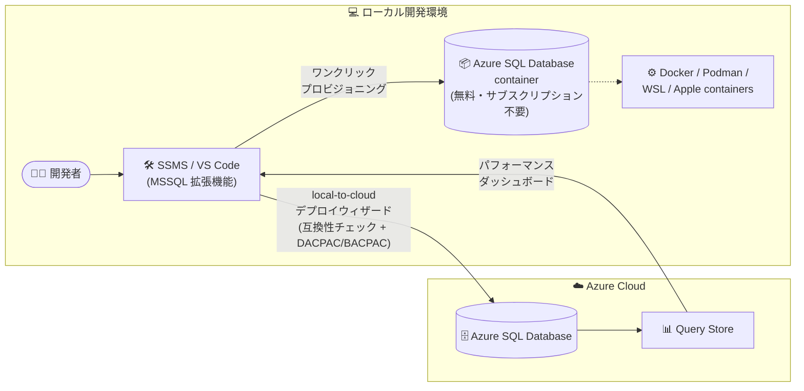

# Azure SQL Database: ローカルコンテナーと SQL 開発者ツール (SSMS / MSSQL extension for VS Code) の大型アップデート

**リリース日**: 2026-11-17

**サービス**: Azure SQL Database / SQL Server Management Studio / MSSQL extension for Visual Studio Code

**機能**: Azure SQL Database container (ローカル開発)、SSMS・VS Code からのコンテナープロビジョニング、local-to-cloud デプロイウィザード、クエリパフォーマンスダッシュボード

**ステータス**: In preview

[このアップデートのインフォグラフィックを見る](https://takech9203.github.io/azure-news-summary/20261117-mssql-vscode-sql-container-tooling.html)

## 概要

Microsoft Ignite に合わせて、Azure SQL Database のローカル開発体験を刷新する一連のアップデートがパブリックプレビューとして発表された。中核となるのは **Azure SQL Database container** で、クラウドで稼働しているものと同じ Azure SQL Database エンジンをローカルマシンのコンテナーとして実行できる。ローカル開発と CI 用途では無料で、Azure サブスクリプションもクレジットカードも不要。x64 / ARM の両アーキテクチャに対応し、初回のイメージ取得後はオフラインでも動作する。

このコンテナーを軸に、開発者ツール側の統合も同時に発表された。**SQL Server Management Studio (SSMS)** と **MSSQL extension for Visual Studio Code** の双方から、Azure SQL Database container を数秒でプロビジョニングできるようになった。VS Code の MSSQL 拡張機能 (v1.48) ではさらに、ローカルのコンテナーから新規・既存の Azure SQL Database へ移行する **local-to-cloud デプロイウィザード**と、Query Store を活用した**クエリパフォーマンスダッシュボード**が追加されている。

「ローカルで無料で開発 → 互換性チェック → クラウドへデプロイ → パフォーマンス分析・最適化」という一連の開発ライフサイクルが、VS Code / SSMS の中で完結する構成となる。

**アップデート前の課題**

- ローカルで Azure SQL Database 相当の環境を用意する手段がなく、SQL Server コンテナーイメージで代用するか、Azure 上に開発用データベースを作成する必要があった (サブスクリプションとコストが発生)
- SQL Server コンテナーは Azure SQL Database とエンジンの挙動・機能差分があり、「ローカルでは動いたがクラウドでは動かない」リスクがあった
- ローカルの開発データベースをクラウドへ移行するには、DACPAC/BACPAC の作成・デプロイを手動で行う必要があった
- クエリパフォーマンスの分析には SSMS の Query Store レポートや Azure Portal を使う必要があり、VS Code 内の開発フローから離れる必要があった

**アップデート後の改善**

- クラウドと同一の Azure SQL Database エンジンをローカル・CI で無料実行可能 (サブスクリプション・クレジットカード不要)
- SSMS / VS Code から数秒でコンテナーをプロビジョニング。ランタイム (Docker、Podman、WSL、Apple containers など) を自動検出し、コンテナーコマンドの手動実行が不要
- VS Code のウィザードがスキーマ互換性チェックから DACPAC/BACPAC の作成・デプロイ、デプロイ後の検証までをガイド付きで自動化
- Query Store ベースのパフォーマンスダッシュボードを VS Code 内で利用でき、GitHub Copilot と連携したクエリ最適化が可能

## アーキテクチャ図



SSMS / VS Code からローカルの Azure SQL Database container をプロビジョニングして開発し、デプロイウィザードでクラウドへ移行、Query Store ベースのダッシュボードでパフォーマンスを分析するという一連のフローを示す。

## サービスアップデートの詳細

### 主要機能

1. **Azure SQL Database container (ローカル実行)**
   - クラウドと同じ Azure SQL Database エンジンをローカルのコンテナーで実行
   - ローカル開発・CI 用途は無料。Azure サブスクリプション、クレジットカード、既存データベースは不要
   - x64 / ARM 両対応。初回 pull 後はオフラインで動作
   - イメージは Microsoft Container Registry (`mcr.microsoft.com/mssql/azure-sql-db-server`) で公開され、サインアップ不要
   - 既存のドライバーや ORM をそのまま利用可能で、接続文字列の変更のみでクラウドへ移行できる

2. **SSMS からの Azure SQL Database container プロビジョニング**
   - SSMS から直接、数秒で Azure SQL Database 開発環境をプロビジョニング
   - SSMS 内で無料のローカル開発体験を利用可能

3. **MSSQL extension for VS Code: コンテナープロビジョニング**
   - **Connections** の **New Deployment** から **Azure SQL Database container (Preview)** を選択
   - ウィザードがランタイム確認 → イメージダウンロード → エンジン起動 → 接続保存を自動実行
   - Docker、Podman、WSL、Apple containers などのランタイムを自動検出 (ブログでは containerd / `nerdctl` にも言及)
   - コンテナーの起動・停止・再接続・削除を VS Code から管理

4. **MSSQL extension for VS Code: local-to-cloud デプロイウィザード**
   - ローカルの Azure SQL Database container からクラウドの Azure SQL Database へ VS Code 内で直接移行
   - スキーマのみ、またはスキーマ + データのデプロイを選択可能 (拡張機能が DACPAC / BACPAC を作成・デプロイ)
   - クラウドリソース作成前に Azure SQL Database ターゲットへのスキーマ互換性チェックを実施
   - ウィザード内でサブスクリプション、リソースグループ、論理サーバー、データベースを設定し、新規・既存どちらのデータベースにも展開可能
   - デプロイ後に検証を行い、Azure SQL への接続を保存。ローカル側のデータベースとコンテナーは変更されない

5. **MSSQL extension for VS Code: クエリパフォーマンスダッシュボード**
   - Query Store の履歴データを VS Code 内に表示し、高負荷クエリの俯瞰から実行履歴・待機・実行プランへ掘り下げ可能
   - CPU、メモリグラント、実行時間、実行頻度、論理読み取りによるランキングと時間範囲コントロール
   - 以前の期間との CPU 時間・メモリグラントのベースライン比較、2 つの実行プランの並列比較
   - GitHub Copilot Chat のエージェントモードにクエリと調査コンテキストを送信してパフォーマンス評価が可能 (変更適用前に確認が必要)

6. **その他の改善 (MSSQL extension v1.48)**
   - マルチ結果グリッド (プレビュー): クエリファイル間で結果を並べて比較
   - ライブクエリ統計 (プレビュー): 実行中に行数・推定進捗・経過時間を表示
   - ネストされた接続グループ: プロジェクト・チーム・環境ごとの階層的な接続整理
   - Data API builder の改善: 再デプロイの簡素化、Docker 不要の DAB CLI ローカル実行、Microsoft Entra 認証のサインイン改善

## 技術仕様

| 項目 | 詳細 |
|------|------|
| コンテナーイメージ | `mcr.microsoft.com/mssql/azure-sql-db-server:latest` (Microsoft Container Registry) |
| 対応アーキテクチャ | x64、ARM |
| 対応コンテナーランタイム | Docker 24 以降、Podman 5.0 以降、Apple container (Apple シリコン + macOS 26 以降)、WSL コンテナー (Windows 11) |
| 対応ツール | Visual Studio Code (MSSQL 拡張機能 v1.48)、SSMS、Docker、Dev containers |
| デプロイ形式 | スキーマのみ (DACPAC) / スキーマ + データ (BACPAC) |
| パフォーマンスダッシュボードの前提 | Query Store が有効でワークロードデータが記録済みであること、読み取り権限 |
| オフライン動作 | 初回イメージ取得後はオフラインで動作可能 |

## 設定方法

### 前提条件

1. 対応コンテナーランタイムのいずれか (Docker 24+、Podman 5.0+、Apple container、WSL)
2. local-to-cloud デプロイには、稼働中のローカルデータベースとリソース作成権限を持つ Azure サブスクリプション
3. パフォーマンスダッシュボードには、Query Store が有効なデータベースと読み取り権限

### CLI (Docker の場合)

```bash
# イメージの取得 (サインアップ不要)
docker pull mcr.microsoft.com/mssql/azure-sql-db-server:latest

# 強力な SA パスワードを生成してコンテナーを起動 (macOS/Linux の例)
MSSQL_SA_PASSWORD="Aa1$(openssl rand -hex 16)"
docker run --name sqldb -e "ACCEPT_EULA=Y" \
  -e "MSSQL_SA_PASSWORD=$MSSQL_SA_PASSWORD" \
  -p 127.0.0.1:1433:1433 -d \
  mcr.microsoft.com/mssql/azure-sql-db-server:latest

# 接続確認 (結果に「Microsoft SQL Azure」と表示されれば成功)
docker exec sqldb /opt/mssql-tools18/bin/sqlcmd \
  -S localhost -U sa -P "$MSSQL_SA_PASSWORD" -C \
  -Q "SELECT @@VERSION;"
```

Podman の場合は `podman`、Apple container の場合は `container`、WSL の場合は `wslc` に読み替える。

### Visual Studio Code (MSSQL 拡張機能)

1. **コンテナー作成**: **Connections** で **New Deployment** → **Azure SQL Database container (Preview)** を選択。ウィザードがランタイム確認、イメージダウンロード、エンジン起動、接続保存を実行
2. **クラウドへのデプロイ**: **New Deployment** → **Local database to Azure SQL Database (Preview)**、またはローカルデータベースを右クリックして **Deploy database to Azure SQL (Preview)** を選択
3. **パフォーマンスダッシュボード**: データベースを右クリック → **Open Query Performance Dashboard (Preview)** を選択

## メリット

### ビジネス面

- ローカル開発・CI が無料になり、開発用 Azure SQL Database の運用コストを削減できる
- Azure サブスクリプション不要で開始でき、新規開発者や外部パートナーのオンボーディングが容易
- Azure SQL Database の無料枠 (General Purpose サーバーレス) と組み合わせ、低コストで開発からクラウド展開まで到達できる

### 技術面

- クラウドと同一エンジンのため、ローカルとクラウドの挙動差分による手戻りを削減できる
- 接続文字列の変更だけでローカルからクラウドへ移行でき、既存のドライバー・ORM がそのまま使える
- ランタイム自動検出とワンクリックプロビジョニングで、コンテナーコマンドの知識が不要
- デプロイ前のスキーマ互換性チェックにより、移行失敗を事前に検出できる
- Query Store ベースの分析と GitHub Copilot 連携により、パフォーマンスチューニングを VS Code 内で完結できる

## デメリット・制約事項

- すべてパブリックプレビュー段階であり、本番利用には GA を待つ必要がある
- ARM 環境では Full text (全文検索)、PolyBase、Extensibility が現時点で未サポート (今後対応予定)
- ローカルコンテナーはマネージド Azure サービスではないため、クラウド固有の動作 (ネットワーク、認証、スケーリングなど) はデプロイ前に Azure SQL Database 本体でテストする必要がある
- パフォーマンスダッシュボードは Query Store が有効でワークロードデータが記録されていることが前提
- 待機カテゴリの調査は、待機キャプチャが対応・有効な環境に限られる

## ユースケース

### ユースケース 1: サブスクリプション不要のローカル開発と CI

**シナリオ**: Azure SQL Database を利用するアプリケーションの開発チームが、各開発者のローカル環境と CI パイプラインでクラウドと同一エンジンのテストを無料で実行する。

**実装例**:

```bash
# CI パイプライン内で Azure SQL Database container を起動してテスト
docker run --name sqldb-ci -e "ACCEPT_EULA=Y" \
  -e "MSSQL_SA_PASSWORD=$CI_SA_PASSWORD" \
  -p 127.0.0.1:1433:1433 -d \
  mcr.microsoft.com/mssql/azure-sql-db-server:latest
# アプリケーションの統合テストを localhost:1433 に対して実行
```

**効果**: クラウド環境の挙動差分による不具合を早期に検出しつつ、開発・CI 用データベースのコストをゼロにできる。

### ユースケース 2: ローカルで構築したデータベースのクラウド展開

**シナリオ**: ローカルの Azure SQL Database container でスキーマとシードデータを構築し、検証後に Azure へ展開する。

**実装例**: VS Code でローカルデータベースを右クリック → **Deploy database to Azure SQL (Preview)** → スキーマ + データを選択 → 互換性チェック → サブスクリプション・リソースグループ・論理サーバーを指定してデプロイ。

**効果**: DACPAC/BACPAC の手動操作なしで、互換性が検証された状態でクラウドに移行できる。ローカル環境は変更されないため、継続して開発に利用できる。

### ユースケース 3: VS Code 内でのクエリパフォーマンス改善

**シナリオ**: 本番 Azure SQL Database で遅いクエリを特定し、最適化する。

**実装例**: データベースを右クリック → **Open Query Performance Dashboard (Preview)** → CPU 時間ランキングで高負荷クエリを特定 → 実行プランを比較 → GitHub Copilot Chat に調査コンテキストを送信して改善案を評価。

**効果**: SSMS や Azure Portal に切り替えることなく、開発フローの中でパフォーマンス分析から最適化までを完結できる。

## 料金

- **Azure SQL Database container (ローカル・CI 利用)**: 無料。Azure サブスクリプション不要
- **クラウドの Azure SQL Database 無料枠** (参考、サブスクリプションが必要): 月あたりコンピューティング 100,000 vCore 秒、データストレージ 32 GB/DB、バックアップ 32 GB/DB、サブスクリプションあたり最大 10 個の無料データベース

クラウド側の詳細な料金は [Azure SQL Database の料金ページ](https://azure.microsoft.com/pricing/details/azure-sql-database/) を参照。

## 関連サービス・機能

- **Azure SQL Database**: ローカルコンテナーのデプロイ先となるマネージドデータベースサービス。無料枠と組み合わせた開発フローが想定されている
- **Query Store**: パフォーマンスダッシュボードのデータ基盤。クエリの実行履歴・統計・実行プランを記録する
- **GitHub Copilot**: パフォーマンスダッシュボードから調査コンテキストを送信し、クエリ最適化の評価に利用可能
- **SQL Server Management Studio (SSMS)**: VS Code と並び、コンテナープロビジョニングに対応した管理ツール
- **Data API builder (DAB)**: MSSQL 拡張機能 v1.48 で統合が改善され、Docker 不要のローカル実行に対応
- **Dev containers**: Azure SQL Database container を組み込んだ再現可能な開発環境の構築に利用可能

## 参考リンク

- [インフォグラフィック](https://takech9203.github.io/azure-news-summary/20261117-mssql-vscode-sql-container-tooling.html)
- [公式アップデート情報: Azure SQL Database container (ローカル開発)](https://azure.microsoft.com/updates?id=579525)
- [公式アップデート情報: SSMS での Azure SQL Database container プロビジョニング](https://azure.microsoft.com/updates?id=579665)
- [公式アップデート情報: MSSQL extension for VS Code - local-to-cloud デプロイウィザード](https://azure.microsoft.com/updates?id=579014)
- [公式アップデート情報: MSSQL extension for VS Code - コンテナープロビジョニング](https://azure.microsoft.com/updates?id=579009)
- [公式アップデート情報: MSSQL extension for VS Code - パフォーマンスダッシュボード](https://azure.microsoft.com/updates?id=579004)
- [Azure SQL Dev Hub: Containers](https://microsoft.github.io/azure-sql-dev-hub/#containers)
- [Azure SQL Devs' Corner: MSSQL extension for VS Code v1.48 (November 2026)](https://devblogs.microsoft.com/azure-sql/vscode-mssql-november2026/)
- [料金ページ (Azure SQL Database)](https://azure.microsoft.com/pricing/details/azure-sql-database/)

## まとめ

Azure SQL Database のローカル開発体験を根本から変えるアップデート群である。クラウドと同一エンジンのコンテナーを無料・サブスクリプション不要で利用でき、SSMS / VS Code からのプロビジョニング、互換性チェック付きのクラウドデプロイ、Query Store ベースのパフォーマンス分析までが開発ツール内で完結する。Azure SQL Database を扱う開発チームは、SQL Server コンテナーで代用している既存のローカル開発・CI 環境を Azure SQL Database container へ置き換える検討を始めることを推奨する。ただし全機能がパブリックプレビューであり、ローカルコンテナーはマネージドサービスの完全な代替ではない点 (クラウド固有の動作は実環境での検証が必要) に留意したい。

---

**タグ**: Azure SQL Database, SSMS, VS Code, MSSQL extension, コンテナー, ローカル開発, Query Store, GitHub Copilot, In preview, Microsoft Ignite
