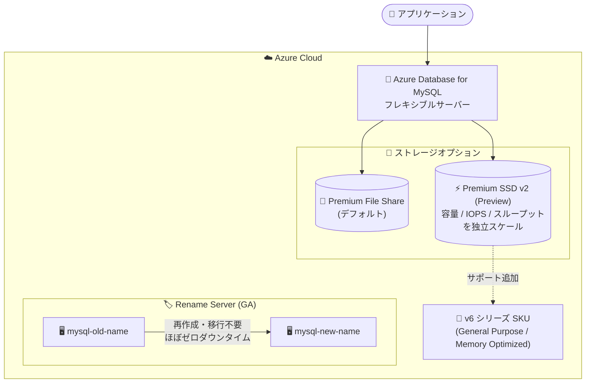

# Azure Database for MySQL: サーバー名変更 (Rename Server) の GA と Premium SSD v2 サポート (Preview)

**リリース日**: 2026-11-17

**サービス**: Azure Database for MySQL

**機能**:
- Rename Server (サーバー名変更)
- Premium SSD v2 (マネージドディスク) ストレージサポート

**ステータス**:
- Rename Server: Launched (GA)
- Premium SSD v2: In preview

[このアップデートのインフォグラフィックを見る](https://takech9203.github.io/azure-news-summary/20261117-mysql-rename-premium-ssd-v2.html)

## 概要

Microsoft Ignite に合わせて、Azure Database for MySQL (フレキシブルサーバー) に 2 つの重要なアップデートが発表された。

1 つ目は **サーバー名変更 (Rename Server) 機能の一般提供 (GA)** である。既存のサーバーインスタンスの名前を、サーバーの再作成・データ移行・アプリケーションの中断なしに変更できるようになった。新しいホスト名への移行は「ほぼゼロダウンタイム (near zero-downtime)」のパスとして提供され、組織の命名規則に沿った明確で一貫性のあるサーバー名を後からでも採用できる。

2 つ目は **Premium SSD v2 (マネージドディスク) ストレージのパブリックプレビュー** である。従来のデフォルトストレージである Premium File Share と比較して、より高いパフォーマンスと優れた価格性能比を提供し、ストレージ容量・IOPS・スループットをそれぞれ独立してスケーリングできる。また、マネージドディスクベースの新アーキテクチャにより、最新の General Purpose / Memory Optimized **v6 シリーズのコンピューティング SKU** のサポートも追加された。なお、Premium SSD v2 サポートは 2026 年 7 月にプライベートプレビューとして発表されており、今回パブリックプレビューに昇格した。

**アップデート前の課題**

- サーバー名を変更するには、サーバーを再作成してデータを移行する必要があり、アプリケーションの接続先変更やダウンタイムが発生していた
- Premium File Share ストレージでは最大 IOPS がコンピューティングサイズに紐づいており、IOPS を上げるためだけにストレージやコンピューティングを過剰にプロビジョニングするケースがあった

**アップデート後の改善**

- サーバーの再作成やデータ移行なしに、ほぼゼロダウンタイムでサーバー名を変更可能になった (GA)
- Premium SSD v2 により容量 (最大 64 TiB)・IOPS (最大 80,000)・スループット (最大 2,000 MB/s) を独立して調整でき、必要な性能にだけ支払うコスト最適化が可能になった (Preview)
- v6 シリーズのコンピューティング SKU に対応し、より大規模で要求の厳しいワークロードを優れた価格性能比で実行可能になった

## アーキテクチャ図

サーバー名変更は再作成なしで新ホスト名へ移行でき、ストレージは従来の Premium File Share に加えて Premium SSD v2 を選択できるようになった。

## サービスアップデートの詳細

### 主要機能

1. **サーバー名変更 (Rename Server) の一般提供**
   - 既存のサーバーインスタンスの名前を、サーバーの再作成なしに更新できる
   - データ移行が不要で、アプリケーションを中断せずに名前を変更可能
   - 新しいホスト名への移行をほぼゼロダウンタイムで実現
   - 組織の命名規則に沿った、明確で一貫性のあるサーバー名を後から採用できる

2. **Premium SSD v2 ストレージのパブリックプレビュー**
   - Azure マネージドディスクをベースとした新しいストレージオプション
   - Premium File Share と比較して高いパフォーマンスと優れた価格性能比を提供
   - ストレージ容量・IOPS・スループットを互いに独立してスケーリング可能
   - 定常状態のアプリケーションからバースト性のあるトランザクション集約型ワークロードまで、コストとパフォーマンスを最適化できる

3. **v6 シリーズ コンピューティング SKU のサポート (Premium SSD v2 利用時)**
   - マネージドディスクベースのアーキテクチャにより、最新の General Purpose / Memory Optimized v6 SKU ファミリーをサポート
   - より大規模で要求の厳しいワークロードを優れた価格性能比で実行可能

## 技術仕様

### Premium SSD v2 のパフォーマンスモデル

| 項目 | 範囲 | 備考 |
|------|------|------|
| ディスクサイズ | 1 GiB 〜 64 TiB | 1 GiB 単位で設定 |
| IOPS | 3,000 〜 80,000 | ディスクサイズと独立して調整可能。実効 IOPS はコンピューティングサイズの上限にも依存 |
| スループット (MB/s) | 125 〜 2,000 | ディスクサイズ・IOPS と独立して調整可能 |

### ストレージオプションの比較

| 項目 | Premium File Share (デフォルト) | Premium SSD v2 (Preview) |
|------|------|------|
| アーキテクチャ | Premium ファイル共有 | Azure マネージドディスク |
| 最大容量 | 16 TiB (Burstable / General Purpose)、32 TiB (Memory Optimized) | 64 TiB |
| IOPS | 最小 360、最大はコンピューティングサイズに依存 (事前プロビジョニング / 自動スケール IOPS) | 3,000 〜 80,000 (独立調整可能) |
| 独立スケーリング | 容量のみ (IOPS はコンピューティングサイズに連動) | 容量・IOPS・スループットを独立調整 |
| 提供状況 | 全サービスレベル・全リージョン | サポート対象のコンピューティング SKU とリージョンでプレビュー提供 |

## メリット

### ビジネス面

- サーバー名変更のためにこれまで必要だった再作成・移行プロジェクトが不要になり、運用コストとリスクを削減できる
- Premium SSD v2 では必要な容量と性能だけをプロビジョニングできるため、IOPS 確保のための過剰プロビジョニングを避けてコストを最適化できる
- 月末処理やセールイベントなど、短期間だけ高い IOPS が必要なワークロードに対して柔軟に対応できる

### 技術面

- ほぼゼロダウンタイムでの名前変更により、環境の標準化 (命名規則の統一) をアプリケーション影響なしに実施できる
- 容量・IOPS・スループットの独立スケーリングにより、ワークロード特性 (トランザクション集約型、スループット重視型) に応じたチューニングが可能
- v6 シリーズ SKU との組み合わせで、より高い性能上限を持つ構成を実現できる

## デメリット・制約事項

- Premium SSD v2 サポートは **パブリックプレビュー** であり、サポート対象のコンピューティング SKU とリージョンに限定される (GA 時期は未発表)
- ストレージをコンピューティングと独立して構成できるものの、実効 IOPS / スループットはコンピューティングサイズの上限に制限されるため、vCore 数が少ないサーバーではプロビジョニングした性能を使い切れない場合がある
- Premium File Share は高可用性、読み取りレプリカ、Accelerated Logs などフレキシブルサーバーの全機能をサポートすると明記されているが、Premium SSD v2 (プレビュー) の機能サポート範囲は公式ドキュメントで確認が必要

## ユースケース

### ユースケース 1: 命名規則の統一とリブランディング

**シナリオ**: 組織再編やプロジェクト名の変更に伴い、既存の MySQL サーバー名を新しい命名規則に合わせたい。

**効果**: サーバーの再作成やデータ移行なしに、ほぼゼロダウンタイムで新しいホスト名へ移行でき、環境全体の命名を一貫させられる。

### ユースケース 2: バースト性の高いトランザクション集約型ワークロード

**シナリオ**: 月末処理やセールイベントなど、短期間だけ大量の IOPS が必要になる EC サイトや業務システム。

**効果**: Premium SSD v2 でコンピューティングサイズに縛られずに IOPS を独立して引き上げられるため、ピーク性能を確保しつつ平常時のコストを抑えられる。

### ユースケース 3: スループット重視の大規模ワークロード

**シナリオ**: レポーティング、バルクロード、ゲームアプリケーションなど、ピーク時間帯のみ高いスループットが必要なワークロードや、Premium File Share の上限を超える大規模データベース。

**効果**: スループット (最大 2,000 MB/s) と容量 (最大 64 TiB) を必要な分だけ個別にプロビジョニングし、性能上限の高い構成を実現できる。

## 料金

料金は、コンピューティングレベル・コンピューティングサイズ・ストレージオプション・ストレージサイズの選択に基づいて課金される。Premium SSD v2 を含む最新の料金情報は公式料金ページを参照。

- [Azure Database for MySQL の料金](https://azure.microsoft.com/pricing/details/mysql/)
- [Azure 料金計算ツール](https://azure.microsoft.com/pricing/calculator/)

## 利用可能リージョン

- **Rename Server (GA)**: 公式アップデート情報にリージョンの限定は記載されていない
- **Premium SSD v2 (Preview)**: サポート対象のコンピューティング SKU とリージョンで利用可能 (具体的なリージョン一覧は公式ドキュメントを参照)

## 関連サービス・機能

- **Azure Managed Disks (Premium SSD v2)**: 本アップデートの基盤となるストレージ技術。容量・IOPS・スループットの独立スケーリングはマネージドディスクの特性に由来する
- **General Purpose / Memory Optimized v6 シリーズ SKU**: Premium SSD v2 のマネージドディスクベースアーキテクチャで新たにサポートされたコンピューティングファミリー
- **Premium File Share ストレージ**: 従来からのデフォルトストレージオプション。高可用性・読み取りレプリカ・Accelerated Logs を含む全機能をサポートし、引き続き多くの本番ワークロードに適合する

## 参考リンク

- [インフォグラフィック](https://takech9203.github.io/azure-news-summary/20261117-mysql-rename-premium-ssd-v2.html)
- [公式アップデート情報: Generally Available: Rename Server in Azure Database for MySQL](https://azure.microsoft.com/updates?id=581140)
- [公式アップデート情報: Public Preview: Azure Database for MySQL on Premium SSD v2](https://azure.microsoft.com/updates?id=577515)
- [Microsoft Learn: Azure Database for MySQL の新機能 (What's new)](https://learn.microsoft.com/azure/mysql/flexible-server/whats-new)
- [Microsoft Learn: ストレージオプション (Premium SSD v2 を含む)](https://learn.microsoft.com/en-us/azure/mysql/flexible-server/concepts-storage)
- [料金ページ](https://azure.microsoft.com/pricing/details/mysql/)

## まとめ

Azure Database for MySQL のサーバー名変更機能が GA となり、これまで再作成と移行を伴っていたサーバー名の変更が、ほぼゼロダウンタイムで実施できるようになった。命名規則の統一を検討していた環境では、すぐに活用できる実用的なアップデートである。

また、Premium SSD v2 サポートのパブリックプレビューにより、容量・IOPS・スループットの独立スケーリングと v6 シリーズ SKU のサポートが追加され、高 IOPS・高スループットが必要なワークロードの選択肢が大きく広がった。プレビュー段階のため本番適用は慎重に判断すべきだが、Premium File Share の性能上限 (特にコンピューティングサイズに連動する IOPS 上限) がボトルネックになっているワークロードでは、サポート対象 SKU・リージョンを確認のうえ評価を開始することを推奨する。

---

**タグ**: Azure Database for MySQL, Databases, Rename Server, Premium SSD v2, Managed Disks, GA, Public Preview, Microsoft Ignite
