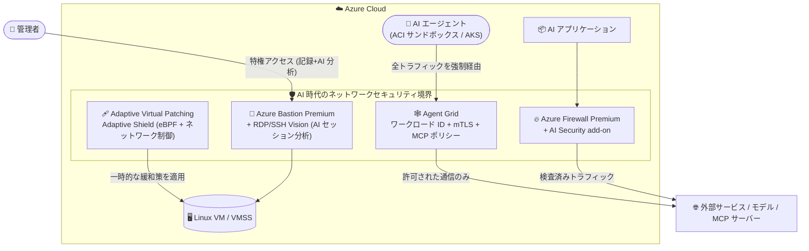

# Azure ネットワークセキュリティ: AI 時代のセキュリティ新機能 4 連発 (Agent Grid / Adaptive Virtual Patching / Firewall AI Security / Bastion Vision)

**リリース日**: 2026-11-17

**サービス**: Azure ネットワークセキュリティ (Agent Grid / Azure Adaptive Virtual Patching / Azure Firewall / Azure Bastion)

**機能**: Agent Grid、Azure Adaptive Virtual Patching、AI Security add-on for Azure Firewall Premium、Azure Bastion RDP/SSH Vision

**ステータス**: In preview

[このアップデートのインフォグラフィックを見る](https://takech9203.github.io/azure-news-summary/20261117-network-security-ai-updates.html)

## 概要

Microsoft Ignite 2026 に合わせて、Azure のネットワークセキュリティ領域で AI に関連する 4 つの新機能がパブリックプレビューとして発表された。いずれも「AI を守る (Secure AI)」と「AI で守る (Secure with AI)」の両面から、ネットワーク層のセキュリティ境界を強化するアップデートである。

1. **Agent Grid**: AI エージェントとモデル・ツール・外部サービス間の通信に、ワークロード ID ベースのゼロトラストネットワークセキュリティを提供する新しいネットワークセキュリティ機能。エージェントのコード変更やサイドカー不要で、エージェントの信頼境界の外側でポリシーを強制する。
2. **Azure Adaptive Virtual Patching**: AI がオーケストレーションする「Adaptive Shield」により、ゼロデイ脆弱性の公開からパッチ適用までの間、一時的な緩和策 (仮想パッチ) を適用してエクスポージャーを削減するサービス。初期対象は Azure 上の Linux VM / VMSS。
3. **AI Security add-on for Azure Firewall Premium**: Azure Firewall Premium 向けの新アドオン。プロンプトインジェクション対策、ネットワーク DLP、マルウェア検出、アプリケーション脆弱性保護、AI によるポリシー分析の 5 つの機能を追加する。
4. **Azure Bastion RDP/SSH Vision**: Azure Bastion Premium のセッション記録を AI が分析し、特権セッションのサマリーとリスクのあるアクティビティのインサイトを生成する機能。全録画を最初から最後まで確認する必要がなくなる。

**アップデート前の課題**

- AI エージェントの通信は多数のエージェント・モデル・MCP サーバー・ツールにまたがる多段ホップで構成され、IP アドレスベースのポリシーや各エージェント前段へのゲートウェイ配置では管理がスケールしなかった。プロンプトインジェクションで操られたエージェントが、本来呼ぶべきでないツールや宛先に正規の資格情報でアクセスするリスクがあった
- 脆弱性 (CVE) の公開からパッチ適用までの間、メンテナンスウィンドウ・再起動・テストの必要性から、ワークロードが無防備なまま露出する期間が存在した
- Azure Firewall は TLS インスペクションや IDPS を備えるものの、AI アプリ特有の脅威 (プロンプトインジェクション、AI アプリへの機密データ流出) やファイル・リクエスト内容の AI 分析には対応していなかった
- Azure Bastion Premium のセッション記録は取得できても、監査やインシデント調査では録画を人手で最初から最後まで確認する必要があった

**アップデート後の改善**

- Agent Grid により、エージェントごとの検証済みワークロード ID (SPIFFE 準拠の X.509 証明書) と mTLS トンネル、集中管理ポリシー (FQDN/URL フィルタリング、MCP ツール単位のフィルタリング、TLS インスペクション、Prompt Shields 連携) で、エージェント通信をコード変更なしに制御できるようになった
- Adaptive Virtual Patching により、CVE 公開から 48 時間以内にゼロデイがインベントリに追加され、eBPF ベースのワークロード保護とネットワーク補償制御による一時緩和策を自動 (Auto モード) または承認制 (Manual モード) で適用し、パッチ適用後にロールバックできるようになった
- Azure Firewall Premium に、CPU 最適化された小規模言語モデル (SLM) によるインラインのマルウェア・エクスプロイト検出、Microsoft Purview 連携のネットワーク DLP、Prompt Shields によるプロンプトインジェクション検出、AI によるポリシー推奨 (Policy Advisor) が追加された
- Bastion のセッション終了後に AI が自動分析し、リスクレベル・カテゴリ・重大度付きのインサイトと該当箇所 (録画のタイムスタンプ / SSH コマンド) を提示するため、調査の優先順位付けが効率化された

## アーキテクチャ図

4 つの新機能はそれぞれ異なるレイヤーでセキュリティ境界を形成する。Agent Grid は AI エージェントの東西・外向き通信、Firewall AI Security はアプリケーショントラフィック、Adaptive Virtual Patching は VM ワークロード、Bastion Vision は特権アクセスの監査をカバーする。

## サービスアップデートの詳細

### 1. Agent Grid (Public Preview)

AI エージェントを「信頼できない内部者」として扱い、Azure ネットワークプラットフォームに組み込まれた形でエージェント通信を保護する新機能。内部名称は Agent Fabric であり、ARM リソースタイプや CLI にはその名前が残る場合がある。

**主要機能**

1. **ワークロード ID とゼロトラスト通信**
   - 登録 (enroll) された各ワークロードを構成証明 (attest) し、SPIFFE 標準に基づく短命の X.509 ワークロード ID 証明書 (SVID) を発行
   - トラフィックはワークロード ID に紐づく mTLS トンネルで伝送され、認証された相手とのみ通信可能
2. **エージェントトラフィック向けの検査ポリシー**
   - FQDN フィルタリング、URL フィルタリング、TLS インスペクション
   - MCP ポリシー: 承認済み MCP サーバー上で特定のツールのみ許可 (例: read 系ツールのみ許可し write 系をブロック) する粒度の制御
   - Azure AI Content Safety (自前リソースを接続) の Prompt Shields によるプロンプトインジェクション検査
3. **信頼境界の外側での強制**
   - サンドボックスの外側でトラフィックを傍受するため、エージェントが強制を無効化・迂回できない。エージェントのコード変更、SDK 追加、サイドカー配置は不要
4. **可観測性**
   - 診断設定経由で Azure Monitor にフローログを送信。フローマップでメンバー間の接続と宛先を可視化し、ブロックされたフローのポリシーと理由を確認可能

**技術仕様**

| 項目 | 詳細 |
|------|------|
| 対応コンピューティング | ACI の AI サンドボックス (サンドボックスグループ): Public Preview / AKS (Agent Sandbox + 通常の Kubernetes ワークロード): Gated Preview |
| ワークロード ID | SPIFFE 準拠の短命 X.509 証明書 (SVID) |
| ポリシーレイヤー | L3〜L7 (ID ベースに加え IP アドレス/範囲も使用可能) |
| サービス上限 | リージョンあたり 500 グリッド、グリッドあたり 100 メンバー |
| プロトコル | TCP、IPv4 のみ (プレビュー時点) |

**主な制約 (プレビュー)**

- ACI サンドボックスグループはパブリック IP のみ対応 (VNet 統合は未対応)
- プライベート AKS クラスターは未対応。AKS クラスターは Microsoft Entra 統合を推奨
- コンピューティングリソースはグリッドと同一サブスクリプションに存在し、1 リソースは 1 グリッドにのみアタッチ可能
- Microsoft Foundry ホストエージェント、Azure Container Apps、Microsoft Copilot Studio などは未対応
- 独自 VNet 使用時は、NSG で Agent Grid ゲートウェイのロードバランサー IP への TCP ポート 15008/15009 のインバウンドを許可する必要がある

### 2. Azure Adaptive Virtual Patching (Public Preview)

CVE 公開からパッチ適用までの「エクスポージャーウィンドウ」を埋める AI 駆動の予防的セキュリティサービス。脆弱性を修正するのではなく、一時的な保護レイヤーを提供する。

**主要機能**

1. **AI オーケストレーションによる保護ループ**
   - 検出 (公開脆弱性情報の監視 + VM のソフトウェアインベントリ取得) → マッチング (CVE と照合して Finding を作成) → 推奨 (ワークロードに合わせた緩和策をランク付け) → 検証 → 適用 → 再検証の 6 ステップを継続実行
2. **3 つのセマンティックレイヤー**
   - 脆弱性とエクスプロイト条件のナレッジグラフ、顧客ワークロードとランタイムコンテキストのマップ、関連するエクスポージャーを特定しワークロード固有の緩和策を生成するオーケストレーションレイヤーを接続
3. **Adaptive Shield による強制**
   - eBPF ベースのワークロード保護とネットワークベースの補償制御を組み合わせ、明示的なマッチング条件と強制アクションを持つ AI 合成ポリシーを決定論的に実行
4. **制御性とロールバック**
   - Auto モード (自動適用) / Manual モード (承認制) を選択可能。適用済みの緩和策は (ロールバック対応のものであれば) いつでも手動ロールバック可能。全コマンドは監査証跡に記録

**技術仕様**

| 項目 | 詳細 |
|------|------|
| 対象ワークロード | Azure Linux / Ubuntu の VM および均一 (uniform) VMSS (カーネル 4.19 以降)。Windows、VMSS Flex、コンテナーは未対応 |
| エージェント | Neuron 拡張機能 (インベントリ収集と緩和策適用を担う軽量エージェント、ポーリング間隔約 15 分) |
| CVE インベントリ | 直近 3 か月の既知 CVE。ゼロデイ CVE は公開から 48 時間以内に追加 |
| 容量クォータ | サブスクリプションあたり Adaptive Shield 2 つまで。1 シールドで VM 40 台まで (VMSS は合計 40 インスタンスまで) |
| 緩和対象 | 構成した重大度しきい値以上の High / Critical の Finding |

**注意**: プレビュー期間中は本番環境ではなくテスト環境への展開が推奨されている。

### 3. AI Security add-on for Azure Firewall Premium (Public Preview)

Azure Firewall Premium を拡張するオプションのアドオン。既存 SKU を置き換えるものではなく、Premium デプロイに保護設定とポリシー分析を追加する。

**主要機能 (5 つの能力)**

1. **Prompt Threat Protection (プロンプトインジェクション保護)**
   - Azure AI Content Safety Prompt Shields を使用し、対象 AI トラフィック内の直接・間接プロンプトインジェクションを検出・ブロック。アプリケーションごとの SDK 統合は不要
2. **Network DLP (ネットワークデータ損失防止)**
   - Microsoft Purview の分類とポリシー判定と統合し、組織が許可していない宛先 (AI アプリやモデルを含む) への機密データのアップロードを防止
3. **Advanced Malware Threat Protection (マルウェア検出)**
   - ネットワークセキュリティ向けにファインチューニングされ CPU で動作するよう最適化された小規模言語モデル (SLM) が、転送中のバイナリファイルをインライン分析し、脅威が宛先に到達する前にポリシーを強制
4. **Advanced Application Threat Protection (アプリケーション脆弱性保護)**
   - 同じく SLM により、アプリケーションリクエストを分析してエクスプロイトの試みを検出し、アラート/拒否のしきい値を適用
5. **Policy Advisor (AI ポリシー分析)**
   - ファイアウォール構成と観測されたトラフィックログを組み合わせてコンテキストに基づくインサイトと推奨事項を提供。未使用ルールのレビュー、ルール順序の改善、トラフィック異常の調査に活用でき、適用前にドライランで検証可能

**技術仕様・設定の考え方**

| 項目 | 詳細 |
|------|------|
| 前提 SKU | Azure Firewall Premium (+ Premium ポリシー) |
| 設定モデル | セキュリティプロファイル (機能ごとの構成) → セキュリティプロファイルグループ (各タイプ最大 1 プロファイル) → アプリケーションルールに関連付け |
| 依存リソース | Prompt Threat Protection: マネージド ID でアクセスする Azure AI Content Safety リソース / DLP: Microsoft Purview のポリシー構成とユーザーコンテキスト / Policy Advisor: Policy Analytics |
| HTTPS 検査 | TLS インスペックションの成功とクライアントによる検査 CA 証明書の信頼が必要 |
| 構成手段 | プレビュー期間中は Azure Portal のみ (PowerShell / CLI / Terraform / REST API は未対応) |

**注意点**

- 既存ファイアウォールでアドオンを有効化する際はダウンタイムが発生するため、メンテナンス作業として計画する必要がある
- ポリシーを複数のファイアウォールに関連付けている場合、保護を構成する前にすべての関連ファイアウォールでアドオンを有効化する必要がある
- ネットワークルールはアプリケーションルールより先に処理されるため、ネットワークルールに一致したトラフィックはセキュリティプロファイルグループ付きのアプリケーションルールに到達しない点に注意

### 4. Azure Bastion RDP/SSH Vision (Public Preview)

Azure Bastion Premium のセッション記録機能の上に構築された、特権セッションの AI 支援レビュー機能。

**主要機能**

1. **RDP Vision**
   - RDP セッションのグラフィカル録画を分析し、リスクのあるアクティビティが発生した録画内の正確な時間帯を提示。タイムライン形式のインサイト (時間範囲、重大度、説明、カテゴリ、信頼度、サムネイル) から録画プレーヤーを該当箇所で起動して検証可能
2. **SSH Vision + SSH コマンドログ**
   - SSH セッションのコマンドログ (新機能のコマンドロギングで取得) を分析し、リスクのあるコマンドそのものを特定。コマンド、説明、カテゴリ、重大度、信頼度を提示
3. **セッションサマリーとリスクレベル**
   - セッションごとに要約、全体リスクレベル (High / Medium など)、重大度別インサイト数を提供し、レビューの優先順位付けを支援
4. **検出例**
   - ローカル Administrators グループへのユーザー追加、ホストファイアウォール保護の無効化、平文ファイルへのシークレット保存、SSH からの特権昇格や sudo 構成変更の試みなど

**技術仕様・前提条件**

| 項目 | 詳細 |
|------|------|
| 必要 SKU | Azure Bastion Premium |
| 前提機能 | RDP Vision: セッション記録 / SSH Vision: コマンドロギング (プレビュー) |
| ストレージ | 録画・コマンドログは顧客指定の Azure Storage アカウントコンテナーに保存 (マネージド ID 推奨 or SAS URL)。閲覧には Storage Blob Data Reader ロールが必要 |
| 分析タイミング | セッション終了後に分析 (リアルタイムのブロックやセッション切断は行わない) |
| ポータル | プレビュー期間中は https://preview.portal.azure.com から構成 |

**主な制約 (プレビュー)**

- 有効化以前に記録されたセッションは分析されない
- 検出対象の挙動はカスタマイズ不可
- セッション記録は RDP/SSH 共通設定 (片方のみの有効化は不可)
- ネイティブクライアント経由のセッションは記録・分析されない
- 構成は Azure Portal のみ対応

## メリット

### ビジネス面

- AI エージェント・AI アプリの本番導入に必要なガバナンスとコンプライアンスの枠組みをネットワーク層で確保でき、AI 活用の推進とリスク管理を両立できる
- パッチ適用の計画・テストに必要な時間を確保しながらゼロデイのリスクを低減でき、緊急パッチ対応による運用負荷と事業影響を軽減できる
- 特権セッション監査の工数を大幅に削減し、監査・調査の対応速度を向上できる

### 技術面

- Agent Grid はエージェントのコード変更・SDK・サイドカー不要で、IP ではなくワークロード ID ベースのポリシーを実現。短命ポッドやサンドボックスが混在する環境でもポリシーが安定する
- Adaptive Virtual Patching は eBPF とネットワーク制御の組み合わせで、ソフトウェア修正をインストールせずに一時緩和を適用し、パッチ後にクリーンにロールバックできる
- Firewall の SLM によるインライン検査は CPU で動作するよう最適化されており、既存の TLS インスペクション・IDPS と同じ経路で AI 由来の脅威検出を追加できる
- Bastion Vision はインサイトから元の証拠 (録画のタイムスタンプ、コマンドログ) に直接到達でき、検証可能性を保った AI 分析となっている

## デメリット・制約事項

- 4 機能ともパブリックプレビューであり、SLA はなく、機能・構成・制限は GA までに変更される可能性がある
- いずれも利用可能リージョンが限定的 (下記「利用可能リージョン」参照)。特に Firewall AI Security は 3 リージョン、Bastion Vision は 5 リージョンのみ
- Agent Grid は現時点で ACI サンドボックス (パブリック IP のみ) が中心で、AKS は Gated Preview。Container Apps や Copilot Studio などは未対応
- Adaptive Virtual Patching は Linux (Azure Linux / Ubuntu、カーネル 4.19+) 限定で、Windows 未対応。クォータも小さく (シールド 2 つ/サブスクリプション、40 VM/シールド)、プレビュー中はテスト環境での利用が推奨
- Firewall AI Security の有効化には既存ファイアウォールのダウンタイムを伴い、構成はポータルのみ。TLS インスペクションの証明書配布が前提となる
- Bastion Vision のインサイトは AI 生成であり、すべてのリスクアクティビティを検出できるとは限らない。元の録画・ログによる検証が前提

## ユースケース

### ユースケース 1: MCP ツールの最小権限化によるプロンプトインジェクション被害の封じ込め

**シナリオ**: サポートチケットを読み取り・要約するエージェントが、チケット本文に仕込まれた隠し指示 (間接プロンプトインジェクション) により、MCP サーバーの write 系ツール (ライセンス延長など) を呼び出そうとする。

**実装**: Agent Grid でエージェントを ACI サンドボックスグループごとグリッドに登録し、MCP ポリシーで該当エージェントには read 系ツールのみ許可する。あわせて FQDN/URL フィルタリングで外部送信先を制限し、Prompt Shields で悪意あるプロンプト自体を検出する。

**効果**: 正規の認証済みワークロードによる不正なツール呼び出しをネットワーク層でブロックし、試行をログとフローマップで可視化できる。

### ユースケース 2: ゼロデイ公開直後の Linux ワークロード保護

**シナリオ**: 重大な CVE が公開されたが、パッチ適用には検証とメンテナンスウィンドウが必要で、数日〜数週間の露出期間が発生する。

**実装**: 対象の Linux VM / VMSS を Adaptive Shield に Protected Resource として登録。重大度しきい値を設定し、Manual モードで推奨された緩和策を承認して適用 (または Auto モードで自動適用)。パッチ適用と修復確認後に緩和策をロールバックする。

**効果**: CVE 公開から 48 時間以内にゼロデイがインベントリに反映され、パッチ前の露出期間を一時緩和策で保護できる。

### ユースケース 3: 生成 AI アプリへの機密データ流出防止と特権アクセス監査

**シナリオ**: 社内から外部 AI サービスへのトラフィックを Azure Firewall Premium 経由とし、機密データのアップロードを防ぎつつ、VM への管理アクセスを監査可能にしたい。

**実装**: Firewall Premium で AI Security add-on を有効化し、DLP 用セキュリティプロファイルを Purview ポリシーと組み合わせてアプリケーションルールに関連付ける。管理アクセスは Bastion Premium に集約し、セッション記録 + RDP/SSH Vision を有効化する。

**効果**: 未許可の AI サービスへの機密データ送信をネットワーク層で防止し、特権セッションは AI サマリーとリスクインサイトで効率的に監査できる。

## 料金

いずれもプレビュー段階であり、確認できた料金情報は以下のとおり。

| 機能 | 料金 (プレビュー時点) |
|------|------|
| Agent Grid | 公式ドキュメント・Updates に料金情報の記載なし |
| Azure Adaptive Virtual Patching | Adaptive Shield の数と保護対象リソース数に基づく課金。プレビュー期間中は 50% の価格 |
| AI Security add-on | Azure Firewall Premium へのアドオンとしてライセンス。詳細は [Azure Firewall 料金ページ](https://azure.microsoft.com/pricing/details/azure-firewall/) を参照 |
| Bastion RDP/SSH Vision | プレビュー期間中は課金なし。Bastion Premium とストレージアカウントの標準料金は発生 ([Azure Bastion 料金ページ](https://azure.microsoft.com/pricing/details/azure-bastion/)) |

## 利用可能リージョン

| 機能 | プレビュー対応リージョン |
|------|------|
| Agent Grid | Central US, West US 2, Sweden Central, Australia East, Indonesia Central |
| Azure Adaptive Virtual Patching | North Central US, West Central US, East US 2, West US, West US 2, Australia East, Southeast Asia, **Japan East**, North Europe, Switzerland North, UAE North (ほか EUAP: East US 2 EUAP, Central US EUAP) |
| AI Security add-on for Azure Firewall Premium | East Asia, UK South, West Central US |
| Azure Bastion RDP/SSH Vision | East Asia, UK South, West Central US, Central US EUAP, East US 2 EUAP |

日本リージョンで利用できるのは現時点で Adaptive Virtual Patching (Japan East) のみ。

## 関連サービス・機能

- **Azure AI Content Safety (Prompt Shields)**: Agent Grid と Firewall AI Security の両方がプロンプトインジェクション検出に利用。顧客所有のリソースをマネージド ID 経由で接続する
- **Microsoft Purview**: Firewall AI Security のネットワーク DLP が分類とポリシー判定に利用
- **Azure Container Instances (AI サンドボックス) / Azure Kubernetes Service**: Agent Grid の対応コンピューティング環境 (AKS Agent Sandbox は Kata Containers を使用)
- **Azure Monitor / Log Analytics**: Agent Grid のフローログ、Firewall の Policy Analytics などの可観測性基盤
- **Azure Storage**: Bastion のセッション録画・SSH コマンドログの保存先
- **Azure Update Manager / パッチ管理**: Adaptive Virtual Patching は恒久的なパッチ適用を置き換えるものではなく補完する位置づけ

## 参考リンク

- [インフォグラフィック](https://takech9203.github.io/azure-news-summary/20261117-network-security-ai-updates.html)
- [公式アップデート情報: Agent Grid](https://azure.microsoft.com/updates?id=580684)
- [公式アップデート情報: Azure Adaptive Virtual Patching](https://azure.microsoft.com/updates?id=580689)
- [公式アップデート情報: AI Security add-on for Azure Firewall Premium](https://azure.microsoft.com/updates?id=580694)
- [公式アップデート情報: Azure Bastion RDP and SSH vision](https://azure.microsoft.com/updates?id=580699)
- [Microsoft Learn: What is Azure Agent Grid?](https://learn.microsoft.com/azure/agent-grid/overview)
- [Microsoft Learn: Azure Adaptive Virtual Patching overview](https://learn.microsoft.com/azure/adaptive-virtual-patching/overview)
- [Microsoft Learn: Azure Firewall AI Security concepts](https://learn.microsoft.com/azure/firewall/ai-security-concepts)
- [Microsoft Learn: Configure Azure Bastion RDP/SSH Vision](https://learn.microsoft.com/azure/bastion/rdp-ssh-vision)
- [発表ブログ: Introducing Agent Grid](https://techcommunity.microsoft.com/blog/AzureNetworkingBlog/introducing-agent-grid/4573407)
- [発表ブログ: Azure Adaptive Virtual Patching](https://techcommunity.microsoft.com/blog/AzureNetworkingBlog/the-patch-window-is-closing-put-time-back-on-the-defender%E2%80%99s-side-/4573402)
- [発表ブログ: Azure Firewall AI Security](https://techcommunity.microsoft.com/blog/AzureNetworkingBlog/secure-ai-secure-with-ai-introducing-the-next-chapter-of-azure-firewall-/4573399)
- [発表ブログ: Azure Bastion RDP/SSH Vision](https://techcommunity.microsoft.com/blog/AzureNetworkingBlog/from-recordings-to-insights-azure-bastion-brings-ai-to-privileged-session-review/4573409)
- [料金ページ: Azure Firewall](https://azure.microsoft.com/pricing/details/azure-firewall/)
- [料金ページ: Azure Bastion](https://azure.microsoft.com/pricing/details/azure-bastion/)

## まとめ

Ignite 2026 で発表されたこれら 4 つのパブリックプレビューは、Azure のネットワークセキュリティが「AI を守る」(Agent Grid、Firewall の Prompt Threat Protection / DLP) と「AI で守る」(Adaptive Virtual Patching、SLM によるインライン検査、Bastion Vision) の両輪へ進化していることを示す重要なアップデートである。特に Agent Grid は、AI エージェントをネットワーク層でゼロトラスト管理するという新しいカテゴリの機能であり、エージェントの本番導入を検討する組織は早期に評価する価値がある。いずれもプレビューでありリージョン・機能の制約が大きいため、まずはテスト環境での検証から始め、GA に向けたアーキテクチャ検討 (TLS インスペクション用証明書の配布、Purview ポリシー、Bastion Premium への移行、パッチ運用プロセスとの統合など) を進めることを推奨する。

---

**タグ**: Agent Grid, Azure Adaptive Virtual Patching, Azure Firewall, Azure Bastion, Security, Networking, AI, Zero Trust, Public Preview, Microsoft Ignite
