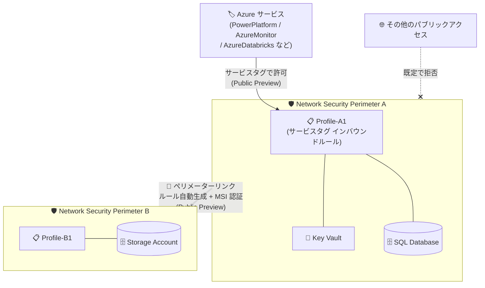

# Azure Network Security Perimeter: サービスタグによるインバウンドルールとペリメーターリンク (クロスペリメーター) のパブリックプレビュー

**リリース日**: 2026-11-17

**サービス**: Azure Network Security Perimeter (Azure Private Link)

**機能**: サービスタグによるインバウンドルール / ペリメーターリンク (クロスペリメーター接続)

**ステータス**: In preview

[このアップデートのインフォグラフィックを見る](https://takech9203.github.io/azure-news-summary/20261117-network-security-perimeter-updates.html)

## 概要

Microsoft Ignite に合わせて、Azure Network Security Perimeter (NSP) に関する 2 つの新機能がパブリックプレビューとして発表されました。NSP は、仮想ネットワーク外にデプロイされる PaaS リソース (Azure Storage、Key Vault など) の周囲に論理的なネットワーク境界を作成し、パブリックアクセスの制御とデータ流出の防止を実現するサービスです。

1 つ目は **サービスタグによるインバウンドルール** のサポートです。NSP で保護されたリソースへのインバウンドアクセスルールのソースとして、Azure サービスタグ (`PowerPlatform`、`AzureMonitor`、`AzureDatabricks` など) を指定できるようになりました。サービスタグは Azure サービスの IP アドレスプレフィックスのグループを表し、Microsoft がアドレス変更時に自動的に更新するため、IP アドレスの手動管理が不要になります。

2 つ目は **ペリメーターリンク (クロスペリメーター接続)** です。異なる NSP で保護されたリソース間のセキュアな接続を可能にする機能で、2 つの境界間に信頼関係を確立し、必要なインバウンド/アウトバウンドルールを両側に自動生成します。これにより、セキュリティ境界をまたぐ制御された通信が必要な、複雑な分散アプリケーションアーキテクチャでも NSP を安心して採用できるようになります。

**アップデート前の課題**

- Azure サービスからのインバウンドアクセスを許可するには、個別の IP ベース (CIDR) ルールを作成・維持する必要があり、サービス側の IP アドレス変更への追従が負担だった
- 異なる NSP に属するリソース間 (例: 境界 A の Key Vault から境界 B の Storage アカウントへのアクセス) の通信には、双方の境界に手動でアクセスルールを作成する必要があった
- 組織やワークロードごとに境界を分割すると境界間通信の管理が複雑になるため、大規模・分散アーキテクチャでの NSP 採用の障壁となっていた

**アップデート後の改善**

- サービスタグをインバウンドルールのソースとして指定でき、IP プレフィックスの管理を Microsoft に任せられる (リージョナルサービスタグにも対応)
- ペリメーターリンクを作成するだけで、両境界のプロファイルに必要な許可ルールが自動生成され、手動ルール作成が不要になる
- ゼロトラスト原則 (境界ベースのアクセス制御、マネージド ID 認証) を維持したまま、境界をまたぐサービス間通信を実現できる

## アーキテクチャ図

NSP で保護されたリソースへは、サービスタグベースのインバウンドルールで Azure サービスからのアクセスを許可でき、異なる NSP 間はペリメーターリンクによる信頼関係で追加ルールなしに通信できます。許可されていないパブリックアクセスは既定で拒否されます。

## サービスアップデートの詳細

### 主要機能

1. **サービスタグによるインバウンドアクセスルール**
   - NSP プロファイルのインバウンドアクセスルールのソースタイプとして「Service Tag」を選択可能
   - サービスタグは Azure サービスの IP プレフィックス群を表し、Microsoft が自動更新するため IP の手動管理が不要
   - `Storage.WestUS` のようなリージョナルサービスタグも利用可能で、より狭い範囲の許可が可能
   - 既存の CIDR (IP ベース) ルールやサブスクリプションベースルールと併用可能 (補完関係)

2. **ペリメーターリンク (クロスペリメーター接続)**
   - 2 つの独立した NSP を 1 つのリンクで接続し、信頼関係を確立
   - リンク先プロファイルに関連付けられたリソース同士は、追加の手動アクセスルールなしで通信可能 (必要なインバウンド/アウトバウンド許可ルールを両側に自動生成、ソースタイプは「Network security perimeter」)
   - リンクは対称的で、構成元が「ローカル」、接続先が「リモート」の境界となる
   - 認証にはマネージド ID (MSI) が必須
   - リンク削除は片方の管理者のみで実行可能 (リモート側の承認不要)。削除すると自動生成ルールが除去され、クロスペリメーター通信は拒否される

## 技術仕様

| 項目 | 詳細 |
|------|------|
| サービスタグ対応リソース (インバウンドルール) | Azure Key Vault、Azure Monitor、Azure AI Search、Azure Event Hubs、Azure Service Bus |
| サービスタグの例 | `PowerPlatform`、`AzureMonitor`、`AzureDatabricks`、`MicrosoftDiscoveryService`、`Storage.WestUS` |
| ペリメーターリンク対応 PaaS (プレビュー期間中) | Azure SQL Database、Azure Storage、Azure Cosmos DB、Azure Key Vault、Azure Monitor、Azure Service Bus |
| ペリメーターリンクの上限 | NSP あたり最大 10 リンク |
| ペリメーターリンクの認証 | マネージド ID (MSI) 必須 (他の認証方式は非サポート) |
| ペリメーターリンクの操作手段 | Azure Portal、CLI、PowerShell、API |
| NSP のアクセスルール種別 | インバウンド: サブスクリプションベース / IP ベース / サービスタグ、アウトバウンド: FQDN ベース |

## 設定方法

### 前提条件

1. アクティブなサブスクリプションを持つ Azure アカウント
2. 既存の Network Security Perimeter とプロファイル
3. NSP に関連付けられた Azure リソース
4. NSP のインバウンドアクセスルールを管理する権限 (RBAC 要件を参照)
5. (ペリメーターリンクをサブスクリプション間で構成する場合) リンク開始側がリモート NSP のサブスクリプションに対する **Contributor** 権限、または `Microsoft.Network/networkSecurityPerimeters/linkPerimeter/action` 権限を持つこと

### Azure Portal (サービスタグによるインバウンドルール)

1. Azure Portal で「Network security perimeters」を検索して選択
2. 構成する NSP を選択し、「Profiles」から対象プロファイルを選択
3. 「Inbound access rules」で「+ Add」を選択
4. 「Source type」で「**Service Tag**」を選択 (一覧にはサポートされている GA のサービスタグのみ表示される)
5. サービスタグ (例: `PowerPlatform`)、ルール名 (例: `Allow-PowerPlatform`)、アクション (Allow) を設定し「Add」で保存
6. プロファイルの「Inbound access rules」に新しいルールが表示されることを確認し、対象サービスからの接続テストと NSP アクセスログで疎通を検証

## メリット

### ビジネス面

- IP アドレスの手動管理が不要になり、運用負荷とルールのメンテナンスコストが削減される
- 境界をまたぐ通信が必要な複雑・分散アーキテクチャでも NSP を採用でき、組織全体でのゼロトラスト導入を促進
- アクセスログによる監査・コンプライアンス対応を維持しながら境界間連携が可能

### 技術面

- サービスタグの IP プレフィックスは Microsoft が自動更新するため、サービス側の IP 変更による接続断を回避できる
- ペリメーターリンクが必要な許可ルールを両側に自動生成し、手動ルールの設定ミスを防止
- マネージド ID 認証の強制により、境界間通信でも強力な ID ベースのアクセス制御を維持
- リージョナルサービスタグにより最小権限の原則に沿った絞り込みが可能

## デメリット・制約事項

- 両機能ともパブリックプレビューであり、SLA はなく本番ワークロードでの使用は非推奨
- **Azure Storage はサービスタグによるインバウンドアクセスルールを現時点でサポートしない** (一部シナリオは動作するように見えても、挙動が不安定になる可能性があるため使用を避ける。例外は Azure Databricks サーバーレス向けの Storage 構成)
- すべてのサービスタグがインバウンドルールとして使用できるわけではない (一覧に表示されるのはサポート対象の GA タグのみ)
- サービスタグは複数の Microsoft 所有サービスインスタンス (マルチテナントワークロードやサードパーティコードを含む場合がある) のトラフィックを含み得るため、より厳格な分離が必要な場合は IP 範囲やサブスクリプションベースのルールを検討する
- ペリメーターリンクの自動承認は同一サブスクリプション内の NSP 間のみ。サブスクリプションをまたぐ場合はリモート側への権限が必要
- ペリメーターリンクは NSP あたり最大 10 個まで
- ペリメーターリンクの削除はリモート側の承認なしに片方の管理者が実行でき、削除時点でクロスペリメーター通信が拒否される点に注意

## ユースケース

### ユースケース 1: Power Platform から NSP 保護リソースへのアクセス許可

**シナリオ**: Power Platform (Power Apps / Power Automate) から NSP で保護された Key Vault や Event Hubs にアクセスする必要があるが、Power Platform 側の IP アドレスを個別に管理したくない。

**実装例**: NSP プロファイルのインバウンドアクセスルールで Source type に「Service Tag」、タグに `PowerPlatform` を指定して許可ルール (`Allow-PowerPlatform`) を作成する。

**効果**: Microsoft が IP プレフィックスを自動更新するため、CIDR ルールの棚卸しが不要になり、IP 変更による接続障害を防げる。検証後は冗長な CIDR ルールを削除してルールセットを簡素化できる。

### ユースケース 2: 部門ごとに分離した境界間のサービス連携

**シナリオ**: 部門 A の NSP に属する Key Vault が、部門 B の NSP に属する Storage アカウントにアクセスする必要がある。双方で手動ルールを管理するのは運用負荷が高い。

**実装例**: 両 NSP のプロファイル間にペリメーターリンクを作成する (Portal / CLI / PowerShell / API)。必要なインバウンド/アウトバウンドルールが両側に自動生成され、リソース間はマネージド ID で認証して通信する。

**効果**: 境界ごとの独立したガバナンスを維持しつつ、境界間のサービス間通信をルール自動生成で安全かつ簡単に実現できる。

## 利用可能リージョン

- Network Security Perimeter 自体はすべての Azure パブリッククラウドリージョンと Azure Government リージョン (US Gov Virginia、US Gov Texas、US Gov Arizona、US DoD East、US DoD Central) で一般提供済み
- ペリメーターリンク (プレビュー) は、NSP がサポートされるすべての Azure パブリッククラウドおよび Azure Government リージョンで利用可能

## 関連サービス・機能

- **Azure Private Link**: VNet から PaaS リソースへのプライベート接続を提供。NSP はプライベートエンドポイント経由のトラフィックを明示的なルールなしで許可する
- **サービスエンドポイント (Standard)**: ネットワーク識別子 (パブリック IP / プレフィックス) を使った IaaS から PaaS へのインバウンド認可に利用
- **Azure Monitor / Log Analytics**: NSP の診断設定により境界内リソースのアクセスログを収集し、監査・コンプライアンスに活用 (Azure Monitor 自体も NSP 対応サービス)
- **マネージド ID (Microsoft Entra ID)**: ペリメーターリンク経由のサービス間通信で必須となる認証方式
- **対応 PaaS サービス**: Azure Storage、Key Vault、SQL Database、Cosmos DB、Event Hubs、Service Bus、Azure AI Search、Microsoft Foundry など (対応状況はサービスごとに GA / プレビューが異なる)

## 参考リンク

- [インフォグラフィック](https://takech9203.github.io/azure-news-summary/20261117-network-security-perimeter-updates.html)
- [公式アップデート情報: Service tags for inbound rules in network security perimeter](https://azure.microsoft.com/updates?id=579201)
- [公式アップデート情報: Perimeter link (cross perimeter) in network security perimeter](https://azure.microsoft.com/updates?id=579206)
- [Microsoft Learn: Network Security Perimeter の概要](https://learn.microsoft.com/en-us/azure/private-link/network-security-perimeter-concepts)
- [Microsoft Learn: サービスタグによるインバウンドアクセスルールの構成](https://learn.microsoft.com/en-us/azure/private-link/configure-network-security-perimeter-service-tag)
- [Microsoft Learn: ペリメーターリンクの概要](https://learn.microsoft.com/en-us/azure/private-link/perimeter-links-overview)

## まとめ

今回の 2 つのパブリックプレビューは、Network Security Perimeter の実運用における大きな課題であった「Azure サービスからのインバウンドアクセスの IP 管理」と「境界をまたぐサービス間通信」をそれぞれ解決するアップデートです。サービスタグによるインバウンドルールは IP 管理を Microsoft に委ね、ペリメーターリンクはルール自動生成とマネージド ID 必須化によりゼロトラストを維持したまま境界間連携を可能にします。NSP の導入を検討している、あるいは複数境界への分割を見送っていた組織は、Transition モードでアクセスパターンを検証した上で、これらのプレビュー機能を非本番環境で評価することを推奨します。なお、Azure Storage はサービスタグによるインバウンドルールに未対応である点、ペリメーターリンクは NSP あたり 10 個までで MSI 認証が必須である点に注意してください。

---

**タグ**: Azure Network Security Perimeter, Azure Private Link, Networking, Service Tags, Perimeter Link, Zero Trust, Public Preview, Microsoft Ignite
