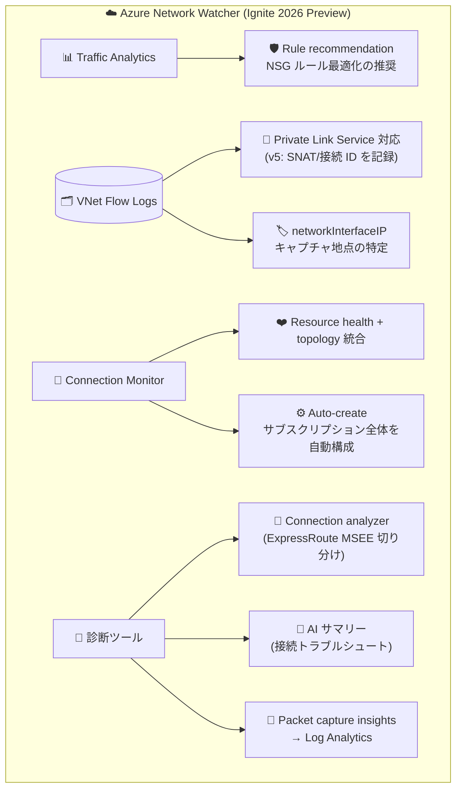

# Azure Network Watcher: Ignite 2026 発表のアップデート群 (rule recommendation、Private Link サポート、Connection Monitor 強化、AI 支援診断など 8 件)

**リリース日**: 2026-11-17

**サービス**: Azure Network Watcher

**機能**: rule recommendation / VNet Flow Logs の Private Link Service 対応・networkInterfaceIP フィールド / Connection Monitor の resource health・topology 統合・auto-create / Connection analyzer (ExpressRoute) / 接続トラブルシュートの AI サマリー / Packet capture insights

**ステータス**: In preview

[このアップデートのインフォグラフィックを見る](https://takech9203.github.io/azure-news-summary/20261117-network-watcher-updates.html)

## 概要

Microsoft Ignite 2026 に合わせて、Azure Network Watcher の 8 件のアップデートがパブリックプレビューとして一斉に発表された。いずれもネットワークの可視性・監視・トラブルシューティングを強化するもので、「セキュリティ最適化 (rule recommendation)」「フローログの可視性強化 (Private Link Service 対応、networkInterfaceIP フィールド)」「監視の効率化 (Connection Monitor の resource health/topology 統合、auto-create)」「診断の高速化 (ExpressRoute 向け Connection analyzer、接続トラブルシュートの AI サマリー、Packet capture insights)」の 4 つの軸に整理できる。

特徴的なのは AI 支援機能の導入で、接続トラブルシュートの 4 つの診断テスト結果を AI が統合的に解釈して推定原因と推奨アクションを提示する機能や、パケットキャプチャから AI が主要な所見を抽出する機能が加わった。また、VNet Flow Logs はバージョン 5 スキーマで Private Link Service (PLS) の NAT コンテキストを保持できるようになり、サービスプロバイダーがクライアントからバックエンドまでのトラフィックをエンドツーエンドで追跡できるようになった。

**アップデート前の課題**

- NSG ルールが過剰に許可的なままか、不要になっているかをトラフィック実績から判断する手段がなく、棚卸しが手作業だった
- Private Link Service 経由のトラフィックではバックエンドに PLS の SNAT アドレスしか見えず、元のクライアントや Private Endpoint 接続の特定が困難だった
- フローログからキャプチャ地点のインターフェイスを特定しにくく、リソースへの帰属付けやネクストホップの追跡が難しかった
- Connection Monitor のトポロジはパスを表示するのみで、経路上のリソースの正常性やメトリックを確認するにはタブやブレードを行き来する必要があった
- Connection Monitor のテストは接続ごとに手動作成が必要で、サブスクリプション全体の監視カバレッジ構築に多大な労力がかかった
- ExpressRoute でパケットロスが発生した際、MSEE・接続プロバイダー・自社ネットワークのどこに問題があるか切り分けられず、調査が長期化していた
- 接続トラブルシュートの 4 つの診断テスト結果を統合的に解釈するには高いネットワーク専門知識と手動の突き合わせが必要だった
- 大規模・複雑なパケットキャプチャはパケットを手動で検査する必要があり、調査に時間がかかっていた

**アップデート後の改善**

- Traffic Analytics の洞察に基づき、過剰に許可的なルールや不要なルールに対する実行可能な推奨が得られるようになった (rule recommendation)
- VNet Flow Logs バージョン 5 で PLS Link Identifier、Source NAT IP/Port が記録され、元クライアント → Private Endpoint → PLS → バックエンドの経路を相関できるようになった
- `networkInterfaceIP` フィールドによりキャプチャ地点のインターフェイス IP (IPv4/デュアルスタック対応) が記録され、リソース帰属付けとネクストホップ追跡が容易になった
- Connection Monitor のトポロジ上でリソースをクリックするだけで resource health と時系列メトリックを同一ビューで確認でき、損失・遅延との相関分析が可能になった (追加設定不要、既存テストにも適用)
- auto-create により、サブスクリプションをスコープに Application Gateway、Load Balancer、VPN/ExpressRoute ゲートウェイ、Private Endpoint、SQL Server などを自動検出し、推奨テストを月額コスト見積り付きで一括作成できるようになった
- Connection analyzer が Azure VM からオンプレミスへ iPerf テストトラフィックを流し MSEE でパケットキャプチャすることで、MSEE 起点のロスかどうかを証拠付きで判定できるようになった (pcap のダウンロードも可能)
- AI が 4 つの診断テスト結果を統合し、事象・推定原因・確信度・推奨される次のステップを単一のサマリーで提示するようになった
- Packet capture insights が AI 支援分析で主要な所見を抽出し、構造化プロトコルログを Log Analytics に取り込んで KQL で再現性のある分析ができるようになった

## アーキテクチャ図

Network Watcher の 3 つの柱 (トラフィック分析・監視・診断) それぞれに新機能が追加され、特に診断系では AI 支援による結果解釈の自動化が進んだ。

## サービスアップデートの詳細

### 主要機能

1. **Rule recommendation (Public Preview)**
   - Traffic Analytics の洞察を利用し、観測されたトラフィックパターンを分析して、過剰に許可的または不要になった可能性のあるネットワークセキュリティルールを特定する
   - 推奨内容と根拠となるトラフィック洞察をドリルダウンで確認し、必要な接続性を維持しながらセキュリティ態勢を強化する判断材料にできる

2. **VNet Flow Logs の Private Link Service 対応 (Public Preview)**
   - フローログバージョン 5 で、バックエンドのフロー詳細を保持しつつ、元ソース・PLS の変換後アドレス情報 (Source NAT IP/Port)・Private Link 接続識別子 (PLS Link Identifier) を付加する
   - Traffic Analytics もこのエンリッチされた PLS トラフィックに対応し、PLS 経由ワークロードの可視化・調査が可能
   - 注意: PLS 側 (バックエンド) でのキャプチャのみ対象で、Private Endpoint NIC でのキャプチャは現時点で未サポート

3. **VNet Flow Logs の networkInterfaceIP フィールド (Public Preview)**
   - フローがキャプチャされたネットワークインターフェイスの IP アドレス (複数可) をレコードレベルの配列として記録
   - IPv4 およびデュアルスタック (IPv4 + IPv6) に対応。特定できない場合は空配列
   - KQL では `FlowCapturedAtResourceIp` で特定のキャプチャリソース IP に関連するフローを抽出可能

4. **Connection Monitor: resource health とトポロジの統合 (Public Preview)**
   - Connection Monitor のテストトポロジ上で任意のリソースをクリックすると、resource health と時系列メトリックを同一ビューで表示
   - 例: Load Balancer を選択するとデータパス可用性、ヘルスプローブ状態、SNAT 接続数、SYN 数を、Connection Monitor 自身の損失・遅延と同じ時間軸で確認できる
   - セットアップ不要で、新規・既存すべての Connection Monitor テストで利用可能

5. **Connection Monitor: auto-create (Public Preview)**
   - サブスクリプションをスコープに選択すると、リソーストポロジをスキャンして Application Gateway、Load Balancer、VPN/ExpressRoute ゲートウェイ、仮想ネットワーク/ローカルネットワークゲートウェイ、Private Endpoint、SQL Server を検出
   - 監視価値の高い接続を推奨し、既存テストはスキップ、各推奨の根拠を提示。確認・フィルタ・編集と月額コスト見積りの上で一括作成できる
   - 手動作成を置き換えるのではなく補完する位置づけ

6. **Connection analyzer for ExpressRoute Circuit (Public Preview)**
   - Azure VM からオンプレミス宛てにオンデマンドの iPerf テストトラフィックを ExpressRoute 回線経由で送信し、MSEE (Microsoft Enterprise Edge) でパケットをキャプチャ
   - MSEE でのパケットロス発生有無と順序逆転 (out-of-order) を報告し、完全なパケットキャプチャ (pcap) をダウンロードして詳細分析も可能
   - ロスが MSEE 起点でなければ、プロバイダー側または顧客側に調査を絞り込める

7. **接続トラブルシュート結果の AI サマリー (Public Preview)**
   - 接続トラブルシュートが実行する 4 つの診断テストの結果を AI が統合的にレビューし、「何が起きているか」「推定原因」「確信度」「推奨される次のステップ」を単一の読みやすいサマリーで提示
   - 例: 宛先へのプローブが全て失敗しテスト対象ポートでサービスが待ち受けていない場合、宛先 VM を高確信度で原因として指摘し、サービス状態とポート設定の確認を提案

8. **Packet capture insights (Public Preview)**
   - AI 支援分析によりパケットキャプチャから主要な所見を抽出し、全パケットの手動検査なしに意味のあるネットワーク観察結果を提示
   - オプションで、導出された構造化プロトコルログを Log Analytics ワークスペースに取り込み、KQL による相関・検証・再現性のある分析に利用できる

## 技術仕様

| 項目 | 詳細 |
|------|------|
| 対象サービス | Azure Network Watcher (一部は Azure ExpressRoute、Azure Private Link と連携) |
| ステータス | 全 8 件とも Public Preview (2026 年 11 月) |
| 発表イベント | Microsoft Ignite |
| PLS エンリッチメント | フローログバージョン 5 が必要。flowTuples に PLS Link Identifier / Source NAT IP / Source NAT Port を追加 |
| フローログ v5 対応リージョン | 現時点では West Central US、East Asia、Canary リージョン (ドキュメント記載時点) |
| networkInterfaceIP | レコードレベルの IP アドレス文字列配列。IPv4 / デュアルスタック対応、特定不可時は空配列 |
| PowerShell 対応 | フローログバージョン 5 のプロビジョニングは Az PowerShell 16.4.0 以降 |
| resource health 統合 | 追加設定不要。新規・既存の Connection Monitor テストで利用可能 |
| auto-create の検出対象 | Application Gateway、Load Balancer、VPN/ExpressRoute ゲートウェイ、VNet/ローカルネットワークゲートウェイ、Private Endpoint、SQL Server |
| Connection analyzer | Azure VM → オンプレミス間の iPerf テスト + MSEE でのパケットキャプチャ。pcap ダウンロード可 |
| Connection Monitor 上限 | リージョン × サブスクリプションあたり 100 個、1 モニターあたり最大 20 テストグループ / 100 ソース・宛先 / 20 テスト構成 |

## 設定方法

### 前提条件

1. Network Watcher が対象リージョンで有効であること (サブスクリプション内で仮想ネットワークを作成・更新すると、そのリージョンで自動的に有効化される)
2. VNet Flow Logs を利用する機能 (PLS 対応、networkInterfaceIP、rule recommendation の基盤となる Traffic Analytics) では、仮想ネットワークと同一リージョンの Standard ストレージアカウントが必要 (Premium は非対応)
3. PLS フローログエンリッチメントにはフローログバージョン 5 のサポートが必要 (リージョン・サブスクリプションでの対応状況を要確認)
4. Traffic Analytics を利用する場合は Log Analytics ワークスペースが必要

## メリット

### ビジネス面

- ネットワークセキュリティルールの棚卸しがデータドリブンになり、セキュリティ態勢の継続的な改善を低コストで実施できる
- ExpressRoute 障害時の責任分界点の切り分けが証拠ベースになり、プロバイダーとの調整やサポート対応の時間を短縮できる
- 深いネットワーク専門知識がないチームでも AI サマリーにより診断結果に基づいて自ら対処でき、エスカレーションを削減できる
- auto-create によりサブスクリプション全体の監視カバレッジを数分で確立でき、監視の盲点 (blind spots) を削減できる

### 技術面

- PLS Link Identifier と SNAT 情報により、アドレス空間が重複する環境や共有バックエンドでも元クライアントを一意に相関できる
- networkInterfaceIP によりフローレコードの正確なリソース帰属付けとネクストホップ追跡が可能になり、マルチリソースのログ相関が容易になる
- 損失・遅延・resource health・トポロジが単一ビューに統合され、接続性問題と基盤リソースの異常の相関を即座に確認できる
- パケットキャプチャ由来の構造化プロトコルログを Log Analytics に保存することで、KQL による再現性のある事後分析が可能になる

## デメリット・制約事項

- 全機能が Public Preview であり、本番運用前に SLA や仕様変更の可能性を考慮する必要がある
- フローログバージョン 5 (PLS エンリッチメント) は現時点で対応リージョンが限定されている (West Central US、East Asia、Canary)
- PLS の Private Link コンテキストはバックエンド (PLS 側) でキャプチャされたトラフィックのみに適用され、Private Endpoint NIC でのキャプチャは未サポート
- VNet Flow Logs は Azure Container Instances、Container Apps、Functions、App Service、Azure SQL Managed Instance など一部サービスに非対応
- ExpressRoute ゲートウェイサブネットでフローログを有効にしても、VM から ExpressRoute 回線へのアウトバウンドフローや FastPath 有効時のトラフィックは記録されない (VM のサブネット/NIC 側で記録が必要)
- Connection Monitor にはリージョン・サブスクリプションあたり 100 個などの上限があり、auto-create で大量のテストを作成する際は考慮が必要

## ユースケース

### ユースケース 1: NSG ルールの定期的な棚卸しとセキュリティ態勢の強化

**シナリオ**: 長期運用してきたサブスクリプションで、過去に追加された NSG ルールのうちどれが実際に使われているか分からず、過剰に許可的なルールが放置されている。

**実装例**: VNet Flow Logs + Traffic Analytics を有効化し、rule recommendation で観測トラフィックに基づく推奨を確認。根拠となるトラフィック洞察をドリルダウンで検証した上でルールを更新する。

**効果**: 必要な接続性を維持しながら、攻撃対象領域を縮小しセキュリティ態勢を改善できる。

### ユースケース 2: Private Link Service 経由のマルチテナントサービスのトラブルシューティング

**シナリオ**: SaaS プロバイダーが Private Link Service で複数顧客にサービスを公開しており、バックエンドで見える SNAT アドレスからは問題のある顧客接続を特定できない。

**実装例**: フローログバージョン 5 を有効化し、PLS Link Identifier と Source NAT IP/Port で元クライアント → Private Endpoint → PLS → バックエンドの経路を相関分析する。

**効果**: アドレス空間が重複する環境でも元クライアントを特定でき、調査・サポート対応の時間を短縮できる。

### ユースケース 3: ExpressRoute のパケットロスの責任分界点切り分け

**シナリオ**: オンプレミスと Azure 間でパケットロスが発生しているが、MSEE・接続プロバイダー・自社ネットワークのどこが原因か不明で、調査が長期化している。

**実装例**: Connection analyzer を実行し、Azure VM からオンプレミス宛ての iPerf テストトラフィックを MSEE でキャプチャ。MSEE でのロス有無と順序逆転の報告を確認し、必要に応じて pcap をダウンロードして分析する。

**効果**: MSEE 起点のロスかどうかを証拠付きで判定でき、プロバイダー側か自社側かに調査を迅速に絞り込める。

### ユースケース 4: サブスクリプション全体の接続監視を一括構築

**シナリオ**: 多数のゲートウェイ・ロードバランサー・Private Endpoint を持つサブスクリプションで、Connection Monitor のテストを手動で 1 つずつ作成するのは現実的でない。

**実装例**: Connection Monitor の auto-create でサブスクリプションをスコープに指定し、推奨されたテストを確認・編集し、月額コスト見積りを確認した上で一括作成する。

**効果**: 監視カバレッジを数分で確立し、接続性問題の早期検出につなげられる。細かい制御が必要な接続は従来どおり手動作成で補完できる。

## 料金

Network Watcher の各機能の料金は公式料金ページを参照。VNet Flow Logs について確認できた情報は以下のとおり。

| 項目 | 料金 |
|------|------|
| VNet Flow Logs | 収集されたネットワークフローログの GB あたり課金 |
| Traffic Analytics | 処理されたデータの GB あたり課金 (無料枠なし) |
| ログの保存 | Azure Blob Storage の料金が別途適用 |

無料枠: VNet Flow Logs はサブスクリプションあたり月 5 GB の無料枠あり。

詳細: [Network Watcher 料金ページ](https://azure.microsoft.com/pricing/details/network-watcher/)

## 利用可能リージョン

- 各機能のプレビュー提供リージョンは公式ドキュメントを参照
- フローログバージョン 5 (PLS エンリッチメントに必要) は現時点で West Central US、East Asia、Canary リージョンでサポート (ドキュメント記載時点)
- VNet Flow Logs 自体は Japan East / Japan West を含む広範なリージョンで利用可能 ([対応リージョン一覧](https://learn.microsoft.com/en-us/azure/network-watcher/vnet-flow-logs-overview#availability))

## 関連サービス・機能

- **Traffic Analytics**: rule recommendation の基盤。PLS エンリッチメント済みトラフィックの可視化・分析にも対応
- **Azure Private Link**: VNet Flow Logs バージョン 5 のエンリッチメント対象。PLS 経由トラフィックのエンドツーエンド可視化を実現
- **Azure ExpressRoute**: Connection analyzer の対象。MSEE でのパケットレベルの可視化を提供
- **Azure Monitor / Log Analytics**: Packet capture insights の構造化プロトコルログの取り込み先。Traffic Analytics のワークスペースとしても利用
- **Azure Virtual Network Manager**: VNet Flow Logs はセキュリティ管理者ルールによる許可/拒否トラフィックの識別に対応

## 参考リンク

- [インフォグラフィック](https://takech9203.github.io/azure-news-summary/20261117-network-watcher-updates.html)
- [公式アップデート情報: Network Watcher rule recommendation](https://azure.microsoft.com/updates?id=578797)
- [公式アップデート情報: Network Watcher Private Link support](https://azure.microsoft.com/updates?id=578792)
- [公式アップデート情報: VNet Flow Logs networkInterfaceIP field](https://azure.microsoft.com/updates?id=578787)
- [公式アップデート情報: Resource health and topology in connection monitor tests](https://azure.microsoft.com/updates?id=578623)
- [公式アップデート情報: Connection analyzer](https://azure.microsoft.com/updates?id=578617)
- [公式アップデート情報: Auto-create connection monitor](https://azure.microsoft.com/updates?id=578611)
- [公式アップデート情報: AI summary of connection troubleshoot results](https://azure.microsoft.com/updates?id=578602)
- [公式アップデート情報: Packet capture insights](https://azure.microsoft.com/updates?id=578172)
- [Microsoft Learn: Network Watcher の概要](https://learn.microsoft.com/en-us/azure/network-watcher/network-watcher-overview)
- [Microsoft Learn: Virtual Network Flow Logs の概要](https://learn.microsoft.com/en-us/azure/network-watcher/vnet-flow-logs-overview)
- [Microsoft Learn: Traffic Analytics](https://learn.microsoft.com/en-us/azure/network-watcher/traffic-analytics)
- [料金ページ](https://azure.microsoft.com/pricing/details/network-watcher/)

## まとめ

Microsoft Ignite 2026 に合わせた Network Watcher の 8 件のパブリックプレビューは、Azure のネットワーク運用を「可視化の深化」と「診断の自動化・AI 支援」の両面から大きく前進させるものである。特に、PLS フローログエンリッチメントはマルチテナントサービスを運用するプロバイダーにとって長年の課題だったエンドツーエンドの追跡を可能にし、Connection analyzer は ExpressRoute の責任分界点切り分けを証拠ベースに変える。Solutions Architect としては、まず追加設定不要の resource health/topology 統合と AI サマリーを既存環境で試し、auto-create によるサブスクリプション全体の監視カバレッジ確立と、Traffic Analytics を有効化した上での rule recommendation によるセキュリティ棚卸しの評価を推奨する。いずれもプレビューであるため、本番適用はリージョン対応状況 (特にフローログ v5) と仕様の安定を確認してから進めたい。

---

**タグ**: Network Watcher, Networking, Management and governance, Azure Private Link, Azure ExpressRoute, Traffic Analytics, Connection Monitor, VNet Flow Logs, AI, Microsoft Ignite, In preview
