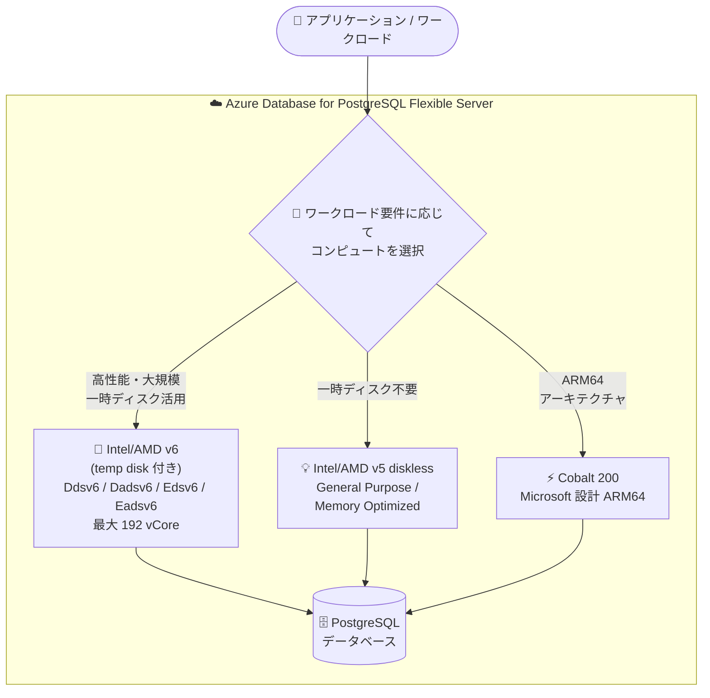

# Azure Database for PostgreSQL: 新コンピュートオプション (Intel/AMD v6・v5 diskless・Cobalt 200) が一般提供開始

**リリース日**: 2026-11-17

**サービス**: Azure Database for PostgreSQL (Flexible Server)

**機能**: Intel/AMD v6 (ローカル一時ディスク付き)、Intel/AMD v5 diskless、Cobalt 200 (ARM64) コンピュート

**ステータス**: Launched (GA)

[このアップデートのインフォグラフィックを見る](https://takech9203.github.io/azure-news-summary/20261117-postgresql-compute-v5-v6-cobalt200.html)

## 概要

Microsoft Ignite に合わせて、Azure Database for PostgreSQL Flexible Server のコンピュートポートフォリオを大幅に拡充する 3 つのアップデートが同時に一般提供 (GA) となりました。

1. **Intel/AMD v6 (ローカル一時ディスク付き)**: 最新の v6 世代コンピュートティアが GA。従来世代より高い性能・より大きなスケール・価格性能比の向上を実現しつつ、ローカル一時ディスクを必要とするワークロード向けにローカル一時ディスクを維持しています。
2. **Intel/AMD v5 diskless**: ローカル一時 SSD を含まない General Purpose および Memory Optimized の v5 SKU が GA。ローカル一時ストレージを必要としないワークロードでは、diskless 構成を選択できるようになりました。
3. **Cobalt 200**: Microsoft が設計した ARM64 ベースのコンピュート「Cobalt 200」が GA。従来の Intel / AMD (x64) に加えて、アーキテクチャの選択肢が広がりました。

いずれも Flexible Server の操作体験 (プロビジョニング、スケーリング、高可用性などの機能) はそのままに、ワークロードの要件に応じて最適なコンピュートを選択できるようにする拡張です。

**アップデート前の課題**

- v5 世代ではローカル一時ディスク付き SKU (Ddsv5/Dadsv5 など) が中心で、ローカル一時ストレージを使わないワークロードでも一時ディスク付き構成を選ぶ必要があった
- コンピュートアーキテクチャは Intel / AMD の x64 のみで、ARM64 ベースの選択肢がなかった
- General Purpose / Memory Optimized の最大 vCore 数は 96 (v5) までだった

**アップデート後の改善**

- v6 世代 (Ddsv6/Dadsv6/Edsv6/Eadsv6) により最大 192 vCore・1,832 GiB メモリまでスケール可能になり、同一 vCore 数でもサポート IOPS / I/O 帯域が向上 (例: D16ds_v6 は 33,333 IOPS / 992 MiB/sec、v5 の 25,600 IOPS / 600 MiB/sec から向上)
- ローカル一時ディスクが不要なワークロード向けに v5 diskless (General Purpose / Memory Optimized) を選択可能になった
- Microsoft 設計の ARM64 ベース Cobalt 200 により、ワークロードの互換性やインフラ要件に応じたアーキテクチャ選択 (x64 / ARM64) が可能になった

## アーキテクチャ図



Flexible Server のコンピュートポートフォリオが x64 (v5 diskless / v6 temp disk 付き) と ARM64 (Cobalt 200) に広がり、ワークロード特性に応じた選択が可能になった構成を示しています。

## サービスアップデートの詳細

### 主要機能

1. **Intel/AMD v6 コンピュートティア (ローカル一時ディスク付き) の GA**
   - v6 世代は「より高い性能・より大きなスケール・価格性能比の向上」を実現しつつ、ローカル一時ディスクを維持 (公式アナウンス原文: "higher performance, larger scale, and improved price/performance while retaining local temporary disk")
   - General Purpose は Ddsv6 / Dadsv6 シリーズ、Memory Optimized は Edsv6 / Eadsv6 シリーズ
   - v6 では新たに 128 vCore / 192 vCore の大規模 SKU が追加 (D128ds_v6、D192ds_v6、E128ds_v6、E192ds_v6)
   - E192ds_v6 は最大 1,832 GiB メモリをサポート

2. **Intel/AMD v5 diskless コンピュートの GA**
   - ローカル一時 SSD を含まない General Purpose / Memory Optimized SKU で v5 ポートフォリオを拡張
   - ワークロードがローカル一時ストレージを必要としない場合に diskless 構成を選択可能
   - Intel ベース・AMD ベースの両コンピュートファミリーで提供

3. **Cobalt 200 (ARM64) コンピュートの GA**
   - Microsoft 設計の ARM64 ベースコンピュートで Flexible Server のポートフォリオを拡張 (公式アナウンス原文: "Cobalt 200 expands the Flexible Server compute portfolio with Microsoft-designed ARM64-based compute")
   - 既存の Intel / AMD x64 コンピュートに加えて、ワークロードの互換性やインフラ要件に応じたアーキテクチャの選択肢を提供

## 技術仕様

Microsoft Learn のコンピュートオプションのドキュメントで確認できた v6 世代の代表的な仕様は以下のとおりです (ストレージは最大 64 TiB、バックアップ保持は 7〜35 日 + 長期保持最大 10 年)。

### General Purpose (vCore あたり 4 GiB メモリ)

| SKU | vCores | メモリ | 最大 IOPS | 最大 I/O 帯域 | 参考: v5 同クラス |
|------|--------|--------|-----------|---------------|-------------------|
| D2ds_v6 | 2 | 8 GiB | 4,167 | 124 MiB/sec | D2ds_v5: 3,750 IOPS / 85 MiB/sec |
| D4ds_v6 | 4 | 16 GiB | 8,333 | 248 MiB/sec | D4ds_v5: 6,400 IOPS / 145 MiB/sec |
| D16ds_v6 | 16 | 64 GiB | 33,333 | 992 MiB/sec | D16ds_v5: 25,600 IOPS / 600 MiB/sec |
| D64ds_v6 | 64 | 256 GiB | 80,000 | 1,200 MiB/sec | D64ds_v5: 80,000 IOPS / 1,200 MiB/sec |
| D128ds_v6 | 128 | 512 GiB | 80,000 | 1,200 MiB/sec | (v5 に該当 SKU なし) |
| D192ds_v6 | 192 | 768 GiB | 80,000 | 1,200 MiB/sec | (v5 に該当 SKU なし) |

### Memory Optimized (vCore あたり 6.75〜9.5 GiB メモリ)

| SKU | vCores | メモリ | 最大 IOPS | 最大 I/O 帯域 |
|------|--------|--------|-----------|---------------|
| E2ds_v6 | 2 | 16 GiB | 4,167 | 124 MiB/sec |
| E16ds_v6 | 16 | 128 GiB | 33,333 | 992 MiB/sec |
| E64ds_v6 | 64 | 512 GiB | 80,000 | 1,200 MiB/sec |
| E128ds_v6 | 128 | 1,024 GiB | 80,000 | 1,200 MiB/sec |
| E192ds_v6 | 192 | 1,832 GiB | 80,000 | 1,200 MiB/sec |

- AMD ベースは `ads` サフィックス (D2ads_v6、E2ads_v6 など)、Intel ベースは `ds` サフィックス
- v5 diskless および Cobalt 200 の個別 SKU 名・仕様は公式アナウンスには記載されていないため、最新のドキュメント ([Compute options](https://learn.microsoft.com/azure/postgresql/flexible-server/concepts-compute)) および Azure ポータルで確認してください
- 実効 IOPS / スループットはストレージティアにも依存するため、ワークロード要件に応じてストレージとインスタンスタイプの両方を選定する必要があります

## 設定方法

### 前提条件

1. Azure サブスクリプションと Azure Database for PostgreSQL Flexible Server のデプロイ権限
2. 利用したいコンピュートティアが対象リージョンで提供されていること ([リージョン一覧](https://learn.microsoft.com/azure/postgresql/overview#azure-regions) を参照)

### Azure CLI

```bash
# v6 コンピュート (例: D4ds_v6) で Flexible Server を作成
az postgres flexible-server create \
  --resource-group myResourceGroup \
  --name mypgserver \
  --tier GeneralPurpose \
  --sku-name Standard_D4ds_v6

# 既存サーバーのコンピュートを変更 (スケール)
az postgres flexible-server update \
  --resource-group myResourceGroup \
  --name mypgserver \
  --sku-name Standard_D4ds_v6
```

### Azure Portal

サーバー作成時、または既存サーバーの「設定」>「コンピューティングとストレージ」から、ティア (General Purpose / Memory Optimized) とコンピュートサイズを選択できます。作成・変更画面には選択した構成に基づく月額コストの見積もりが表示されます。

## メリット

### ビジネス面

- v6 世代は価格性能比が向上しており、同等性能をより低コストで、または同コストでより高い性能を得られる可能性がある
- diskless v5 により、ローカル一時ディスクが不要なワークロードで構成の選択肢が増える
- Cobalt 200 により ARM64 を含めたアーキテクチャ選択が可能になり、組織のインフラ戦略 (x64 / ARM64) に合わせたデータベース基盤を構築できる

### 技術面

- v6 は同一 vCore 数でもサポート IOPS / I/O 帯域が向上 (例: 16 vCore で 25,600 → 33,333 IOPS、600 → 992 MiB/sec)
- v6 で最大 192 vCore / 1,832 GiB メモリまで垂直スケールが可能になり、大規模ワークロードの集約に対応
- ローカル一時ディスク付き SKU では、一時テーブルスペースをローカル SSD に配置する構成 (`azure.enable_temp_tablespaces_on_local_ssd` パラメーター) を引き続き利用可能
- いずれの新コンピュートも Flexible Server の既存の操作体験 (スケーリング、HA など) を維持

## デメリット・制約事項

- 公式アナウンスには各オプションの対応リージョン一覧が記載されておらず、リージョンによっては利用できない場合がある (ドキュメントでの確認が必要)
- Cobalt 200 の具体的な SKU 名・vCore 構成・性能値は公式アナウンスに記載がなく、Azure ポータルまたは最新ドキュメントでの確認が必要
- 実効 IOPS / スループットの上限はストレージティアにも依存するため、コンピュートだけでなくストレージの選定も必要
- ARM64 (Cobalt 200) を選択する場合、拡張機能やワークロードの互換性要件を事前に確認することが推奨される (アナウンスでも「ワークロードの互換性に応じて選択」と言及)

## ユースケース

### ユースケース 1: 大規模 OLTP ワークロードの v6 への移行

**シナリオ**: v5 世代の D64ds_v5 で稼働中のミッションクリティカルな OLTP データベースで、ピーク時の I/O とさらなる垂直スケール余地が必要。

**実装例**:

```bash
# 既存サーバーを v6 の大規模 SKU にスケールアップ
az postgres flexible-server update \
  --resource-group myResourceGroup \
  --name mypgserver \
  --sku-name Standard_D128ds_v6
```

**効果**: v5 では最大 96 vCore だったが、v6 では 128 / 192 vCore まで拡張可能。一時テーブルスペースにローカル一時ディスクを活用するワークロードもそのまま移行できる。

### ユースケース 2: 一時ディスク不要なワークロードでの v5 diskless 採用

**シナリオ**: 一時テーブルや大規模ソートをほとんど発生させない Web アプリケーションのバックエンドデータベースで、ローカル一時ディスクを使っていない。

**効果**: ローカル一時 SSD を含まない diskless 構成を選択でき、ワークロード特性に合ったコンピュートを利用できる。

### ユースケース 3: ARM64 への標準化

**シナリオ**: アプリケーション層を ARM64 ベース (Cobalt) の VM / コンテナーで運用しており、データベース層も含めて ARM64 に統一したい。

**効果**: Cobalt 200 により、PostgreSQL Flexible Server でも Microsoft 設計の ARM64 コンピュートを選択でき、アーキテクチャの統一とインフラ要件への適合が可能になる。

## 料金

料金ページでは具体的な金額はリージョン・通貨選択により動的に表示されるため、本レポートでは料金体系の概要のみ記載します。

- **課金モデル**: vCore ベースの従量課金 (Pay as you go)、1 年 / 3 年の Savings Plan、1 年 / 3 年の予約 (Reserved Instances) に対応 (SKU により対応モデルが異なる)
- 料金ページ上では General Purpose に v6 シリーズ (Ddsv6 / Dsv6 / Dadsv6 など) と v5 シリーズ (Dsv5 / Dasv5 / Ddsv5 / Dadsv5 など) が掲載されている
- 具体的な料金は [料金ページ](https://azure.microsoft.com/pricing/details/postgresql/flexible-server/) および [Azure 料金計算ツール](https://azure.microsoft.com/pricing/calculator/) を参照

## 利用可能リージョン

公式アナウンスにリージョン一覧の記載はありません。[Azure Database for PostgreSQL のリージョン情報](https://learn.microsoft.com/azure/postgresql/overview#azure-regions) を参照してください。

## 関連サービス・機能

- **Azure Virtual Machines (Dsv6 / Ddsv6 / Cobalt シリーズ)**: Flexible Server のコンピュートティアは Azure VM シリーズに対応しており、VM 側の世代拡充がデータベースサービスにも展開された形
- **Premium SSD / Premium SSD v2 ストレージ**: 実効 IOPS / スループットはストレージティアとの組み合わせで決まるため、コンピュートとあわせた選定が必要
- **高可用性 (ゾーン冗長 HA) / 読み取りレプリカ**: 新コンピュートでも Flexible Server の既存機能をそのまま利用可能 (Flexible Server の操作体験を維持とアナウンスに明記)

## 参考リンク

- [インフォグラフィック](https://takech9203.github.io/azure-news-summary/20261117-postgresql-compute-v5-v6-cobalt200.html)
- [公式アップデート情報: Intel and AMD v6 with temp disk (GA)](https://azure.microsoft.com/updates?id=579590)
- [公式アップデート情報: Intel and AMD v5 diskless tier (GA)](https://azure.microsoft.com/updates?id=579595)
- [公式アップデート情報: Cobalt 200 compute (GA)](https://azure.microsoft.com/updates?id=579585)
- [Microsoft Learn: Compute options in Azure Database for PostgreSQL](https://learn.microsoft.com/azure/postgresql/flexible-server/concepts-compute)
- [Microsoft Learn: Azure Database for PostgreSQL のリージョン情報](https://learn.microsoft.com/azure/postgresql/overview#azure-regions)
- [料金ページ](https://azure.microsoft.com/pricing/details/postgresql/flexible-server/)

## まとめ

Azure Database for PostgreSQL Flexible Server のコンピュートポートフォリオが、v6 世代 (temp disk 付き・最大 192 vCore)、v5 diskless、そして ARM64 ベースの Cobalt 200 へと一気に拡充されました。特に v6 は同一 vCore 数でも IOPS / I/O 帯域が向上し、128 / 192 vCore の大規模 SKU が追加されたため、既存の v4 / v5 ユーザーはスケールアップ余地と価格性能比の観点で移行を検討する価値があります。新規設計では、ローカル一時ディスクの要否 (v6 temp disk 付き vs diskless) とアーキテクチャ (x64 vs ARM64 Cobalt 200) という 2 つの軸でコンピュート選定を行うことが推奨されます。Cobalt 200 と v5 diskless の具体的な SKU・リージョン展開は、Azure ポータルおよび最新の公式ドキュメントで確認してください。

---

**タグ**: Azure Database for PostgreSQL, Flexible Server, Compute, v6, v5 diskless, Cobalt 200, ARM64, GA, Microsoft Ignite, Databases
