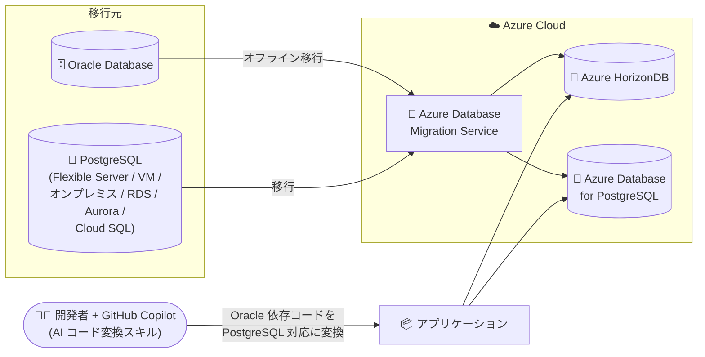

# Azure Database Migration Service: Oracle / PostgreSQL から Azure HorizonDB・Azure Database for PostgreSQL への移行サポート (Public Preview)

**リリース日**: 2026-11-17

**サービス**: Azure Database Migration Service / Azure HorizonDB / Azure Database for PostgreSQL

**機能**: Oracle および PostgreSQL ワークロードの Azure HorizonDB / Azure Database for PostgreSQL への移行サポート

**ステータス**: In preview

[このアップデートのインフォグラフィックを見る](https://takech9203.github.io/azure-news-summary/20261117-postgresql-horizondb-migration-dms.html)

## 概要

Microsoft Ignite 2026 に合わせて、Azure Database Migration Service (DMS) を中心とした Oracle / PostgreSQL データベースの移行に関する 5 つのアップデートが Public Preview として発表された。いずれも、Oracle や各種 PostgreSQL 環境から Azure HorizonDB および Azure Database for PostgreSQL へのモダナイゼーションを、カスタムの移行基盤を構築することなくマネージドな体験で実現するものである。

発表されたアップデートは以下の 5 件。

1. **Oracle → Azure Database for PostgreSQL** のオフラインデータ移行 (DMS)
2. **Oracle → Azure HorizonDB** のデータ移行 (DMS)
3. **Azure Database for PostgreSQL → Azure HorizonDB** の移行 (DMS V2 アーキテクチャの拡張)
4. **各種 PostgreSQL サーバー → Azure HorizonDB** の移行 (Azure portal のガイド付きエクスペリエンス)
5. **AI 支援による Oracle → PostgreSQL アプリケーションコード変換** (GitHub Copilot CLI / VS Code プラグイン)

Azure HorizonDB はミッションクリティカルかつ AI 対応ワークロード向けのフルマネージド PostgreSQL 互換データベースサービスであり、今回のアップデートにより DMS のターゲットとして正式にサポートされた。また、データ移行だけでなく、AI 支援によるアプリケーションコード変換 (Postgres Skills プラグイン) も提供され、スキーマ変換・データ移行・アプリケーション変換というエンドツーエンドの移行ワークフローが揃った形となる。

**アップデート前の課題**

- Oracle から PostgreSQL 系サービスへのデータ移行には、カスタムのデータ移動プロセスを独自に構築・管理する必要があった
- Azure HorizonDB への移行経路が DMS でサポートされておらず、既存の Azure Database for PostgreSQL やオンプレミス・他クラウドの PostgreSQL から HorizonDB へ移行する標準的な手段がなかった
- Oracle 固有のアプリケーションコード (SQL、ドライバー、接続設定など) の PostgreSQL 対応は手作業での書き換えが中心で、工数が大きかった

**アップデート後の改善**

- DMS がソース/ターゲットの接続検証、スキーマ選択、移行コンピューティングのオンデマンドプロビジョニング、データ転送、進捗監視までを単一のエクスペリエンスでオーケストレーションする
- Azure HorizonDB が DMS のサポートターゲットに追加され、Azure Database for PostgreSQL Flexible Server、Azure VM / オンプレミスの PostgreSQL、Amazon RDS / Aurora for PostgreSQL、Google Cloud SQL for PostgreSQL などから移行できるようになった
- Postgres Skills プラグインの AI 支援スキルにより、Oracle 依存コードの評価 (assess) と変換 (convert) を GitHub Copilot (VS Code / CLI) で実行でき、開発者がレビュー・検証したうえで変更を受け入れられる

## アーキテクチャ図



DMS が Oracle / PostgreSQL ソースと Azure HorizonDB / Azure Database for PostgreSQL ターゲットの間に位置し、並列ワーカーによるデータコピーと進捗監視を担う。アプリケーションコードの Oracle 依存部分は GitHub Copilot 経由の AI 支援スキルで変換する。

## サービスアップデートの詳細

### 主要機能

1. **Oracle → Azure Database for PostgreSQL のデータ移行 (Public Preview)**
   - DMS が Oracle から Azure Database for PostgreSQL Flexible Server へのオフラインデータ移行をサポート
   - ソース/ターゲット接続の構成、移行対象スキーマの選択、データ転送の開始、移行ステータスの追跡を単一のエクスペリエンスで実行できる
   - スキーマ変換は DMS の対象外。事前に VS Code の PostgreSQL 拡張機能に含まれる Oracle スキーマ変換ツールなどでスキーマを変換・展開しておく
   - 移行ワーカーが複数接続で Oracle の一貫した特定時点スナップショットを並列に読み取り、ターゲットへ並列書き込みする

2. **Oracle → Azure HorizonDB のデータ移行 (Public Preview)**
   - 同様の DMS エクスペリエンスで、Oracle から Azure HorizonDB へのデータ移行をサポート
   - スキーマ変換ツールで Oracle スキーマを変換した後、DMS でデータを HorizonDB に移行する

3. **Azure Database for PostgreSQL → Azure HorizonDB の移行 (Public Preview)**
   - DMS V2 アーキテクチャが HorizonDB をサポート対象の PostgreSQL ターゲットとして拡張された
   - Azure portal またはコマンドラインから移行を開始・管理できる
   - DMS がソース/ターゲットの接続検証、データベースオブジェクトの検出、分離された移行コンピューティングのオンデマンドプロビジョニング、初期データコピー、オンライン移行時の継続的同期、進捗監視、エラー処理、キャンセル、計画的カットオーバーまでをオーケストレーション
   - 移行の状態と操作履歴は中央で永続化され、サポートチームも含めて一貫した可視性を得られる

4. **各種 PostgreSQL サーバー → Azure HorizonDB の移行 (Public Preview)**
   - Azure portal ベースのガイド付きエクスペリエンスで、サポートされる PostgreSQL ワークロードを HorizonDB へ移行できる
   - 対応ソース: Azure Database for PostgreSQL Flexible Server、Azure VM 上やオンプレミスのセルフマネージド PostgreSQL、Amazon RDS for PostgreSQL、Amazon Aurora for PostgreSQL、Google Cloud SQL for PostgreSQL、その他互換環境
   - ソース/ターゲットの接続、データベース選択、移行監視を簡素化する

5. **AI 支援による Oracle → PostgreSQL アプリケーションコード変換 (Public Preview)**
   - Postgres Skills マーケットプレースの `postgres-skills` プラグインに含まれる Oracle アプリケーション変換スキルとして提供
   - GitHub Copilot (Visual Studio Code / Copilot CLI) から利用でき、Modernize CLI の既存のモダナイゼーションワークフローからも利用可能
   - 2 つのワークフローを提供: **コードベース評価 (assess)** で Oracle 固有の依存関係と必要な変更を特定し、**コード変換 (convert)** で PostgreSQL 互換コードへの変更案を生成
   - 評価はデータベース読み取り専用で、ソース編集には承認が必要。開発者は提案された変更をレビュー・検証したうえで受け入れられる
   - オプションでユニットテスト生成、Docker と合成データを使った PostgreSQL 統合テスト生成、テスト修復なども実行できる
   - 対応アプリケーション: Java、.NET、Python、C、C++

## 技術仕様

| 項目 | 詳細 |
|------|------|
| 移行モード (Oracle ソース) | オフラインのみ (特定時点スナップショットのコピー。スナップショット後の変更は同期されない) |
| 移行モード (PostgreSQL → HorizonDB) | オフライン移行手順をドキュメントで提供 (DMS V2 はオンライン移行時の継続的同期・計画的カットオーバーもオーケストレーション対象) |
| 対応ターゲット | Azure Database for PostgreSQL Flexible Server、Azure HorizonDB |
| 対応 PostgreSQL ソース (HorizonDB 向け) | Flexible Server、Azure VM / オンプレミス PostgreSQL、Amazon RDS / Aurora for PostgreSQL、Google Cloud SQL for PostgreSQL、その他互換環境 |
| 接続方法 | パブリック接続 (DMS の送信 IP をファイアウォールで許可) / プライベート接続 (VNet ピアリング、プライベートエンドポイント、VPN / ExpressRoute) |
| 接続の暗号化 (Oracle) | TCPS (TLS) を推奨。TCP も利用可能だが TLS 暗号化は提供されない |
| スキーマ変換 | DMS の対象外。VS Code PostgreSQL 拡張機能の Oracle スキーマ変換ツールなどで事前に実施 |
| ユーザー/ロールの移行 (PostgreSQL → HorizonDB) | `pg_dumpall --roles-only --no-role-passwords` でエクスポートし、ターゲットへ `psql` で復元 (パスワードは別途設定) |
| AI コード変換の動作環境 | VS Code (PostgreSQL 拡張 + Copilot) / GitHub Copilot CLI。Node.js 22 以上、Docker (統合テスト用)、GitHub Copilot Business / Enterprise |

## 設定方法

### 前提条件

1. ターゲット (Azure HorizonDB クラスターまたは Azure Database for PostgreSQL Flexible Server) をプロビジョニング済みであること
2. ソースで拡張機能を使用している場合、ターゲットでのサポートを確認し、許可リストへの追加と `shared_preload_libraries` の構成を完了していること (HorizonDB)
3. DMS からソース/ターゲットへのネットワーク到達性 (パブリック IP 許可リストまたはプライベート接続、名前解決、ポート 5432 等へのアクセス) が確保されていること
4. Oracle ソースの場合、スキーマ変換ツールで変換済みのスキーマをターゲットに展開済みであること

### Azure Portal (PostgreSQL → HorizonDB の例)

1. Azure portal で **Azure Database Migration Service** を開き **Create** を選択。ソースサーバータイプに **PostgreSQL**、ターゲットサーバータイプに **Azure HorizonDB** を選択
2. **Basics** タブでサブスクリプション、リソースグループ、リージョン (レイテンシ最小化のためソース/ターゲットと同一リージョンを推奨)、移行サービス名を入力して作成
3. ユーザー/ロールを `pg_dumpall --roles-only --no-role-passwords` でエクスポートし、内容をレビューのうえ HorizonDB に復元

   ```bash
   pg_dumpall --roles-only --no-role-passwords --host=<source-host> --port=5432 --username=<source-admin> --file=roles.sql
   psql "host=<horizondb-host> port=5432 dbname=postgres user=<target-admin> sslmode=require" --file=roles.sql
   ```

4. DMS リソースで **New migration** を選択し、ソース/ターゲットと移行モード (**Offline**) を指定。ソース・ターゲットそれぞれで接続情報を入力し **Test connection** で検証
5. **Databases** タブで移行対象データベースを選択し、ソースへの書き込みと定期ジョブを停止したうえで移行を開始。データコピー完了まで監視する
6. 移行後、ロールメンバーシップ・権限・所有権の適用、監視/アラートの再作成、検証 (オブジェクト、行数、セキュリティ、アプリケーション動作) を実施し、接続文字列を切り替えてカットオーバー

### AI コード変換 (GitHub Copilot CLI の例)

```shell
# Postgres Skills マーケットプレースの登録とプラグインのインストール
copilot plugin marketplace add microsoft/postgres-skills
copilot plugin install postgres-skills@postgres-skills
```

```text
# Copilot セッション内: まず評価、レビュー後に変換
/migrate-oracle-application mode=assess codebase=. postgres-connection=my-profile database=my_database schema=app
/migrate-oracle-application mode=convert codebase=. postgres-connection=my-profile database=my_database schema=app
```

## メリット

### ビジネス面

- Oracle からのデータベースモダナイゼーション (ライセンスコスト削減、PostgreSQL エコシステムへの移行) の障壁が下がる
- 移行基盤の構築・運用が不要になり、移行プロジェクトの期間とコストを削減できる
- AI 支援によるアプリケーションコード変換で、移行の中で最も工数のかかるアプリケーション改修を加速できる
- Amazon RDS / Aurora、Google Cloud SQL などの他クラウドからの移行経路も提供され、Azure への集約がしやすくなる

### 技術面

- 接続検証、オブジェクト検出、並列データコピー、進捗監視、エラー処理までを DMS が一括でオーケストレーション
- 移行状態と操作履歴が中央で永続化され、移行ライフサイクル全体で一貫した可視性を確保
- パブリック/プライベート両方の接続オプションに対応し、既存のネットワーク要件に合わせられる
- AI コード変換は評価 → レビュー → 変換の段階的ワークフローで、変更はすべて開発者が承認してから適用される

## デメリット・制約事項

- すべて Public Preview であり、本番移行の前にリージョン可用性、サポートされるソースバージョン、ネットワークオプション、拡張機能の互換性、機能制限を確認する必要がある
- Oracle ソースの移行はオフラインのみ。スナップショット取得後のソース変更は同期されないため、コピー・検証・切り替えが完了するまでアプリケーションを停止する必要がある
- DMS はデータ移動のみを担当し、スキーマ変換・アプリケーション変換は別ツール (VS Code PostgreSQL 拡張のスキーマ変換ツール、AI コード変換スキル) で事前・並行して実施する必要がある
- ロールのエクスポートにパスワードは含まれず、復元後に別途設定が必要
- AI 支援コード変換は誤った・不完全な変更を生成する可能性があり、ビルド成功や変換レポートは本番準備完了を意味しない。機能・統合・性能テストによる検証が必須
- AI コード変換には GitHub Copilot の有料サブスクリプション (Business / Enterprise)、Node.js 22 以上、Docker などの前提条件がある

## 料金

今回のアナウンスおよび確認したドキュメントには、これらのプレビュー機能に固有の料金情報は記載されていない。詳細は各料金ページを参照。

- [Azure Database Migration Service の料金](https://azure.microsoft.com/pricing/details/database-migration/)
- [Azure Database for PostgreSQL の料金](https://azure.microsoft.com/pricing/details/postgresql/)

## 関連サービス・機能

- **Azure HorizonDB**: ミッションクリティカル・AI 対応ワークロード向けのフルマネージド PostgreSQL 互換データベース。今回 DMS のターゲットとして追加された
- **Azure Database for PostgreSQL Flexible Server**: Oracle 移行のターゲットであると同時に、HorizonDB への移行ソースにもなる
- **VS Code PostgreSQL 拡張機能 (Oracle スキーマ変換ツール)**: DMS でのデータ移行前に Oracle スキーマを PostgreSQL 互換に変換する
- **GitHub Copilot / Postgres Skills プラグイン**: AI 支援による Oracle 依存アプリケーションコードの評価・変換を提供
- **Modernize CLI (GitHub Copilot app modernization)**: 既存のモダナイゼーションワークフローから Oracle → PostgreSQL コード変換スキルを利用できる

## 参考リンク

- [インフォグラフィック](https://takech9203.github.io/azure-news-summary/20261117-postgresql-horizondb-migration-dms.html)
- [公式アップデート情報: Migrate Azure Database for PostgreSQL to Azure HorizonDB with DMS](https://azure.microsoft.com/updates?id=579612)
- [公式アップデート情報: Migrate Oracle databases to Azure Database for PostgreSQL using DMS](https://azure.microsoft.com/updates?id=579607)
- [公式アップデート情報: AI Assisted Oracle-to-PostgreSQL Application Code Migration](https://azure.microsoft.com/updates?id=579231)
- [公式アップデート情報: Migrate Oracle databases to Azure HorizonDB using DMS](https://azure.microsoft.com/updates?id=579226)
- [公式アップデート情報: Migrate PostgreSQL servers to Azure HorizonDB](https://azure.microsoft.com/updates?id=579564)
- [Microsoft Learn: Migrate PostgreSQL to Azure HorizonDB (DMS)](https://learn.microsoft.com/en-us/azure/horizondb/migrate/how-to-migrate-postgresql-using-database-migration-service)
- [Microsoft Learn: Oracle to Azure Database for PostgreSQL Data Migration overview](https://learn.microsoft.com/en-us/azure/postgresql/migrate/oracle-data-migration/data-migration-overview)
- [Microsoft Learn: Oracle to PostgreSQL Application Conversion overview](https://learn.microsoft.com/en-us/azure/postgresql/migrate/oracle-conversions-application/app-conversions-overview)
- [料金ページ: Azure Database Migration Service](https://azure.microsoft.com/pricing/details/database-migration/)

## まとめ

Microsoft Ignite 2026 に合わせて、Oracle / PostgreSQL から Azure HorizonDB・Azure Database for PostgreSQL への移行経路が DMS で一気に拡充された。スキーマ変換 (VS Code 拡張)、データ移行 (DMS)、アプリケーションコード変換 (AI 支援スキル) というエンドツーエンドの移行ツールチェーンが揃ったことで、Oracle 脱却や他クラウド PostgreSQL の Azure 集約、既存 Flexible Server の HorizonDB へのモダナイゼーションを計画しやすくなった。すべて Public Preview のため、まずは非本番環境で移行リハーサルを実施し、リージョン可用性・拡張機能互換性・移行時間 (オフライン移行のダウンタイム) を評価することを推奨する。

---

**タグ**: Azure Database Migration Service, Azure HorizonDB, Azure Database for PostgreSQL, Oracle, Migration, Public Preview, Microsoft Ignite, Databases
