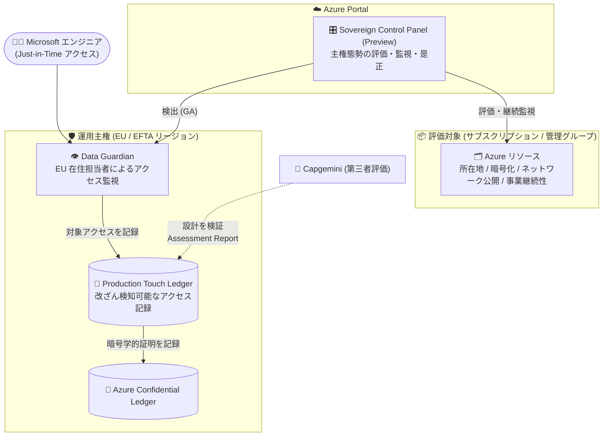

# Azure Sovereign Cloud: Sovereign Control Panel / Data Guardian / Production Touch Ledger アップデート

**リリース日**: 2026-11-17

**サービス**: Azure Sovereign Cloud (Sovereign Public Cloud)

**機能**: Sovereign Control Panel (Public Preview)、Sovereign Control Panel からの Data Guardian 検出 (GA)、Production Touch Ledger (PTL) Assessment Report の公開

**ステータス**: In preview (Sovereign Control Panel) / Launched (Data Guardian 検出) / Announcement (PTL Assessment Report)

[このアップデートのインフォグラフィックを見る](https://takech9203.github.io/azure-news-summary/20261117-sovereign-cloud-updates.html)

## 概要

Microsoft Ignite 2026 に合わせて、Azure の Sovereign Cloud (主権クラウド) 関連で 3 つのアップデートが発表された。いずれも、政府機関や規制産業の顧客がハイパースケールクラウドの利点を維持しながら、データ主権・運用主権の要件を満たすための取り組みを強化するものである。

1 つ目は **Sovereign Control Panel (SCP) の Public Preview** である。SCP は Azure ポータル上の新しいエクスペリエンスで、選択したサブスクリプションや管理グループを対象に、データ所在地 (data residency)、保存時/転送時の暗号化、ネットワーク公開範囲、事業継続性といった観点から組織の主権態勢 (sovereignty posture) を評価・継続監視できる。従来は複数のツールやチームにまたがって手作業で情報を収集する必要があったが、SCP により一元的な評価・ギャップの根拠確認・ガイド付きの是正が可能になる。

2 つ目は **Sovereign Control Panel からの Data Guardian 検出の一般提供 (GA)** である。Data Guardian は、EU データ境界内の対象本番システムに対する Microsoft エンジニアの対象リモートアクセスを、信頼されたパートナーの EU 在住の認可済み担当者が監視する運用監督機能であり、SCP の画面から直接その内容を確認・理解できるようになった。3 つ目は **Production Touch Ledger (PTL) Assessment Report の公開**である。独立した第三者機関である Capgemini が、本番アクセス記録の完全性 (completeness)、改ざん検知性 (tamper-evidence)、否認防止 (non-repudiation) を保持する PTL の設計を検証したレポートが利用可能になった。

**アップデート前の課題**

- 主権態勢の評価のたびに、複数のツールやチームから手作業で情報を収集・集約する必要があった
- Microsoft エンジニアによる本番システムへのアクセスに対する監督・記録の仕組みについて、顧客が内容を確認するには個別のツールやドキュメントを探す必要があった
- PTL の改ざん検知性などの特性について、Microsoft 自身の主張以外に独立した評価の証拠がなかった

**アップデート後の改善**

- SCP により、データ所在地・暗号化・ネットワーク公開・事業継続性の評価結果を 1 か所で確認し、ギャップの根拠 (エビデンス) の把握とガイド付き是正が可能になった
- SCP から Data Guardian を直接検出でき、態勢評価から関連コントロールの検討へ同一の一元化された環境内でスムーズに移行できるようになった
- Capgemini による第三者評価レポートにより、規制当局のレビュー、内部監査、顧客との対話において独立した証拠として PTL を活用できるようになった

## アーキテクチャ図

Sovereign Control Panel が Azure リソースの主権態勢評価の起点となり、Data Guardian による運用監視と Production Touch Ledger による改ざん検知可能な記録 (Azure Confidential Ledger を基盤) がそれを補完する。PTL の設計は Capgemini により第三者検証された。

## サービスアップデートの詳細

### 主要機能

1. **Sovereign Control Panel (Public Preview)**
   - Sovereign view を作成し、選択したサブスクリプション・管理グループを評価。評価結果の背後にあるリソースのレコードを調査できる
   - 評価は 5 つのディメンションに分類: データ所在地、保存時の暗号化 (CMK 要件を含む)、転送時の暗号化、制御されたネットワーク公開 (プライベートエンドポイント / パブリックネットワークアクセス)、事業継続性
   - Residency360 (R360) により、サポートされるリンクされたデータ保持コピーへ所在地の検出を拡張可能
   - Public Preview の是正 (remediation) はプライマリリソースのデータ所在地の検出結果に限定。リンクされたコピーは評価のみ
   - 評価用ポリシー割り当ては非強制 (non-enforcing)。コントロールを選択してもリソース構成やガードレールの強制は行われず、強制は組織の Azure ガバナンスプロセスで引き続き管理する

2. **Sovereign Control Panel からの Data Guardian 検出 (GA)**
   - Data Guardian は、EU および EFTA リージョンの対象本番システムに対する Microsoft エンジニアの対象リモートアクセスを、信頼されたパートナーの EU 在住の認可済み担当者が監視する機能
   - 動作の流れ: (1) Microsoft エンジニアが本番リソースへの Just-in-Time アクセスを要求 → (2) 指定された担当者が対象の production touch セッションを監視 → (3) PTL が対象アクセスの改ざん検知可能な記録を保持
   - SCP 内から Data Guardian の内容とアクセス監視要件への対応を確認でき、別のツールやドキュメントを探す必要がない

3. **Production Touch Ledger (PTL) Assessment Report**
   - 独立した第三者機関 Capgemini が、本番アクセス記録の完全性・改ざん検知性・否認防止を保持する PTL の設計を検証
   - PTL は対象の production-touch イベントをソースシステムから捕捉し、イベントを暗号署名した上で、完全なイベントをイミュータブルストレージに永続化、暗号学的な完全性証明を Azure Confidential Ledger に記録する
   - 保存されたイベントデータが変更されると、フィンガープリントが台帳に記録された証明と一致しなくなり、検証時に改ざんを検出できる
   - Microsoft が認可した第三者バリデーターが、ソースのロギングシステムに依存せずに記録の完全性を独立検証できる
   - EU データ境界で段階的ロールアウト中

## 技術仕様

| 項目 | 詳細 |
|------|------|
| SCP ホスティング | グローバルサービスとしてスウェーデンでホスト。ビューのデータと関連メタデータはスウェーデンに保存 |
| SCP 評価ディメンション | データ所在地 / 保存時の暗号化 / 転送時の暗号化 / 制御されたネットワーク公開 / 事業継続性 |
| SCP 前提条件 | Azure RBAC 権限とリソースプロバイダーの登録が必要 |
| SCP ポリシー | 非強制 (non-enforcing) のポリシー割り当て。強制は行わない |
| Data Guardian 対象範囲 | EU / EFTA リージョンの対象 (in-scope) 本番システムへの Microsoft エンジニアの対象リモートアクセス |
| PTL 記録方式 | ソースシステムによる暗号署名 + イミュータブルストレージへの永続化 + Azure Confidential Ledger への完全性証明の記録 |
| PTL 第三者評価 | Capgemini による設計検証 (完全性・改ざん検知性・否認防止) |

## 設定方法

### 前提条件 (Sovereign Control Panel)

1. Azure RBAC の権限 (評価対象のサブスクリプション / 管理グループへのアクセス)
2. リソースプロバイダーの登録

### Azure Portal

1. Azure ポータルで Sovereign Control Panel を開く
2. Sovereign view を作成し、対象のサブスクリプション・管理グループと評価するコントロール (ディメンション) を選択する
3. 評価結果からギャップと背後のレコードを確認し、対象となるプライマリリソースのデータ所在地については是正を実施する

注: Public Preview では、既存ビューのスコープや含まれるコントロールの編集はサポートされない。異なる評価が必要な場合は代替ビューを新規作成する。

## メリット

### ビジネス面

- 政府機関・規制産業が、ハイパースケールクラウドの利点を維持しながら運用主権の目標 (地域での監督、透明性) に対応できる
- Capgemini の第三者評価レポートを、規制当局のレビュー・内部監査・顧客との対話における独立した証拠として利用できる
- 主権態勢評価のための情報収集にかかる手作業とチーム間調整を削減できる

### 技術面

- データ所在地・暗号化・ネットワーク公開・事業継続性を単一のビューで横断評価し、ギャップのエビデンスまで掘り下げられる
- PTL により、本番アクセス記録の改ざんを暗号学的に検出可能 (記録が変更されるとフィンガープリントが Azure Confidential Ledger 上の証明と不一致になる)
- Data Guardian の human-in-the-loop による地域監督で、本番システムへの未監視アクセスのリスクを低減できる

## デメリット・制約事項

- SCP の Public Preview は欧州クラウドリージョンに限定される (テナント自体は欧州拠点である必要はないが、選択した地域外のリソースは所在地基準を満たさない)
- SCP のポリシー割り当ては非強制であり、コントロールの選択はガードレールの強制にはならない
- Public Preview の是正はプライマリリソースのデータ所在地の検出結果に限定。リンクされたコピーは評価のみ
- 既存ビューのスコープ・コントロールの編集は不可 (ビューの再作成が必要)
- レポート生成はリアルタイムではないため、結果の利用前に権限とレポートの状態を確認する必要がある
- 事業継続性パラメーターは互換性と制約の評価のみで、リソースの移動や復旧構成は行わない。RTO / RPO / 稼働継続時間は Public Preview では利用不可
- 必要な機能 (データ所在地・保存時の暗号化) の提供状況はサービスとリージョンによって異なり、是正パスが存在しないギャップが検出される場合がある
- PTL は本番アクセス活動の文書化と検証を提供するものであり、アクセスの可否を決定するコントロールを置き換えるものではない

## ユースケース

### ユースケース 1: 欧州の規制産業における主権態勢の継続監視

**シナリオ**: 欧州の金融機関が、複数サブスクリプションにまたがる Azure 環境について、データ所在地と顧客管理キー (CMK) による暗号化の要件を継続的に監視したい。

**実装例**: SCP で管理グループをスコープとした Sovereign view を作成し、データ所在地と保存時の暗号化のコントロールを選択。検出されたギャップのエビデンスを確認し、対象のプライマリリソースの所在地ギャップを是正する。

**効果**: ツール・チーム横断の手作業による情報集約が不要になり、監査対応のための態勢評価を一元化できる。

### ユースケース 2: 規制当局レビューに向けた運用主権の証拠整備

**シナリオ**: 政府機関が、Microsoft エンジニアによる本番システムへのアクセスが監視・記録されていることを規制当局に示す必要がある。

**実装例**: SCP から Data Guardian の内容を確認し、自組織のアクセス監視要件との対応を整理。PTL Assessment Report (Capgemini による設計検証) をダウンロードし、独立した証拠として監査資料に組み込む。

**効果**: Microsoft の自己申告に依存しない第三者検証済みの証拠により、規制当局・内部監査への説明責任を果たせる。

## 利用可能リージョン

- **Sovereign Control Panel (Public Preview)**: 欧州クラウドリージョンに限定。サービス自体はスウェーデンでホストされ、ビューのデータもスウェーデンに保存される
- **Data Guardian / PTL**: EU および EFTA リージョンの対象本番システムが対象。PTL は EU データ境界で段階的ロールアウト中

## 関連サービス・機能

- **Azure Confidential Ledger**: PTL が本番アクセス記録の暗号学的な完全性証明を記録する基盤。改ざん検知性を実現する
- **Sovereign Landing Zone (SLZ)**: ワークロード展開前に主権コントロールを確立するためのガイダンス。SCP による評価と補完関係にある
- **Residency360 (R360)**: SCP のデータ所在地の検出を、サポートされるリンクされたデータ保持コピーに拡張する機能
- **Azure Policy / Azure RBAC**: SCP の評価は非強制ポリシー割り当てを利用。強制は組織のガバナンスプロセス (Azure Policy 等) で行う

## 参考リンク

- [インフォグラフィック](https://takech9203.github.io/azure-news-summary/20261117-sovereign-cloud-updates.html)
- [公式アップデート情報: Public Preview: Sovereign Control Panel](https://azure.microsoft.com/updates?id=581220)
- [公式アップデート情報: Generally Available: Discover Data Guardian from Sovereign Control Panel](https://azure.microsoft.com/updates?id=581226)
- [公式アップデート情報: Announcing: Production Touch Ledger (PTL) Assessment Report](https://azure.microsoft.com/updates?id=581221)
- [Microsoft Learn: Sovereign Control Panel (SCP) (preview) overview](https://learn.microsoft.com/azure/azure-sovereign-clouds/public/sovereign-control-panel)
- [Microsoft Learn: Data Guardian](https://learn.microsoft.com/azure/azure-sovereign-clouds/public/data-guardian)
- [Microsoft Learn: Production Touch Ledger](https://learn.microsoft.com/azure/azure-sovereign-clouds/public/production-touch-ledger)
- [PTL Assessment Report のダウンロード](http://aka.ms/downloadptlreport)

## まとめ

今回の 3 つのアップデートは、Azure Sovereign Public Cloud における「評価 (SCP)」「監督 (Data Guardian)」「証明 (PTL + 第三者評価)」という主権対応の 3 層を揃えるものである。欧州リージョンで政府機関や規制産業のワークロードを扱う Solutions Architect は、まず SCP の Public Preview で既存環境の Sovereign view を作成して主権態勢のギャップを把握し、運用主権の要件がある場合は Data Guardian と PTL の対象範囲・記録の仕組みを確認することを推奨する。規制当局対応や監査では、Capgemini による PTL Assessment Report が独立した証拠として活用できる。Preview 段階のため、ポリシーが非強制である点や是正範囲の制限には留意が必要である。

---

**タグ**: Azure Sovereign Cloud, Sovereign Control Panel, Data Guardian, Production Touch Ledger, Azure Confidential Ledger, EU Data Boundary, Compliance, Microsoft Ignite
