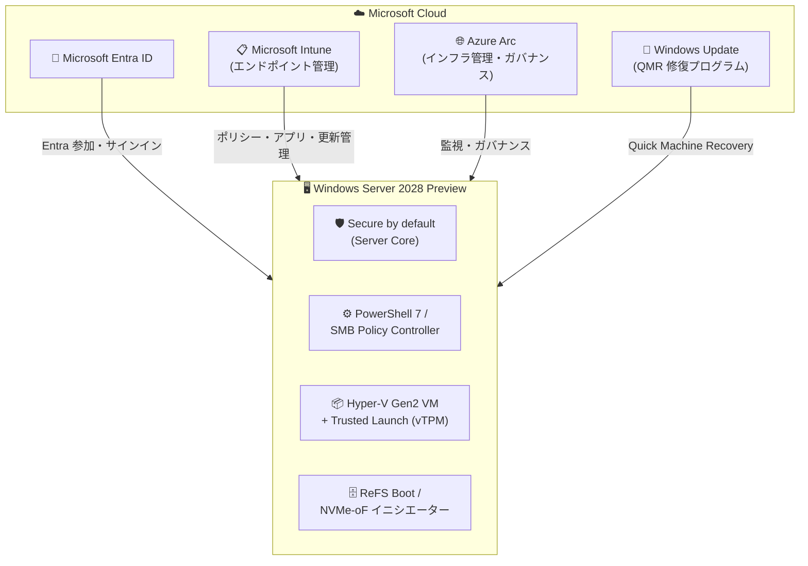

# Windows Server: Windows Server 2028 パブリックプレビュー

**リリース日**: 2026-11-17

**サービス**: Windows Server

**機能**: Windows Server 2028 (次期 LTSC リリース) のパブリックプレビュー

**ステータス**: In preview

[このアップデートのインフォグラフィックを見る](https://takech9203.github.io/azure-news-summary/20261117-windows-server-2028-preview.html)

## 概要

Windows Server の次期 Long-Term Servicing Channel (LTSC) リリースである **Windows Server 2028** がパブリックプレビューとして公開されました。Microsoft Ignite 2026 に合わせて発表されたこのプレビューは、セキュリティ、仮想化、ハイブリッドクラウド管理、ハイブリッドインテリジェンスへの投資を 1 つにまとめ、データセンター・エッジ・クラウドにまたがるミッションクリティカルなワークロードを支えることを目的としています。

プレビューは Windows Server Insider Preview ビルドとして段階的に機能が追加されており、最新のビルド 29706 (2026 年 11 月 17 日) では PowerShell 7 の標準搭載、SMB Policy Controller、Microsoft Entra ID / Microsoft Intune による Windows Server 管理が加わりました。これ以前のビルドでは、Server Core の Secure by default 構成、第 2 世代 VM 向け Trusted Launch、Quick Machine Recovery、NVMe over Fabrics イニシエーター、ReFS Boot が提供されています。

評価を開始するには Windows Insider Program に参加し、Windows Server Insider Preview ビルドを入手します。プレビュー版のため、リリース前に大幅な変更が行われる可能性があり、本番環境での利用は想定されていません。

**アップデート前の課題**

- Windows Server の Entra 参加や Intune による管理は Windows 11 クライアントのような標準フローでは行えず、サーバー管理はオンプレミスの Active Directory や Group Policy に依存していた
- Server Core は展開後に手動でセキュリティ強化 (ハードニング) を行う必要があった
- OS 標準の自動化環境は Windows PowerShell 5.1 が中心で、PowerShell 7 は別途導入が必要だった
- 起動不能になったサーバーの復旧は手動対応が必要だった
- ブートボリュームは NTFS のみで、破損検出・修復にはオフラインの chkdsk が必要になるケースがあった
- オンプレミス Hyper-V の第 2 世代 VM には、Azure の Trusted Launch に相当するブート・ファームウェアレベルの保護がなかった

**アップデート後の改善**

- **Settings** からの Microsoft Entra ID 参加、Entra アカウントでのサインイン、Intune への自動登録により、Windows クライアントと同様の ID・エンドポイント管理がサーバーでも可能に (Azure Arc と併用可)
- Server Core の新規インストールが初回起動時点から 7 つのレイヤーで強化された Secure by default 構成に
- PowerShell 7 が標準搭載され、Windows PowerShell 5.1 とサイドバイサイドで共存 (既存の自動化を強制移行せずに済む)
- Quick Machine Recovery により、起動失敗を繰り返すサーバーがネットワーク接続された WinRE で Microsoft 公開の修復プログラムを自動適用して再起動
- ReFS Boot (オプション) により、ブートボリュームでメタデータチェックサム・オンラインスクラブなどの ReFS の回復性と最大 35 PB のスケールを利用可能
- 組み込みの NVMe-oF イニシエーター (TCP / RDMA) でリモート NVMe ストレージを Windows ディスクとして利用可能
- 第 2 世代 Hyper-V VM 向け Trusted Launch (Secure Boot + vTPM + 暗号化ゲスト状態) でブート・ファームウェア攻撃から保護
- SMB Policy Controller により、共有の用途とプロファイルを PowerShell で宣言するだけで SMB 設定が適用され、ドリフトも自動修復

## アーキテクチャ図

Windows Server 2028 は、Entra ID / Intune / Azure Arc によるハイブリッド管理と、OS 内蔵のセキュリティ・仮想化・ストレージ強化を組み合わせた構成になっています。

## サービスアップデートの詳細

### 主要機能

1. **PowerShell 7 標準搭載** (ビルド 29706 / 2026-11-17)
   - Windows PowerShell 5.1 からのアップグレードパスを提供。5.1 はサイドバイサイドで残るため、既存の自動化は強制移行なしで継続利用できる

2. **SMB Policy Controller** (ビルド 29706 / 2026-11-17)
   - 既存の SMB 共有の用途 (部門ファイル共有、アプリケーションデータなど) とセキュリティ重視 / パフォーマンス重視のプロファイルを PowerShell で宣言すると、管理対象の設定が適用され、設定ドリフトも自動的に修復される。共有単位とサーバー全体の設定を個別に管理可能

3. **Microsoft Entra ID / Microsoft Intune による Windows Server 管理** (ビルド 29706 / 2026-11-17)
   - Windows 11 と同じ **Settings** > **Accounts** > **Access work or school** フローで Entra ID に参加し (AD DS 不要)、Entra アカウントでサインイン可能
   - デバイスコンプライアンスを Entra 条件付きアクセスのシグナルとして利用可能
   - サーバー登録をオプトインした Intune 環境では要件を満たすサーバーが自動登録され、OS・アプリインベントリ表示、セキュリティベースライン / 構成ポリシー適用 (CSP 経由)、Win32 アプリ配布、Windows Update for Business / Windows Autopatch による更新管理が可能
   - Intune (エンドポイント管理) と Azure Arc (インフラ管理・監視・ガバナンス) は同一サーバー上で併用可能。Intune サーバー登録は既定で無効で、非本番のプレビュー評価用

4. **Secure by default for Server Core** (ビルド 29683 / 2026-10-12)
   - 新規インストールが初回起動から強化されたセキュリティ既定値で開始。資格情報窃取、ラテラルムーブメント、プロトコルダウングレード攻撃などから保護
   - 強化既定値は「ネットワーク露出」「ID と認証」「特権と管理アクセス」「リモートアクセスと管理」「暗号化」「OS プラットフォームとコード整合性」「可観測性」の 7 レイヤーで構成。新規インストールのみに適用

5. **第 2 世代 VM 向け Trusted Launch** (ビルド 29621 / 2026-07-13)
   - Secure Boot、仮想 TPM (vTPM)、暗号化されたゲスト状態により、OS 防御が開始される前のブート・ファームウェアレベルの攻撃から Hyper-V ワークロードを保護

6. **Quick Machine Recovery** (ビルド 29574 / 2026-04-27)
   - 起動失敗を繰り返すサーバーがネットワーク接続された WinRE に入り、Windows Update から Microsoft 公開の修復プログラムを取得・適用して再起動。自動実行の有無、再試行間隔、合計待機時間を管理者が制御可能
   - Windows Server 2025 でも 2026 年 10 月のセキュリティ更新から利用可能

7. **NVMe over Fabrics (NVMe-oF) イニシエーター** (ビルド 29550 / 2026-03-12)
   - リモート NVMe ストレージを Windows ディスクとして利用可能。標準イーサネットで広い互換性を得られる NVMe over TCP と、低レイテンシ・高スループットの NVMe over RDMA を選択できる

8. **ReFS Boot** (ビルド 29531 / 2026-02-12)
   - ReFS フォーマットのブートボリュームから起動できるオプション機能。メタデータチェックサム、整合性ストリーム (オプション)、オンラインスクラブにより、オフライン chkdsk なしで破損を検出しブートボリュームをオンラインに維持。大容量ファイルコピーや VM ディスク管理などストレージ集約型操作を高速化し、最大 35 PB のボリューム / ファイルをサポート

## 技術仕様

| 項目 | 詳細 |
|------|------|
| リリースチャネル | Long-Term Servicing Channel (LTSC) の次期リリース |
| 現在のステータス | パブリックプレビュー (2026 年 11 月発表、Microsoft Ignite) |
| 入手方法 | Windows Insider Program (Windows Server Insider Preview ビルド) |
| 最新プレビュービルド | ビルド 29706 (2026 年 11 月 17 日) |
| ReFS Boot 要件 | UEFI ファームウェア必須、第 1 世代 VM 非対応、2 GB 以上の WinRE パーティションを作成 |
| NVMe-oF プレビューの制限 | コマンドラインのみ、マルチパス非対応、一部ネットワーク障害時の回復が限定的 |
| Trusted Launch プレビューの制限 | VM の他サーバーへの移動、フェールオーバークラスター、Hyper-V レプリカ、ブート整合性検証は非対応 |
| Intune サーバー登録 | 既定で無効 (オプトイン)、非本番のプレビュー評価用 |

## 設定方法

### 前提条件

1. Windows Insider Program への参加 (プレビュービルドの入手に必要)
2. 評価用の非本番環境 (プレビュー版は本番利用を想定していない)

### 評価の開始

1. [Windows Insider Program](https://aka.ms/JoinWindowsInsiderProgram) に参加する
2. Windows Server Insider Preview ビルド (最新: ビルド 29706) を入手してインストールする
3. 評価したい機能に応じてドキュメントを参照する (Entra/Intune 管理は [Windows Server management in Intune](https://aka.ms/IntuneServerGuide)、Secure by default は [Secure by default for Windows Server](https://aka.ms/WSHardened) など)

プレビューに関する問題やフィードバックは、Microsoft サポートではなく [Windows Server Insiders コミュニティ](https://techcommunity.microsoft.com/category/windows-server/discussions/windowsserverinsiders) などのフィードバックチャネルを利用します。

## メリット

### ビジネス面

- LTSC の次期リリースを事前評価でき、Windows Server 2025 以前からの移行計画・検証を早期に開始できる
- Secure by default により展開後のハードニング作業が減り、初期構築のコストとセキュリティリスクを低減できる
- Intune / Entra ID / Azure Arc を組み合わせたハイブリッド管理により、クライアントとサーバーの管理基盤を統一できる

### 技術面

- PowerShell 7 標準搭載と 5.1 の共存により、既存スクリプト資産を維持しつつモダンな自動化へ段階的に移行できる
- Quick Machine Recovery と ReFS Boot により、起動障害・ストレージ破損からの回復性が向上する
- NVMe-oF (TCP / RDMA) により、追加ソフトウェアなしで高性能なリモート NVMe ストレージを利用できる
- オンプレミス Hyper-V でも Trusted Launch によるブートレベルの保護を適用できる

## デメリット・制約事項

- プレビュー版であり、リリース前に大幅な変更の可能性がある。本番環境での利用は不可
- Secure by default の強化既定値は新規インストールのみに適用される (既存環境のアップグレードには適用されない)
- Trusted Launch プレビューは VM の移動、フェールオーバークラスター、Hyper-V レプリカ、ブート整合性検証に非対応
- NVMe-oF プレビューはコマンドライン操作のみで、マルチパス非対応
- ReFS Boot は UEFI 必須・第 1 世代 VM 非対応。WinRE パーティションを削除して ReFS ブートボリュームを拡張した場合、WinRE の復元にはクリーンインストールが必要
- Quick Machine Recovery はベストエフォートであり、Microsoft が該当する修復プログラムを公開している場合のみ成功する
- Intune サーバー登録は既定で無効であり、非本番のプレビュー評価向け。Group Policy / Configuration Manager / Azure Arc など他の管理ツールと設定が競合しないよう注意が必要

## ユースケース

### ユースケース 1: 次期 LTSC への移行評価

**シナリオ**: Windows Server 2019/2022/2025 を運用中の企業が、次期 LTSC への移行に向けて新機能 (Secure by default、ReFS Boot、PowerShell 7) の互換性と運用影響を事前検証する。

**効果**: GA 前に自社ワークロードとの互換性問題や運用手順の変更点を把握でき、移行計画を前倒しで策定できる。

### ユースケース 2: クライアントとサーバーの統合エンドポイント管理の検証

**シナリオ**: Windows 11 クライアントを Intune で管理している組織が、検証環境の Windows Server 2028 Preview を Entra ID に参加させ、Intune サーバー登録 (オプトイン) でセキュリティベースラインや更新管理を評価する。

**効果**: クライアントとサーバーの管理基盤統一によるガバナンス簡素化の効果を、本番導入前に見極められる。

### ユースケース 3: ブート・ファームウェアレベルのセキュリティ強化の検証

**シナリオ**: オンプレミス Hyper-V 上の機密ワークロードに対し、Trusted Launch (Secure Boot + vTPM + 暗号化ゲスト状態) を有効化してブートレベルの攻撃対策を検証する。

**効果**: Azure VM の Trusted Launch と同等の保護モデルをオンプレミスでも適用でき、ハイブリッド環境全体のセキュリティベースラインを揃えられる。

## 料金

プレビュー版の料金情報は公表されていません。評価は Windows Insider Program 経由で行います。Windows Server の料金体系 (ライセンス) については公式ページを参照してください。

- [Windows Server 料金とライセンス](https://www.microsoft.com/windows-server/pricing)

## 関連サービス・機能

- **Microsoft Entra ID**: Settings からのサーバー参加と Entra アカウントでのサインイン、条件付きアクセスのシグナルとしてのデバイスコンプライアンス利用
- **Microsoft Intune**: Entra 参加済みサーバーの自動登録、セキュリティベースライン・構成ポリシー・Win32 アプリ・更新管理 (プレビュー)
- **Azure Arc**: Intune と同一サーバー上で併用可能。インフラ管理・監視・ガバナンスを担当
- **Windows Update for Business / Windows Autopatch**: Intune サーバー管理プレビューでサポートされる更新管理
- **Windows Server 2025**: Quick Machine Recovery は 2026 年 10 月のセキュリティ更新から Windows Server 2025 でも利用可能

## 参考リンク

- [インフォグラフィック](https://takech9203.github.io/azure-news-summary/20261117-windows-server-2028-preview.html)
- [公式アップデート情報](https://azure.microsoft.com/updates?id=581135)
- [Windows Server 2028 Preview: New features (Microsoft Learn)](https://learn.microsoft.com/windows-server/get-started/whats-new-windows-server-2028)
- [Windows Insider Program への参加](https://aka.ms/JoinWindowsInsiderProgram)
- [Windows Server management in Intune](https://aka.ms/IntuneServerGuide)
- [Secure by default for Windows Server](https://aka.ms/WSHardened)
- [Windows Server Insiders コミュニティ](https://techcommunity.microsoft.com/category/windows-server/discussions/windowsserverinsiders)

## まとめ

Windows Server 2028 のパブリックプレビューは、次期 LTSC リリースの方向性を示す重要なマイルストーンです。Entra ID / Intune によるクラウドネイティブなサーバー管理、Server Core の Secure by default、ReFS Boot や NVMe-oF といったストレージ刷新、オンプレミス Hyper-V への Trusted Launch 展開など、ハイブリッド環境の運用とセキュリティを大きく底上げする機能が揃っています。Solutions Architect としては、Windows Insider Program 経由で検証環境を構築し、特に既存の AD / Group Policy 中心の管理モデルから Entra / Intune / Azure Arc を組み合わせたハイブリッド管理モデルへの移行可能性を早期に評価することを推奨します。

---

**タグ**: Windows Server, Windows Server 2028, LTSC, In preview, Microsoft Ignite, Microsoft Entra ID, Microsoft Intune, Azure Arc, Hyper-V, Trusted Launch, ReFS, NVMe-oF, PowerShell 7, セキュリティ
