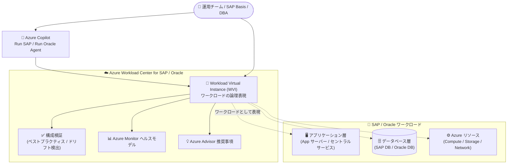

# Azure Workload Center: SAP / Oracle 向け Workload Center と Azure Copilot Run Agent (Limited Preview)

**リリース日**: 2026-11-17

**サービス**: Azure Workload Center

**機能**: Azure Workload Center for SAP / Oracle と Azure Copilot Run SAP / Oracle Agent

**ステータス**: In preview (Limited Preview)

[このアップデートのインフォグラフィックを見る](https://takech9203.github.io/azure-news-summary/20261117-workload-center-sap-oracle.html)

## 概要

Microsoft Ignite に合わせて、**Azure Workload Center for SAP** と **Azure Workload Center for Oracle** が、それぞれ専用 AI エージェント (**Azure Copilot Run SAP Agent** / **Azure Copilot Run Oracle Agent**) とともに Limited Preview として発表された。いずれも **Workload Virtual Instance (WVI)** を基盤とした「ワークロード認識型 (workload-aware)」の運用エクスペリエンスであり、Azure 上で SAP / Oracle ワークロードを運用するチームが、ワークロードの健全性把握、構成逸脱の特定、プラットフォーム障害がアプリケーションに与える影響の評価を、担当するシステムの文脈で行えるよう支援する。

WVI は、SAP システム (セントラルサービス、アプリケーションサーバー、データベースサーバー、Web ディスパッチャーなど) や Oracle システム (Oracle AI Database@Azure または Azure VM 上の Oracle) のコンポーネントと、それを支える Azure のコンピュート・ストレージ・ネットワークリソースを 1 つの論理的な Azure リソースとして表現する。これにより、個々の Azure リソースを独立したインフラとして扱うのではなく、「ワークロード全体」としての構成管理・ヘルス監視・推奨事項・AI 支援トラブルシューティングが可能になる。

両サービスとも 2026 年 6 月に Private Preview を開始しており、今回 2026 年 11 月に Limited Preview (申込制) へ移行した。GA 時期は未定。

**アップデート前の課題**

- SAP / Oracle システムを構成する VM、ストレージ、ネットワークなどの Azure リソースを個別に管理する必要があり、ワークロード全体としての構成・健全性を把握するには各インフラビューを手動でつなぎ合わせる必要があった
- 障害発生時に、Azure プラットフォームの問題がどの SAP / Oracle コンポーネントに影響するかを、運用チームが手作業で調査・関連付けする必要があった
- Azure / SAP on Azure / Oracle on Azure のベストプラクティスからの構成逸脱 (ドリフト) を継続的に検出する仕組みがなかった

**アップデート後の改善**

- WVI によりシステム・コンポーネント・Azure リソースを単一ビューに統合し、ワークロード単位での管理が可能になった
- Azure Monitor のヘルスモデルにより、アプリケーション・データベース・インフラの各レイヤーを横断した健全性インサイトと、劣化の発生箇所・影響範囲の特定が可能になった
- ベストプラクティスに対する構成検証が自動実行され、逸脱の内容・影響・修復手順を確認できるようになった
- Azure Copilot の Run SAP / Run Oracle Agent に自然言語で質問し、構成変更の把握、影響評価、ワークロードを考慮した修復ガイダンスを得られるようになった (変更の実行判断はチーム側に残る)

## アーキテクチャ図

WVI が SAP / Oracle システムのコンポーネントと Azure リソースを 1 つのワークロードとして表現し、その文脈の上で構成検証・ヘルス監視・Advisor 推奨事項・Copilot エージェントによる AI 支援が提供される。

## サービスアップデートの詳細

### 主要機能

1. **Workload Virtual Instance (WVI)**
   - SAP / Oracle システムを表現する論理的な Azure リソース。アーキテクチャ、依存関係、メタデータ、運用コンテキストを単一ビューに集約する
   - 既存リソースを移動・変更することなく、Azure リソースを「ワークロードコンポーネント」(例: Database Services、Application Services) にグループ化する
   - SAP SID / Oracle SID や本番環境指定などのワークロード固有情報により、チームと AI エージェントが各環境を文脈的に理解できる

2. **ワークロードの検出とオンボーディング**
   - 既存の SAP / Oracle システムをオンボードすると WVI が作成される
   - Oracle は Oracle AI Database@Azure (Exadata Database Service on Dedicated Infrastructure、Oracle Autonomous AI Database など) と Azure VM 上の Oracle の両方に対応

3. **構成検証とドリフト検出**
   - Azure および SAP on Azure / Oracle on Azure のベストプラクティスに対して構成を継続的に評価
   - 逸脱の内容・影響・修復ガイダンスを提示

4. **ヘルス監視とトラブルシューティング**
   - Azure Monitor のヘルスモデルで、システム・コンポーネント・リソースの健全性を階層的に可視化
   - 劣化の発生元と全体への影響範囲を特定

5. **ワークロードを考慮した推奨事項**
   - WVI を構成するリソースに対する Azure Advisor の推奨事項をワークロードビュー内で表示し、影響コンポーネントに基づく優先順位付けが可能

6. **Azure Copilot Run SAP / Run Oracle Agent (AI エージェント)**
   - 自然言語で「何が変わったか」の把握、構成値の取得・比較、劣化の原因調査、影響評価、推奨される次のステップの特定を支援
   - Azure プラットフォーム障害とワークロードトポロジを相関させた影響分析 (インパクト分析) を提供
   - 意思決定と修復の実行権限はあくまで運用チーム側に残る設計

## 技術仕様

| 項目 | 詳細 |
|------|------|
| 基盤リソース | Workload Virtual Instance (WVI) — ワークロードの論理表現となる Azure リソース |
| 対象ワークロード (SAP) | Azure 上の SAP システム (セントラルサービス、アプリケーションサーバー、DB サーバー、Web ディスパッチャーなど) |
| 対象ワークロード (Oracle) | Oracle AI Database@Azure (Exadata Database Service on Dedicated Infrastructure、Oracle Autonomous AI Database など) および Azure VM 上の Oracle |
| ヘルス監視 | Azure Monitor ヘルスモデル |
| 推奨事項 | Azure Advisor との統合 |
| AI エージェント | Azure Copilot Run SAP Agent / Run Oracle Agent |
| 提供形態 | Limited Preview (申込フォームによる登録・承認が必要) |
| プレビュー経緯 | Private Preview: 2026 年 6 月 → Limited Preview: 2026 年 11 月、GA 未定 |

## 設定方法

### 前提条件

1. Limited Preview への参加申込 (サブスクリプション単位での登録)
   - SAP: https://aka.ms/workloadcenter/SAPPreviewSignup
   - Oracle: https://aka.ms/workloadcenter/Oracle-Ignite
2. 対象リージョン (下記「利用可能リージョン」参照) で SAP / Oracle ワークロードを運用していること
3. プレビュー機能のため [Supplemental Terms of Use for Microsoft Azure Previews](https://azure.microsoft.com/support/legal/preview-supplemental-terms/) が適用される

### Azure Portal

1. Limited Preview の承認後、既存の SAP / Oracle システムを Azure Workload Center にオンボードする
2. オンボードにより WVI が作成され、システムのコンポーネントと Azure リソースがワークロードとして表現される
3. 構成検証・ヘルスモデル・Advisor 推奨事項をワークロードビューで確認し、Azure Copilot から Run SAP / Run Oracle Agent を利用する

詳細な手順は Microsoft Learn のオンボーディングドキュメントを参照 (参考リンク)。

## メリット

### ビジネス面

- ミッションクリティカルな SAP / Oracle ワークロードの障害調査時間を短縮し、ダウンタイムによるビジネス影響を低減できる
- 構成逸脱を運用問題化する前にプロアクティブに是正でき、ベストプラクティス準拠を維持しやすい
- SAP Basis / DBA チームとクラウド運用チームが同一のワークロードビューを共有でき、組織間の調査・連携コストを削減できる

### 技術面

- インフラ単位ではなくワークロード単位の管理により、依存関係・影響範囲の手動の突き合わせ作業が不要になる
- Azure Monitor ヘルスモデルによるレイヤー横断 (アプリ / DB / インフラ) の健全性可視化
- 自然言語での調査 (構成値の取得・比較、劣化原因の調査) により、トラブルシューティングの初動を高速化
- AI エージェントは調査・ガイダンスに徹し、変更の実行はチームの判断に委ねられるため、ガバナンスを維持できる

## デメリット・制約事項

- Limited Preview のため、申込フォームでの登録とサブスクリプション単位の承認が必要 (即時利用はできない)
- 利用可能リージョンは現時点で 10 リージョンに限定される
- GA 時期は未定であり、プレビュー規約 (Supplemental Terms of Use) が適用されるため、本番運用の中核に据えるには時期尚早
- プレビュー時点での料金・SLA に関する公式情報は確認できていない

## ユースケース

### ユースケース 1: SAP 本番システムの構成ドリフト検出と是正

**シナリオ**: Azure 上で複数の SAP 本番システム (SID 単位) を運用しており、SAP on Azure ベストプラクティスからの構成逸脱を定期的に棚卸ししたい。

**実装例**: SAP システムを Workload Center にオンボードして WVI を作成し、構成検証の結果 (逸脱の内容・影響・修復手順) をワークロードビューで確認。Run SAP Agent に「前回から何が変わったか」を質問し、変更内容と影響を把握した上で是正する。

**効果**: 手動の構成棚卸し作業を削減し、逸脱が運用障害に発展する前に対処できる。

### ユースケース 2: Azure プラットフォーム障害の Oracle ワークロードへの影響評価

**シナリオ**: Azure のインフラ障害発生時に、Oracle AI Database@Azure / Azure VM 上の Oracle システムのどのコンポーネントが影響を受けるかを迅速に判断したい。

**実装例**: WVI のトポロジと Azure プラットフォームシグナルを相関させるインパクト分析を利用し、Run Oracle Agent に影響を受ける VM / コンポーネントを質問して初動対応を決定する。

**効果**: 障害時の影響範囲特定と根本原因調査を高速化し、MTTR を短縮できる。

## 利用可能リージョン

SAP / Oracle とも以下の 10 リージョンで利用可能 (Limited Preview 時点):

- Australia East
- Central US
- East US
- East US 2
- Germany West Central
- Italy North
- Japan East
- Korea Central
- North Europe
- South Central US

## 関連サービス・機能

- **Azure Monitor**: WVI のヘルスモデルの基盤。アプリ・DB・インフラの各レイヤーの健全性インサイトを提供
- **Azure Advisor**: WVI を構成するリソースへの推奨事項をワークロードビューに統合表示
- **Azure Copilot**: Run SAP / Run Oracle Agent の実行基盤。自然言語での調査・ガイダンスを提供
- **Azure Center for SAP solutions**: 従来からの SAP on Azure 管理機能。Workload Center for SAP の WVI 概要ドキュメントは同ドキュメントセット配下で提供されている
- **Oracle AI Database@Azure**: Azure データセンター内で Oracle が運用するデータベースサービス群 (Exadata Database Service on Dedicated Infrastructure、Oracle Autonomous AI Database など)。Workload Center for Oracle の対象ワークロード

## 参考リンク

- [インフォグラフィック](https://takech9203.github.io/azure-news-summary/20261117-workload-center-sap-oracle.html)
- [公式アップデート情報 (SAP)](https://azure.microsoft.com/updates?id=581209)
- [公式アップデート情報 (Oracle)](https://azure.microsoft.com/updates?id=581214)
- [Microsoft Learn: Workload virtual instances - Azure Workload Center for SAP](https://learn.microsoft.com/en-us/azure/sap/center-sap-solutions/workload-virtual-instance-overview)
- [Microsoft Learn: Azure Workload Center for Oracle overview (Preview)](https://learn.microsoft.com/en-us/azure/oracle/overview)
- [Tech Community ブログ (SAP)](https://aka.ms/workloadcenterforsap-blog)
- [Tech Community ブログ (Oracle)](https://aka.ms/workloadcenter/Oracle-blog)
- [Limited Preview 申込 (SAP)](https://aka.ms/workloadcenter/SAPPreviewSignup)
- [Limited Preview 申込 (Oracle)](https://aka.ms/workloadcenter/Oracle-Ignite)

## まとめ

Azure Workload Center for SAP / Oracle は、ミッションクリティカルなエンタープライズワークロードの運用を「リソース単位」から「ワークロード単位」へ引き上げる、Ignite 発表の中でも注目度の高いアップデートである。WVI によるワークロード表現を基盤に、構成検証・ヘルス監視・Advisor 統合・Azure Copilot エージェントが一体で提供され、AI は調査とガイダンスに徹し実行判断は人間に残すという設計も実運用を意識している。Azure 上で SAP / Oracle を運用しているチームは、Japan East を含む対象リージョンであれば Limited Preview への申込を検討し、構成検証とインパクト分析の効果を早期に評価することを推奨する。GA 時期は未定のため、現時点では評価・検証用途での利用が適切である。

---

**タグ**: Azure Workload Center, SAP on Azure, Oracle on Azure, Workload Virtual Instance, Azure Copilot, AI Agent, Azure Monitor, Azure Advisor, Limited Preview, Microsoft Ignite
