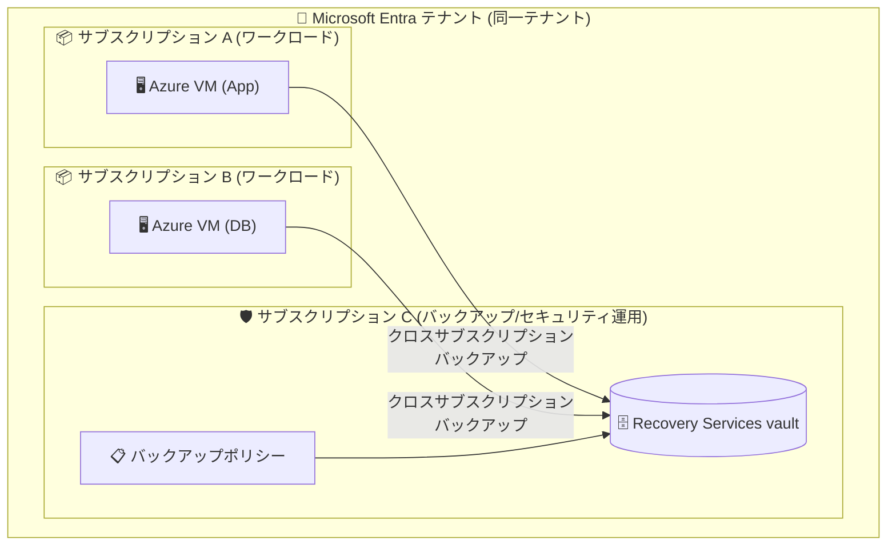

# Azure Backup: Azure Virtual Machines のクロスサブスクリプションバックアップが一般提供開始 (GA)

**リリース日**: 2026-11-18

**サービス**: Azure Backup

**機能**: Cross-subscription backup for Azure Virtual Machines

**ステータス**: Launched (GA)

[このアップデートのインフォグラフィックを見る](https://takech9203.github.io/azure-news-summary/20261118-azure-backup-cross-subscription-vm.html)

## 概要

Azure Backup が Azure Virtual Machines のクロスサブスクリプションバックアップ (Cross-subscription backup) の一般提供を開始しました。これにより、同一テナント内であれば、VM が存在するサブスクリプションとは別のサブスクリプションにある Recovery Services vault を使って VM を保護できるようになります。

この機能により、組織は複数サブスクリプションにまたがるバックアップ管理を一元化できます。バックアップ運用の簡素化、ガバナンスの向上、サブスクリプションごとに個別のバックアップ vault を維持する必要性の削減につながります。特に、バックアップやセキュリティ運用の専用サブスクリプションを持つ大規模な Azure 環境を管理するエンタープライズにとって価値の高い機能です。

本機能は 2026 年 4 月にプレビュー提供が開始され、2026 年 11 月 (Microsoft Ignite のタイミング) で GA に到達しました。

**アップデート前の課題**

- VM とそのバックアップ先の Recovery Services vault は同一サブスクリプション内に配置する必要があり、サブスクリプションごとに vault を作成・維持する必要があった
- サブスクリプション単位で vault が分散するため、バックアップポリシーの統制やガバナンスの一元化が困難だった

**アップデート後の改善**

- 同一テナント内であれば、別サブスクリプションの Recovery Services vault で VM を保護できるようになった
- バックアップ/セキュリティ運用専用のサブスクリプションに vault を集約し、複数サブスクリプションの VM バックアップを一元管理できるようになった

## アーキテクチャ図

同一テナント・同一リージョン内であれば、ワークロード用サブスクリプション A/B の VM を、バックアップ運用専用のサブスクリプション C に集約した Recovery Services vault で一元的に保護できます。

## サービスアップデートの詳細

### 主要機能

1. **別サブスクリプションの vault による VM 保護**
   - VM と Recovery Services vault が同一テナント・同一リージョン内であれば、異なるサブスクリプション間でのバックアップ構成が可能

2. **バックアップ管理の一元化**
   - 複数サブスクリプションに分散した VM のバックアップを、専用サブスクリプションの vault に集約して管理可能
   - サブスクリプションごとに個別の vault を維持する必要性を削減し、ガバナンスを向上

3. **全 Azure リージョンで利用可能**
   - GA 時点ですべての Azure リージョンで利用可能

## 技術仕様

| 項目 | 詳細 |
|------|------|
| 対象リソース | Azure Virtual Machines |
| vault の種類 | Recovery Services vault |
| テナント要件 | VM と vault が同一の Microsoft Entra テナント内にあること |
| リージョン要件 | VM と vault が同一リージョンにあること (クロスリージョンバックアップは非サポート) |
| 利用可能リージョン | すべての Azure リージョン |
| 非サポート | Confidential VM (CVM)。ADE で暗号化された CVM を含む |
| vault 間のデータ移動 | バックアップ済みデータの vault 間移動は非サポート |
| 提供時期 | プレビュー: 2026 年 4 月 / GA: 2026 年 11 月 |

## 設定方法

### 前提条件

1. VM と Recovery Services vault が同一テナント・同一リージョン内にあること
2. VM に Azure VM エージェントがインストールされていること (Azure Marketplace イメージから作成した VM にはインストール済み。Azure Backup はエージェントの拡張機能を通じてバックアップを実行)
3. [サポートマトリックス](https://learn.microsoft.com/en-us/azure/backup/backup-support-matrix-iaas)で対象 VM の構成がサポートされていることを確認すること

### Azure Portal

Azure Portal の Resiliency (旧 Backup center) から構成します。

1. **Resiliency** に移動し、**+ Configure protection** を選択
2. **Resources managed by** に **Azure**、**Datasource type** に **Azure Virtual machines**、**Solution** に **Azure Backup** を選択して続行
3. バックアップ先の Recovery Services vault (別サブスクリプションの vault を含む) を選択
4. バックアップポリシーを割り当て (既定ポリシーは 1 日 1 回バックアップ、30 日間保持、インスタント リカバリ スナップショット 2 日間保持)
5. **Virtual Machines** で **Add** を選択し、保護対象の VM を選択 (vault と同一リージョンの VM のみ選択可能。vault と異なるサブスクリプションの VM も同一テナント内であれば選択可能)
6. **Enable backup** を選択してポリシーをデプロイし、バックアップを有効化

## メリット

### ビジネス面

- サブスクリプションごとの vault 乱立を防ぎ、バックアップ運用コスト (管理工数) を削減できる
- バックアップ/セキュリティ運用を専用サブスクリプションに分離することで、ガバナンスと職務分掌を強化できる

### 技術面

- 複数サブスクリプションの VM バックアップを単一 vault に集約し、ポリシー管理・監視を一元化できる
- Cross Subscription Restore と組み合わせることで、バックアップから復元までサブスクリプションをまたいだ運用が可能になる

## デメリット・制約事項

- VM と vault は同一テナント・同一リージョン内にある必要がある (クロステナント、クロスリージョンのバックアップは不可)
- Confidential VM (CVM) はクロスサブスクリプションバックアップ非サポート (ADE で暗号化された CVM を含む)
- バックアップ済みデータの vault 間移動は非サポートのため、vault の配置 (集約先サブスクリプション) は事前に慎重に設計する必要がある

## ユースケース

### ユースケース 1: バックアップ専用サブスクリプションへの vault 集約

**シナリオ**: ランディングゾーン設計で、アプリケーションチームごとにワークロード用サブスクリプションを分離している企業が、バックアップ運用を中央の管理チームに集約したい。

**実装**: バックアップ/セキュリティ運用専用のサブスクリプションに Recovery Services vault を作成し、各ワークロードサブスクリプションの VM に対してクロスサブスクリプションバックアップを構成する。

**効果**: vault とバックアップポリシーが一元管理され、各サブスクリプションに vault を個別に作成・維持する必要がなくなる。バックアップデータをワークロード所有者から分離することでガバナンスも向上する。

## 料金

本アップデートに固有の料金情報は公式ページで確認できませんでした。Azure Backup の料金体系は以下の公式料金ページを参照してください。

- [Azure Backup の料金](https://azure.microsoft.com/pricing/details/backup/)

## 利用可能リージョン

すべての Azure リージョンで利用可能です (VM と vault は同一リージョン内に配置する必要があります)。

## 関連サービス・機能

- **Recovery Services vault**: VM の復旧ポイントを格納する管理エンティティ。本機能により VM と異なるサブスクリプションに配置可能
- **Cross Subscription Restore**: vault 層の復旧ポイントを同一テナント内の別サブスクリプションへ復元する機能。vault で有効化が必要
- **Resiliency (Backup center)**: 複数 vault をまたいだバックアップのガバナンス・監視・運用を提供する統合管理エクスペリエンス。クロスサブスクリプションバックアップの構成にも使用
- **Azure Backup immutable vault**: 復旧ポイントの期限前削除を防ぐ不変 vault。ランサムウェア対策として集中管理 vault と組み合わせて利用可能

## 参考リンク

- [インフォグラフィック](https://takech9203.github.io/azure-news-summary/20261118-azure-backup-cross-subscription-vm.html)
- [公式アップデート情報](https://azure.microsoft.com/updates?id=581048)
- [Back up Azure VMs in a Recovery Services vault (Microsoft Learn)](https://learn.microsoft.com/en-us/azure/backup/backup-azure-arm-vms-prepare)
- [Support matrix for Azure VM backups (Microsoft Learn)](https://learn.microsoft.com/en-us/azure/backup/backup-support-matrix-iaas)
- [料金ページ](https://azure.microsoft.com/pricing/details/backup/)

## まとめ

Azure VM のクロスサブスクリプションバックアップの GA により、同一テナント内であれば別サブスクリプションの Recovery Services vault で VM を保護できるようになり、エンタープライズ環境でのバックアップ管理の一元化とガバナンス強化が実現しやすくなりました。複数サブスクリプションを運用している組織は、バックアップ専用サブスクリプションへの vault 集約を検討する価値があります。ただし、同一テナント・同一リージョンの制約、Confidential VM の非サポート、vault 間データ移動不可の制約があるため、vault の配置設計は事前に十分に検討してください。

---

**タグ**: Azure Backup, Virtual Machines, Recovery Services vault, Cross-subscription, Management and governance, Storage, Microsoft Ignite, GA
