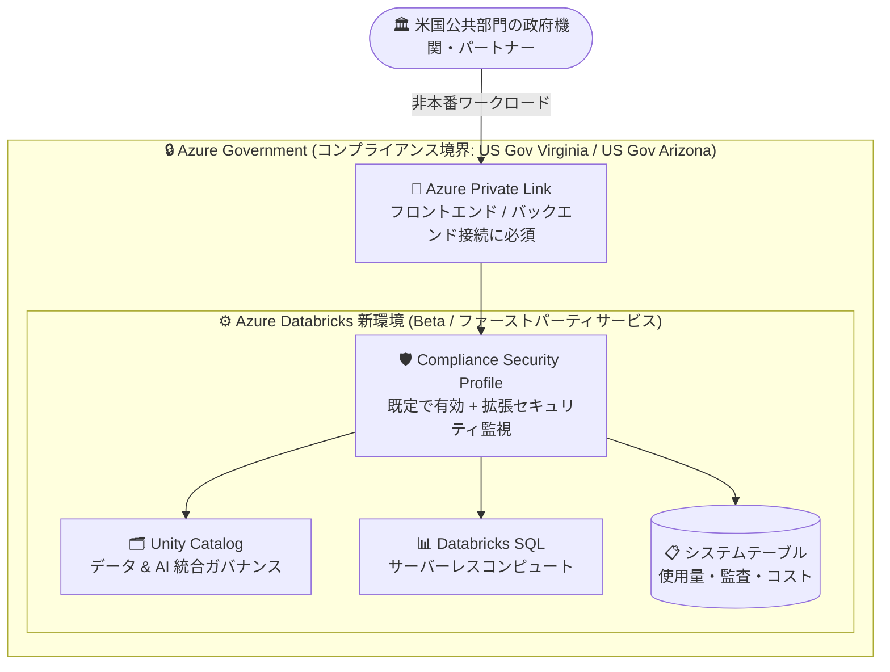

# Azure Databricks: Azure Government 向け新環境が Beta 提供開始

**リリース日**: 2026-11-18

**サービス**: Azure Databricks

**機能**: Azure Databricks on Azure Government (新環境・Beta)

**ステータス**: Beta (Announcement)

[このアップデートのインフォグラフィックを見る](https://takech9203.github.io/azure-news-summary/20261118-databricks-azure-government-beta.html)

## 概要

Microsoft Azure Government 上で新しい Azure Databricks 環境が Beta として提供開始された。グローバル Azure で提供されているモダンなデータ & AI プラットフォームを、米国公共部門の政府機関とそのパートナー向けに、Azure のファーストパーティサービスとして提供するものである。

Beta には、データと AI 資産を統合的にガバナンスする Unity Catalog、インフラ管理不要でスケーラブルな分析を実現するサーバーレスコンピュート対応の Databricks SQL、使用量・監査・コストを可視化するシステムテーブルが含まれる。すべてのワークスペースで Compliance Security Profile が既定で有効化され、Azure Private Link の利用が必須となり、顧客データは US Gov Virginia および US Gov Arizona リージョン内に保持される。

なお、Beta は非本番ワークロード専用であり、CUI (Controlled Unclassified Information) などの規制対象データの処理には使用できない。アクセスはサブスクリプション単位で有効化される。

**アップデート前の課題**

- Azure Government には既存の Azure Databricks 環境が存在するが、グローバル Azure で提供されているモダンなデータ & AI プラットフォーム (Unity Catalog、サーバーレスコンピュート対応の Databricks SQL、システムテーブルなど) は新環境として提供されていなかった

**アップデート後の改善**

- グローバル Azure と同等のモダンなデータ & AI プラットフォームが、Azure Government 上の新環境 (Beta) として利用可能になった
- Unity Catalog による統合ガバナンス、Databricks SQL (サーバーレス)、システムテーブルによる使用量・監査・コスト可視化が利用可能
- Compliance Security Profile と拡張セキュリティ監視が全ワークスペースで既定で有効化され、Private Link 必須・米国政府クラウドリージョン内でのデータ所在地保証といったセキュリティ統制が組み込まれている

## アーキテクチャ図



米国公共部門ユーザーは Azure Private Link 経由で Azure Government 内の新しい Azure Databricks 環境にアクセスする。すべてのワークスペースで Compliance Security Profile が既定で有効化され、顧客データは US Gov Virginia / US Gov Arizona リージョン内に保持される。

## サービスアップデートの詳細

### 主要機能

1. **Unity Catalog**
   - データと AI 資産に対する統合ガバナンスを提供

2. **Databricks SQL (サーバーレスコンピュート)**
   - インフラストラクチャを管理することなくスケーラブルな分析を実行可能

3. **システムテーブル**
   - 使用量、監査、コストの可視化に利用できるシステムテーブルを提供
   - `system.access` (audit、inbound_network、outbound_network など)、`system.billing` (list_prices、usage)、`system.compute`、`system.lakeflow`、`system.mlflow`、`system.query`、`system.storage` の各スキーマが利用可能

4. **組み込みのセキュリティ統制**
   - Compliance Security Profile が全ワークスペースで既定で有効 (追加の監視、ノード間暗号化対応インスタンスタイプの強制、強化されたコンピュートイメージなど)
   - 自動クラスター更新と拡張セキュリティ監視も自動的に有効化
   - フロントエンド / バックエンド接続に Azure Private Link が必須

5. **データ所在地の保証**
   - 顧客コンテンツは米国政府クラウドリージョン (US Gov Virginia / US Gov Arizona) 内でのみ保存・処理される
   - クロス Geo 処理の設定は Azure Government ワークスペースには適用されず、米国政府クラウドリージョン外でのデータ処理には使用できない

## 技術仕様

| 項目 | 詳細 |
|------|------|
| 提供形態 | Azure ファーストパーティサービス |
| ステータス | Beta (非本番ワークロード専用) |
| 対象リージョン | US Gov Virginia (`usgovva`)、US Gov Arizona (`usgovaz`) |
| アクセス有効化 | サブスクリプション単位 (プレビュー機能 "Azure Databricks New GovCloud environment" の登録) |
| セキュリティ | Compliance Security Profile 既定有効、拡張セキュリティ監視、自動クラスター更新、Azure Private Link 必須 |
| ノード間暗号化 | Azure Virtual Network 暗号化対応の VM インスタンスタイプを強制 |
| データ所在地 | 米国政府クラウドリージョン内でのみ保存・処理 (クロス Geo 処理は不可) |
| アカウントコンソール URL | `https://accounts.usgov.databricks.azure.us/` |
| ワークスペース URL | `https://adb-<workspace-id>.<random-number>.usgov.databricks.azure.us/` |
| 既存環境との関係 | 新環境は既存の Azure Government 上の Databricks 環境とは別環境。既存ワークスペースは移行されない |

## 設定方法

### 前提条件

1. Azure Databricks ワークスペースを一度も作成したことがない Azure Government サブスクリプション (既存ワークスペースを含む、過去に作成して削除した、または既存環境に関連付けられているサブスクリプションは登録不可)
2. サブスクリプションでプレビュー機能を登録する権限

### Azure Portal (Azure Government ポータル)

1. [Azure Government ポータル](https://portal.azure.us/) にサインインする
2. **サブスクリプション** を開き、Beta に使用するサブスクリプションを選択する
3. **設定** > **プレビュー機能** を選択する
4. **Azure Databricks New GovCloud environment** 機能を検索して選択し、**登録** を実行する
5. 登録状態が **Registered** になるまで待つ
6. 標準の Azure Government ワークスペース作成手順で新しい Azure Databricks ワークスペースを作成する

**重要**: ワークスペースを作成する前に必ず機能登録を行うこと。機能登録前に作成されたワークスペースは新環境には作成されない。また、1 つのサブスクリプションは既存環境か新環境のどちらか一方にのみ関連付け可能で、既存環境に関連付け済みのサブスクリプションに新環境の機能を登録すると、リソース保護のためワークスペース操作がブロックされる。

### Azure CLI (登録競合の解消)

既存環境に関連付けられたサブスクリプションでワークスペース操作が失敗する場合は、競合している機能登録を解除する。

```bash
# Azure CLI を Azure Government に設定してサインイン
az cloud set --name AzureUSGovernment
az login

# 競合する機能登録を解除
az feature unregister --namespace Microsoft.Databricks --name UseEverGreenControlPlane --subscription <subscription-id>

# 登録解除を確認
az feature show --namespace Microsoft.Databricks --name UseEverGreenControlPlane --subscription <subscription-id>
```

**警告**: アクティブな Beta ワークスペースを持つサブスクリプションからは、Microsoft サポートの指示がない限り機能登録を解除しないこと。

## メリット

### ビジネス面

- 米国公共部門の政府機関とそのパートナーが、グローバル Azure と同等のモダンなデータ & AI プラットフォームを Azure Government 内で利用可能になる
- Azure Government は審査済みの米国人によって運用される物理的に分離されたクラウドであり、米国連邦・州・地方・部族政府のコンプライアンス要件に対応する環境で Databricks を評価できる
- システムテーブルにより使用量・監査・コストの可視化が可能で、ガバナンスとコスト管理を支援

### 技術面

- Compliance Security Profile、拡張セキュリティ監視、自動クラスター更新が既定で有効化され、セキュリティ構成の手間を削減
- Azure Private Link 必須によりネットワーク境界が強制され、閉域での利用が前提となる
- Unity Catalog によるデータ & AI 資産の統合ガバナンス
- サーバーレスコンピュート対応の Databricks SQL により、インフラ管理不要で分析をスケール可能

## デメリット・制約事項

- **非本番ワークロード専用**: Beta 期間中、本番ワークロードはサポートされない
- **CUI の処理禁止**: コンプライアンス認証の取得が完了するまで、CUI (Controlled Unclassified Information) やその他の規制対象データを処理してはならない (Databricks はコンプライアンス認証取得に向けて作業中)
- **サブスクリプション要件が厳格**: 現在または過去に Azure Databricks ワークスペースの利用履歴があるサブスクリプションは Beta に登録できない。専用の新規サブスクリプションが必要
- **既存ワークスペースは移行されない**: 新環境の機能登録は移行手段ではなく、ノートブック、データ、構成などは引き継がれない
- **リージョンが限定**: US Gov Virginia と US Gov Arizona の 2 リージョンのみ
- **顧客定義の入力フィールドに注意**: ワークスペース名、コンピュートリソース名、タグ、ジョブ名、ストレージアカウント名、Git リポジトリ URL などはコンプライアンス境界外で保存・処理・アクセスされる可能性があるため、機密情報を入力しない責任は利用者側にある

## ユースケース

### ユースケース 1: 公共部門向けデータ & AI 基盤の事前評価

**シナリオ**: 米国政府機関やそのパートナーが、将来の本番利用を見据えて、Azure Government 上で Unity Catalog によるガバナンスモデルや Databricks SQL (サーバーレス) の分析ワークロードを非本番データで検証する。

**実装のポイント**:

- Databricks 利用履歴のない専用の Azure Government サブスクリプションを用意し、プレビュー機能 "Azure Databricks New GovCloud environment" を登録する
- Azure Private Link のフロントエンド / バックエンド接続を設計に組み込む
- `system.billing.usage` や `system.access.audit` などのシステムテーブルでコストと監査の運用プロセスを事前に確立する

**効果**: GA に先立ち、コンプライアンス統制が組み込まれた環境でアーキテクチャとガバナンス運用を検証できる。

## 料金

Beta に固有の料金情報は公式アップデートおよびドキュメントでは確認できなかった。最新の料金は以下の公式料金ページを参照。

- [Azure Databricks の料金](https://azure.microsoft.com/pricing/details/databricks/)

## 利用可能リージョン

- US Gov Virginia (`usgovva`)
- US Gov Arizona (`usgovaz`)

## 関連サービス・機能

- **Azure Government**: 米国政府機関とそのパートナー専用の、グローバル Azure から物理的に分離された Microsoft Azure クラウド。本アップデートの提供基盤
- **Azure Private Link**: 新環境ではフロントエンド / バックエンド接続に必須。閉域ネットワークでのアクセスを強制する
- **Unity Catalog**: データと AI 資産の統合ガバナンスを提供する Databricks のガバナンスソリューション
- **Azure Virtual Network 暗号化**: Compliance Security Profile により、クラスターノード間のハードウェア実装ネットワーク暗号化に対応した VM インスタンスタイプが強制される
- **Microsoft Entra ID**: 初回のアカウント管理者設定には、昇格アクセス権を持つ Microsoft Entra ID グローバル管理者が必要

## 参考リンク

- [インフォグラフィック](https://takech9203.github.io/azure-news-summary/20261118-databricks-azure-government-beta.html)
- [公式アップデート情報](https://azure.microsoft.com/updates?id=581645)
- [Azure Databricks on Microsoft Azure Government (Microsoft Learn)](https://learn.microsoft.com/en-us/azure/databricks/security/privacy/gov-cloud)
- [Microsoft Azure Government ドキュメント](https://learn.microsoft.com/en-us/azure/azure-government/documentation-government-welcome)
- [料金ページ](https://azure.microsoft.com/pricing/details/databricks/)

## まとめ

Azure Government 上に、グローバル Azure と同等のモダンな Azure Databricks 環境が Beta として登場した。Unity Catalog、サーバーレス対応の Databricks SQL、システムテーブルを含み、Compliance Security Profile の既定有効化・Private Link 必須・米国政府クラウドリージョン内でのデータ所在地保証といったセキュリティ統制が組み込まれている。米国公共部門向けのデータ & AI 基盤を検討している Solutions Architect は、Databricks 利用履歴のない専用サブスクリプションを用意して Beta を評価するとよい。ただし Beta は非本番専用であり、コンプライアンス認証の取得完了まで CUI などの規制対象データは処理できない点に留意が必要である。

---

**タグ**: Azure Databricks, Azure Government, AI + machine learning, Analytics, Microsoft Ignite, Unity Catalog, Databricks SQL, Beta
