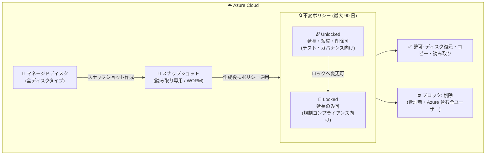
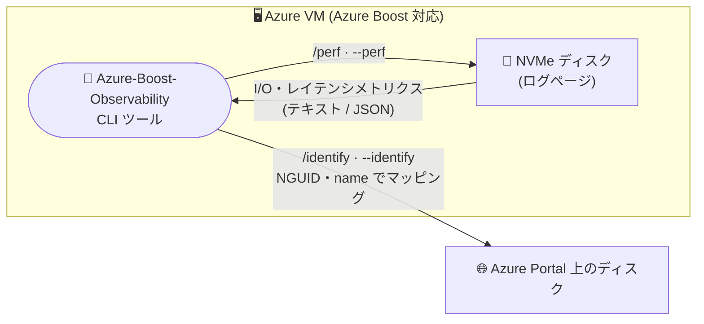

# Azure Disk Storage: 不変スナップショット (Public Preview) と Azure Boost NVMe ディスク可観測性ツール

**リリース日**: 2026-11-18

**サービス**: Azure Disk Storage / Virtual Machines

**機能**: Immutable snapshots (不変スナップショット) / Azure Boost observability for NVMe disks

**ステータス**: Immutable snapshots: In preview / Azure Boost observability: Announcement

[このアップデートのインフォグラフィックを見る](https://takech9203.github.io/azure-news-summary/20261118-disk-storage-immutable-snapshots-boost.html)

## 概要

Azure Disk Storage に関連する 2 つのアップデートが発表された。

1 つ目は **Azure Disk Storage の不変スナップショット (Immutable snapshots) のパブリックプレビュー**である。スナップショットは作成後は読み取り専用 (WORM: Write Once, Read Many) だが、新たに任意のディスクタイプの既存スナップショットに「不変ポリシー (immutability policy)」を適用し、最大 90 日間の削除を禁止できるようになった。ポリシーが有効な間は、ロールや権限にかかわらず誰もスナップショットを削除できない。これにより、誤削除やランサムウェアなどの悪意ある削除からバックアップを保護し、規制上のデータ保持要件 (SEC 17a-4、CFTC 1.31、FINRA 4511) への準拠を支援する。不変スナップショットは Azure Backup の不変コンテナー (Immutable Vault) を補完する位置付けで、長期保持にはコスト効率の良い Vault を、高速リストアが必要な短期バックアップには不変スナップショットを使い分ける。

2 つ目は **Azure Boost observability for NVMe disks** の発表である。互換性のある Azure VM 内で実行するオープンソースのコマンドラインツールで、Azure Boost を基盤として、リモートディスクの I/O・レイテンシメトリクスを取得し、VM 内の各ディスクを Azure Portal に表示されるディスクにマッピングできる。リモートディスクのパフォーマンス調査と、メトリクスと正しいディスクの対応付けに役立つ。

**アップデート前の課題**

- ディスクスナップショットはデータの変更こそ不可能だったが、削除は権限を持つユーザーなら可能であり、誤操作・ランサムウェア・悪意ある管理者による削除からバックアップを保護する仕組みがスナップショット単位では存在しなかった
- 高速リストアが必要な短期バックアップに対して、金融規制 (SEC 17a-4 など) に準拠する不変ストレージの選択肢が限られていた
- ゲスト OS 内の NVMe ディスク (例: Linux の `/dev/nvme0n1`、Windows のディスク番号) と Azure Portal 上のディスクリソースの対応付けが難しく、リモートディスクのパフォーマンス問題を正しいディスクに紐付けて調査しにくかった

**アップデート後の改善**

- 既存スナップショットに Unlocked / Locked の 2 種類の不変ポリシーを適用でき、保持期間中 (最大 90 日) は誰も削除できなくなる。Locked ポリシーは Azure 自身を含め誰も短縮・解除できず、コンプライアンスグレードの保護を提供する
- 不変ポリシーは追加料金なしで利用でき、ポリシー有効中もディスクのリストア、スナップショットの他リージョンへのコピーなど他のスナップショット操作はすべて実行可能
- VM 内から CLI ツール 1 つでリモートディスクの累積 IOPs・転送バイト数・レイテンシ (平均/最大) を取得でき、NGUID やディスク名により VM 内のディスクと Portal 上のディスクを正確にマッピングできる

## アーキテクチャ図



不変ポリシーを適用したスナップショットは、保持期間中の削除がすべてのユーザーに対してブロックされる一方、リストアやコピーなどの操作は通常どおり実行できる。



Azure Boost observability ツールは VM 内の NVMe デバイスからメトリクスを読み取り、Identify Namespace コマンドで VM 内のディスクと Azure Portal 上のディスクを対応付ける。

## サービスアップデートの詳細

### 主要機能

#### 1. Azure Disk Storage の不変スナップショット (Public Preview)

1. **Unlocked ポリシー**
   - 権限を持つユーザーがポリシーの延長・短縮・削除を実行できる。ロック前のテストやデータガバナンス、ランサムウェア対策に使用する
   - 保持期間を 0 日に設定すると即時に期限切れとなり、スナップショットを通常状態に戻せる

2. **Locked ポリシー**
   - コンプライアンスグレードの保護。延長のみ可能で、管理者や Azure 自身を含め誰も短縮・削除できない
   - 保持期間が終了するまでスナップショットは削除不可。ランサムウェア対策、金融規制対応、不正な AI エージェントの挙動からの保護に使用する
   - Unlocked から Locked への変更は可能 (逆は不可)。ロックしても保持期間の起点 (`policyStartTime`) はリセットされない

3. **ポリシー有効中も通常のスナップショット操作が可能**
   - スナップショットからのディスク作成 (リストア)、他リージョン・他サブスクリプションへのコピー、プロパティ読み取りはすべて許可。削除のみブロック
   - コピー先のスナップショットは元の不変ポリシーを継承しない (必要なら個別にポリシーを適用する)

4. **専用 RBAC ロール**
   - `Disk Snapshot Immutability Operator`: Unlocked ポリシーの作成・延長・短縮・削除 (`Microsoft.Compute/snapshots/updateImmutabilityPolicy/action`)
   - `Disk Snapshot Immutability Admin`: Locked ポリシーの作成・延長など (`Microsoft.Compute/snapshots/updateImmutabilityPolicyLock/action`)
   - Contributor / Owner はこれらの権限を既定で保有

5. **規制コンプライアンス認定**
   - 第三者評価機関 Cohasset Associates が、Locked ポリシー適用済みスナップショットが CFTC Rule 1.31(c)-(d)、FINRA Rule 4511、SEC Rule 17a-4(f) のストレージ要件を満たすことを検証。認定書は Microsoft Service Trust Portal で確認可能
   - ポリシー操作・アクセス操作は Azure Activity Log に記録される (既定で 90 日間保持)

#### 2. Azure Boost observability for NVMe disks

1. **パフォーマンスメトリクスの取得**
   - ディスクのライフタイム累積値: 読み取り/書き込み Ops 数、読み取り/書き込みバイト数
   - 5 秒サンプリング間隔の値: 未処理 I/O 数、読み取り/書き込みレイテンシ (最大/平均、マイクロ秒)、ディスパッチレイテンシ (最大/平均)
   - `is degraded`: ハードウェアアクセラレーションモードで動作していないかを示すフラグ

2. **ディスク識別 (Identify Namespace)**
   - NGUID (128 ビットの Namespace Globally Unique Identifier)、ディスクサイズ (GiB)、ディスクの役割 (`os` / `data` / `local` / `unknown`) とディスク名を取得
   - ゲスト OS 内のディスク (Windows のディスク番号/ドライブレター、Linux のデバイスパス) を Azure Portal 上のディスクに対応付けられる

3. **バッチ処理・出力形式**
   - 対象を指定しない場合は全 NVMe ドライブを自動的にスキャン (最大 32 ディスク)
   - テキスト出力と JSON 出力 (`/json` / `--json`) に対応。トラブルシューティング用の詳細ログ (`/verbose`) も利用可能
   - Windows / Linux の両ゲスト OS をサポート。オープンソースとして GitHub で公開

## 技術仕様

### 不変スナップショット

| 項目 | 詳細 |
|------|------|
| 最大保持期間 | 90 日 |
| ポリシータイプ | `Unlocked` (延長・短縮・削除可) / `Locked` (延長のみ可) |
| 適用タイミング | スナップショット作成後のみ (作成時には設定不可) |
| 適用可能な状態 | `snapshotAccessState` が `Available` または `AvailableWithInstantAccess` のスナップショット |
| 適用不可の状態 | `Pending` (バックグラウンドコピー中・リージョン間コピー中)、`InstantAccess` (コピー進行中) |
| 対象ディスクタイプ | 任意の Azure ディスクタイプ (Premium SSD、Standard SSD、Standard HDD、Ultra Disk / Premium SSD v2 の増分スナップショット) |
| 設定手段 (プレビュー時点) | Azure PowerShell / REST API のみ (Portal・Azure CLI は GA で対応予定) |
| 主なプロパティ | `immutabilityDurationDays` (保持日数)、`type`、`policyStartTime`、`policyExpirationTime`、`isPolicyExpired` |
| コピーのポリシー継承 | なし (コピー先には個別に適用が必要) |
| 追加料金 | なし (スナップショットは標準のマネージドディスクスナップショット料金) |

### Azure Boost observability for NVMe disks

| 項目 | 詳細 |
|------|------|
| 提供形態 | オープンソースの CLI ツール (GitHub: microsoft/Azure-Boost-Observability) |
| 対応ゲスト OS | Windows (C++ 実行ファイル、MSVC v143 でビルド) / Linux (Python 3 スクリプト、`nvme-cli` が必要) |
| 対応 VM サイズ (Intel) | Dlsv7、Dldsv7、Dsv7、Ddsv7、Esv7、Edsv7 |
| 対応 VM サイズ (Cobalt 200) | Dplsv7、Dpldsv7、Dpsv7、Dpdsv7、Epsv7、Epdsv7、Mpsv4、Mpdsv4、Lpsv5 |
| パフォーマンスメトリクス | 互換 VM サイズの全 Azure リージョンでリモートディスクに対して利用可能 |
| ディスク識別 | リモート・ローカル NVMe ディスクが対象。現在は EUAP リージョンで提供、他リージョンへの拡大は 2027 年を予定 |
| 実行権限 | NVMe デバイスへの直接アクセスに管理者権限が必要な場合がある (Linux は `sudo`) |
| スキャン動作 | ディスク未指定時は最大 32 ディスクを順にスキャンし、クエリ不能なデバイスで停止 |

## 設定方法

### 不変スナップショットのポリシー設定 (Azure PowerShell)

前提条件:

1. 対象スナップショットが作成済みで、`snapshotAccessState` が `Available` または `AvailableWithInstantAccess` であること
2. パブリックプレビュー対応リージョンのスナップショットであること
3. `Disk Snapshot Immutability Operator` / `Disk Snapshot Immutability Admin` ロール、または Contributor / Owner 相当の権限

```powershell
# Unlocked ポリシーを 30 日で設定 (テスト・ガバナンス向け)
$snapshot = Set-AzSnapshotImmutabilityPolicy `
    -ResourceGroupName "myResourceGroup" `
    -Name "mySnapshot" `
    -PolicyType Unlocked `
    -DurationInDays 30

# Locked ポリシーを 30 日で設定 (コンプライアンス向け・解除不可)
$snapshot = Set-AzSnapshotImmutabilityPolicy `
    -ResourceGroupName "myResourceGroup" `
    -Name "mySnapshot" `
    -PolicyType Locked `
    -DurationInDays 30

# Unlocked ポリシーの削除
Remove-AzSnapshotImmutabilityPolicy `
    -ResourceGroupName "myResourceGroup" `
    -Name "mySnapshot"
```

REST API では `updateImmutabilityPolicy` (Unlocked) / `updateImmutabilityPolicyLock` (Locked) アクション (api-version `2026-03-02`) を使用する。ポリシー更新時に指定する日数は「元の開始時刻からの合計保持日数」であり、追加日数ではない点に注意。

### Azure Boost observability ツールの使用 (Linux)

```bash
# セットアップ: スクリプトを VM にコピーし、Python 3 と nvme-cli をインストール後
chmod +x ./azure-boost-observability

# パフォーマンスメトリクスの取得 (JSON 出力)
sudo ./azure-boost-observability --json --perf /dev/nvme0n1

# ディスク識別 (Portal 上のディスクとのマッピング)
sudo ./azure-boost-observability --identify /dev/nvme0n1
```

### Azure Boost observability ツールの使用 (Windows)

GitHub リポジトリのソースから `AzureBoostObservability.sln` を MSVC v143 でビルドし、管理者権限の PowerShell で実行する。

```powershell
# ディスク 0 のパフォーマンスメトリクスを取得
.\Azure-Boost-Observability.exe /perf 0

# JSON 出力でディスク識別
.\Azure-Boost-Observability.exe /json /identify 0
```

## メリット

### ビジネス面

- Locked ポリシーは Cohasset Associates により SEC 17a-4(f)、CFTC 1.31(c)-(d)、FINRA 4511 への準拠が検証済みで、金融・法務・医療分野の記録保持規制に対応できる
- 不変ポリシー自体は追加料金なしで、ランサムウェアや内部不正による「バックアップの削除」リスクを低減できる
- Azure Backup Immutable Vault (長期・低コスト) と不変スナップショット (短期・高速リストア) の使い分けにより、保護レベルとコストを最適化できる

### 技術面

- ポリシー有効中もリストア・コピーなどの運用操作は妨げられず、保護と運用性を両立できる
- 専用 RBAC ロールにより、Unlocked ポリシーの運用者と Locked ポリシーの管理者で職務分掌を実現できる
- Azure Boost observability により、ゲスト OS 内から追加エージェントなしでリモートディスクのレイテンシ内訳 (I/O レイテンシとディスパッチレイテンシ) を確認でき、パフォーマンス問題の切り分けが容易になる
- NGUID とディスク名により、マルチディスク構成の VM でも Portal 上のディスクリソースと確実に対応付けられる

## デメリット・制約事項

### 不変スナップショット (Public Preview)

- プレビュー対応リージョンは Australia East、East Asia、East US、East US 2、France Central、India Central、North Europe、South Central US、West Central US、West Europe に限定される
- プレビュー期間中は PowerShell / REST API のみ対応 (Portal・Azure CLI は GA で対応予定)
- 最大保持期間は 90 日。長期の不変保持には Azure Backup Immutable Vault を使用する必要がある
- Locked ポリシーは有効期間中、Azure を含め誰も解除・短縮できないため、保持期間満了までスナップショット課金が継続する。適用前にポリシータイプと期間の確認が必須
- ポリシーは作成済みスナップショットにのみ適用可能 (作成時の指定は不可)。`Pending` / `InstantAccess` 状態のスナップショットには適用できない
- プレビュー期間中は、サポート外の状態のスナップショットへのポリシー適用リクエストが、保存されないまま成功として報告される場合がある (GA でエラー返却に変更予定)

### Azure Boost observability for NVMe disks

- 対応 VM サイズは Intel v7 系および Cobalt 200 系の特定シリーズに限定される
- ディスク識別機能は現在 EUAP リージョンのみで提供 (他リージョンは 2027 年に拡大予定)
- Windows 版はビルド済みバイナリではなくソースからのビルドが必要
- Linux でディスク未指定実行時は `lsblk` で NVMe 以外も列挙され、クエリ失敗デバイスでコマンドが途中終了する場合がある (個別デバイス指定を推奨)

## ユースケース

### ユースケース 1: ランサムウェア対策としての短期不変バックアップ

**シナリオ**: 基幹システムの VM ディスクについて、日次スナップショットを 30 日間保持しているが、攻撃者や誤操作によるスナップショット削除を防ぎたい。復旧時には高速なリストアが必要。

**実装例**:

```powershell
# 日次スナップショット作成後に Locked ポリシーを 30 日で適用
Set-AzSnapshotImmutabilityPolicy `
    -ResourceGroupName "prod-rg" `
    -Name "daily-snapshot-20261118" `
    -PolicyType Locked `
    -DurationInDays 30
```

**効果**: 保持期間中は管理者権限が侵害されてもスナップショットを削除できず、スナップショットからのディスク作成による高速リストアは通常どおり実行できる。

### ユースケース 2: 金融規制 (SEC 17a-4) 対応の記録保持

**シナリオ**: 金融機関が、短期保持が求められる記録データのディスクスナップショットについて、非書き換え・非消去ストレージ要件への準拠を証明する必要がある。

**実装**: Locked ポリシーを適用し、Microsoft Service Trust Portal の Cohasset Associates 認定書を監査証跡として利用。ポリシー操作は Azure Activity Log で追跡する。

**効果**: SEC 17a-4(f) / CFTC 1.31 / FINRA 4511 のストレージ要件を満たしつつ、必要時には即座にディスクへ復元できる。

### ユースケース 3: リモートディスクのレイテンシ問題の切り分け

**シナリオ**: 複数のデータディスクを接続した DB サーバー VM で I/O レイテンシの悪化が報告されたが、どの Azure ディスクが原因か特定できない。

**実装例**:

```bash
# 各 NVMe デバイスのレイテンシを確認
sudo ./azure-boost-observability --json --perf /dev/nvme1n1

# 問題のデバイスを Portal 上のディスク名にマッピング
sudo ./azure-boost-observability --identify /dev/nvme1n1
```

**効果**: I/O レイテンシとディスパッチレイテンシの内訳から、問題がディスク側かスケジューラ側かを切り分け、`is degraded` フラグでハードウェアアクセラレーション状態も確認できる。NGUID / ディスク名により正しい Azure ディスクに対して対処できる。

## 料金

- **不変ポリシー**: 追加料金なし。スナップショット自体は標準のマネージドディスクスナップショット料金で課金される。Locked ポリシー有効中はスナップショットを削除できないため、保持期間満了まで課金が継続する点に注意。ポリシー期限切れや削除後も、スナップショットを削除するまで通常の課金は続く
- **Azure Boost observability**: オープンソースツールであり、ツール自体の料金に関する記載はない

詳細は [Managed Disks の料金ページ](https://azure.microsoft.com/pricing/details/managed-disks/) を参照。

## 利用可能リージョン

- **不変スナップショット (Public Preview)**: Australia East、East Asia、East US、East US 2、France Central、India Central、North Europe、South Central US、West Central US、West Europe。他リージョンへのアクセスはフィードバックフォーム (https://aka.ms/DiskImmutableSnapshotsFeedback) から申請可能
- **Azure Boost observability**: パフォーマンスメトリクスは互換 VM サイズの全 Azure リージョンで利用可能。ディスク識別機能は現在 EUAP リージョンのみ (2027 年に他リージョンへ拡大予定)

## 関連サービス・機能

- **Azure Backup (Immutable Vault)**: 長期保持向けのコスト効率の良い不変バックアップ。不変スナップショットは高速リストアが必要な短期バックアップとしてこれを補完する
- **Azure RBAC**: 新しい組み込みロール `Disk Snapshot Immutability Operator` / `Disk Snapshot Immutability Admin` によりポリシー操作の職務分掌を実現
- **Azure Activity Log**: 不変ポリシーの設定・変更などの操作を監査証跡として記録 (既定 90 日保持)
- **Azure Boost**: Azure のホストインフラをオフロードするハードウェアプラットフォーム。NVMe 可観測性ツールのメトリクス提供基盤
- **Azure Virtual Machines (NVMe インターフェイス)**: v7 系 Intel / Cobalt 200 系 VM で NVMe ディスクを利用する際の可観測性を強化

## 参考リンク

- [インフォグラフィック](https://takech9203.github.io/azure-news-summary/20261118-disk-storage-immutable-snapshots-boost.html)
- [公式アップデート情報: Immutable snapshots for Azure Disk Storage (Public Preview)](https://azure.microsoft.com/updates?id=581503)
- [公式アップデート情報: Azure Boost observability for NVMe disks](https://azure.microsoft.com/updates?id=581227)
- [Microsoft Learn: Configure immutability for managed disk snapshots (Preview)](https://learn.microsoft.com/en-us/azure/virtual-machines/snapshot-configure-immutability)
- [Microsoft Learn: Azure Boost observability for NVMe disks](https://learn.microsoft.com/en-us/azure/virtual-machines/azure-boost-observability)
- [GitHub: microsoft/Azure-Boost-Observability](https://github.com/microsoft/Azure-Boost-Observability)
- [料金ページ: Managed Disks](https://azure.microsoft.com/pricing/details/managed-disks/)

## まとめ

Azure Disk Storage の不変スナップショットは、スナップショットレベルで「削除不能」な保護を最大 90 日間提供するもので、ランサムウェア対策と金融規制対応 (SEC 17a-4 / CFTC 1.31 / FINRA 4511、Cohasset Associates 検証済み) の両面で重要なアップデートである。追加料金なしで利用でき、ポリシー有効中もリストア・コピーは可能なため、運用への影響が小さい。Solutions Architect としては、Azure Backup Immutable Vault (長期) と不変スナップショット (短期・高速リストア) の使い分け設計と、Locked ポリシー適用前の期間確認プロセス (解除不能のため) の整備を推奨する。現時点では対応リージョンと設定手段 (PowerShell / REST API のみ) が限定されるため、本番適用は対応リージョンの確認後に検討したい。

Azure Boost observability for NVMe disks は、v7 系 VM でのリモートディスクのパフォーマンス調査とディスクマッピングを支援する実用的なツールである。NVMe ベースの VM への移行が進む中、レイテンシ問題の切り分けやディスク特定の標準手順に組み込む価値がある。

---

**タグ**: Azure Disk Storage, Virtual Machines, Storage, Compute, Immutable Snapshots, Azure Boost, NVMe, Security, Compliance, Ransomware Protection, Public Preview, Microsoft Ignite
