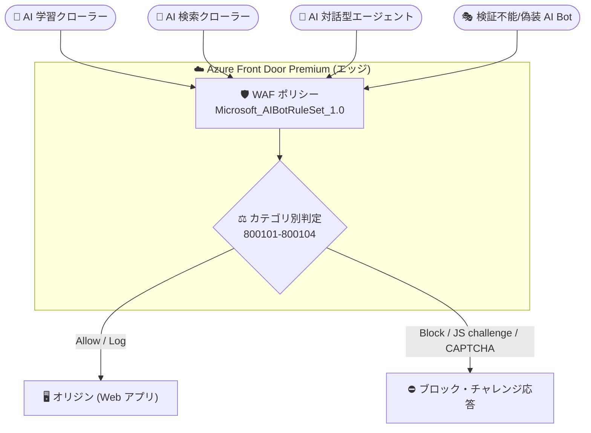

# Azure Front Door Premium WAF: AI bot ruleset (Public Preview)

**リリース日**: 2026-11-18

**サービス**: Azure Front Door / Azure Web Application Firewall (WAF)

**機能**: AI bot ruleset for Azure Front Door Premium WAF

**ステータス**: In preview (Public Preview)

[このアップデートのインフォグラフィックを見る](https://takech9203.github.io/azure-news-summary/20261118-front-door-waf-ai-bot-ruleset.html)

## 概要

Azure Front Door Premium の Web Application Firewall (WAF) に、AI クローラー / AI エージェント専用のマネージドルールセット「AI bot ruleset」が Public Preview として追加されました。Microsoft Ignite 2026 に合わせて発表されたアップデートです。

AI クローラーやエージェントは、AI モデルの学習データ収集、AI 検索のインデックス作成、ユーザーの依頼に基づくリアルタイムのページ取得など、さまざまな目的でサイトにアクセスします。サイト運営者としては「AI 検索には載せたいが、学習データ収集は拒否したい」といった選択的な制御が求められますが、robots.txt は Bot 側が従う場合にのみ機能し、著名な AI クローラーを騙る偽装 Bot も存在します。

AI bot ruleset は、AI Bot を識別して目的別に 4 つのカテゴリに分類し、カテゴリごとに Allow / Block / Log / Redirect / JS challenge / CAPTCHA のアクションをエッジで強制適用します。Bot が robots.txt に従うかどうかに関係なく、サイト運営者のポリシーを確実に実行できます。

**アップデート前の課題**

- AI クローラーの制御は robots.txt に依存しており、Bot 側が従わなければ効果がなかった
- 著名な AI クローラーを騙る偽装 Bot (User-Agent 偽装) を識別・排除する標準的な手段がなかった
- 従来の Bot Manager ruleset は Good / Bad / Unknown の分類であり、「AI 学習は拒否、AI 検索は許可」といった AI Bot の目的別の制御はできなかった
- AI 事業者ごとの IP アドレスレンジを自前で追跡・管理する必要があった

**アップデート後の改善**

- AI Bot を「AI training」「AI search」「AI interactive agents」「Miscellaneous AI agents」の 4 カテゴリに分類し、カテゴリごとに異なるアクションを設定可能
- ルール 800101〜800103 は、リクエストが申告どおりの AI Bot 運営者からのものかを Azure WAF が検証。検証に失敗した偽装 Bot は 800104 (Miscellaneous) にのみマッチ
- AI Bot のシグネチャは Microsoft が管理・自動更新 (ルールセットのバージョン変更は不要)
- すべてのルールが Log アクションで開始されるため、ブロック前に WAF ログ / WAF insights で AI Bot トラフィックを安全に把握できる
- `AIProvider` 一致変数による例外設定で、信頼する AI 事業者 (例: `OpenAI`、`Google`) のみを許可可能。IP レンジの自前管理が不要

## アーキテクチャ図



AI クローラー / エージェントからのリクエストは Front Door Premium のエッジで WAF により検証・分類され、カテゴリごとに設定したアクション (許可 / ブロック / チャレンジなど) が、オリジンに到達する前に適用されます。

## サービスアップデートの詳細

### 主要機能

1. **AI Bot の 4 カテゴリ分類 (ルールグループ: AIBotAccess)**
   - 公開コンテンツを AI モデルの学習用に収集する検証済みクローラー、AI 検索・回答・要約のためにインデックスする検証済みクローラー、ユーザーの依頼でリアルタイムにページを取得する検証済みエージェント、検証できない AI Bot (偽装 Bot 含む) の 4 ルールで構成

2. **運営者の検証 (Identity verification)**
   - ルール 800101 / 800102 / 800103 では、リクエストが申告どおりの AI Bot 運営者からのものかを Azure WAF が検証。検証に失敗したリクエストは 800104 にのみマッチする

3. **Microsoft 管理のシグネチャ自動更新**
   - AI Bot の変化に合わせて Microsoft がシグネチャを更新。ルールセットのバージョン変更は不要

4. **Log から始める安全な導入**
   - ルールセット割り当て時は全ルールが Log アクション。WAF ログ / メトリック / WAF insights で AI Bot トラフィックを確認してから、カテゴリごとにアクションを変更できる

5. **AIProvider 一致変数による例外 (Exception)**
   - 信頼する AI 事業者 (WAF ログの `provider_s` フィールドの値、大文字小文字を区別) を指定して、特定ルール / ルールグループ / ルールセットのスコープで除外可能。AI Bot と運営者のマッピングは Azure WAF が日次で検証・維持

6. **可観測性 (ログ・メトリック・WAF insights)**
   - ログのルール名は `Microsoft_AIBotRuleSet-1.0-AIBotAccess-800101` 形式。`provider_s` フィールドに `OpenAI`、`Google`、`Anthropic`、`Amazon`、`Meta`、`Perplexity` などの運営者名が記録される。メトリックは **Web Application Firewall Request Count** に **AIProvider** ディメンションが追加

### ルール一覧

| ルール ID | ルール名 | マッチ対象 | デフォルトアクション |
|-----------|---------|-----------|-------------------|
| 800101 | AI training | AI モデルの学習 / ファインチューニング用に公開コンテンツを収集する検証済みクローラー | Log |
| 800102 | AI search | AI 検索・回答・要約のためにコンテンツをインデックスする検証済みクローラー | Log |
| 800103 | AI Interactive agents | ユーザーが AI アシスタントに依頼した際にリアルタイムでページ取得・タスク実行する検証済みエージェント | Log |
| 800104 | Miscellaneous AI agents | 検証できない AI Bot。検証情報を公開していない既知の AI 事業者の Bot や、著名 AI Bot を騙るが検証に失敗したリクエストを含む | Log |

**重要な注意点**: ルール 800104 は、800101〜800103 の検証済み Bot の User-Agent にもマッチします。Log アクションはルール評価を停止しないため、800104 を Block / JS challenge / CAPTCHA に設定する場合は、許可したいカテゴリのルールを Log ではなく **Allow** に設定する必要があります。そうしないと検証済み Bot も 800104 でブロックされます。

## 技術仕様

| 項目 | 詳細 |
|------|------|
| ルールセット名 | Microsoft_AIBotRuleSet_1.0 |
| ルールグループ | AIBotAccess (4 ルール) |
| 対応 SKU | Azure Front Door Premium (WAF ポリシーは Premium tier) |
| サポートされるアクション | Allow / Block / Log / Redirect / JS challenge / CAPTCHA |
| 非サポートのアクション | Anomaly score (本ルールセットでは利用不可、sensitivity level も未使用) |
| 評価順序 | HTTP DDoS ruleset → カスタムルール → Default Rule Set → Bot Manager ruleset → **AI bot ruleset** |
| Detection モード時の動作 | マッチしたリクエストはログのみ記録され、設定アクションは実行されない |
| 除外 (Exclusions) | 非サポート。代わりに例外 (Exceptions、`AIProvider` 一致変数) を使用 |
| 設定方法 | Azure Portal / Azure PowerShell / Azure CLI / Bicep |
| シグネチャ更新 | Microsoft が管理・自動更新 (バージョン変更不要) |

## 設定方法

### 前提条件

1. Azure Front Door Premium プロファイル
2. Premium tier の WAF ポリシー

### Azure CLI

```bash
# AI bot ruleset を WAF ポリシーに追加 (全ルール Log で開始)
az network front-door waf-policy managed-rules add \
  --resource-group FrontDoorWafPolicy \
  --policy-name WafPolicy \
  --type Microsoft_AIBotRuleSet \
  --version 1.0

# AI 学習クローラー (ルール 800101) を Block に変更
az network front-door waf-policy managed-rules override add \
  --resource-group FrontDoorWafPolicy \
  --policy-name WafPolicy \
  --type Microsoft_AIBotRuleSet \
  --rule-group-id AIBotAccess \
  --rule-id 800101 \
  --action Block
```

### Azure Portal

1. Azure Portal で対象の WAF ポリシーを開く
2. **Managed rules** を選択し、**Assign** を選択
3. 利用可能なルールセットの一覧から AI bot ruleset を選択して **Save**
4. アクションを変更するには、マネージドルール一覧で対象ルールを選択し、**Change action** からアクションを選んで保存

### 推奨導入フロー

1. デフォルトの Log アクションのままルールセットを割り当てる
2. WAF ログ / WAF insights で AI Bot トラフィック (カテゴリ別・運営者別) を確認する
3. ブロックまたはチャレンジしたいカテゴリのアクションを変更する (許可カテゴリは Allow に設定)

### モニタリング (Log Analytics クエリ例)

```kusto
AzureDiagnostics
| where Category == "FrontDoorWebApplicationFirewallLog"
| where ruleName_s startswith "Microsoft_AIBotRuleSet"
| summarize RequestCount = count() by provider_s, ruleName_s, action_s
| order by RequestCount desc
```

## メリット

### ビジネス面

- コンテンツの利用ポリシーを目的別に制御できる (例: AI 学習への無断利用は拒否しつつ、AI 検索経由の流入は維持)
- AI 検索 (800102) や対話型エージェント (800103) を許可することで、AI 時代のコンテンツ到達性 (AI 検索・回答への掲載) を確保できる
- Log から始める設計により、正当なトラフィックを誤ってブロックするリスクを抑えて導入できる

### 技術面

- robots.txt と異なり、Bot の自主性に依存せずエッジで強制適用される
- 運営者検証により User-Agent 偽装 Bot を排除できる
- シグネチャと AI 事業者マッピングは Microsoft が管理・更新するため、IP レンジの自前追跡が不要
- Bot Manager ruleset / Default Rule Set と同一ポリシーで併用可能
- ログ・メトリック (AIProvider ディメンション)・WAF insights による運営者別の可視化

## デメリット・制約事項

- Public Preview のため、Azure プレビューの追加利用規約が適用される (本番利用は非推奨)
- **Azure Front Door Premium 専用** (Standard や Application Gateway WAF では利用不可)
- Anomaly score アクションは非サポート
- 除外 (Exclusions) は非サポート (例外 Exceptions で代替)
- ルール 800104 は検証済み Bot の User-Agent にもマッチするため、800104 をブロックに設定する際は許可カテゴリを Allow に設定する必要がある (設定ミスで検証済み Bot をブロックする可能性)
- 検証可能な情報 (IP / 逆引き DNS) を公開していない AI 事業者の Bot は、正当でも 800104 (Miscellaneous) に分類される
- Bot Manager ruleset など先に評価されるルールで Allow / Block された場合、AI bot ruleset は評価されない。検索エンジンや SNS のクローラーなど両ルールセットにマッチする Bot を AI bot ruleset で制御したい場合は、該当する Bot Manager ルールを Log に設定する必要がある
- AI Bot の許可にカスタムルールの Allow を使うことは非推奨 (マネージドルールセット全体の評価がスキップされ、攻撃検査が行われないため)

## ユースケース

### ユースケース 1: AI 学習クローラーのみブロックし、AI 検索・エージェントは許可

**シナリオ**: メディアサイトがコンテンツの AI モデル学習への無断利用を防ぎつつ、AI 検索経由の読者流入と、ユーザーの依頼に基づく AI アシスタントのアクセスは維持したい。

**実装例** (Bicep、公式ドキュメントの例):

```bicep
managedRuleSets: [
  {
    ruleSetType: 'Microsoft_AIBotRuleSet'
    ruleSetVersion: '1.0'
    ruleGroupOverrides: [
      {
        ruleGroupName: 'AIBotAccess'
        rules: [
          { ruleId: '800101', enabledState: 'Enabled', action: 'Block' }       // AI 学習: ブロック
          { ruleId: '800102', enabledState: 'Enabled', action: 'Allow' }       // AI 検索: 許可
          { ruleId: '800103', enabledState: 'Enabled', action: 'Allow' }       // 対話型エージェント: 許可
          { ruleId: '800104', enabledState: 'Enabled', action: 'JSChallenge' } // 検証不能 Bot: JS チャレンジ
        ]
      }
    ]
  }
]
```

**効果**: 学習用クローラーはエッジでブロック。検証済みの AI 検索・エージェントは許可され、偽装 Bot を含む検証不能な Bot は JavaScript チャレンジで排除 (大半のクローラーは JavaScript を実行できないため通過不可)。

### ユースケース 2: 特定の信頼する AI 事業者のみ許可

**シナリオ**: Miscellaneous カテゴリをブロックしつつ、提携している特定の AI 事業者の Bot だけは通したい。

**実装例**: WAF ポリシーの例外 (Exception) を作成し、以下を設定。

- **Applies to**: Microsoft_AIBotRuleSet_1.0 (スコープは可能な限り狭く、単一ルール推奨)
- **Match variable**: AIProvider
- **Operator**: Equals
- **Values**: 信頼する AI 事業者名 (WAF ログの `provider_s` の値、大文字小文字を区別)

**効果**: 例外にマッチしたリクエストはスコープ内の AI Bot ルールのみバイパスし、カスタムルール・Default Rule Set・Bot Manager ruleset による攻撃検査は引き続き適用される。IP レンジの自前管理も不要。

## 料金

Azure Front Door Premium には WAF (マネージドルールセット含む) が追加料金なしで含まれます。料金ページに "includes WAF and Private Link at no additional cost" と明記されています。AI bot ruleset 自体の個別料金の記載はありません。

| 項目 | 料金 (従量課金、参考) |
|------|------|
| Front Door Premium 基本料金 | $330/月 (時間単位で課金) |
| リクエスト料金 (Premium、1 万リクエストあたり) | Zone 1 (北米) / Zone 6 (欧州): $0.015、Zone 2 (日本含むアジア太平洋): $0.0168 |
| WAF マネージドルール | Premium に含まれる (追加料金なし) |
| CAPTCHA (アドオン) | $0.4 / 1,000 CAPTCHA セッション |

CAPTCHA アクションを使用する場合のみ、セッション数に応じた追加課金が発生する点に注意してください。最新の料金は [Azure Front Door 料金ページ](https://azure.microsoft.com/pricing/details/frontdoor/)を参照してください。

## 関連サービス・機能

- **Bot Manager ruleset (Bot protection rule set)**: 従来からの Bot 対策マネージドルールセット。Good / Bad / Unknown の分類で、検索エンジン・SNS クローラーなどを制御。AI bot ruleset は Bot Manager ruleset の直後に評価され、同一ポリシーで併用可能
- **WAF Default Rule Set**: SQL インジェクションや XSS などの一般的な攻撃からの保護。AI bot ruleset と併用して多層防御を構成
- **HTTP DDoS ruleset**: ポリシー内で最初に評価されるルールセット。アプリケーション層 DDoS 対策
- **JavaScript challenge / CAPTCHA challenge**: AI bot ruleset の各ルールに設定できるチャレンジアクション
- **Azure Monitor / Log Analytics / WAF insights**: AI Bot トラフィックのカテゴリ別・運営者別 (AIProvider ディメンション) の可視化と分析

## 参考リンク

- [インフォグラフィック](https://takech9203.github.io/azure-news-summary/20261118-front-door-waf-ai-bot-ruleset.html)
- [公式アップデート情報](https://azure.microsoft.com/updates?id=581604)
- [Microsoft Learn: AI bot ruleset for Azure Front Door WAF (Preview)](https://learn.microsoft.com/en-us/azure/web-application-firewall/afds/ai-bot-ruleset)
- [Microsoft Learn: What is Azure Web Application Firewall on Azure Front Door?](https://learn.microsoft.com/en-us/azure/web-application-firewall/afds/afds-overview)
- [Azure Front Door 料金ページ](https://azure.microsoft.com/pricing/details/frontdoor/)
- [Azure Blog: Microsoft Ignite 2026 — What's new in Azure](https://azure.microsoft.com/en-us/blog/microsoft-ignite-2026-whats-new-in-azure-the-platform-purpose-built-for-ai/)

## まとめ

AI bot ruleset は、急増する AI クローラー / エージェントのトラフィックを「学習」「検索」「対話型エージェント」「検証不能」の 4 カテゴリに分類し、robots.txt に依存せずエッジで目的別の制御を可能にする、Front Door Premium WAF の新しいマネージドルールセットです。運営者検証により偽装 Bot を排除でき、シグネチャは Microsoft が自動更新します。

Front Door Premium を利用中であれば、まずはデフォルトの Log アクションのままルールセットを割り当て、WAF insights で自サイトへの AI Bot トラフィックの実態 (カテゴリ・運営者・アクセス先 URL) を把握することを推奨します。その上で、組織のコンテンツポリシーに応じてカテゴリごとのアクションを設定してください。なお、800104 をブロックに変更する際は、許可したいカテゴリを Allow に設定することを忘れないよう注意が必要です。

---

**タグ**: Networking, Security, Azure Front Door, Web Application Firewall, Features, Microsoft Ignite, Public Preview
